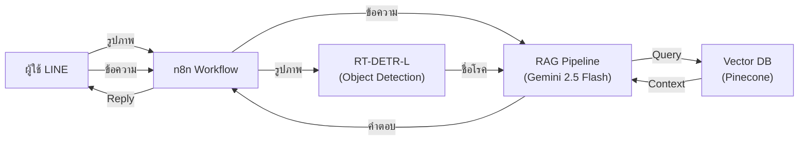
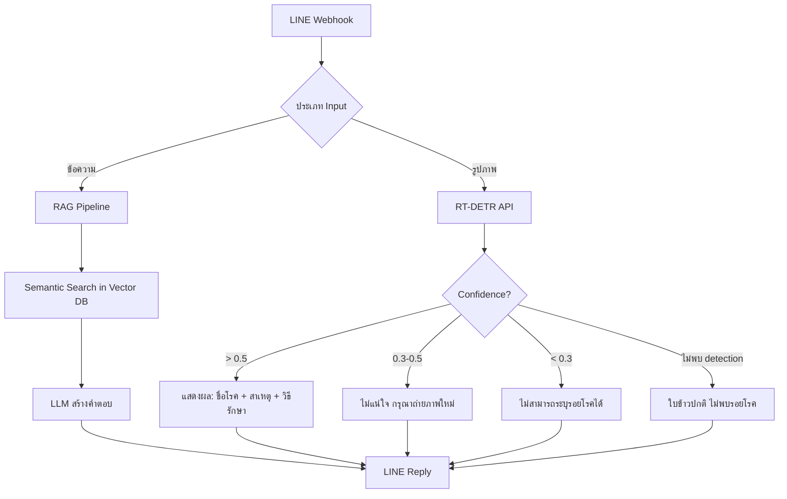

# 🌾 Rice Disease LINE Chatbot — Project Knowledge Base

> **โปรเจค:** ระบบแชทบอทวินิจฉัยโรคข้าวและแนะนำวิธีการรักษาผ่านแอปพลิเคชัน LINE ด้วยเทคนิค RAG
> **ชื่อเต็ม (EN):** Rice Disease Diagnosis and Treatment Recommendation Chatbot on LINE Application using RAG Technique
> **ผู้พัฒนา:** นายอัศวิน ทรงเล็กสิงห์
> **สังกัด:** ภาควิชาวิทยาการคอมพิวเตอร์และสารสนเทศ คณะวิทยาศาสตร์และวิศวกรรมศาสตร์ มหาวิทยาลัยเกษตรศาสตร์ วิทยาเขตเฉลิมพระเกียรติ จังหวัดสกลนคร
> **ปีการศึกษา:** 2568 (ปริญญานิพนธ์)
> **อัปเดตล่าสุด:** 1 ก.ค. 2569

---

## 1. ภาพรวมโปรเจค (Project Overview)

### 1.1 ปัญหาที่ต้องการแก้ไข
- เกษตรกรไม่สามารถระบุชนิดโรคข้าวด้วยตนเอง
- ข้อจำกัดด้านระยะทางและจำนวนเจ้าหน้าที่เกษตร
- ข้อมูลวิธีรักษาอยู่ในเอกสารวิชาการหนา ไม่สะดวกค้นหา
- การวินิจฉัยผิด/ล่าช้า → ผลผลิตเสียหาย ต้นทุนสูง

### 1.2 วัตถุประสงค์
1. พัฒนาระบบแชทบอทวิเคราะห์โรคข้าวอัตโนมัติผ่าน LINE
2. เพิ่มช่องทางเข้าถึงข้อมูลการจัดการโรคข้าวให้เกษตรกร
3. ประยุกต์ใช้ RAG + Vector DB เพิ่มความแม่นยำของข้อมูล

### 1.3 สถาปัตยกรรมระบบ



| Component | เทคโนโลยี | หน้าที่ |
|---|---|---|
| **Image Detection** | RT-DETR-L (Ultralytics) | ตรวจจับ + จำแนกโรคจากภาพใบข้าว |
| **RAG / LLM** | Gemini 2.5 Flash | สร้างคำตอบจาก Context |
| **Vector DB** | Pinecone (cloud) | จัดเก็บ + ค้นหา Knowledge Base |
| **Workflow** | n8n | เชื่อมต่อ LINE ↔ RT-DETR ↔ RAG |
| **Chat Platform** | LINE Messaging API | ช่องทางติดต่อผู้ใช้ |
| **Embedding** | Gemini Embedding API / sentence-transformers | แปลงข้อความเป็น Vector |

---

## 2. ฮาร์ดแวร์ (Hardware)

### 2.1 เครื่องเทรน (Training Machine)
- **Model:** Dell Precision 3690
- **GPU:** NVIDIA RTX 2000 Ada Generation — **16GB VRAM**
- **CPU:** Intel Core i7-14700 (2.10 GHz)
- **RAM:** 32 GB (31.7 GB usable)
- **Storage:** 477 GB
- **OS:** Windows 11 Education (Version 25H2)

### 2.2 เครื่อง Deploy (Inference)
- **Device:** NVIDIA Jetson Orin (16GB Module) / ชื่อเครื่อง: `cis-desktop`
- **GPU:** NVIDIA Tegra Orin (nvgpu) / integrated
- **CPU:** ARMv8 Processor rev 1 (v8l) × 8 (8-Core)
- **RAM:** 16 GB (15.1 GiB usable)
- **Storage:** 128 GB
- **OS:** Ubuntu 20.04.6 LTS (64-bit)

> [!IMPORTANT]
> สเปคฮาร์ดแวร์ในเล่มบทที่ 1 (ข้อ 1.5.1) **ยังเป็น RTX 3060 Laptop** — ต้องอัปเดตให้ตรงกับ RTX 2000 Ada (Phase 1.3 ทำเสร็จแล้วในแพลน)

---

## 3. Dataset (ชุดข้อมูลรูปภาพ)

### 3.1 แหล่งที่มา
- **Kaggle:** Rice Leaf Diseases Dataset
- **Roboflow:** [atsawins-workspace/rice-leaf-disease-detection-cad4t](https://universe.roboflow.com/atsawins-workspace/rice-leaf-disease-detection-cad4t/dataset/1) (v1)
- **License:** CC BY 4.0

### 3.2 คลาสโรค (6 คลาส — ตัด Tungro ออกแล้ว)

| # | ชื่อคลาส | จำนวนรูป (raw) | ประเภทเชื้อ |
|---|---|---|---|
| 0 | `bacterial_leaf_blight` (โรคใบขีดสีน้ำตาล) | 636 | แบคทีเรีย — *Xanthomonas oryzae pv. oryzae* |
| 1 | `brown_spot` (โรคใบจุดสีน้ำตาล) | 646 | เชื้อรา — *Bipolaris oryzae* |
| 2 | `healthy_rice_leaf` (ใบข้าวปกติ) | 653 | — (ไม่มีรอยโรค) |
| 3 | `leaf_blast` (โรคไหม้) | 634 | เชื้อรา — *Pyricularia oryzae* |
| 4 | `leaf_scald` (โรคใบไหม้แห้ง) | 628 | เชื้อรา — *Microdochium oryzae* |
| 5 | `sheath_blight` (โรคกาบใบแห้ง) | 632 | เชื้อรา — *Rhizoctonia solani* |
| | **รวม** | **3,829** | |

> [!NOTE]
> - Class balance ดีมาก (ต่างกัน ≤ 25 รูป)
> - `healthy_rice_leaf` ไม่ต้องตี bbox → ใช้เป็น Negative Sample
> - ถ้า RT-DETR detect ไม่เจอ → ตอบ "ใบข้าวปกติ"

### 3.3 คู่โรคที่แยกยาก (Visual Similarity)
- `bacterial_leaf_blight` ↔ `leaf_scald` (รอยไหม้ขอบใบ คล้ายมาก)
- `brown_spot` ↔ `leaf_blast` ระยะแรก (จุดเล็กสีน้ำตาล)
- โรคระยะเริ่มต้น ↔ `healthy`

### 3.4 Pipeline การเตรียมข้อมูล

```
data/raw/ (รูปต้นฉบับ — หลายขนาด: 224x224, 1600x1200, 4000x3000 ...)
    ↓ scripts/resize_dataset.py (letterbox resize → 640x640)
data/processed/ (640x640 ทุกรูป — 3,829 รูป)
    ↓ อัปโหลด Roboflow → Label bbox → Augmentation x3
data/labeled/ (Roboflow export — YOLO format — 8,474 รูป)
    ├── train/images/ + train/labels/
    ├── valid/images/ + valid/labels/
    └── test/images/ + test/labels/
```

### 3.5 Data Augmentation (Roboflow)
- Horizontal flip: 50% probability
- Random crop: 0-10%
- Random rotation: ±15°
- Random brightness: ±20%
- Random Gaussian blur: 0-2px
- **Augmentation multiplier:** x3 → สร้าง 3 versions/image
- **ผลลัพธ์:** 8,474 รูปหลัง augmentation

### 3.6 Labeled Dataset Config

```yaml
# data/labeled/data.yaml
train: ../train/images
val: ../valid/images
test: ../test/images
nc: 5   # ⚠ 5 คลาส (ไม่รวม healthy — เป็น negative sample)
names: ['bacterial_leaf_blight', 'brown_spot', 'leaf_blast', 'leaf_scald', 'sheath_blight']
```

> [!WARNING]
> `data/labeled/data.yaml` มี `nc: 5` (ไม่รวม healthy) ในขณะที่ `Project/dataset.yaml` มี `nc: 6` (รวม healthy)
> - `data/labeled/data.yaml` → สำหรับ object detection (bbox) → **ไม่มี healthy class** เพราะไม่มี bbox ให้ตี
> - `Project/dataset.yaml` → อาจเป็นเวอร์ชันเก่าที่ยังรวม healthy / ใช้สำหรับ classification
> - **ต้องใช้ `data/labeled/data.yaml` สำหรับเทรน RT-DETR** และอัปเดต `Project/dataset.yaml` ให้ชี้ไปที่ `data/labeled/`

---

## 4. โครงสร้างไฟล์โปรเจค (File Structure)

```
rice_leaf_diseases/
├── .gitignore
├── data/
│   ├── raw/                          # รูปต้นฉบับ (6 โฟลเดอร์คลาส — gitignored)
│   │   ├── bacterial_leaf_blight/
│   │   ├── brown_spot/
│   │   ├── healthy_rice_leaf/
│   │   ├── leaf_blast/
│   │   ├── leaf_scald/
│   │   └── sheath_blight/
│   ├── processed/                    # Letterbox 640x640 (6 โฟลเดอร์คลาส — gitignored)
│   │   └── (โครงสร้างเดียวกับ raw/)
│   └── labeled/                      # Roboflow export — YOLO format (gitignored)
│       ├── README.dataset.txt
│       ├── README.roboflow.txt
│       ├── data.yaml                 # YOLO config (nc: 5, ไม่รวม healthy)
│       ├── train/images/ + labels/
│       ├── valid/images/ + labels/
│       └── test/images/ + labels/
├── docs/
│   ├── dataset/
│   │   ├── รายละเอียดไฟล์.txt        # สรุปจำนวนรูปแต่ละคลาส
│   │   └── สรุปการวิเคราะห์dataset.txt # วิเคราะห์ dataset เชิงลึก
│   └── plans/
│       └── แพลนดำเนินงาน.txt         # ★ แพลนหลัก 8 Phases
├── training/                         # ★ โฟลเดอร์สำหรับเทรนโมเดล (แยกจาก Project/)
│   ├── train_rtdetr.py               # ★ สคริปต์เทรน RT-DETR-L
│   ├── dataset.yaml                  # ★ YOLO config (nc: 5, ชี้ไป data/labeled/)
│   └── runs/                         # ผลเทรน (สร้างอัตโนมัติเมื่อเทรน)
│       └── rtdetr_rice_v1/           # Experiment ล่าสุด
│           ├── weights/best.pt       # โมเดลที่ดีที่สุด
│           └── weights/last.pt       # Checkpoint ล่าสุด
├── Project/                          # เอกสารปริญญานิพนธ์ (โครงสร้างรูปเล่ม ไม่เกี่ยวกับ RAG)
│   ├── Chapter_01.pdf + .txt         # บทที่ 1 — บทนำ
│   ├── Chapter_02.pdf + .txt         # บทที่ 2 — ทฤษฎีและวรรณกรรม
│   ├── Chapter_03.pdf + .txt         # บทที่ 3 — การวิเคราะห์และออกแบบระบบ
│   ├── dataset.yaml                  # (เวอร์ชันเก่า — nc: 6 — ไม่ใช้แล้ว)
│   └── train_rtdetr.py               # (เวอร์ชันเก่า — ย้ายไป training/)
├── RAGAS_Evaluation/
│   ├── Evaluation_Guide.md           # คู่มือใช้งานและอธิบายการทำงาน RAGAS เชิงลึก
│   ├── ragas_ground_truth.json       # ★ Ground Truth 70 Q&A (คัดเฉพาะที่มีคำตอบ)
│   ├── 01_generate_answers.py        # ★ สคริปต์ให้ Gemini ทำข้อสอบ (สร้างคำตอบ)
│   ├── 02_evaluate_scores.py         # ★ สคริปต์ให้ DeepSeek (ผ่าน OpenCodeZen) ตรวจข้อสอบ
│   └── evaluation_results/           # ผลประเมิน RAGAS (eval_results.json, eval_details.csv, eval_scores.json)
├── scripts/
│   ├── check_dataset.py              # ตรวจสอบรูปเสีย + วิเคราะห์ resolution
│   ├── extract_pdf.py                # Extract text จาก PDF (PyMuPDF)
│   └── resize_dataset.py             # ★ Letterbox resize → 640x640
└── output/                           # (โฟลเดอร์สำหรับผลรันอื่นๆ)
```

---

## 5. Scripts สำคัญ (Key Scripts)

### 5.1 [train_rtdetr.py](file:///c:/Users/COLORFUL/Documents/rice_leaf_diseases/training/train_rtdetr.py) — เทรน RT-DETR

> **ที่อยู่:** `training/train_rtdetr.py` (ย้ายจาก `Project/` เพื่อแยก code เทรนออกจากเอกสารปริญญานิพนธ์)

```python
# Hyperparameters
model = RTDETR('rtdetr-l.pt')         # Pre-trained RT-DETR-L จาก COCO
epochs = 100                          # 100 epochs
imgsz = 640                           # Input size 640x640
batch = 8                             # Batch size 8 (ปรับเป็น 16 ถ้า VRAM พอ)
lr0 = 0.0001                          # Learning Rate
optimizer = 'AdamW'                   # Optimizer
warmup_epochs = 5                     # Warmup 5 epochs
patience = 15                         # Early Stopping patience
amp = True                            # Mixed Precision (fp16)
cos_lr = True                         # Cosine LR Scheduler
workers = 8                           # DataLoader workers
cache = True                          # Cache dataset ใน RAM
project = 'runs'                      # Output folder: training/runs/
name = 'rtdetr_rice_v1'               # Experiment name
```

**วิธีใช้:**
```bash
cd training/
python train_rtdetr.py
```

**Dataset config:** [dataset.yaml](file:///c:/Users/COLORFUL/Documents/rice_leaf_diseases/training/dataset.yaml) — ชี้ไป `data/labeled/` (nc: 5, ไม่รวม healthy)

**ผลเทรนจะอยู่ที่:** `training/runs/rtdetr_rice_v1/`

### 5.2 [resize_dataset.py](file:///c:/Users/COLORFUL/Documents/rice_leaf_diseases/scripts/resize_dataset.py) — Letterbox Resize

- Input: `data/raw/` → Output: `data/processed/`
- Resize ให้ด้านยาวที่สุด = 640px แล้ว pad ส่วนที่เหลือด้วยสีเทา `(114,114,114)`
- รักษา aspect ratio — ไม่ยืด/บีบรูป
- ใช้ `cv2.INTER_AREA` (ย่อ) หรือ `cv2.INTER_LINEAR` (ขยาย)

### 5.3 [extract_pdf.py](file:///c:/Users/COLORFUL/Documents/rice_leaf_diseases/scripts/extract_pdf.py) — PDF → Text (ไม่ได้ใช้กับ RAG)

- Extract Chapter_01-03.pdf → .txt ด้วย PyMuPDF (สำหรับรูปเล่มปริญญานิพนธ์ ไม่ใช่ข้อมูลโรคข้าว)

### 5.4 [check_dataset.py](file:///c:/Users/COLORFUL/Documents/rice_leaf_diseases/scripts/check_dataset.py) — ตรวจสอบ Dataset

- ตรวจไฟล์เสีย (corrupted) ด้วย PIL
- นับ resolution ของรูปทั้งหมด

### 5.5 RAGAS Evaluation Scripts (ประเมิน RAG)

ถูกแบ่งเป็น 2 ขั้นตอนเพื่อแก้ปัญหา Rate Limit และความเสถียร (ใช้ OpenCodeZen):
1. **[01_generate_answers.py](file:///c:/Users/COLORFUL/Documents/rice_leaf_diseases/RAGAS_Evaluation/01_generate_answers.py) (แชตบอตทำข้อสอบ):**
   - **Backend LLM:** Gemini 3.1 Flash Lite
   - **Vector DB:** Pinecone (`rice-knowledge`)
   - **Ground Truth:** 70 Q&A
   - **Output:** `evaluation_results/eval_results.json`
2. **[02_evaluate_scores.py](file:///c:/Users/COLORFUL/Documents/rice_leaf_diseases/RAGAS_Evaluation/02_evaluate_scores.py) (กรรมการตรวจข้อสอบ):**
   - **Judge LLM:** DeepSeek V4 (ผ่าน OpenCodeZen)
   - **Embeddings:** Gemini
   - **Metrics:** context_precision, faithfulness, answer_relevancy (strictness=1), context_recall
   - **Output:** `evaluation_results/eval_details.csv` และ `eval_scores.json`

---

## 6. Knowledge Base (ฐานความรู้วิชาการ)

### 6.1 แหล่งข้อมูล
- **ไฟล์ข้อมูลโรคข้าว (`data/knowledge/`)**: ข้อมูลเชิงวิชาการสำหรับโรคข้าวแต่ละชนิดในรูปแบบ Markdown:
  - `bacterial_leaf_blight.md` (โรคขอบใบแห้ง)
  - `brown_spot.md` (โรคใบจุดสีน้ำตาล)
  - `leaf_blast.md` (โรคไหม้)
  - `leaf_scald.md` (โรคใบขีดโปร่งแสง / โรคใบขีดสีส้ม / โรคใบขีดสีน้ำตาล)
  - `sheath_blight.md` (โรคกาบใบแห้ง)

### 6.2 RAG Pipeline (ยังไม่ Build เสร็จ)

```
Markdown (data/knowledge/*.md) → Chunking & Parsing
    ↓
Embedding (Gemini)
    ↓
Pinecone (cloud) — Index: rice_knowledge
    ↓
Semantic Search (Top-K = 3) → Context → LLM → คำตอบ
```

### 6.3 Prompt Template

```
System: "คุณคือผู้เชี่ยวชาญด้านโรคข้าว"
Rules:
  - ตอบคำถามโดยอ้างอิงจาก Context ที่ให้เท่านั้น
  - ถ้าไม่พบข้อมูลใน Context ให้ตอบว่าไม่ทราบ
  - ห้ามสร้างข้อมูลเอง (No Hallucination)
```

---

## 7. RAGAS Evaluation (การประเมิน RAG)

### 7.1 Ground Truth Dataset
- **จำนวน:** 70 คำถาม-คำตอบ (คัดข้อที่ไม่มีเนื้อหาอ้างอิงในระบบออกแล้ว)
- **ภาษา:** ไทย

| หมวด | จำนวน | ตัวอย่างคำถาม |
|---|---|---|
| `symptom_identification` | 17 | "โรคไหม้มีอาการอย่างไร", "ใบข้าวเป็นจุดสีน้ำตาลคือโรคอะไร" |
| `treatment` | 16 | "โรคไหม้รักษายังไง", "โรคกาบใบแห้งใช้ยาอะไร" |
| `prevention` | 15 | "วิธีป้องกันโรคไหม้", "ทำไมต้องทำลายตอซังหลังเก็บเกี่ยว" |
| `chemical` | 9 | "อัตราการใช้ไตรไซคลาโซล", "อัตราการใช้แมนโคเซบ" |
| `general` | 23 | "โรคข้าวเกิดจากอะไรบ้าง", "ชื่อวิทยาศาสตร์ของข้าว" |

| ระดับความยาก | จำนวน |
|---|---|
| easy | 38 |
| medium | 35 |
| hard | 7 |

### 7.2 RAGAS Metrics

| Metric | Range | ความหมาย |
|---|---|---|
| `context_precision` | 0-1 | ความแม่นยำในการดึง Context ที่เกี่ยวข้อง |
| `faithfulness` | 0-1 | ความถูกต้องของคำตอบเทียบกับ Context |
| `answer_relevance` | 0-1 | ความตรงประเด็นของคำตอบต่อคำถาม |
| `context_recall` | 0-1 | ความสามารถในการดึง Context ที่จำเป็นครบ |

---

## 8. สถานะงานปัจจุบัน (Current Progress)

### Phase Overview

| Phase | ชื่อ | สถานะ | หมายเหตุ |
|---|---|---|---|
| **1** | แก้ไขปริญญานิพนธ์ | ✅ เสร็จ | แก้ตาราง 3-2, 3-3, สเปค HW, chunk size, RT-DETR variant |
| **2** | จัดการ Dataset | ✅ เสร็จ | Unified ext, ตรวจ corrupted, วิเคราะห์ resolution |
| **3** | Labeling + Augmentation | ✅ เสร็จ | Roboflow labeling, augmentation x3, export YOLO |
| **4** | Train + Evaluate RT-DETR | ⬜ ยังไม่เริ่ม | ต้องเทรน + ประเมิน mAP, Precision, Recall |
| **5** | RAG Pipeline | 🔄 กำลังดำเนินการ | สร้าง Embedding และทำ RAG ได้แล้ว (เหลือเชื่อม LINE) |
| **6** | LINE + n8n Integration | ⬜ ยังไม่เริ่ม | ตั้งค่า LINE, n8n workflow, RT-DETR API |
| **7** | Testing + Evaluation | 🔄 กำลังดำเนินการ | ระบบ RAGAS 2 ขั้นตอน (Gemini + DeepSeek) ทำงานได้สมบูรณ์แล้ว |
| **8** | ส่งเล่ม + Present | ⬜ ยังไม่เริ่ม | เขียนบทที่ 4-5, วิดีโอ, Present |

### รายละเอียด Phase 4 (Train RT-DETR) — TODO

- [ ] ติดตั้ง `ultralytics`, ตรวจ CUDA
- [ ] อัปเดต `Project/dataset.yaml` ให้ชี้ไป `data/labeled/`
- [ ] รัน `Project/train_rtdetr.py`
- [ ] ประเมิน: mAP@0.5, mAP@0.5:0.95, Precision, Recall, F1-Score, Inference Time
- [ ] ดู Confusion Matrix → หาคู่โรคที่สับสน
- [ ] Export ONNX สำหรับ Jetson

### รายละเอียด Phase 5 (RAG Pipeline) — IN PROGRESS

- [x] สร้างโครงสร้างไฟล์ฐานข้อมูลความรู้โรคข้าวที่ `data/knowledge/`
- [x] Ground Truth 80 Q&A พร้อม
- [x] RAGAS eval script พร้อม
- [ ] ใส่ข้อมูลวิชาการสำหรับโรคข้าวในแต่ละไฟล์ Markdown (รอการใส่ข้อมูลจริง)
- [ ] Chunking & Parsing ข้อมูลจากไฟล์ Markdown
- [ ] สร้าง Embedding (Gemini)
- [ ] สร้าง Pinecone Index (`rice_knowledge`)
- [ ] ทดสอบ Semantic Search
- [ ] เชื่อม LLM (Gemini)
- [ ] รัน RAGAS evaluation

---

## 9. n8n Workflow Design (Phase 6)



---

## 10. การประเมินระบบ (Evaluation Framework)

### 10.1 RT-DETR Evaluation (ตาราง 3-2 — แก้จาก Likert เป็นค่าตัวเลข)

| Metric | คำอธิบาย | หน่วย |
|---|---|---|
| mAP@0.5 | ค่าความแม่นยำเฉลี่ย (IoU ≥ 0.5) | 0-1 |
| mAP@0.5:0.95 | ค่าความแม่นยำเฉลี่ย (IoU 0.5-0.95) | 0-1 |
| Precision | ความถูกต้องในการจำแนก | 0-1 |
| Recall | ความครอบคลุมในการตรวจพบ | 0-1 |
| F1-Score | จุดสมดุล Precision-Recall | 0-1 |
| Inference Time | ความเร็วประมวลผล | ms/รูป |

### 10.2 RAG Evaluation (ตาราง 3-3 — แก้จาก Likert เป็น RAGAS 0-1)

| Metric | Range | คำอธิบาย |
|---|---|---|
| Context Precision | 0-1 | ดึง Context ที่เกี่ยวข้องได้แม่นยำ |
| Faithfulness | 0-1 | คำตอบถูกต้องตาม Context |
| Answer Relevance | 0-1 | คำตอบตรงประเด็นกับคำถาม |
| Context Recall | 0-1 | ดึง Context ที่จำเป็นได้ครบ |

### 10.3 User Satisfaction (ตาราง 3-4 — Likert Scale 5 ระดับ)
- กลุ่มตัวอย่าง: เกษตรกร/ผู้ใช้ทั่วไป 30 คน
- 5 ด้าน: ความสะดวก, ความถูกต้อง, ความเร็ว, ความเป็นมิตร, ความพึงพอใจรวม

---

## 11. Test Cases (8 กรณีทดสอบ)

| # | สถานการณ์ | Input | Expected Output |
|---|---|---|---|
| 1 | วินิจฉัยจากภาพชัด | รูปใบข้าวโรคไหม้ | ชื่อโรค + สาเหตุ + วิธีรักษา |
| 2 | สอบถามการรักษา | "โรคไหม้รักษายังไง" | สารเคมี + วิธีใช้จากกรมการข้าว |
| 3 | สอบถามวิธีป้องกัน | "วิธีป้องกันโรคไหม้" | ขั้นตอนป้องกันจากกรมการข้าว |
| 4 | อธิบายอาการ (ไม่บอกชื่อโรค) | "ใบข้าวเป็นจุดสีน้ำตาล" | วิเคราะห์ → ระบุโรค + วิธีรักษา |
| 5 | ขออัตราส่วนสารเคมี | "อัตราใช้ไตรไซคลาโซล" | ตัวเลขตามข้อมูลวิชาการ |
| 6 | ภาพไม่ชัด | รูปภาพเบลอ | "กรุณาถ่ายภาพใหม่ให้ชัดขึ้น" |
| 7 | ถามนอกฐานข้อมูล | คำถามที่ไม่มีใน KB | "ไม่พบข้อมูลในฐานข้อมูลวิชาการ" |
| 8 | ข้อความนอก intent | "สวัสดีครับ" | "ไม่เข้าใจ → แนะนำใช้เมนู" |

---

## 12. แผนสำรอง (Backup Plans)

| ปัญหา | แผนหลัก | แผนสำรอง |
|---|---|---|
| ค่า API LLM | Gemini 2.5 Flash (pay-as-you-go) | — (ยืนยันใช้ Gemini) |
| ค่า Vector DB | Pinecone ($70/เดือน) | — (ยืนยันใช้ Pinecone) |
| VRAM ไม่พอ | batch=8, imgsz=640, amp=True | ลด batch / ลด imgsz |
| mAP < 0.7 | เพิ่ม epochs, ปรับ lr0 | เพิ่มรูป + augmentation ในคลาสที่ AP ต่ำ |

---

## 13. Dependencies สำคัญ

```
# Training
ultralytics          # RT-DETR, YOLO
torch + torchvision  # PyTorch (CUDA)
opencv-python        # Image processing

# RAG Pipeline
google-generativeai  # Gemini API
pinecone-client      # Vector DB (cloud)

# RAGAS Evaluation
ragas                # RAGAS framework
datasets             # HuggingFace datasets
langchain-openai     # OpenAI integration (OpenCodeZen)
langchain-google-genai # Google Gemini integration

# Utilities
pymupdf              # PDF text extraction
Pillow               # Image verification
numpy                # Numerical ops
```

---

## 14. หมายเหตุและข้อควรระวัง

> [!CAUTION]
> 1. **อย่า overwrite `data/raw/`** — เป็นรูปต้นฉบับ ห้ามแก้ไข
> 2. **ใช้ `training/dataset.yaml` สำหรับเทรน** — ชี้ไปที่ `data/labeled/` ถูกต้องแล้ว (nc: 5)
> 3. **`Project/dataset.yaml` + `Project/train_rtdetr.py` เป็นเวอร์ชันเก่า** — ไม่ใช้แล้ว ย้ายไป `training/`
> 4. **ตาราง 3-2, 3-3 ในเล่ม** ถูกแก้จาก Likert Scale เป็นค่าตัวเลขแล้ว (Phase 1)
> 5. **Chunk Size ในเล่ม** เปลี่ยนจาก 500 → 1000 ตัวอักษร, overlap 200

> [!TIP]
> - **เทรนโมเดล:** `cd training/ && python train_rtdetr.py`
> - Phase 4 (Train) กับ Phase 5 (RAG) ทำพร้อมกันได้ เพราะใช้คนละทรัพยากร (GPU vs CPU/API)
> - RTX 2000 Ada (16GB VRAM) เทรน RT-DETR-L ที่ imgsz 640 ได้สบาย — ลอง batch 16 ก่อน
> - ใช้ `amp=True` (Mixed Precision) เพื่อประหยัด VRAM

---

*สร้างโดย Antigravity AI — อัปเดตล่าสุด: 1 ก.ค. 2569*
