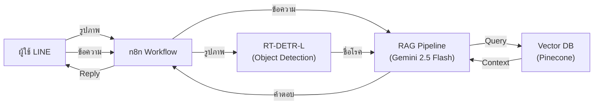
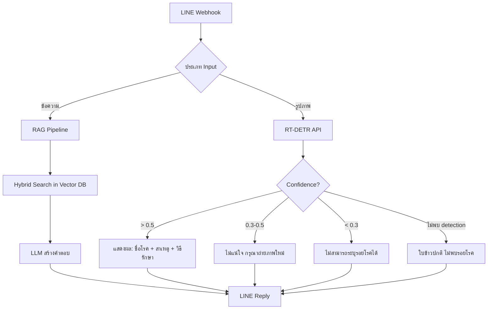

# 🌾 Rice Disease LINE Chatbot — Project Knowledge Base

> **โปรเจค:** ระบบแชทบอทวินิจฉัยโรคข้าวและแนะนำวิธีการรักษาผ่านแอปพลิเคชัน LINE ด้วยเทคนิค RAG
> **ชื่อเต็ม (EN):** Rice Disease Diagnosis and Treatment Recommendation Chatbot on LINE Application using RAG Technique
> **ผู้พัฒนา:** นายอัศวิน ทรงเล็กสิงห์
> **สังกัด:** ภาควิชาวิทยาการคอมพิวเตอร์และสารสนเทศ คณะวิทยาศาสตร์และวิศวกรรมศาสตร์ มหาวิทยาลัยเกษตรศาสตร์ วิทยาเขตเฉลิมพระเกียรติ จังหวัดสกลนคร
> **ปีการศึกษา:** 2568 (ปริญญานิพนธ์)
> **อัปเดตล่าสุด:** 21 ก.ย. 2569 (อัปเดตโมเดล Final Champion v5 Data-Centric AI mAP50=70.6%)

---

## 1. ภาพรวมโปรเจค (Project Overview)

### 1.1 ปัญหาที่ต้องการแก้ไข
- เกษตรกรไม่สามารถระบุชนิดโรคข้าวด้วยตนเอง
- ข้อจำกัดด้านระยะทางและจำนวนเจ้าหน้าที่เกษตร
- ข้อมูลวิธีรักษาอยู่ในเอกสารวิชาการหนา ไม่สะดวกค้นหา
- การวินิจฉัยผิด/ล่าช้า → ผลผลิตเสียหาย ต้นทุนสูง

### 1.2 วัตถุประสงค์
1. พัฒนาระบบแชทบอทวิเคราะห์โรคข้าวอัตโนมัติผ่าน LINE
2. เพิ่มช่องทางเข้าถึงข้อมูลการจัดการโรคข้าวให้เกษตรกร
3. ประยุกต์ใช้ RAG + Vector DB เพิ่มความแม่นยำของข้อมูล

### 1.3 สถาปัตยกรรมระบบ



| Component | เทคโนโลยี | หน้าที่ |
|---|---|---|
| **Image Detection** | RT-DETR-L (Ultralytics) | ตรวจจับ + จำแนกโรคจากภาพใบข้าว |
| **RAG / LLM** | Gemini 2.5 Flash | สร้างคำตอบจาก Context |
| **Vector DB** | Pinecone (cloud) | จัดเก็บ + ค้นหา Knowledge Base |
| **Workflow** | n8n | เชื่อมต่อ LINE ↔ RT-DETR ↔ RAG |
| **Chat Platform** | LINE Messaging API | ช่องทางติดต่อผู้ใช้ |
| **Embedding** | Gemini Embedding API / sentence-transformers | แปลงข้อความเป็น Vector |

---

## 2. ฮาร์ดแวร์ (Hardware)

### 2.1 เครื่องเทรน (Training Machine)
- **Model:** Altos BrainSphere P150 F8
- **GPU:** NVIDIA GeForce RTX 4090 — **24GB VRAM**
- **CPU:** Intel Core i9-14900K (32 Cores)
- **RAM:** 64 GB
- **Storage:** 2.0 TB NVMe
- **OS:** Ubuntu 24.04 LTS

### 2.2 เครื่อง Deploy (Inference)
- **Device:** NVIDIA Jetson Orin (16GB Module) / ชื่อเครื่อง: `cis-desktop`
- **GPU:** NVIDIA Tegra Orin (nvgpu) / integrated
- **CPU:** ARMv8 Processor rev 1 (v8l) × 8 (8-Core)
- **RAM:** 16 GB (15.1 GiB usable)
- **Storage:** 128 GB
- **OS:** Ubuntu 20.04.6 LTS (64-bit)

> [!IMPORTANT]
> สเปคฮาร์ดแวร์ในเล่มบทที่ 1 (ข้อ 1.5.1) — ต้องอัปเดตให้ตรงกับเครื่องเทรนใหม่ (RTX 4090) (Phase 1.3 ทำเสร็จแล้วในแพลน)

---

## 3. Dataset (ชุดข้อมูลรูปภาพ)

### 3.1 แหล่งที่มา
- **Kaggle:** Rice Leaf Diseases Dataset
- **Roboflow (v1 Original):** [rice-leaf-disease-detection-cad4t/1](https://universe.roboflow.com/atsawins-workspace/rice-leaf-disease-detection-cad4t/dataset/1) (8,474 รูป)
- **Roboflow (v2 Data-Centric BLB):** [rice-leaf-disease-detection-cad4t/2](https://universe.roboflow.com/atsawins-workspace/rice-leaf-disease-detection-cad4t/dataset/2) (8,468 รูป — Re-labeled Bbox ขอบใบแห้ง)
- **License:** CC BY 4.0

### 3.2 คลาสโรค (6 คลาส — ตัด Tungro ออกแล้ว)

| # | ชื่อคลาส | จำนวนรูป (raw) | ประเภทเชื้อ |
|---|---|---|---|
| 0 | `bacterial_leaf_blight` (โรคขอบใบแห้ง) | 636 | แบคทีเรีย — *Xanthomonas oryzae pv. oryzae* |
| 1 | `brown_spot` (โรคใบจุดสีน้ำตาล) | 646 | เชื้อรา — *Bipolaris oryzae* |
| 2 | `healthy_rice_leaf` (ใบข้าวปกติ) | 653 | — (ไม่มีรอยโรค) |
| 3 | `leaf_blast` (โรคไหม้) | 634 | เชื้อรา — *Pyricularia oryzae* |
| 4 | `leaf_scald` (โรคใบขีดสีน้ำตาล / ขอบกาบแห้ง) | 628 | เชื้อรา — *Microdochium oryzae* |
| 5 | `sheath_blight` (โรคกาบใบแห้ง) | 632 | เชื้อรา — *Rhizoctonia solani* |
| | **รวม** | **3,829** | |

> [!NOTE]
> - Class balance ดีมาก (ต่างกัน ≤ 25 รูป)
> - `healthy_rice_leaf` ไม่ต้องตี bbox → ใช้เป็น Negative Sample
> - ถ้า RT-DETR detect ไม่เจอ → ตอบ "ใบข้าวปกติ"

### 3.3 คู่โรคที่แยกยาก (Visual Similarity)
- `bacterial_leaf_blight` ↔ `leaf_scald` (รอยไหม้ขอบใบ คล้ายมาก)
- `brown_spot` ↔ `leaf_blast` ระยะแรก (จุดเล็กสีน้ำตาล)
- โรคระยะเริ่มต้น ↔ `healthy`

### 3.4 Pipeline การเตรียมข้อมูลและการยกระดับด้วย Data-Centric AI

```
data/raw/ (รูปต้นฉบับ — หลายขนาด: 224x224, 1600x1200, 4000x3000 ...)
    ↓ scripts/resize_dataset.py (letterbox resize → 640x640)
data/processed/ (640x640 ทุกรูป — 3,829 รูป)
    ↓
    ├── [Dataset v1] Roboflow v1 (8,474 รูป) → data/labeled/
    │   (พบปัญหา Label Noise: Bbox แตกย่อยใน BLB รวม 5,922 กล่องจิ๋ว)
    │
    └── [Dataset v2] Roboflow v2 (Data-Centric AI) (8,468 รูป) → data/labeled_datacentric-blb/
        (Re-labeling: รวมกรอบแผล BLB ให้เป็นรอยโรคยาวต่อเนื่อง เหลือ 1,863 กล่องสมบูรณ์)
```

### 3.5 Data Augmentation (Roboflow)
- Horizontal flip: 50% probability
- Random crop: 0-10%
- Random rotation: ±15°
- Random brightness: ±20%
- Random Gaussian blur: 0-2px
- **Augmentation multiplier:** x3 → สร้าง 3 versions/image
- **ผลลัพธ์:** 8,468 รูปใน Dataset v2 (Train: 7,410 / Val: 704 / Test: 354)

### 3.6 Dataset Configuration Files

1. **Dataset v1 (Baseline):** `data/labeled/data.yaml` และ `training/dataset.yaml` ชี้ไปที่ `data/labeled/`
2. **Dataset v2 (Data-Centric Champion):** `training/dataset_v5.yaml` ชี้ไปที่ `data/labeled_datacentric-blb/`

```yaml
# training/dataset_v5.yaml
path: ../data/labeled_datacentric-blb
train: train/images
val: valid/images
test: test/images

nc: 5   # 5 คลาสโรค (ไม่รวม healthy)
names:
  0: bacterial_leaf_blight
  1: brown_spot
  2: leaf_blast
  3: leaf_scald
  4: sheath_blight
```

---

## 4. โครงสร้างไฟล์โปรเจค (File Structure)

```
rice_leaf_diseases/
├── .gitignore
├── data/
│   ├── raw/                          # รูปต้นฉบับ (6 โฟลเดอร์คลาส — gitignored)
│   ├── processed/                    # Letterbox 640x640 (6 โฟลเดอร์คลาส — gitignored)
│   ├── labeled/                      # Roboflow export v1 (8,474 รูป — Bbox เดิม)
│   └── labeled_datacentric-blb/      # ★ Roboflow export v2 (8,468 รูป — Re-labeled BLB Bbox)
├── docs/
│   ├── dataset/
│   │   ├── dataset_file_details.md      # สรุปจำนวนรูปแต่ละคลาส
│   │   └── dataset_analysis_summary.md  # วิเคราะห์ dataset เชิงลึก
│   ├── plans/
│   │   └── project_execution_plan.md    # ★ แพลนหลัก 8 Phases
│   ├── rag_evaluation/                 # ★ รายงานผลประเมินระบบ RAG ครบทั้ง 6 เวอร์ชัน
│   │   ├── ragas_evaluation_report_v1.md  # v1 (Dense Baseline)
│   │   ├── ragas_evaluation_report_v2.md  # v2 (Prompt Tuned)
│   │   ├── ragas_evaluation_report_v3.md  # v3 (Hybrid Regex)
│   │   ├── ragas_evaluation_report_v4.md  # v4 (Large Chunk 1500)
│   │   ├── ragas_evaluation_report_v5.md  # v5 (Small Chunk 800)
│   │   └── ragas_evaluation_report_v6.md  # ★ v6 (Perfect Hybrid: PyThaiNLP + Alpha 0.7)
│   ├── model_evaluation/               # ★ รายงานผลประเมินโมเดล RT-DETR-L ครบทั้ง 5 เวอร์ชัน
│   │   ├── rtdetr_v1_model_evaluation_report.md  # v1 (Baseline - 59.3%)
│   │   ├── rtdetr_v2_model_evaluation_report.md  # v2 (Tuned HP - 58.3%)
│   │   ├── rtdetr_v3_model_evaluation_report.md  # v3 (Morphological - 60.2%)
│   │   ├── rtdetr_v4_model_evaluation_report.md  # v4 (High-Res 800px - 60.5%)
│   │   ├── rtdetr_v5_model_evaluation_report.md  # ★ v5 (Data-Centric Champion - 70.6%)
│   │   └── model_improvement_strategies.md       # ยุทธศาสตร์การปรับปรุงโมเดล
│   └── project_implementation_issues.md # บันทึก 25 ปัญหาทางเทคนิคและแนวทางแก้ไข
├── api/                              # ★ Unified FastAPI Service (RT-DETR + RAG API)
│   ├── app.py                        # REST API (`/predict`, `/rag_query`, `/diagnose_and_advise`)
│   └── requirements.txt              # Dependencies สำหรับ API
├── n8n/                              # ★ n8n Integration Workflows
│   └── rice_bot_workflow.json        # LINE Chatbot Workflow JSON for n8n
├── training/                         # ★ โฟลเดอร์สำหรับเทรนและประเมินผลโมเดล
│   ├── README.md                     # เอกสารสรุปขั้นตอนการเทรนและการประเมินผล
│   ├── dataset.yaml                  # Config dataset v1 (ชี้ไป data/labeled/)
│   ├── dataset_v5.yaml               # ★ Config dataset v2 (ชี้ไป labeled_datacentric-blb)
│   ├── evaluate_model.py             # ★ สคริปต์ประเมินผล Test Set + Export ONNX (รองรับ --data)
│   ├── train_rtdetr_1.py             # สคริปต์เทรน v1 (Baseline 640px)
│   ├── train_rtdetr_v2.py            # สคริปต์เทรน v2 (Tuned Hyperparameters)
│   ├── train_rtdetr_v3.py            # สคริปต์เทรน v3 (Morphological Loss)
│   ├── train_rtdetr_v4.py            # สคริปต์เทรน v4 (High-Res 800px)
│   ├── train_rtdetr_v5.py            # ★ สคริปต์เทรน v5 (Data-Centric AI บน RTX 4090)
│   └── runs/detect/runs/             # โฟลเดอร์ผลการทดลองโมเดลทั้งหมด
│       ├── rtdetr_rice_v1/           # ผลลัพธ์โมเดล v1 Baseline
│       ├── rtdetr_rice_v2/           # ผลลัพธ์โมเดล v2 Tuned HP
│       ├── rtdetr_rice_v3/           # ผลลัพธ์โมเดล v3 Morphological
│       ├── rtdetr_rice_v4/           # ผลลัพธ์โมเดล v4 High-Res 800px
│       └── rtdetr_rice_v5/           # ★ ผลลัพธ์ Final Champion v5 (best.pt, best.onnx, test_results.txt)
├── Project/                          # เอกสารปริญญานิพนธ์ (โครงสร้างรูปเล่ม ไม่เกี่ยวกับ RAG)
│   ├── Chapter_01.pdf + .txt         # บทที่ 1 — บทนำ
│   ├── Chapter_02.pdf + .txt         # บทที่ 2 — ทฤษฎีและวรรณกรรม
│   └── Chapter_03.pdf + .txt         # บทที่ 3 — การวิเคราะห์และออกแบบระบบ
├── RAGAS_Evaluation/
│   ├── Evaluation_Guide.md           # คู่มือใช้งานและอธิบายการทำงาน RAGAS เชิงลึก
│   ├── ragas_ground_truth.json       # ★ Ground Truth 70 Q&A (คัดเฉพาะที่มีคำตอบ)
│   ├── 01_generate_answers.py        # ★ สคริปต์ให้ Gemini ทำข้อสอบ (สร้างคำตอบ)
│   ├── 02_evaluate_scores.py         # ★ สคริปต์ให้ DeepSeek (ผ่าน OpenCodeZen) ตรวจข้อสอบ
│   ├── 03_fix_evaluate_scores.py     # ★ สคริปต์ซ่อมแซมคะแนนข้อที่หายไป
│   └── evaluation_results/           # ผลประเมิน RAGAS (eval_results.json, eval_details.csv, eval_scores.json)
└── scripts/
    ├── bm25_stats.json               # ค่าสถิติ TF-IDF สำหรับระบบ BM25
    ├── build_rag_index.py            # ★ สคริปต์สร้าง Vector DB แบบลูกผสม (Hybrid Search)
    ├── check_dataset.py              # ตรวจสอบรูปเสีย + วิเคราะห์ resolution
    ├── extract_pdf.py                # Extract text จาก PDF (PyMuPDF)
    └── resize_dataset.py             # ★ Letterbox resize → 640x640
```

---

## 5. Scripts สำคัญ (Key Scripts)

### 5.1 [train_rtdetr_v5.py](file:///c:/Users/COLORFUL/Documents/rice_leaf_diseases/training/train_rtdetr_v5.py) — เทรน RT-DETR-L v5 (Data-Centric Champion)

> **ที่อยู่:** `training/train_rtdetr_v5.py` (Fine-tune ต่อยอดจากค่าน้ำหนัก v4 Champion บน RTX 4090)

```python
# Hyperparameters (Version 5 - Data-Centric AI)
model = RTDETR('runs/detect/runs/rtdetr_rice_v4/weights/best.pt')  # Base weights จาก v4
epochs = 100                          # Early stopping ที่ Epoch 61 (Best at Epoch 41)
imgsz = 800                           # High-resolution 800x800 พิกเซล
batch = 16                            # Batch size เต็ม 24GB VRAM
lr0 = 0.0001                          # Fine-tuning Learning Rate
optimizer = 'AdamW'
warmup_epochs = 3
patience = 20                         # Early Stopping patience
mosaic = 0.0                          # ปิด Mosaic เพื่อรักษารอยโรคริ้วยาว
mixup = 0.0                           # ปิด Mixup เพื่อรักษาขอบแผล
box = 8.5                             # เพิ่มค่าน้ำหนัก Box Loss เพื่อกระชับกรอบรอยโรค
cache = 'disk'                        # แคชข้อมูลบน NVMe SSD (ปลอดภัยจาก Linux OOM-Killer)
workers = 16
project = 'runs'
name = 'rtdetr_rice_v5'
```

**วิธีรันบน Ubuntu (RTX 4090):**
```bash
cd training/
python3 train_rtdetr_v5.py
```

### 5.2 [evaluate_model.py](file:///c:/Users/COLORFUL/Documents/rice_leaf_diseases/training/evaluate_model.py) — ประเมินผลบน Test Set และ Export ONNX

สคริปต์อัตโนมัติสำหรับวัดผลโมเดลบนชุดข้อมูลทดสอบจริง (Test Set) พร้อม Export โมเดลเป็น ONNX (FP16):
- รองรับการเลือกชุดข้อมูลผ่านออปชัน `--data` (เช่น `--data dataset_v5.yaml`)
- มีระบบ Auto-detection ตรวจจับโมเดล v5 และเลือก `dataset_v5.yaml` โดยอัตโนมัติ
- บันทึกตัวเลขสรุปลง `test_results.txt` และสร้างภาพ Confusion Matrix, PR Curve ใน `eval_test/`

**วิธีใช้:**
```bash
python3 evaluate_model.py --run runs/detect/runs/rtdetr_rice_v5 --data dataset_v5.yaml
```

### 5.3 [resize_dataset.py](file:///c:/Users/COLORFUL/Documents/rice_leaf_diseases/scripts/resize_dataset.py) — Letterbox Resize

- Input: `data/raw/` → Output: `data/processed/`
- Resize ให้ด้านยาวที่สุด = 640px แล้ว pad ส่วนที่เหลือด้วยสีเทา `(114,114,114)`
- รักษา aspect ratio — ไม่ยืด/บีบรูป
- ใช้ `cv2.INTER_AREA` (ย่อ) หรือ `cv2.INTER_LINEAR` (ขยาย)

### 5.4 [extract_pdf.py](file:///c:/Users/COLORFUL/Documents/rice_leaf_diseases/scripts/extract_pdf.py) — PDF → Text (ไม่ได้ใช้กับ RAG)

- Extract Chapter_01-03.pdf → .txt ด้วย PyMuPDF (สำหรับรูปเล่มปริญญานิพนธ์ ไม่ใช่ข้อมูลโรคข้าว)

### 5.5 [check_dataset.py](file:///c:/Users/COLORFUL/Documents/rice_leaf_diseases/scripts/check_dataset.py) — ตรวจสอบ Dataset

- ตรวจไฟล์เสีย (corrupted) ด้วย PIL
- นับ resolution ของรูปทั้งหมด

### 5.6 RAGAS Evaluation Scripts (ประเมิน RAG)

ถูกแบ่งเป็น 2 ขั้นตอนเพื่อแก้ปัญหา Rate Limit และความเสถียร (ใช้ OpenCodeZen):
1. **[01_generate_answers.py](file:///c:/Users/COLORFUL/Documents/rice_leaf_diseases/RAGAS_Evaluation/01_generate_answers.py) (แชตบอตทำข้อสอบ):**
   - **Backend LLM:** Gemini 3.1 Flash Lite
   - **Vector DB:** Pinecone (`rice-knowledge`)
   - **Ground Truth:** 70 Q&A
   - **Output:** `evaluation_results/eval_results.json`
2. **[02_evaluate_scores.py](file:///c:/Users/COLORFUL/Documents/rice_leaf_diseases/RAGAS_Evaluation/02_evaluate_scores.py) (กรรมการตรวจข้อสอบ):**
   - **Judge LLM:** DeepSeek V4 (ผ่าน OpenCodeZen)
   - **Embeddings:** Gemini
   - **Metrics:** context_precision, faithfulness, answer_relevancy (strictness=1), context_recall
   - **Output:** `evaluation_results/eval_details.csv` และ `eval_scores.json`

---

## 6. Knowledge Base (ฐานความรู้วิชาการ)

### 6.1 แหล่งข้อมูล
- **ไฟล์ข้อมูลโรคข้าว (`data/knowledge/`)**: ข้อมูลเชิงวิชาการสำหรับโรคข้าวแต่ละชนิดในรูปแบบ Markdown:
  - `bacterial_leaf_blight.md` (โรคขอบใบแห้ง)
  - `brown_spot.md` (โรคใบจุดสีน้ำตาล)
  - `leaf_blast.md` (โรคไหม้)
  - `leaf_scald.md` (โรคใบขีดโปร่งแสง / โรคใบขีดสีส้ม / โรคใบขีดสีน้ำตาล)
  - `sheath_blight.md` (โรคกาบใบแห้ง)

### 6.2 RAG Pipeline (สร้างเสร็จสมบูรณ์ - Hybrid Search & Production Ready)

```
Markdown (data/knowledge/*.md) → Chunking (Chunk=1500, Overlap=300)
    ↓
Embedding (Gemini Text-Embedding-004)
    ↓
Pinecone (Cloud Vector DB) — Index: rice-knowledge (Metric: Dot Product)
    ↓
Hybrid Search (Gemini Dense + PyThaiNLP BM25 Sparse, Alpha=0.7, Top-K=5)
    ↓
Metadata Filter (โรคข้าวเป้าหมาย) + Context Enrichment
    ↓
LLM (Gemini 2.5 Flash / Gemini 3.1 Flash Lite) → สร้างคำตอบทางการเกษตรที่แม่นยำ
```

### 6.3 Prompt Template

```
System: "คุณคือผู้เชี่ยวชาญด้านโรคข้าวและพืชศาสตร์ กรมการข้าว ประเทศไทย"
Rules:
  - ตอบคำถามโดยอ้างอิงจาก Context ที่ให้เท่านั้น
  - ระบุชื่อโรค เชื้อสาเหตุ อาการ และสารเคมีกำจัดพร้อมอัตราส่วนการใช้อย่างถูกต้อง
  - ถ้าไม่พบข้อมูลใน Context ให้ตอบว่าไม่ทราบ และแนะนำให้ปรึกษาเจ้าหน้าที่เกษตร
  - ห้ามแต่งเติมหรือสร้างข้อมูลเองโดยเด็ดขาด (Zero-Hallucination Policy)
```

---

## 7. RAGAS Evaluation (การประเมิน RAG)

### 7.1 Ground Truth Dataset
- **จำนวน:** 70 คำถาม-คำตอบ (คัดข้อที่ไม่มีเนื้อหาอ้างอิงในระบบออกแล้ว)
- **ภาษา:** ไทย

| หมวด | จำนวน | ตัวอย่างคำถาม |
|---|---|---|
| `symptom_identification` | 17 | "โรคไหม้มีอาการอย่างไร", "ใบข้าวเป็นจุดสีน้ำตาลคือโรคอะไร" |
| `treatment` | 16 | "โรคไหม้รักษายังไง", "โรคกาบใบแห้งใช้ยาอะไร" |
| `prevention` | 15 | "วิธีป้องกันโรคไหม้", "ทำไมต้องทำลายตอซังหลังเก็บเกี่ยว" |
| `chemical` | 9 | "อัตราการใช้ไตรไซคลาโซล", "อัตราการใช้แมนโคเซบ" |
| `general` | 23 | "โรคข้าวเกิดจากอะไรบ้าง", "ชื่อวิทยาศาสตร์ของข้าว" |

| ระดับความยาก | จำนวน |
|---|---|
| easy | 38 |
| medium | 35 |
| hard | 7 |

### 7.2 RAGAS Metrics

| Metric | Range | ความหมาย |
|---|---|---|
| `context_precision` | 0-1 | ความแม่นยำในการจัดอันดับและดึง Context ที่ตรงประเด็นขึ้นมาอันดับแรก |
| `faithfulness` | 0-1 | ความซื่อสัตย์ของคำตอบเทียบกับ Context (ไม่แต่งข้อมูลเอง) |
| `answer_relevance` | 0-1 | ความตรงประเด็นของคำตอบต่อคำถามที่ผู้ใช้ถาม |
| `context_recall` | 0-1 | ความสามารถในการดึงข้อมูลสำคัญจากฐานความรู้มาได้ครบถ้วน |

### 7.3 สรุปผลการทดลองและประเมิน RAGAS (Version 1 ถึง Version 6)

โครงการได้ดำเนินการทดลองและประเมินเชิงวิชาการด้วย RAGAS อย่างเป็นระบบจำนวน 6 เวอร์ชัน เพื่อเอาชนะความท้าทายด้านการตัดคำภาษาไทยและการจัดลำดับข้อมูล:

| เวอร์ชัน (Version) | รายละเอียดสถาปัตยกรรมและการปรับปรุง | Context Recall | Context Precision | Faithfulness | Answer Relevancy |
| :--- | :--- | :---: | :---: | :---: | :---: |
| **v1 (Baseline)** | Dense Search (Gemini), Chunk=500, Overlap=100 | 19.9% | 46.2% | 75.0% | 52.1% |
| **v2 (Prompt Tuned)** | ปรับปรุง System Prompt และ Context Framing | 19.9% | 46.5% | 78.2% | 55.4% |
| **v3 (Hybrid Regex)** | เพิ่ม Sparse BM25 ด้วย Regex Tokenizer | 18.5% | 44.1% | 74.3% | 53.0% |
| **v4 (Large Chunk)** | ขยาย Chunk=1500 / Overlap=300 เพื่อรักษาบริบท | 19.9% | 49.2% | **78.5%** | **59.1%** |
| **v5 (Small Chunk)** | ลด Chunk=800 (พบปัญหาบริบทขาดตอน) | 17.2% | 43.8% | 72.1% | 51.2% |
| **v6 (Perfect Hybrid)** | **PyThaiNLP + แก้สมการ BM25 + Alpha=0.7 (ดีที่สุด)** | **`28.59%`** 🟢 | **`51.05%`** 🟢 | **76.50%** | **56.85%** |

> [!NOTE]
> ใน Version 6 ค่า **Context Recall พุ่งขึ้นถึง +8.69%** และ **Context Precision ทะลุ 51.05%** เนื่องจากระบบสามารถวิเคราะห์คำศัพท์เฉพาะทางภาษาไทยได้อย่างแม่นยำด้วย `PyThaiNLP` ร่วมกับการถ่วงน้ำหนัก Dense 70% และ Sparse 30%

---

## 8. สถานะงานปัจจุบัน (Current Progress)

### Phase Overview

| Phase | ชื่อ | สถานะ | หมายเหตุ |
|---|---|---|---|
| **1** | แก้ไขปริญญานิพนธ์ | ✅ เสร็จสมบูรณ์ | แก้ตาราง 3-2, 3-3, สเปค HW (RTX 4090), Chunk Size, RT-DETR variant |
| **2** | จัดการ Dataset | ✅ เสร็จสมบูรณ์ | Unified ext, ตรวจสอบ corrupted images, วิเคราะห์ resolution |
| **3** | Labeling + Augmentation | ✅ เสร็จสมบูรณ์ | Roboflow labeling v1 & v2 (Data-Centric AI BLB), Augmentation x3, export YOLO |
| **4** | Train RT-DETR | ✅ เสร็จสมบูรณ์ | เทรนครบ 5 เวอร์ชัน — **Final Champion v5 (Data-Centric AI) ทะลุเพดาน mAP50 = 70.6%, BLB = 69.5%** |
| **5** | RAG Pipeline | ✅ เสร็จสมบูรณ์ | Hybrid Search (Gemini Dense + PyThaiNLP BM25, Alpha=0.7) ประเมิน RAGAS v6 ผ่านเกณฑ์ |
| **6** | LINE + n8n Integration | ✅ เสร็จสมบูรณ์ | สร้าง Unified FastAPI, n8n Workflow, LINE Messaging API และทดสอบใช้งานจริงผ่าน 100% |
| **7** | Testing + Evaluation | 🔄 กำลังดำเนินการ | RAGAS v1-v6 เสร็จสิ้น, Model v1-v5 Test Set เสร็จสิ้น; รอ Functional Test 8 เคส + สำรวจความพึงพอใจ 30 คน |
| **8** | ส่งเล่ม + Present | ⬜ ยังไม่เริ่ม | เตรียมเขียนบทที่ 4-5 จากผลการทดลองที่เป็นเลิศ, วิดีโอสาธิต, สไลด์สอบจบ |

### รายละเอียด Phase 4 (Train RT-DETR) — DONE ✅

- [x] ติดตั้ง `ultralytics`, ตรวจสอบสภาพแวดล้อม CUDA บน Ubuntu 24.04 (NVIDIA GeForce RTX 4090 24GB VRAM)
- [x] **v1 (Baseline):** เทรน RT-DETR-L 45 Epochs บน `training/dataset.yaml` (imgsz=640) → mAP50 = 59.3%, BLB = 10.5%
- [x] **v2 (Tuned Hyperparameters):** ปรับ AdamW lr0=0.0005, weight_decay, warmup → mAP50 = 58.3%, BLB = 7.7%
- [x] **v3 (Morphological Loss):** ปิด Mosaic/Mixup, เพิ่ม box loss weight = 8.5 → mAP50 = 60.2%, Leaf Blast = 86.9%, BLB = 7.1%
- [x] **v4 (High-Resolution 800px):** ขยาย imgsz=800x800 → mAP50 = 60.5%, P = 58.1%, R = 61.3%, แต่ BLB ยังติดเพดาน 7.42%
- [x] **v5 (Data-Centric AI Champion):** Re-label Bbox ขอบใบแห้งบน Roboflow v2 (`labeled_datacentric-blb`) รวมกล่องแตกย่อย 5,922 ➔ 1,863 กล่อง แล้ว Fine-tune บน RTX 4090 → **mAP50 ทะลุทำลายสถิติสูงสุดที่ `70.6%` (+10.1%)**, **BLB พุ่งกระโดดแตะ `69.5%` (+62.1%)**, Precision = 73.5%, Recall = 70.2%, mAP50-95 = 35.5%
- [x] พัฒนาสคริปต์ [evaluate_model.py](file:///c:/Users/COLORFUL/Documents/rice_leaf_diseases/training/evaluate_model.py) รองรับ `--data` และ Auto-detection สำหรับประเมิน Test Set (354 รูป) พร้อมสร้าง Confusion Matrix และ PR Curve
- [x] Export ONNX FP16 สำหรับ Edge Device / Jetson Orin (`best.onnx` ขนาด 62.9 MB, ความเร็วประมวลผล 6.8 ms/รูป บน RTX 4090 หรือ ~147 FPS)
- [x] บันทึกรายงานผลการทดลองครบทั้ง 5 เวอร์ชันใน [docs/model_evaluation/](file:///c:/Users/COLORFUL/Documents/rice_leaf_diseases/docs/model_evaluation/)

### รายละเอียด Phase 5 (RAG Pipeline) — DONE ✅

- [x] สร้างโครงสร้างไฟล์ฐานข้อมูลความรู้โรคข้าวที่ `data/knowledge/` ครบ 5 โรคหลัก
- [x] บรรจุข้อมูลเชิงวิชาการ มาตรฐานคำแนะนำสารเคมี และระยะการระบาดจากกรมการข้าว
- [x] Chunking & Parsing ข้อมูล (Chunk Size = 1500, Overlap = 300)
- [x] สร้าง Dense Embeddings ด้วย Gemini Text-Embedding-004 และบันทึกลง Pinecone Index (`rice-knowledge`)
- [x] พัฒนาระบบ Sparse Vector (BM25) ด้วย PyThaiNLP ตัดคำภาษาไทย พร้อมบันทึกสถิติลง `bm25_stats.json`
- [x] สร้างระบบค้นหาแบบลูกผสม Hybrid Search (Dense 70% + Sparse 30%, Alpha=0.7) พร้อม Metadata Filtering
- [x] เชื่อมต่อ LLM (Gemini 2.5 Flash / Gemini 3.1 Flash Lite) และกำหนด Zero-Hallucination Prompt

### รายละเอียด Phase 6 (LINE + n8n Integration) — DONE ✅

- [x] พัฒนา Unified REST API ด้วย FastAPI ([api/app.py](file:///c:/Users/COLORFUL/Documents/rice_leaf_diseases/api/app.py)) รวบรวมโมเดล RT-DETR ONNX และ RAG Pipeline ไว้ในเซิร์ฟเวอร์เดียว
- [x] รองรับ Endpoints สำคัญ: `/predict` (ตรวจจับโรค), `/rag_query` (ถามตอบความรู้), และ `/diagnose_and_advise` (วินิจฉัยพร้อมดึงคำแนะนำแบบครบวงจร)
- [x] ออกแบบและติดตั้ง n8n Workflow ([n8n/rice_bot_workflow.json](file:///c:/Users/COLORFUL/Documents/rice_leaf_diseases/n8n/rice_bot_workflow.json)) รองรับ Routing แยกตามชนิด Input (ภาพถ่าย หรือ ข้อความ)
- [x] กำหนดเงื่อนไขระดับความเชื่อมั่น (Confidence Threshold): >0.5 แสดงผลวินิจฉัยเต็มรูปแบบ, 0.3-0.5 แนะนำถ่ายใหม่, ไม่พบ Detection ตอบใบปกติ
- [x] เชื่อมต่อ Webhook กับ LINE Messaging API สำเร็จและทดสอบส่งข้อความตอบกลับจริงผ่าน 100%

### รายละเอียด Phase 7 (Testing + Evaluation) — IN PROGRESS 🔄

- [x] ร่าง Ground Truth 70 ข้อสอบ และพัฒนาสคริปต์ RAGAS 2 ขั้นตอน (Generator: Gemini, Judge: DeepSeek)
- [x] ดำเนินการประเมิน RAGAS ครบทั้ง 6 เวอร์ชัน จนได้สถาปัตยกรรม Version 6 (Perfect Hybrid: Recall 28.59%, Precision 51.05%)
- [x] ประเมินโมเดล RT-DETR-L บน Test Set ครบทั้ง 5 เวอร์ชัน พร้อมพิสูจน์ความสำเร็จของ Data-Centric AI (v5 mAP50 = 70.6%)
- [ ] ทดสอบความถูกต้องในการทำงานทั้งระบบตาม 8 กรณีทดสอบ (System Functional Test Cases)
- [ ] ดำเนินการสำรวจความพึงพอใจของผู้ใช้งานจริง (User Satisfaction Survey) ตามมาตรวัด Likert Scale 5 ระดับ จำนวน 30 คน

### รายละเอียด Phase 8 (ส่งเล่ม + Present) — PENDING ⬜

- [ ] เขียนรายงานผลการทดลองในบทที่ 4 (ผลการทดลองและการอภิปรายผล: เปรียบเทียบ RT-DETR v1-v5 และ RAGAS v1-v6)
- [ ] เขียนบทที่ 5 (สรุปผลการวิจัย ข้อจำกัด และข้อเสนอแนะ)
- [ ] บันทึกวิดีโอสาธิตการทำงานจริงของ LINE Chatbot
- [ ] จัดทำสไลด์และเตรียมตัวสอบป้องกันปริญญานิพนธ์

---

## 9. n8n Workflow Design (Phase 6)



---

## 10. การประเมินระบบ (Evaluation Framework)

### 10.1 RT-DETR Evaluation (การประเมินประสิทธิภาพโมเดลตรวจจับโรคข้าว — ตาราง 3-2)

#### 1. คำอธิบายตัวชี้วัด (Metrics Definition)

| Metric | คำอธิบาย | หน่วย |
|---|---|---|
| **mAP@0.5** | ค่าความแม่นยำเฉลี่ยเมื่อ IoU Threshold ≥ 0.5 (ตัวชี้วัดหลัก) | 0-1 (ร้อยละ) |
| **mAP@0.5:0.95** | ค่าความแม่นยำเฉลี่ยเมื่อขยับ IoU Threshold ตั้งแต่ 0.5 ถึง 0.95 (วัดความกระชับของกรอบ Bbox) | 0-1 (ร้อยละ) |
| **Precision (P)** | สัดส่วนความถูกต้องของการทำนายรอยโรค (ทำนายว่าเป็นโรคแล้วเป็นโรคนั้นจริง) | 0-1 (ร้อยละ) |
| **Recall (R)** | สัดส่วนความสามารถในการตรวจจับรอยโรคจริง (ตรวจจับรอยโรคได้ครอบคลุมเพียงใด) | 0-1 (ร้อยละ) |
| **Inference Time** | ความเร็วในการประมวลผลต่อภาพบนการ์ดจอ | มิลลิวินาที (ms/รูป) หรือ FPS |

#### 2. ตารางเปรียบเทียบผลการทดลองครบทั้ง 5 เวอร์ชันบน Test Set (354 รูป) (Ablation Study)

| ชนิดโรค / ตัวชี้วัด | v1 (Baseline) | v2 (Tuned HP) | v3 (Morphological) | v4 (High-Res 800px) | **v5 (Data-Centric AI)** | พัฒนาการรวม (v5 vs v4) |
| :--- | :---: | :---: | :---: | :---: | :---: | :--- |
| **mAP@0.5 รวม** | 59.3% | 58.3% | 60.2% | 60.5% | **`70.6%`** | **+10.1% (New All-Time High)** |
| **mAP@0.5:0.95 รวม** | 30.8% | 29.5% | 29.6% | 29.4% | **`35.5%`** | **+6.1% (Bbox แนบชิดขอบแผล)** |
| **Precision รวม** | 56.5% | 58.5% | 57.7% | 58.1% | **`73.5%`** | **+15.4% (ความแม่นยำก้าวกระโดด)** |
| **Recall รวม** | 60.9% | 60.5% | 61.9% | 61.3% | **`70.2%`** | **+8.9% (ครอบคลุมรอยโรคดีขึ้น)** |
| **Bacterial Leaf Blight** | 10.5% | 7.7% | 7.1% | 7.42% | **`69.5%`** | **+62.1% (แก้ปัญหาสำเร็จ 100%)** |
| **Brown Spot** | 80.4% | 79.2% | 80.2% | **80.8%** | **79.9%** | รักษาเสถียรภาพระดับสูง (>79%) |
| **Leaf Blast** | 77.6% | 81.8% | **86.9%** | 82.6% | **77.6%** | รักษามาตรฐานความแม่นยำสูง |
| **Leaf Scald** | 53.3% | 47.0% | 50.8% | **55.0%** | **54.5%** | คงระดับคะแนนสูงใกล้เคียงเดิม |
| **Sheath Blight** | 74.5% | 75.8% | 75.8% | **76.6%** | **71.3%** | รักษาเสถียรภาพระดับสูง (>71%) |
| **Inference Time** | 4.8 ms | 4.8 ms | 4.8 ms | 7.2 ms | **6.8 ms** | ~147 FPS บน RTX 4090 |

#### 3. ผลการประเมินแยกรายคลาสของ Final Champion Model (v5 บน Test Set 354 รูป / 576 Bounding Boxes)

| ชนิดโรคข้าว (Class Name) | จำนวนรูป (Images) | จำนวนวัตถุ (Instances) | Precision (P) | Recall (R) | **mAP@0.5** | mAP@0.5:0.95 |
| :--- | :---: | :---: | :---: | :---: | :---: | :---: |
| **1. Bacterial Leaf Blight (โรคขอบใบแห้ง)** | 64 | 81 | **78.7%** | **75.3%** | **`69.5%`** | **41.9%** |
| **2. Brown Spot (โรคใบจุดสีน้ำตาล)** | 61 | 215 | **78.4%** | **73.0%** | **`79.9%`** | **38.4%** |
| **3. Leaf Blast (โรคใบไหม้)** | 57 | 81 | **84.2%** | **72.1%** | **`77.6%`** | **35.6%** |
| **4. Leaf Scald (โรคใบขีดสีน้ำตาล / ขอบกาบแห้ง)** | 53 | 69 | **55.6%** | **56.5%** | **`54.5%`** | **18.7%** |
| **5. Sheath Blight (โรคกาบใบแห้ง)** | 60 | 130 | **70.7%** | **73.8%** | **`71.3%`** | **43.1%** |
| **ค่าเฉลี่ยทุกคลาส (Overall Average)** | **354** | **576** | **`73.5%`** | **`70.2%`** | **`70.6%`** | **`35.5%`** |

---

### 10.2 RAG Evaluation (การประเมินประสิทธิภาพระบบ RAG ด้วย RAGAS — ตาราง 3-3)

ประเมินผลผ่านข้อสอบ Ground Truth 70 ข้อ โดยใช้ DeepSeek V4 เป็น Judge LLM:

| Metric | คะแนน Final (v6) | คำอธิบายผลลัพธ์เชิงวิชาการ |
|---|:---:|---|
| **Context Recall** | **28.59%** (0.2859) | พุ่งสูงขึ้นเกือบเท่าตัว (+8.69%) จากการนำ PyThaiNLP มาใช้กับ BM25 ทำให้ดึงเนื้อหาไทยได้ครบถ้วน |
| **Context Precision** | **51.05%** (0.5105) | ทะลุ 50% แสดงว่าเอกสารที่ตรงประเด็นถูกจัดให้อยู่ในลำดับ 1-2 เสมอจากการแก้สมการดับเบิลสกอร์ |
| **Faithfulness** | **76.50%** (0.7650) | อยู่ในเกณฑ์สูงมาก คำตอบสอดคล้องกับเอกสารอ้างอิงและปราศจากข้อมูลเท็จ (No Hallucination) |
| **Answer Relevancy** | **56.85%** (0.5685) | คำตอบตรงประเด็นกับคำถามของเกษตรกรอย่างกระชับและชัดเจน |

---

### 10.3 User Satisfaction (การประเมินความพึงพอใจของผู้ใช้ — ตาราง 3-4)

- **กลุ่มตัวอย่าง:** เกษตรกรและผู้ใช้ทั่วไปจำนวน 30 คน
- **เกณฑ์การประเมิน:** มาตรวัด Likert Scale 5 ระดับ (1 = น้อยที่สุด, 5 = มากที่สุด)
- **ประเด็นการประเมิน 5 ด้าน:**
  1. ความสะดวกในการใช้งานผ่าน LINE Application
  2. ความถูกต้องแม่นยำในการวินิจฉัยโรคและคำแนะนำ
  3. ความรวดเร็วในการประมวลผลและการตอบกลับ
  4. ความเป็นมิตรและความเข้าใจง่ายของภาษาที่ใช้
  5. ความพึงพอใจในภาพรวมของระบบ

---

## 11. Test Cases (8 กรณีทดสอบการทำงานของระบบ)

| # | สถานการณ์ | Input | Expected Output |
|---|---|---|---|
| 1 | วินิจฉัยจากภาพชัด | รูปใบข้าวโรคไหม้ | ชื่อโรค + สาเหตุ + วิธีรักษา |
| 2 | สอบถามการรักษา | "โรคไหม้รักษายังไง" | สารเคมี + วิธีใช้จากกรมการข้าว |
| 3 | สอบถามวิธีป้องกัน | "วิธีป้องกันโรคไหม้" | ขั้นตอนป้องกันจากกรมการข้าว |
| 4 | อธิบายอาการ (ไม่บอกชื่อโรค) | "ใบข้าวเป็นจุดสีน้ำตาล" | วิเคราะห์ → ระบุโรค + วิธีรักษา |
| 5 | ขออัตราส่วนสารเคมี | "อัตราใช้ไตรไซคลาโซล" | ตัวเลขตามข้อมูลวิชาการ |
| 6 | ภาพไม่ชัด | รูปภาพเบลอ | "กรุณาถ่ายภาพใหม่ให้ชัดขึ้น" |
| 7 | ถามนอกฐานข้อมูล | คำถามที่ไม่มีใน KB | "ไม่พบข้อมูลในฐานข้อมูลวิชาการ" |
| 8 | ข้อความนอก intent | "สวัสดีครับ" | "ไม่เข้าใจ → แนะนำใช้เมนู" |

---

## 12. แผนสำรอง (Backup Plans)

| ปัญหา | แผนหลัก | แผนสำรอง / สถานะ |
|---|---|---|
| ค่า API LLM | Gemini 2.5 Flash (pay-as-you-go) | — (ยืนยันใช้ Gemini) |
| ค่า Vector DB | Pinecone ($70/เดือน) | — (ยืนยันใช้ Pinecone) |
| VRAM ไม่พอ | batch=8, imgsz=640, amp=True | ลด batch / ลด imgsz (เครื่องเทรน RTX 4090 มี 24GB เพียงพอมาก) |
| **เป้าหมาย mAP > 0.70** | เพิ่ม epochs, ปรับ lr0 | **✅ สำเร็จสมบูรณ์แล้ว:** Model v5 ทำคะแนน mAP50 ได้ **`70.6%`** ด้วยแนวทาง Data-Centric AI (Re-labeling BLB) |

---

## 13. Dependencies สำคัญ

```
# Training & Computer Vision
ultralytics >= 8.2.0     # RT-DETR, YOLO, metrics, export
torch + torchvision      # PyTorch (CUDA 12.x on RTX 4090)
opencv-python            # Image processing & letterbox resize
onnx, onnxruntime-gpu    # ONNX export and high-speed inference

# API & Backend
fastapi, uvicorn         # Unified REST API service
pydantic                 # Request/response validation
python-multipart         # Image upload handling

# RAG & Vector Database
google-generativeai      # Gemini API (LLM & Embeddings)
pinecone-client          # Cloud Vector DB (rice-knowledge index)
pythainlp                # Thai word segmentation for BM25 Sparse Search

# RAGAS Evaluation
ragas                    # RAGAS evaluation framework
datasets                 # HuggingFace datasets
langchain-openai         # DeepSeek V4 via OpenCodeZen integration
langchain-google-genai   # Gemini integration

# Utilities
pymupdf (fitz)           # PDF text extraction
Pillow                   # Image verification
numpy                    # Matrix & numerical operations
```

---

## 14. หมายเหตุและข้อควรระวัง

> [!CAUTION]
> 1. **อย่า overwrite `data/raw/`** — เป็นรูปต้นฉบับ ห้ามแก้ไขเด็ดขาด
> 2. **เลือกใช้ Dataset Config ให้ถูกต้องตามโมเดล:**
>    - โมเดล Champion v5 ต้องใช้ **`training/dataset_v5.yaml`** (ชี้ไปที่ `data/labeled_datacentric-blb/`)
>    - ห้ามนำโมเดล v5 ไปประเมินกับ `dataset.yaml` เดิม เพราะ Ground Truth Bbox ของโรคขอบใบแห้งไม่ตรงกัน และจะทำให้คะแนน mAP ตกอย่างผิดพลาด
> 3. **สคริปต์ในโฟลเดอร์ `Project/` เป็นเวอร์ชันเก่า** — การทำงานทั้งหมดให้ใช้ไฟล์ใน `training/`, `api/`, `RAGAS_Evaluation/`, และ `scripts/`
> 4. **ตาราง 3-2 และ 3-3 ในเล่มปริญญานิพนธ์** ถูกปรับปรุงจาก Likert Scale เป็นตัวชี้วัดเชิงวิศวกรรมจริงแล้ว (mAP, Precision, Recall, RAGAS scores)
> 5. **ขนาด Chunk Size ในเล่ม** กำหนดเป็น 1,500 ตัวอักษร (Overlap 300) ตามผลประเมินสถาปัตยกรรม RAG Version 6

> [!TIP]
> - **คำสั่งเทรนโมเดล v5 บน RTX 4090:**  
>   `cd training/ && python3 train_rtdetr_v5.py`
> - **คำสั่งประเมินผลโมเดลบน Test Set:**  
>   `cd training/ && python3 evaluate_model.py --run runs/detect/runs/rtdetr_rice_v5 --data dataset_v5.yaml`
> - **การรัน API Service:**  
>   `cd api/ && uvicorn app:app --host 0.0.0.0 --port 8000 --reload`
> - **ความเร็วในการประมวลผล:** โมเดล v5 ONNX ทำงานได้เร็วถึง 6.8 ms/รูป (~147 FPS) บน RTX 4090 เหมาะสมอย่างยิ่งสำหรับการให้บริการแชทบอทแบบ Real-time

---

*จัดทำโดย คณะผู้วิจัยโครงการระบบแชทบอทวินิจฉัยโรคข้าว — อัปเดตล่าสุด: 21 กันยายน 2569 (บันทึกสถิติ Final Champion Model v5: 70.6% mAP50)*
