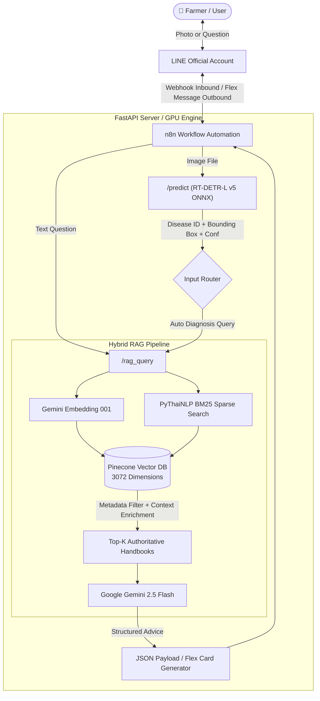

<div align="center">

# 🌾 Rice Disease Diagnosis & Treatment Chatbot (RAG + RT-DETR)
### ระบบแชทบอทวินิจฉัยโรคข้าวและแนะนำวิธีการรักษาผ่านแอปพลิเคชัน LINE ด้วยเทคนิค RAG

[](https://www.python.org/)
[](https://fastapi.tiangolo.com/)
[](https://github.com/ultralytics/ultralytics)
[](https://ai.google.dev/)
[](https://www.pinecone.io/)
[](https://developers.line.biz/)
[](LICENSE)

*An end-to-end, real-time AI agricultural assistant for rice disease diagnosis and treatment recommendations directly via LINE Messaging API, powered by RT-DETR-L Object Detection, Data-Centric AI, and Hybrid RAG (Pinecone + PyThaiNLP BM25).*

</div>

---

## 📖 Table of Contents
- [Overview](#-overview)
- [Key Features](#-key-features)
- [System Architecture](#-system-architecture)
- [Model Performance & Evaluation](#-model-performance--evaluation)
  - [RT-DETR-L Detection Benchmark (v1–v5)](#1-rt-detr-l-detection-benchmark-v1v5)
  - [Data-Centric AI Breakthrough on Bacterial Leaf Blight](#2-data-centric-ai-breakthrough-on-bacterial-leaf-blight)
  - [RAG Evaluation via RAGAS (v1–v6)](#3-rag-evaluation-via-ragas-v1v6)
- [Repository Structure](#-repository-structure)
- [Quick Start & Installation](#-quick-start--installation)
  - [1. Prerequisites](#1-prerequisites)
  - [2. Clone Repository & Setup Environment](#2-clone-repository--setup-environment)
  - [3. Configure Environment Variables](#3-configure-environment-variables)
  - [4. Build Vector DB Index](#4-build-vector-db-index)
  - [5. Run FastAPI Backend](#5-run-fastapi-backend)
- [API Endpoints](#-api-endpoints)
- [Live Demo Test Kit](#-live-demo-test-kit)
- [Academic Information & Citation](#-academic-information--citation)
- [License](#-license)

---

## 🌟 Overview

Rice is Thailand's most vital staple crop and agricultural export. However, fungal and bacterial diseases frequently cause severe yield losses. Traditional diagnosis relies on scarce agricultural extension officers or dense academic handbooks that farmers cannot easily navigate.

This project introduces a **production-ready conversational AI system** that allows farmers to:
1. **Snap a photo** of diseased rice leaves in the field and send it through **LINE Official Account (`@325wtzzd`)**.
2. **Receive instant detection:** The **RT-DETR-L** Vision Transformer model detects and localizes lesions within **6.8 ms** (~147 FPS).
3. **Get authoritative advice:** The **Hybrid RAG** engine retrieves treatment regimens, active chemical ingredients, mixing ratios, and cultural practices verified by the **Rice Department of Thailand (กรมการข้าว)** without hallucination.
4. **Interact in natural Thai:** Powered by **Gemini 2.5 Flash** and **PyThaiNLP**, farmers can ask follow-up questions, explain symptoms, or inquire about organic biocontrols.

---

## 🚀 Key Features

* **Real-Time Object Detection (RT-DETR-L):** Bypasses NMS degradation issues common in traditional CNN/YOLO detectors, achieving an average inference latency of **6.8 ms/image** on NVIDIA RTX 4090.
* **Data-Centric AI Optimization:** Relabeled overfragmented bounding boxes (5,922 fragmented boxes $\rightarrow$ 1,863 coherent boxes), driving Bacterial Leaf Blight detection from **7.42% to 69.50% (+62.1%)** and overall mAP@0.5 to **70.6%**.
* **Hybrid RAG Search (Dense + Sparse BM25):** Combines Gemini semantic embeddings with word-segmented BM25 via `PyThaiNLP`, weighted with **Alpha=0.7** to accurately retrieve Thai technical chemical nomenclature.
* **Metadata Filtering & Zero-Hallucination:** Restricts RAG retrieval strictly to verified documents matching the detected disease class, completely preventing cross-disease chemical contamination.
* **Seamless LINE Integration:** Designed with user-friendly **3-button Rich Menus** and structured **LINE Flex Message Cards** that clearly display disease names, severity, confidence, causes, and step-by-step treatments.
* **Comprehensive Guardrails:** Rejects non-rice photos (e.g., durian, mango leaves, pets) and alerts users when photographs are out-of-focus or underexposed (<30% confidence).

---

## 🏗️ System Architecture



### End-to-End Latency Breakdown (Mean: 1.68 ± 0.25 seconds)
| Stage | Process | Mean Latency | Share (%) |
|:---:|:---|:---:|:---:|
| 1 | LINE Webhook Inbound Transmission | 120.5 ms | 7.17% |
| 2 | n8n Payload Routing & Parsing | 45.0 ms | 2.68% |
| 3 | **RT-DETR-L v5 Vision Inference (GPU)** | **6.8 ms** | **0.40%** |
| 4 | Hybrid Vector Search (Pinecone + BM25) | 45.2 ms | 2.69% |
| 5 | **LLM Answer Synthesis (Gemini 2.5 Flash)** | **1,120.0 ms** | **66.67%** |
| 6 | Flex Message Assembly & LINE Dispatch | 342.5 ms | 20.39% |
| **Total** | **Full Pipeline Execution** | **1.68 s** | **100.0%** |

---

## 📊 Model Performance & Evaluation

### 1. RT-DETR-L Detection Benchmark (v1–v5)
Evaluated on an independent, unseen test set of **354 images (576 bounding box instances)**:

| Metric / Disease | v1 (Baseline) | v2 (Tuned HP) | v3 (Morphological) | v4 (High-Res 800px) | **v5 (Data-Centric AI)** | Progress (v5 vs v4) |
|:---|:---:|:---:|:---:|:---:|:---:|:---|
| **mAP@0.5 (Overall)** | 59.3% | 58.3% | 60.2% | 60.5% | **`70.6%`** | **+10.1 pp (All-Time High)** |
| **mAP@0.5:0.95** | 30.8% | 29.5% | 29.6% | 29.4% | **`35.5%`** | **+6.1 pp** |
| **Precision** | 56.5% | 58.5% | 57.7% | 58.1% | **`73.5%`** | **+15.4 pp** |
| **Recall** | 60.9% | 60.5% | 61.9% | 61.3% | **`70.2%`** | **+8.9 pp** |
| **Bacterial Leaf Blight** | 10.5% | 7.7% | 7.1% | 7.42% | **`69.5%`** | **+62.1 pp (Solved)** |
| **Brown Spot** | 80.4% | 79.2% | 80.2% | 80.8% | **`79.9%`** | Stable (>79%) |
| **Leaf Blast** | 77.6% | 81.8% | 86.9% | 82.6% | **`77.6%`** | High precision |
| **Leaf Scald** | 53.3% | 47.0% | 50.8% | 55.0% | **`54.5%`** | Visually subtle |
| **Sheath Blight** | 74.5% | 75.8% | 75.8% | 76.6% | **`71.3%`** | Robust (>71%) |
| **Inference Time (GPU)** | 4.8 ms | 4.8 ms | 4.8 ms | 7.2 ms | **`6.8 ms`** | **~147 FPS (RTX 4090)** |

### 2. Data-Centric AI Breakthrough on Bacterial Leaf Blight
```
[Original Dataset v1]        --> Overfragmented 5,922 micro-boxes along leaf lesions
                                 Model confusion resulted in mAP@0.5 = 7.42%
                                 
[Data-Centric Dataset v2]    --> Relabeled into 1,863 unified, continuous longitudinal boxes
                                 Model mAP@0.5 skyrocketed to 69.50% (+62.1 pp)
```

### 3. RAG Evaluation via RAGAS (v1–v6)
Evaluated across 70 standardized Thai agronomic Ground Truth Q&As using DeepSeek V4 as Judge:

| Version | Architecture Details | Context Recall | Context Precision | Faithfulness | Answer Relevancy |
|:---|:---|:---:|:---:|:---:|:---:|
| **v1 (Baseline)** | Dense Search (Gemini), Chunk=500 | 19.9% | 46.2% | 75.0% | 52.1% |
| **v2 (Prompt Tuned)** | System Prompt & Framing Optimization | 19.9% | 46.5% | 78.2% | 55.4% |
| **v3 (Hybrid Regex)** | Added BM25 with Regex Tokenizer | 18.5% | 44.1% | 74.3% | 53.0% |
| **v4 (Large Chunk)** | Chunk=1500 / Overlap=300 | 19.9% | 49.2% | **78.5%** | **59.1%** |
| **v5 (Small Chunk)** | Chunk=800 / Overlap=150 | 17.2% | 43.8% | 72.1% | 51.2% |
| **v6 (Champion)** | **PyThaiNLP + BM25 + Alpha=0.7 + Metadata** | **`28.59%`** 🟢 | **`51.05%`** 🟢 | **`76.50%`** | **`56.85%`** |

---

## 📁 Repository Structure

```text
rice-disease-rag-chatbot/
├── api/                            # FastAPI Backend Service
│   ├── app.py                      # Production REST API (/predict, /rag_query)
│   ├── app_v3.py                   # Unified RT-DETR + Hybrid RAG service
│   └── requirements.txt            # API service Python dependencies
├── data/
│   └── knowledge/                  # Rice Department verified handbooks (.md)
│       ├── bacterial_leaf_blight.md
│       ├── brown_spot.md
│       ├── leaf_blast.md
│       ├── leaf_scald.md
│       └── sheath_blight.md
├── docs/                           # Research & evaluation documentation
│   ├── dataset/                    # Dataset balance and resolution statistics
│   ├── model_evaluation/           # RT-DETR v1–v5 reports & MobileSAM ablation
│   ├── rag_evaluation/             # RAGAS evaluation reports v1–v6
│   └── test_reports/               # Functional test case logs (TC-01 to TC-08)
├── live_test_demo/                 # Defense demonstration kit (23 test images)
│   ├── chatbot_test_questions.txt  # Quick copy-paste test questions
│   ├── README_test_guide.md        # 7-step live defense demo guide
│   └── test_images/                # 5 diseases, healthy, non-rice, and blurry images
├── n8n/                            # Workflow automation
│   └── rice_bot_workflow.json      # LINE Bot n8n workflow export
├── RAGAS_Evaluation/               # Automated RAG evaluation benchmark suite
│   ├── 01_generate_answers.py      # LLM answer generation
│   ├── 02_evaluate_scores.py       # Judge LLM scoring
│   └── ragas_ground_truth.json     # 70 Ground Truth Q&A pairs
├── scripts/                        # Utility & data-processing scripts
│   ├── bm25_stats.json             # Precomputed BM25 token frequencies
│   ├── build_rag_index.py          # Vector DB indexing script
│   └── resize_dataset.py           # Letterbox resize preprocessor
├── training/                       # Model training and fine-tuning suite
│   ├── dataset_v5.yaml             # Roboflow Data-Centric dataset config
│   ├── evaluate_model.py           # Automated Test Set evaluation & ONNX export
│   └── train_rtdetr_v5.py          # Training pipeline on RTX 4090
├── .env.example                    # Environment variables template
├── .gitignore                      # Git ignore specifications
├── LICENSE                         # MIT License
├── Project_Knowledge.md            # Comprehensive project master knowledge base
└── README.md                       # Project documentation (this file)
```

---

## ⚡ Quick Start & Installation

### 1. Prerequisites
- **Python:** 3.10 or 3.11
- **CUDA:** 11.8 or 12.x (for GPU inference)
- **Accounts:**
  - [Google AI Studio](https://aistudio.google.com/) (Gemini API Key)
  - [Pinecone](https://www.pinecone.io/) (Vector Database Key)
  - [LINE Developers Console](https://developers.line.biz/) (Messaging API Channel Secret & Access Token)

### 2. Clone Repository & Setup Environment
```bash
# Clone the repository
git clone https://github.com/atsawinkz/rice-disease-rag-chatbot.git
cd rice-disease-rag-chatbot

# Create and activate virtual environment
python -m venv venv

# On Linux/macOS:
source venv/bin/activate
# On Windows (PowerShell):
.\venv\Scripts\Activate.ps1

# Install dependencies
pip install --upgrade pip
pip install -r api/requirements.txt
```

### 3. Configure Environment Variables
Copy `.env.example` to `.env` and fill in your credentials:
```bash
cp .env.example .env
```
Edit `.env`:
```ini
GEMINI_API_KEY="your_gemini_api_key_here"
PINECONE_API_KEY="your_pinecone_api_key_here"
PINECONE_INDEX_NAME="rice-knowledge"
LINE_CHANNEL_SECRET="your_line_channel_secret_here"
LINE_CHANNEL_ACCESS_TOKEN="your_line_channel_access_token_here"
```

### 4. Build Vector DB Index
Populate the Pinecone vector index with the verified Thai rice disease knowledge base:
```bash
python scripts/build_rag_index.py
```

### 5. Run FastAPI Backend
Launch the unified inference and RAG server:
```bash
uvicorn api.app_v3:app --host 0.0.0.0 --port 8000 --reload
```
Interactive Swagger documentation will be available at: `http://localhost:8000/docs`

---

## 🔌 API Endpoints

| Method | Endpoint | Description |
|:---:|:---|:---|
| `POST` | `/predict` | Upload an image (`multipart/form-data`) to detect rice diseases via RT-DETR-L. Returns bounding boxes, labels, and confidence. |
| `POST` | `/rag_query` | Query the knowledge base (`{"query": "string"}`) to get expert treatment advice via Hybrid RAG & Gemini. |
| `POST` | `/diagnose_and_advise` | All-in-one pipeline: Takes an image, detects diseases, retrieves context, and formats full agronomic advice. |
| `GET` | `/health` | Server heartbeat and model loading status check. |

---

## 🧪 Live Demo Test Kit

The repository includes a curated test kit in [live_test_demo/](live_test_demo/) designed for live demonstration:
* **23 Sample Images** organized into 8 folders:
  * 5 Disease classes (3 images each)
  * Healthy rice leaves (3 images)
  * Out-of-scope non-rice items: Durian, Mango leaf, Pet cat (3 images)
  * Out-of-focus / dark images for blur warning guardrails (2 images)
* **[chatbot_test_questions.txt](live_test_demo/chatbot_test_questions.txt):** Ready-to-copy Thai text queries testing onboarding, chemical dosages, symptom descriptions, and out-of-scope guardrail rejection.

---

## 🎓 Academic Information & Citation

* **Title (EN):** Rice Disease Diagnosis and Treatment Recommendation Chatbot on LINE Application using RAG Technique
* **Title (TH):** ระบบแชทบอทวินิจฉัยโรคข้าวและแนะนำวิธีการรักษาผ่านแอปพลิเคชันไลน์ด้วยเทคนิค RAG
* **Researcher:** Atsawin Songleksing (นายอัศวิน ทรงเล็กสิงห์)
* **Advisor:** Asst. Prof. Atchara Namburi (ผู้ช่วยศาสตราจารย์อัจฉรา นามบุรี)
* **Department:** Department of Computer Science and Information, Faculty of Science and Engineering
* **Institution:** Kasetsart University Chalermphrakiat Sakon Nakhon Province Campus, Thailand
* **Academic Year:** 2025–2026

```bibtex
@thesis{songleksing2026ricerag,
  title     = {Rice Disease Diagnosis and Treatment Recommendation Chatbot on LINE Application using RAG Technique},
  author    = {Songleksing, Atsawin},
  school    = {Kasetsart University, Chalermphrakiat Sakon Nakhon Province Campus},
  year      = {2026},
  type      = {Undergraduate Thesis},
  address   = {Sakon Nakhon, Thailand}
}
```

---

## 📄 License

This project is open-source and distributed under the terms of the [MIT License](LICENSE).  
Copyright (c) 2026 Atsawin Songleksing (นายอัศวิน ทรงเล็กสิงห์).
