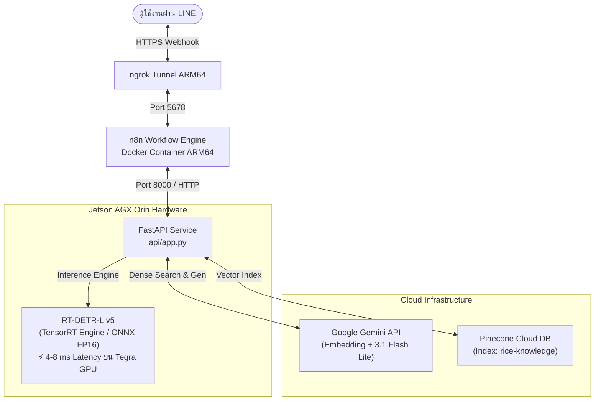

# คู่มือการติดตั้งและ Deploy ระบบบน NVIDIA Jetson AGX Orin
**โครงการ:** ระบบเชี่ยวชาญเพื่อการวินิจฉัยโรคพืชในข้าวและให้คำแนะนำด้วยปัญญาประดิษฐ์ (Rice Disease LINE Chatbot)  
**อุปกรณ์เป้าหมาย:** NVIDIA Jetson AGX Orin (16GB/32GB Module — ชื่อเครื่อง: `cis-desktop`)  
**สถาปัตยกรรม:** ARM64 (aarch64) / Tegra Orin GPU / JetPack 5.x หรือ 6.x  
**โมเดลหลัก:** RT-DETR-L Version 5 Data-Centric AI (TensorRT Engine / ONNX FP16)

---

## 🏗️ 1. สถาปัตยกรรมการทำงานบน Edge Device (Jetson AGX Orin)



---

## 📋 2. ขั้นตอนการเตรียมเครื่องและคัดลอกไฟล์ (File Preparation)

### 2.1 คัดลอกโปรเจกต์มายัง Jetson
คัดลอกโฟลเดอร์ `rice_leaf_diseases` ไปยังเครื่อง Jetson (เช่น วางไว้ที่ `~/rice_leaf_diseases` หรือ `/home/cis-desktop/rice_leaf_diseases`):
```bash
cd ~/rice_leaf_diseases
```

### 2.2 ตรวจสอบไฟล์น้ำหนักโมเดล Champion (v5)
ตรวจสอบว่ามีไฟล์ `best.onnx` หรือ `best.pt` อยู่ในโฟลเดอร์ดังต่อไปนี้:
```bash
ls -lh training/runs/detect/runs/rtdetr_rice_v5/weights/
```
*(ควรพบ `best.onnx` ขนาด ~62.9 MB หรือ `best.pt` ขนาด ~63.2 MB)*

### 2.3 ตรวจสอบไฟล์ `.env`
สร้างหรือคัดลอกไฟล์ `.env` ไว้ที่ Root โฟลเดอร์ของโปรเจกต์:
```bash
cat << 'EOF' > .env
GEMINI_API_KEY=your_gemini_api_key_here
PINECONE_API_KEY=your_pinecone_api_key_here
EOF
```

---

## ⚙️ 3. การตั้งค่าสภาพแวดล้อม Python บน Jetson (Environment Setup)

> [!IMPORTANT]
> บนบอร์ด NVIDIA Jetson สถาปัตยกรรม ARM64 ระบบ JetPack จะมีไลบรารี PyTorch (CUDA-enabled) และ TensorRT ติดตั้งมากับระบบอยู่แล้ว การติดตั้ง PyTorch ใหม่ผ่าน PyPI ธรรมดาอาจทำให้ CUDA ไม่ทำงาน ดังนั้น**ต้องสร้าง Virtual Environment โดยใช้แฟล็ก `--system-site-packages` เสมอ**

### 3.1 สร้างและเปิดใช้งาน Virtual Environment
```bash
# สร้าง venv ที่สามารถเข้าถึง CUDA และ TensorRT ของระบบได้
python3 -m venv venv --system-site-packages

# เปิดใช้งาน venv
source venv/bin/activate
```

### 3.2 ติดตั้ง Dependencies ที่จำเป็น
```bash
pip install --upgrade pip
pip install -r api/requirements.txt
```

### 3.3 ตรวจสอบความพร้อมของระบบด้วยสคริปต์อัตโนมัติ
โครงการได้จัดทำสคริปต์ตรวจสอบความพร้อมและวัดประสิทธิภาพฮาร์ดแวร์ไว้ให้แล้ว:
```bash
python3 scripts/check_jetson_env.py
```
**ผลลัพธ์ที่คาดหวัง:**
- `CUDA Available : ✅ YES`
- `GPU Device Name: NVIDIA Tegra Orin`
- `Gemini Embedding: ✅ เชื่อมต่อสำเร็จ`
- `Pinecone Index : ✅ พบดัชนี 'rice-knowledge'`

---

## ⚡ 4. การเร่งความเร็วขั้นสูงสุดด้วย TensorRT Engine (แนะนำอย่างยิ่ง)

แม้ว่าไฟล์ `best.onnx` จะสามารถประมวลผลได้ดี แต่การแปลงเป็น **TensorRT Engine (`.engine`)** บนชิป Tegra Orin โดยตรง จะช่วยดึงประสิทธิภาพของ Tensor Cores ออกมาได้สูงสุด และประหยัดพลังงานที่สุด:

```bash
python3 scripts/export_tensorrt_jetson.py
```
- สคริปต์จะทำการ Optimize Layer ต่างๆ บนสถาปัตยกรรม Tegra Orin (ใช้เวลาประมาณ 3–8 นาที)
- ผลลัพธ์จะได้ไฟล์ `best.engine`
- เซิร์ฟเวอร์ `api/app.py` ถูกตั้งค่าให้ตรวจจับและโหลด `best.engine` เป็นลำดับสูงสุดโดยอัตโนมัติ

---

## 🚀 5. การเปิดใช้งานระบบ (System Startup)

### วิธีที่ 1: สั่งรันอัตโนมัติด้วยสคริปต์เดียว (Single Command)
```bash
chmod +x scripts/start_jetson.sh
./scripts/start_jetson.sh
```
สคริปต์จะทำการ:
1. ปรับ Power Mode ของ Jetson เป็น `MAXN` (ประสิทธิภาพสูงสุด) และรัน `jetson_clocks`
2. เปิด Docker Container ของ n8n (พอร์ต 5678)
3. เปิดเซิร์ฟเวอร์ FastAPI (พอร์ต 8000)
4. เปิดท่อ ngrok ด้วย Static Domain ถาวร เชื่อมต่อไปยัง LINE Webhook ทันที

---

### วิธีที่ 2: รันแยกทีละส่วน (สำหรับตรวจสอบและ Debug)

#### Step 1: ปรับโหมดพลังงานสูงสุด
```bash
sudo nvpmodel -m 0
sudo jetson_clocks
```

#### Step 2: เปิดเซิร์ฟเวอร์ FastAPI (สมองประมวลผล)
```bash
source venv/bin/activate
python3 api/app.py
```
- ตรวจสอบผ่านเบราว์เซอร์: `http://localhost:8000/health` (ต้องแสดง `{"status":"online"}`)
- ตรวจสอบ Swagger API Doc: `http://localhost:8000/docs`

#### Step 3: เปิด n8n Workflow Engine
```bash
cd n8n
docker compose up -d
```
- เปิดเบราว์เซอร์ไปที่ `http://<JETSON_IP>:5678`
- นำเข้า Workflow จากไฟล์ `n8n/rice_bot_workflow.json` และเปิดสวิตช์เป็น **Active**

#### Step 4: เปิดท่อความปลอดภัย ngrok
```bash
ngrok http --url=snowsuit-baboon-zealous.ngrok-free.dev 5678
```

---

## 🧪 6. การทดสอบการทำงานบน Jetson (Verification)

### 6.1 ทดสอบ Endpoint `/predict` ด้วย cURL
```bash
curl -X POST "http://localhost:8000/predict" \
     -H "accept: application/json" \
     -H "Content-Type: multipart/form-data" \
     -F "file=@data/processed/leaf_blast/blast_001.jpg"
```
**ผลลัพธ์:** คืนค่า JSON ระบุโรค `leaf_blast`, ค่าความเชื่อมั่น (Confidence), และพิกัด Bounding Box ในเวลาไม่กี่มิลลิวินาที

### 6.2 ทดสอบ Endpoint `/rag_query` ด้วย cURL
```bash
curl -X POST "http://localhost:8000/rag_query" \
     -H "Content-Type: application/json" \
     -d '{"question": "โรคไหม้มีอาการอย่างไรและใช้ยาอะไรป้องกัน"}'
```
**ผลลัพธ์:** คำตอบวิชาการจากกรมการข้าวที่สังเคราะห์ผ่าน Hybrid Search และ Gemini

---

## 🛠️ 7. การตั้งค่าให้ระบบเปิดอัตโนมัติเมื่อเปิดเครื่อง (Systemd Service)

หากต้องการนำกล่อง Jetson AGX Orin ไปติดตั้งใช้งานจริงในแปลงเกษตร หรือสาธิต โดยให้ระบบเปิดขึ้นมาเองทันทีที่เสียบปลั๊ก:

### 7.1 สร้างไฟล์ Service สำหรับ FastAPI:
```bash
sudo nano /etc/systemd/system/rice-ai-api.service
```
ใส่เนื้อหาดังนี้:
```ini
[Unit]
Description=Rice Disease Diagnosis FastAPI Service on Jetson
After=network.target

[Service]
User=cis-desktop
WorkingDirectory=/home/cis-desktop/rice_leaf_diseases
ExecStart=/home/cis-desktop/rice_leaf_diseases/venv/bin/python3 api/app.py
Restart=always
RestartSec=5

[Install]
WantedBy=multi-user.target
```

### 7.2 สั่งเปิดใช้งาน Service:
```bash
sudo systemctl daemon-reload
sudo systemctl enable rice-ai-api.service
sudo systemctl start rice-ai-api.service
```

---

*จัดทำโดย คณะผู้วิจัยโครงการระบบแชทบอทวินิจฉัยโรคข้าว — อัปเดตล่าสุด: กันยายน 2569*
