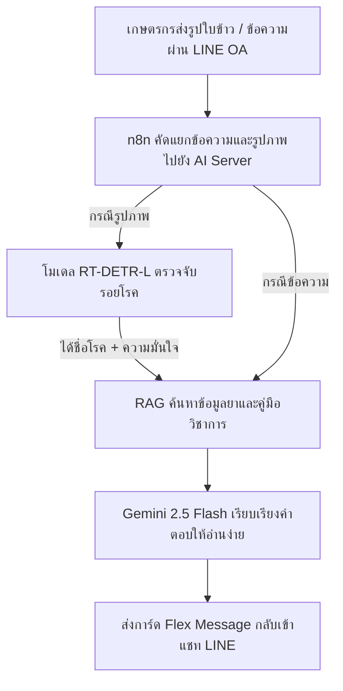

# สไลด์นำเสนอโครงงานวิทยานิพนธ์ (Thesis Defense Presentation Deck)

**หัวข้อโครงงาน (ภาษาไทย):** ระบบแชทบอทวินิจฉัยโรคข้าวและแนะนำวิธีการรักษาผ่านแอปพลิเคชันไลน์ด้วยเทคนิค RAG  
**หัวข้อโครงงาน (ภาษาอังกฤษ):** Rice Disease Diagnosis and Treatment Recommendation Chatbot on LINE Application using RAG Technique  
**ผู้นำเสนอ:** นายอัศวิน ทรงเล็กสิงห์  
**อาจารย์ที่ปรึกษา:** ผู้ช่วยศาสตราจารย์อัจฉรา นามบุรี  
**แหล่งที่มา:** ถอดรหัสโครงสร้างเนื้อหาและตัวเลขจากไฟล์สไลด์นำเสนอจริง (`Presentation_Chapter_04-05.pdf`) รวมทั้งหมด 21 สไลด์ พร้อมบทพูดนำเสนอ (Script) ภาษาไทยที่อ่านง่าย เข้าใจได้ทันที  

---

## 🖥️ สไลด์ที่ 1: หน้าปกการนำเสนอ (Title Slide)

* **ชื่อโครงงานภาษาไทย:** ระบบแชทบอทวินิจฉัยโรคข้าวและแนะนำวิธีการรักษาผ่านแอปพลิเคชันไลน์ด้วยเทคนิค RAG
* **ชื่อโครงงานภาษาอังกฤษ:** Rice Disease Diagnosis and Treatment Recommendation Chatbot on LINE Application using RAG Technique
* **ผู้นำเสนอ:** นายอัศวิน ทรงเล็กสิงห์
* **อาจารย์ที่ปรึกษา:** ผู้ช่วยศาสตราจารย์อัจฉรา นามบุรี
* **ช่องทางให้บริการ:** LINE Official Account "บอทวินิจฉัยโรคข้าว" (`@325wtzzd`)
* **🎙️ Script ผู้บรรยาย:**
  > *"กราบเรียนท่านประธาน ท่านอาจารย์ที่ปรึกษา และคณะกรรมการทุกท่านครับ ผม นายอัศวิน ทรงเล็กสิงห์ ขอเสนองานวิทยานิพนธ์เรื่อง 'ระบบแชทบอทวินิจฉัยโรคข้าวและแนะนำวิธีการรักษาผ่านแอปพลิเคชันไลน์ด้วยเทคนิค RAG' ซึ่งเป็นการพัฒนาระบบ AI แบบครบวงจร เพื่อช่วยเกษตรกรตรวจโรคข้าวและค้นหาวิธีรักษาที่ถูกต้องตามคู่มือของกรมการข้าวผ่าน LINE ได้สะดวกรวดเร็วครับ"*

---

## 🖥️ สไลด์ที่ 2: ขอบเขตของโครงงาน - ด้านผู้ใช้งาน (User Scope)

* **(1) เกษตรกร / ผู้ใช้งานทั่วไป:**
  - สามารถส่งรูปภาพใบข้าวที่มีความผิดปกติเข้าสู่ LINE
  - สามารถรับผลการวิเคราะห์ชื่อโรค สาเหตุ และวิธีการรักษาเบื้องต้น
  - สามารถสอบถามข้อมูลเพิ่มเติมเกี่ยวกับโรคข้าวผ่านการพิมพ์ข้อความ
* **(2) ผู้ดูแลระบบ (Admin):**
  - จัดการข้อมูลเอกสารความรู้ (Knowledge Base) ใน Vector Database
  - สามารถดูประวัติการใช้งาน (Log) ของระบบ
* **ช่องทางให้บริการ:** LINE Official Account "บอทวินิจฉัยโรคข้าว" (`@325wtzzd`)
* **🎙️ Script ผู้บรรยาย:**
  > *"ในส่วนขอบเขตด้านผู้ใช้งาน แบ่งออกเป็น 2 ฝั่งครับ ฝั่งเกษตรกรสามารถถ่ายรูปใบข้าวส่งตรวจผ่าน LINE, ได้รับการ์ดสรุปชื่อโรค สาเหตุ และวิธีรักษาเบื้องต้นทันที รวมถึงพิมพ์คุยสอบถามเพิ่มเติมได้ ส่วนฝั่งผู้ดูแลระบบ สามารถเข้ามาอัปเดตคู่มือวิชาการในฐานข้อมูล Vector และดูประวัติการใช้งานย้อนหลังผ่านระบบ Log ได้อย่างเป็นระบบครับ"*

---

## 🖥️ สไลด์ที่ 3: ขอบเขตด้านระบบและการทำงาน (System Function)

* **(1) การวิเคราะห์รูปภาพ (Image Analysis):**
  - ใช้โมเดล RT-DETR (Real-Time DEtection TRansformer) ในการตรวจจับ (Detection) และจำแนก (Classification) ลักษณะรอยโรคที่ปรากฏบนใบข้าว
* **(2) ระบบค้นหาข้อมูล (RAG System):**
  - ใช้เทคนิค Retrieval-Augmented Generation (RAG) เชื่อมต่อกับ Vector Database เพื่อค้นหาข้อมูลยาและการรักษาจากเอกสารคู่มือวิชาการที่เชื่อถือได้
* **(3) ระบบสนทนา (Conversational Agent):**
  - ใช้ Large Language Model (Gemini 2.5 Flash) ในการประมวลผลภาษาธรรมชาติและเรียบเรียงคำตอบให้เข้าใจง่ายสำหรับเกษตรกร
* **🎙️ Script ผู้บรรยาย:**
  > *"ด้านการทำงานของระบบมี 3 ส่วนหลักครับ ส่วนแรกคือการวิเคราะห์ภาพ เราใช้โมเดล RT-DETR เพื่อตรวจจับตำแหน่งและจำแนกชนิดของรอยโรคบนใบข้าว ส่วนที่สองคือระบบค้นหาความรู้ ใช้เทคนิค RAG ดึงข้อมูลวิธีรักษาจากคู่มือวิชาการ และส่วนที่สามคือระบบสนทนา ใช้ LLM ช่วยเรียบเรียงคำแนะนำให้อ่านเข้าใจง่ายสำหรับเกษตรกรครับ"*

---

## 🖥️ สไลด์ที่ 4: ขอบเขตด้านข้อมูล (Data Scope)

* **(1) ชุดข้อมูลรูปภาพใบโรคข้าว (Image Dataset):**
  - ใช้ข้อมูลจากแหล่งข้อมูลสาธารณะ Kaggle: Rice Leaf Diseases Dataset เพื่อใช้เป็นฐานความรู้ในการวิเคราะห์ลักษณะอาการของโรค
* **(2) ชุดข้อมูลเอกสารความรู้ (Knowledge Base):**
  - รวบรวมข้อมูลจากองค์ความรู้เรื่องข้าว กรมการข้าว กระทรวงเกษตรและสหกรณ์ เพื่อใช้เป็นฐานข้อมูลอ้างอิงในระบบ RAG
* **🎙️ Script ผู้บรรยาย:**
  > *"ขอบเขตด้านข้อมูลแบ่งเป็น 2 ส่วนครับ ฝั่งรูปภาพ เราใช้ชุดข้อมูล Rice Leaf Diseases Dataset จาก Kaggle ในการฝึกสอนโมเดลตรวจจับโรคข้าว ส่วนฝั่งฐานความรู้ เรานำข้อมูลมาจากเอกสารองค์ความรู้เรื่องข้าวของกรมการข้าว กระทรวงเกษตรและสหกรณ์ เพื่อใช้เป็นแหล่งอ้างอิงวิธีรักษาที่ถูกต้องและปลอดภัยครับ"*

---

## 🖥️ สไลด์ที่ 5: ขอบเขตด้านฮาร์ดแวร์และซอฟต์แวร์ (Technical Stack)

* **แอปพลิเคชัน:** LINE Application
* **ระบบ Workflow Automation:** n8n (Node-based Workflow Automation)
* **AI Model:** Gemini 2.5 Flash สำหรับการทำ RAG และตอบคำถาม
* **Database:** Pinecone (Vector Database) สำหรับจัดเก็บ Knowledge Base
* **ภาษาที่ใช้ในการพัฒนา:** Python
* **🎙️ Script ผู้บรรยาย:**
  > *"ด้านเครื่องมือและซอฟต์แวร์ที่ใช้พัฒนา เราเลือกใช้ LINE เป็นช่องทางหลักที่เกษตรกรคุ้นเคย, ใช้ n8n เป็นตัวจัดการขั้นตอนการทำงานอัตโนมัติ, ใช้ Gemini 2.5 Flash สรุปคำตอบ, ใช้ Pinecone จัดเก็บเวกเตอร์ความรู้ และพัฒนาโค้ดส่วนประมวลผลทั้งหมดด้วยภาษา Python ครับ"*

---

## 🖥️ สไลด์ที่ 6: ภาพรวมการทำงานของระบบ (System Workflow)

* **ขั้นตอนการทำงานของระบบ:**
  1. **เกษตรกรส่งข้อมูล:** ส่งรูปใบข้าวหรือพิมพ์ข้อความผ่าน LINE OA (`@325wtzzd`)
  2. **n8n คัดแยกข้อมูล:** ตรวจสอบว่าสิ่งที่ส่งเข้ามาเป็นรูปภาพหรือข้อความ
  3. **ตรวจจับโรคด้วย AI:** หากเป็นรูปภาพ จะส่งให้โมเดล RT-DETR-L ตรวจจับรอยโรค ได้ผลลัพธ์เป็นชื่อโรคและระดับความมั่นใจ
  4. **ค้นหาวิธีรักษา:** นำชื่อโรคส่งต่อไปยังระบบ RAG เพื่อดึงข้อมูลยาและการดูแลรักษาจากคู่มือวิชาการ
  5. **เรียบเรียงคำตอบ:** Gemini 2.5 Flash เรียบเรียงคำแนะนำให้อ่านเข้าใจง่าย
  6. **ตอบกลับผู้ใช้:** ส่งข้อมูลเป็นการ์ด Flex Message กลับเข้าแชท LINE ทันที

* **🎙️ Script ผู้บรรยาย:**
  > *"นี่คือภาพรวมขั้นตอนการทำงานของระบบครับ เมื่อเกษตรกรส่งรูปถ่ายหรือข้อความเข้ามา ระบบ n8n จะคัดแยกข้อมูล ถ้าเป็นภาพถ่ายจะส่งไปให้โมเดล RT-DETR ตรวจโรค เมื่อได้ชื่อโรคแล้ว ระบบจะนำชื่อโรคไปค้นหาข้อมูลยาจากคู่มือกรมการข้าวผ่าน RAG และให้ Gemini สรุปคำแนะนำเป็นภาษาที่เข้าใจง่าย ก่อนจะส่งกลับเป็นการ์ดสรุปผลเข้า LINE ของเกษตรกรทันทีครับ"*

---

## 🖥️ สไลด์ที่ 7: การทำงานจริงฝั่งผู้ใช้และผู้ดูแลระบบ (User & Admin Interfaces)

* **ฟังก์ชันฝั่งเกษตรกร / ผู้ใช้งานทั่วไป:**
  - **1. ส่งภาพถ่ายตรวจโรค:** ถ่ายภาพสดจากแปลงหรือเลือกจากคลังภาพส่งเข้า LINE *(ภาพที่ 4-1)*
  - **2. รับผลตรวจและคำแนะนำ:** ระบบส่งผลชื่อโรค ความมั่นใจ สาเหตุ และวิธีรักษา *(ภาพที่ 4-2)*
  - **3. พิมพ์สอบถามเพิ่มเติม:** พิมพ์ถามข้อมูลเรื่องยาหรืออาการเพิ่มเติมได้ตลอดเวลา *(ภาพที่ 4-3)*
* **ฟังก์ชันฝั่งผู้ดูแลระบบ (Admin):**
  - จัดการข้อมูลเอกสารความรู้ใน Vector Database *(ภาพที่ 4-4)*
  - ตรวจสอบประวัติและสถิติการใช้งานย้อนหลังผ่านระบบ Log *(ภาพที่ 4-5)*
* **🎙️ Script ผู้บรรยาย:**
  > *"ในส่วนหน้าจอการใช้งานจริง ฝั่งเกษตรกรมี 3 ฟังก์ชันหลักคือ ถ่ายรูปส่งตรวจ, รับผลการวินิจฉัยพร้อมคำแนะนำยาที่เป็นการ์ดอ่านง่าย และสามารถพิมพ์สอบถามข้อมูลเพิ่มเติมได้ตลอดเวลาครับ ส่วนฝั่งผู้ดูแลระบบ ก็สามารถเข้ามาอัปเดตคู่มือวิชาการใหม่ ๆ ในฐานข้อมูล และตรวจสอบประวัติการใช้งานย้อนหลังได้อย่างสะดวกครับ"*

---

## 🖥️ สไลด์ที่ 8: ชุดข้อมูลภาพถ่ายใบข้าวและฐานข้อมูลความรู้โรคข้าว (Dataset & Knowledge Base)

* **ตารางที่ 4-1 การกระจายตัวของชุดข้อมูลภาพถ่ายใบข้าวและการแบ่งสัดส่วนข้อมูล:**

| ชนิดของคลาส (Class Name) | จำนวนภาพรวม | สัดส่วน (%) | ชุดฝึกฝน (Train 70%) | ชุดตรวจสอบ (Val 20%) | ชุดทดสอบ (Test 10%) |
| :--- | :---: | :---: | :---: | :---: | :---: |
| 1. โรคขอบใบแห้ง | 636 | 16.61% | 445 | 127 | 64 |
| 2. โรคใบจุดสีน้ำตาล | 646 | 16.87% | 452 | 129 | 65 |
| 3. โรคใบไหม้ | 634 | 16.56% | 444 | 127 | 63 |
| 4. โรคใบขอบกาบแห้ง | 628 | 16.40% | 440 | 125 | 63 |
| 5. โรคกาบใบแห้ง | 632 | 16.51% | 442 | 126 | 64 |
| 6. ใบข้าวสมบูรณ์ | 653 | 17.05% | 457 | 131 | 65 |
| **รวมทั้งหมด (Total)** | **3,829** | **100.00%** | **2,680 ภาพ** | **765 ภาพ** | **384 ภาพ** |

* **คุณลักษณะของชุดข้อมูล:**
  - ภาพถ่ายใบข้าวจากแปลงจริงรวมทั้งหมด **3,829 ภาพ**
  - ครอบคลุม 5 โรคสำคัญ และ 1 คลาสใบสมบูรณ์ปกติ โดยมีสัดส่วนสมดุลกันทุกคลาส (16–17%)
* **ฐานความรู้อ้างอิง (Knowledge Base):**
  - รวบรวมข้อมูลโรคข้าวและการรักษาจาก **คู่มือมาตรฐานของกรมการข้าว กระทรวงเกษตรและสหกรณ์**
* **🎙️ Script ผู้บรรยาย:**
  > *"ชุดข้อมูลภาพถ่ายใบข้าวมีทั้งหมด 3,829 ภาพ ครอบคลุม 5 โรคสำคัญ และมีคลาสใบข้าวสมบูรณ์ด้วย ข้อมูลมีความสมดุลกันทุกคลาส อยู่ที่ประมาณ 16–17% เราแบ่งข้อมูลเป็น Train 70%, Validation 20% และ Test 10% ส่วนข้อมูลวิธีรักษา เราใช้คู่มือมาตรฐานของกรมการข้าวเป็นฐานข้อมูลอ้างอิงครับ"*

---

## 🖥️ สไลด์ที่ 9: ผลการทดลองเปรียบเทียบโมเดล RT-DETR-L ทั้ง 5 เวอร์ชัน (Model Evolution)

* **ตารางที่ 4-2 การเปรียบเทียบผลการทดลองของโมเดล RT-DETR-L ทั้ง 5 เวอร์ชัน (Test Set 354 ภาพ):**

| ตัวชี้วัด / เวอร์ชัน | v1 (Baseline) | v2 (Tuned HP) | v3 (Morphological) | v4 (High-Res 800px) | v5 (Data-Centric) |
| :--- | :---: | :---: | :---: | :---: | :---: |
| ขนาดภาพนำเข้า (Resolution) | 640 px | 640 px | 640 px | 800 px | **800 px** |
| วิธีที่ใช้ปรับปรุง | COCO Transfer | ปรับ Cosine LR, Warmup | ปิด Mosaic, ปรับ Scale | ขยายภาพเป็น 800px | **แก้ฉลากโรคขอบใบแห้ง** |
| **mAP@0.5 รวม (All Classes)** | 59.30% | 58.30% | 60.20% | 60.50% | **`70.6%` (0.7056)** |
| **mAP@0.5:0.95 รวม** | 30.80% | 29.50% | 29.60% | 29.40% | **`35.5%` (0.3554)** |
| **ความแม่นยำรวม (Precision)** | 56.50% | 58.50% | 57.70% | 58.10% | **`73.5%` (0.7351)** |
| **การตรวจจับครบถ้วน (Recall)** | 60.90% | 60.50% | 61.90% | 61.30% | **`70.2%` (0.7017)** |
| **F1-Score รวม (All Classes)** | 58.60% | 59.50% | 59.70% | 59.70% | **`71.8%` (0.7180)** |
| 1. โรคขอบใบแห้ง | 10.50% | 7.70% | 7.10% | 7.42% | **`69.50%`** |
| 2. โรคใบจุดสีน้ำตาล | 80.40% | 79.20% | 80.20% | 80.80% | **79.90%** |
| 3. โรคใบไหม้ | 77.60% | 81.80% | 86.90% | 82.60% | **77.60%** |
| 4. โรคใบขอบกาบแห้ง | 53.30% | 47.00% | 50.80% | 55.00% | **54.50%** |
| 5. โรคกาบใบแห้ง | 74.50% | 75.80% | 75.80% | 76.60% | **71.30%** |
| **เวลาประมวลผลต่อภาพ (GPU)** | 4.8 ms | 4.8 ms | 4.8 ms | 7.2 ms | **6.8 ms (~147 FPS)** |

* **🎙️ Script ผู้บรรยาย:**
  > *"ตารางนี้แสดงพัฒนาการของโมเดลทั้ง 5 เวอร์ชันครับ ในเวอร์ชัน 1 ถึง 4 เราลองปรับจูนค่าพารามิเตอร์ เช่น ปรับ Learning Rate หรือขยายภาพเป็น 800 พิกเซล คะแนนความแม่นยำจะตันอยู่ที่ประมาณ 60% และโรคขอบใบแห้งตรวจแทบไม่ติด แต่เมื่อเรานำข้อมูลที่แก้กรอบแผลแล้วมาเทรนในเวอร์ชัน 5 คะแนน mAP รวมเพิ่มขึ้นเป็น 70.6%, Precision อยู่ที่ 73.5%, Recall 70.2% และได้ค่า F1-Score รวม 71.8% โดยใช้เวลาตรวจจับเร็วมากเพียง 6.8 มิลลิวินาทีต่อภาพครับ"*

---

## 🖥️ สไลด์ที่ 10: การแก้ปัญหาฉลากข้อมูลด้วยแนวทาง Data-Centric (Annotation Refinement)

* **ปัญหาเดิม:**
  - โมเดลตรวจจับโรคขอบใบแห้งแทบไม่ติด ความแม่นยำต่ำมาก ($mAP@0.5$ เพียง $7.42\%$)
* **สาเหตุของปัญหา:**
  - การตีกรอบแผล (Bounding Box) ซอยย่อยและซ้อนทับกันเกินไปมากถึง **5,922 กล่อง** ทำให้โมเดลสับสนรูปทรงของแผลจริง
* **วิธีแก้ไข:**
  - ตีกรอบใหม่ให้คลุมตามแนวยาวของแผลจริง ลดกรอบที่ซ้ำซ้อนลงเหลือ **1,863 กล่อง (ลดความซ้ำซ้อนลง 68.5%)** *(ภาพที่ 4-6)*
* **ผลลัพธ์ที่ได้:**
  - ความแม่นยำ ($mAP@0.5$) เพิ่มขึ้นจาก **`7.42%` เป็น `69.50%` (เพิ่มขึ้น 62.1%)**
  - พิสูจน์ให้เห็นว่า **"ข้อมูลที่มีคุณภาพ"** ส่งผลต่อความแม่นยำมากกว่าการปรับจูนตัวโมเดลเพียงอย่างเดียว
* **🎙️ Script ผู้บรรยาย:**
  > *"จุดนี้เป็นข้อค้นพบสำคัญมากครับ ตอนแรกโมเดลของเราตรวจโรคขอบใบแห้งแทบไม่ติด ได้คะแนนแค่ 7.4% พอเข้าไปดูภาพจริงถึงพบว่า คนติดฉลากเดิมตีกรอบแผลยาวแผลเดียวแตกเป็นกล่องเล็ก ๆ ซ้อนกันเกือบ 6,000 กล่อง เราจึงแก้ปัญหาด้วยแนวทาง Data-Centric AI คือรวมกรอบย่อยให้เป็นกรอบยาวตามแนวแผลจริง เหลือ 1,863 กล่อง ผลปรากฏว่าความแม่นยำของโรคนี้เพิ่มขึ้นเป็น 69.5% ทันที แสดงให้เห็นชัดเจนว่าคุณภาพของข้อมูลส่งผลต่อความแม่นยำมากครับ"*

---

## 🖥️ สไลด์ที่ 11: กราฟผลการฝึกฝนและค่าความสูญเสียของโมเดล v5 (Training Curves)

* **รายละเอียดการฝึกสอนโมเดล v5:**
  - ฝึกสอนบนเครื่อง **NVIDIA RTX 4090** รวมทั้งหมด **60 Epochs**
* **ข้อสังเกตจากกราฟผลการฝึกฝน (ภาพที่ 4-7):**
  - **ค่าความสูญเสีย (Loss Curves):** ทั้งด้านการจำแนกประเภท (`cls_loss`) และตำแหน่งกรอบ (`giou_loss`, `l1_loss`) ลดลงอย่างต่อเนื่องทั้งในชุดฝึกและชุดตรวจสอบ แสดงว่าโมเดลเรียนรู้ได้ดีและไม่เกิดปัญหา Overfitting
  - **ค่าความแม่นยำ (Metrics Curves):** ค่า $mAP@0.5$ และ $mAP@0.5:0.95$ ไต่ระดับสูงขึ้นอย่างต่อเนื่อง และเริ่มเข้าสู่จุดคงที่หลังจาก Epoch ที่ 35 เป็นต้นไป
* **ความพร้อมของโมเดล:** โมเดลมีความเสถียร เรียนรู้ได้คงที่ พร้อมนำไปใช้งานจริง
* **🎙️ Script ผู้บรรยาย:**
  > *"จากกราฟผลการฝึกฝน 60 Epochs ของโมเดลเวอร์ชัน 5 จะเห็นว่าค่า Loss ทุกตัวลดลงอย่างต่อเนื่องทั้งในชุดฝึกและชุดตรวจสอบครับ ส่วนค่าความแม่นยำ mAP เพิ่มขึ้นอย่างรวดเร็วและเริ่มนิ่งคงที่ตั้งแต่ Epoch ที่ 35 เป็นต้นไป แสดงว่าโมเดลเรียนรู้ได้อย่างมีประสิทธิภาพและไม่มีปัญหา Overfitting ครับ"*

---

## 🖥️ สไลด์ที่ 12: ผลการประเมินแยกตามรายโรคของโมเดล v5 (Detailed Evaluation)

* **ตารางที่ 4-3 ผลการประเมินประสิทธิภาพรายโรคบน Test Set (295 ภาพแสดงโรค / 576 รอยโรค):**

| ชนิดโรคข้าว (Disease Class) | จำนวนภาพทดสอบ | จำนวนรอยโรค (BBox) | Precision (P) | Recall (R) | F1-Score | mAP@0.5 | mAP@0.5:0.95 |
| :--- | :---: | :---: | :---: | :---: | :---: | :---: | :---: |
| 1. โรคขอบใบแห้ง | 64 | 81 | 78.70% | 75.30% | 77.00% | 69.50% | 41.90% |
| 2. โรคใบจุดสีน้ำตาล | 61 | 215 | 78.40% | 73.00% | 75.60% | 79.90% | 38.40% |
| 3. โรคใบไหม้ | 57 | 81 | 84.20% | 72.10% | 77.70% | 77.60% | 35.60% |
| 4. โรคใบขอบกาบแห้ง | 53 | 69 | 55.60% | 56.50% | 56.00% | 54.50% | 18.70% |
| 5. โรคกาบใบแห้ง | 60 | 130 | 70.70% | 73.80% | 72.20% | 71.30% | 43.10% |
| **ค่าเฉลี่ยรวมทุกคลาส (Overall)** | **295** | **576** | **73.50%** | **70.20%** | **71.80%** | **70.60%** | **35.50%** |

* **🎙️ Script ผู้บรรยาย:**
  > *"เมื่อดูผลแยกตามรายโรคบนชุดทดสอบ จะเห็นว่าโรคใบจุดสีน้ำตาลทำคะแนนได้สูงสุดถึง 79.90% ตามด้วยโรคใบไหม้ 77.60% และโรคกาบใบแห้ง 71.30% ส่วนโรคขอบใบแห้งอยู่ที่ 69.50% และโรคใบขอบกาบแห้งอยู่ที่ 54.50% โดยภาพรวมเฉลี่ยทุกโรคได้ค่า mAP@0.5 อยู่ที่ 70.60%, Precision 73.50%, Recall 70.20% และมีค่า F1-Score รวม 71.80% ครับ"*

---

## 🖥️ สไลด์ที่ 13: การทดลองเปรียบเทียบการตัดพื้นหลัง (Ablation Study)

* **สมมติฐานของการทดลอง:**
  - *"หากตัดฉากหลังแปลงนา (ดิน น้ำ วัชพืช) ออกก่อนตรวจจับ จะช่วยเพิ่มความแม่นยำได้หรือไม่?"*
* **ปัญหาจากการใช้โมเดลตัดภาพทั่วไป:**
  - เกิดปัญหาภาพจอดำสูงถึง **155 จาก 354 ภาพ (43.8%)** คือ AI ลบเนื้อใบข้าวทิ้งจนหมด
  - **สาเหตุที่ 1:** สีเขียวของใบข้าวกลืนไปกับต้นข้าวรอบข้างและวัชพืชในแปลง
  - **สาเหตุที่ 2:** ภาพถ่ายระยะใกล้ ใบข้าวพาดผ่านขอบภาพ โมเดลเข้าใจผิดว่าเป็นพื้นหลัง
* **การแก้ปัญหาด้วย MobileSAM ร่วมกับระบบป้องกันข้อผิดพลาดอัตโนมัติ (Safety Guardrail):**
  - **1.** นำพิกัดกรอบรอยโรคมาชี้เป้าให้ SAM รู้ว่าต้องตัดใบข้าวบริเวณไหน
  - **2.** หากตัดแล้วเหลือเนื้อใบข้าวน้อยกว่า 2% ระบบจะสลับกลับไปใช้ภาพต้นฉบับทันที
* **ผลลัพธ์:** ตัดพื้นหลังสำเร็จ 266 ภาพ (75.14%) และสลับกลับไปใช้ภาพเดิมอย่างปลอดภัย 88 ภาพ (24.86%) แก้ปัญหาภาพจอดำได้ทั้งหมด
* **🎙️ Script ผู้บรรยาย:**
  > *"เราได้ทำการทดลองเปรียบเทียบว่า การตัดฉากหลังแปลงนาออกจะช่วยให้ AI ตรวจแม่นขึ้นไหม ในตอนแรกเราลองใช้โมเดลตัดภาพทั่วไป ปรากฏว่าเจอปัญหาภาพกลายเป็นจอดำมืดไปถึง 155 ภาพ เพราะสีเขียวของใบข้าวกลืนไปกับแปลงนาข้างหลัง เราจึงแก้ปัญหาโดยนำ MobileSAM มาใส่กรอบช่วยชี้เป้า และตั้งระบบความปลอดภัย 2% ถ้าตัดแล้วใบเหลือน้อยเกินไปให้ดึงภาพเดิมกลับมาใช้ ผลคือตัดสำเร็จ 266 ภาพ และสลับกลับภาพเดิม 88 ภาพ แก้ปัญหาจอดำได้ 100% ครับ"*

---

## 🖥️ สไลด์ที่ 14: ผลเปรียบเทียบการตัดพื้นหลัง: ความแตกต่างตามลักษณะรอยโรค

* **ตารางที่ 4-4 เปรียบเทียบผลการทดสอบโมเดลภาพจริง vs โมเดลตัดพื้นหลัง (เทรน 93 Epochs):**

| ชนิดโรคข้าว (Disease Class) | โมเดล v5 (ภาพจริง) | Segmented Model (ตัดพื้นหลัง) | ผลต่าง (Difference) |
| :--- | :---: | :---: | :---: |
| 1. โรคขอบใบแห้ง | 69.50% | **75.32%** | **+5.82%** |
| 2. โรคใบจุดสีน้ำตาล | **79.90%** | 64.71% | **-15.19%** |
| 3. โรคใบไหม้ | 77.60% | **78.59%** | **+0.99%** |
| 4. โรคใบขอบกาบแห้ง | 54.50% | **65.67%** | **+11.17%** |
| 5. โรคกาบใบแห้ง | 71.30% | **75.73%** | **+4.43%** |
| **ภาพรวม (mAP@0.5)** | **70.56%** | **72.00%** | **+1.44%** |
| **ความกระชับ (mAP@0.5:0.95)** | **35.54%** | 34.99% | **-0.55%** |

* **ข้อค้นพบสำคัญ:** การตัดพื้นหลังช่วยให้แผลขนาดใหญ่ตรวจจับได้ดีขึ้น แต่กลับทำให้ **โรคใบจุดสีน้ำตาลความแม่นยำลดลงถึง -15.19%** เพราะจุดแผลเล็กต้องอาศัยสีเขียวของใบข้าวรอบแผลเป็นบริบทอ้างอิง พอฉากหลังกลายเป็นสีดำ โมเดลจึงแยกแผลได้ยากขึ้น
* **🎙️ Script ผู้บรรยาย:**
  > *"ผลการทดลองนี้ให้ข้อคิดที่น่าสนใจมากครับ คือการตัดพื้นหลังไม่ได้ดีกับทุกโรค สำหรับโรคที่แผลใหญ่ เช่น ขอบใบแห้ง หรือใบขอบกาบแห้ง คะแนนเพิ่มขึ้นจริง แต่กับโรคที่แผลเป็นจุดเล็ก ๆ อย่าง 'ใบจุดสีน้ำตาล' คะแนนกลับลดลงไปถึง 15% เพราะแผลเล็กต้องการเนื้อใบสีเขียวรอบข้างช่วยอ้างอิง พอฉากหลังกลายเป็นสีดำ โมเดลจึงแยกแผลได้ยากขึ้นครับ"*

---

## 🖥️ สไลด์ที่ 15: เปรียบเทียบระหว่าง 2 ทางเลือกในการนำไปใช้จริง

* **ตารางเปรียบเทียบระหว่าง 2 แนวทาง:**

| ประเด็นเปรียบเทียบ | แบบตัดพื้นหลัง (Segmented Pipeline) | แบบตรวจจับภาพจริงโดยตรง (Direct Detection v5) |
| :--- | :--- | :--- |
| **เวลาประมวลผล (Latency)** | **ช้ามาก (100–170 มิลลิวินาที)** เพราะต้องรัน 2 โมเดล | **เร็วมาก (6.8 มิลลิวินาที หรือ ~147 FPS)** |
| **อัตราความเร็ว (Speed Ratio)** | ช้ากว่าประมาณ **15–25 เท่า** | **เร็วกว่า 15–25 เท่า** ทำงานแบบ Real-Time ได้สบาย |
| **การใช้หน่วยความจำ** | กินหน่วยความจำเครื่องมากกว่า | ประหยัดทรัพยากร เหมาะกับเซิร์ฟเวอร์ |
| **ความแม่นยำใบจุดสีน้ำตาล** | ตกลงเหลือ 64.71% เสี่ยงวินิจฉัยผิด | **แม่นยำสูงถึง 79.90%** ปลอดภัยกว่า |
| **ความซับซ้อนของระบบ** | สูง ต้องดูแล 2 โมเดลต่อกัน | ไม่ซับซ้อน ดูแลรักษาง่าย ไม่สะดุด |

* **ข้อสรุป:** ผู้จัดทำเลือกใช้ **โมเดลตรวจจับภาพจริงโดยตรง (Direct Detection v5)** ในระบบจริง เพราะเร็วกว่า ใช้แรมน้อยกว่า และแม่นยำสม่ำเสมอในทุกโรค
* **🎙️ Script ผู้บรรยาย:**
  > *"จากผลการทดลอง ทำให้เราเลือกใช้โมเดลตรวจจับภาพจริงโดยตรงในระบบจริงครับ แม้แบบตัดพื้นหลังจะได้คะแนนรวมเพิ่มขึ้นเล็กน้อย 1.4% แต่ทำให้ระบบช้าลงถึง 15–25 เท่า และทำให้ความแม่นยำของโรคใบจุดสีน้ำตาลลดลงไปมาก เราจึงเลือกใช้โมเดลเวอร์ชัน 5 ตรวจจับภาพจริงโดยตรง เพราะเร็วกว่า ประหยัดทรัพยากร และแม่นยำสม่ำเสมอในทุกโรคครับ"*

---

## 🖥️ สไลด์ที่ 16: การเตรียมฐานข้อมูลความรู้โรคข้าว (Hybrid RAG)

* **การทดลองการแบ่งข้อความ (Chunking Strategy):**
  - ทดสอบเปรียบเทียบขนาด Chunk Size หลายขนาด: 500, 1,000 และ 1,500 ตัวอักษร
  - **ขนาดที่เหมาะสมที่สุด (Version 6): Chunk Size = 1,000 ตัวอักษร และ Overlap = 200 ตัวอักษร**
  - ช่วยให้ได้ค่า Context Recall สูงสุด และคงความสมบูรณ์ของเนื้อหาคู่มือวิชาการได้ดีที่สุด
* **เทคนิคเพิ่มความแม่นยำ:**
  - **ใส่ชื่อโรคกำกับไว้ที่หัวข้อความทุกท่อน** เพื่อช่วยล็อกบริบทเนื้อหา
  - **ระบบกรองข้อมูล (Metadata Filtering):** ค้นหาเฉพาะเอกสารของโรคที่ตรวจพบจากรูปภาพ เพื่อตัดข้อมูลโรคอื่นที่ไม่เกี่ยวข้องออก
* **🎙️ Script ผู้บรรยาย:**
  > *"ในระบบค้นหาความรู้ เรานำคู่มือวิชาการของกรมการข้าวมาจัดเตรียม โดยทดลองแบ่งเนื้อหาหลายขนาด และพบว่าขนาด 1,000 ตัวอักษร ซ้อนทับกัน 200 ตัวอักษร ดึงเนื้อหาได้ครบถ้วนที่สุด พร้อมใส่ชื่อโรคกำกับไว้ทุกท่อน และล็อกเป้าค้นหาเฉพาะโรคที่ตรวจพบ เพื่อป้องกันไม่ให้มีข้อมูลโรคอื่นปนเข้ามาครับ"*

---

## 🖥️ สไลด์ที่ 17: ผลการประเมินระบบ RAG (RAG Evaluation)

* **ตารางที่ 4-5 การเปรียบเทียบผลการประเมินระบบ RAG ทั้ง 6 เวอร์ชันด้วย RAGAS Framework:**

| ตัวชี้วัด RAGAS | V1 (Baseline) | V2 (Top-k) | V3 (Chunk 1000) | V4 (Hybrid เดิม) | V5 (Chunk 500) | V6 (Hybrid RAG) | การเปลี่ยนแปลง |
| :--- | :---: | :---: | :---: | :---: | :---: | :---: | :--- |
| **Context Recall** | 12.30% | 15.40% | 18.20% | 19.90% | 14.10% | **`28.59%`** | **+8.69 pp (ค้นหาได้ครอบคลุมขึ้น)** |
| **Context Precision** | 42.10% | 45.00% | 48.70% | 49.20% | 46.50% | **`51.05%`** | **+1.85 pp (จัดลำดับได้ตรงจุดขึ้น)** |
| **Faithfulness (ความถูกต้องอิงเนื้อหาจริง)** | 71.00% | 73.20% | 75.00% | 78.50% | 72.00% | **`76.50%`** | **-2.00 pp (สอดคล้องตามเอกสารอ้างอิง)** |
| **Answer Relevancy** | 52.40% | 54.10% | 55.00% | 59.12% | 53.00% | **`56.85%`** | **-2.27 pp (ตอบตรงประเด็นคำถาม)** |

* **บทวิเคราะห์:** ในเวอร์ชัน 6 (Hybrid RAG) ค่าความครอบคลุม (Context Recall) เพิ่มขึ้นเป็น 28.59% และที่สำคัญคือค่าความถูกต้องตามเอกสาร (Faithfulness) สูงถึง 76.50% มั่นใจได้ว่าข้อมูลสารเคมีและวิธีรักษาถูกต้องตามคู่มือของกรมการข้าว
* **🎙️ Script ผู้บรรยาย:**
  > *"เราประเมินระบบ RAG ด้วยมาตรฐาน RAGAS บนชุดคำถาม 70 ข้อ ในเวอร์ชัน 6 ความสามารถในการค้นหาข้อมูลครอบคลุมขึ้นเป็น 28.59% และความตรงจุดเพิ่มเป็น 51.05% ที่สำคัญคือค่าความถูกต้องตามเอกสาร (Faithfulness) สูงถึง 76.50% ช่วยป้องกันปัญหา AI ตอบผิดพลาด และมั่นใจได้ว่าคำแนะนำเรื่องยาจะตรงตามคู่มือของกรมการข้าวครับ"*

---

## 🖥️ สไลด์ที่ 18: ผลการทดสอบฟังก์ชันการทำงานระบบแชทบอท (Test Cases)

* **ตารางที่ 4-6 ผลการทดสอบฟังก์ชันการทำงานของระบบแชทบอท (8 กรณีทดสอบ):**

| รหัสทดสอบ | กรณีการทดสอบ (Test Scenario) | ข้อมูลนำเข้า (Input) | ผลลัพธ์ที่คาดหวัง | ผลการทดสอบจริง |
| :---: | :--- | :--- | :--- | :--- |
| **TC-01** | ตรวจจับโรคจากภาพชัดเจน | ภาพโรคขอบใบแห้งความละเอียดสูง | ตรวจพบกรอบ BBox และระบุโรคถูกต้อง | แสดงกรอบพร้อมชื่อ BLB (Conf 85.4%) |
| **TC-02** | ตรวจจับโรคแผลขนาดเล็ก | ภาพโรคใบจุดสีน้ำตาล (แผลจุดเล็ก) | ตรวจจับจุดสีน้ำตาลได้ครบถ้วน | ตรวจจับจุดแผลได้แม่นยำ (Conf 81.2%) |
| **TC-03** | ภาพใบข้าวสมบูรณ์ปกติ | ภาพใบข้าวเขียวสดไม่มีรอยโรค | ไม่ตีกรอบผิดพลาด และระบุว่าใบสมบูรณ์ | แจ้งว่าใบข้าวสมบูรณ์ดี ไม่พบรอยโรค |
| **TC-04** | ภาพถ่ายไม่ชัดเจน / ภาพเบลอ | ภาพถ่ายหลุดโฟกัสและมืดมัว | แจ้งเตือนให้เกษตรกรถ่ายภาพใหม่ | แจ้งว่าภาพไม่ชัด พร้อมแนะนำวิธีถ่ายภาพ |
| **TC-05** | สอบถามวิธีรักษาและสารเคมี | "โรคไหม้รักษายังไง สารเคมีอะไร" | ดึงสารไตรไซคลาโซลและอัตราการใช้ | ดึงข้อมูลสารและอัตราผสมถูกต้องครบถ้วน |
| **TC-06** | สอบถามอาการโดยไม่บอกชื่อโรค | "ใบมีแผลรูปกระสวย ตรงกลางสีเทา" | วิเคราะห์อาการว่าเป็นโรคใบไหม้ | ระบุโรคใบไหม้พร้อมวิธีดูแลเบื้องต้นถูกต้อง |
| **TC-07** | คำถามนอกขอบเขตโรคข้าว | "วิธีปลูกทุเรียนหมอนทอง" | ปฏิเสธอย่างสุภาพตาม Guardrail | ตอบปฏิเสธอย่างสุภาพว่าเชี่ยวชาญเฉพาะเรื่องข้าว |
| **TC-08** | การทักทายและการสนทนาทั่วไป | "สวัสดีครับ", "ขอบคุณมากครับ" | ตอบกลับทักทายและแนะนำการใช้งาน | ส่งข้อความต้อนรับและเมนูการใช้งาน |

* **สรุปผล:** ระบบผ่านการทดสอบฟังก์ชันครบถ้วน **100% (8/8 Test Cases)**
* **🎙️ Script ผู้บรรยาย:**
  > *"เราได้ทดสอบระบบตามกรณีทดสอบจริง 8 กรณี ผลคือผ่านครบ 100% ครับ ระบบสามารถตรวจจับได้ทั้งภาพแผลใหญ่ แผลเล็ก และภาพใบปกติที่ไม่ตีกรอบมั่ว ถ้าภาพเบลอก็จะเตือนให้ถ่ายใหม่ นอกจากนี้ยังตอบคำถามจากการบอกอาการได้ และถ้าถามคำถามนอกเรื่อง เช่น ถามเรื่องทุเรียน ระบบก็ปฏิเสธอย่างสุภาพ พร้อมแนะนำให้ถามเรื่องข้าวครับ"*

---

## 🖥️ สไลด์ที่ 19: ผลการวัดความเร็วในการทำงานของระบบ (End-to-End Latency)

* **ตารางที่ 4-7 การแจกแจงเวลาการตอบสนองของระบบ:**

| ลำดับขั้นตอนการทำงาน (Sub-process) | ส่วนประมวลผล / แพลตฟอร์ม | เวลาเฉลี่ย (Mean Latency) | สัดส่วนของเวลา (%) |
| :---: | :--- | :---: | :---: |
| **1. LINE Webhook Inbound Transmission** | LINE Messaging API Network | $120.5 \pm 15.2$ ms | 7.17% |
| **2. n8n Routing & Payload Parsing** | Docker Container (Node.js) | $45.0 \pm 8.4$ ms | 2.68% |
| **3. RT-DETR-L v5 Vision Inference (GPU)** | NVIDIA RTX 4090 Workstation | **`6.8 ± 0.4 ms`** | **0.40%** |
| **4. Hybrid Vector Search (Pinecone + BM25)** | Pinecone Cloud + PyThaiNLP | $45.2 \pm 6.1$ ms | 2.69% |
| **5. LLM Answer Synthesis** | Google Gemini 2.5 Flash API | $1,120.0 \pm 180.5$ ms | 66.67% |
| **6. Flex Message Assembly & LINE Dispatch** | n8n + LINE Outbound API | $342.5 \pm 42.1$ ms | 20.39% |
| **เวลารวมทั้งหมดของระบบ (End-to-End)** | **Full Pipeline Execution** | **`1.68 ± 0.25 วินาที`** | **100.00%** |

* **ข้อสรุป:** เวลารวมเฉลี่ยทั้งระบบอยู่ที่ **1.68 วินาที** รวดเร็วมาก เหมาะสำหรับการใช้งานผ่านแอป LINE บนโทรศัพท์มือถือ
* **🎙️ Script ผู้บรรยาย:**
  > *"ในเรื่องความเร็ว จากการทดสอบใช้งานจริง ระบบใช้เวลารวมตั้งแต่เกษตรกรกดส่งรูปจนได้รับคำตอบเฉลี่ยเพียง 1.68 วินาทีครับ โดยตัว AI ตรวจโรค RT-DETR ของเราใช้เวลาวิเคราะห์ภาพแค่ 6.8 มิลลิวินาที ถือว่าตอบสนองได้รวดเร็วมาก เหมาะกับการใช้งานผ่าน LINE บนมือถือครับ"*

---

## 🖥️ สไลด์ที่ 20: สรุปผลการดำเนินงาน (Summary)

* **สรุปผลตามกลุ่มผู้ใช้งาน:**
  - **1. ฝั่งเกษตรกร / ผู้ใช้งานทั่วไป:**
    - ใช้งานผ่าน Rich Menu 3 เมนู (ถ่ายภาพ, ส่งภาพ, วิธีใช้งาน)
    - ได้รับผลตรวจวินิจฉัยพร้อมการ์ด Flex Message สรุปชื่อโรค, สาเหตุ, อาการ, สารเคมี/ชีวภัณฑ์ และวิธีจัดการแปลง
    - พิมพ์สอบถามเพิ่มเติมได้ตลอดเวลา และเตือนให้ถ่ายใหม่เมื่อภาพไม่ชัด
  - **2. ฝั่งผู้ดูแลระบบ (Admin):**
    - ตรวจสอบประวัติการส่งภาพและสถิติผ่านระบบ Log
    - จัดการและอัปเดตเอกสารข้อมูลโรคข้าวใน Pinecone ให้เป็นปัจจุบัน
    - ตรวจสอบสถานะการทำงานของเซิร์ฟเวอร์
* **สรุปประสิทธิภาพหลัก:**
  - **RT-DETR-L v5:** ทำคะแนนค่าเฉลี่ยความแม่นยำ ($mAP@0.5$) ได้ **`70.6%`** (และ F1-Score รวม 71.8%) ประมวลผลเร็ว 6.8 ms
  - **Hybrid RAG v6:** มีค่าความถูกต้องตามเอกสาร (Faithfulness) **`76.50%`**
  - **เวลาตอบสนองรวมทั้งระบบเฉลี่ย:** **`1.68 วินาที`**
* **🎙️ Script ผู้บรรยาย:**
  > *"สรุปผลการดำเนินงาน โครงงานของเราพัฒนาได้สำเร็จครบถ้วนตามวัตถุประสงค์ครับ ฝั่งเกษตรกรสามารถตรวจโรคและรับคำแนะนำยาตามมาตรฐานกรมการข้าวผ่าน LINE ได้อย่างสะดวก ฝั่งผู้ดูแลระบบสามารถอัปเดตข้อมูลและดู Log ได้อย่างเป็นระบบ โดยโมเดลตรวจจับโรคมีความแม่นยำ 70.6%, F1-Score 71.8% ระบบ RAG มีความถูกต้องตามคู่มือ 76.5% และตอบสนองได้เร็วภายใน 1.68 วินาทีครับ"*

---

## 🖥️ สไลด์ที่ 21: สรุปประโยชน์และตอบข้อซักถาม (Thank You & Q&A)

* **Thank You**
* **สรุปประโยชน์ที่ได้รับจากโครงงาน:**
  - **ช่วยเกษตรกร:** วินิจฉัยโรคข้าวได้รวดเร็วและถูกต้องผ่าน LINE ที่คุ้นเคย ช่วยป้องกันผลผลิตเสียหาย
  - **ลดต้นทุนและปลอดภัย:** แนะนำสารเคมีและอัตราส่วนผสมที่ถูกต้องตามมาตรฐานกรมการข้าว ป้องกันการใช้ยาผิดประเภท
  - **ความพร้อมใช้งานจริง:** โค้ดทั้งหมดทดสอบผ่าน 100%, โมเดลตรวจจับเร็ว 6.8 ms, ฐานข้อมูลความรู้พร้อมให้บริการ
* **ขอขอบพระคุณท่านประธาน อาจารย์ที่ปรึกษา และคณะกรรมการทุกท่านเป็นอย่างสูง**
* **ขอเชิญคณะกรรมการให้ข้อเสนอแนะและซักถามได้เลยครับ (Q&A Session)**
* **🎙️ Script ผู้บรรยาย:**
  > *"สุดท้ายนี้ โครงงานระบบแชทบอทวินิจฉัยโรคข้าวผ่าน LINE เป็นระบบที่พัฒนาขึ้นแบบครบวงจรและพร้อมนำไปช่วยเหลือเกษตรกรได้จริงครับ ช่วยให้เกษตรกรรู้โรคได้ทันท่วงที และใช้ยาได้อย่างถูกต้องปลอดภัยตามคู่มือของกรมการข้าว ผมขอขอบพระคุณท่านประธาน อาจารย์ที่ปรึกษา และคณะกรรมการทุกท่านเป็นอย่างสูง และพร้อมรับฟังข้อเสนอแนะและตอบข้อซักถามครับ ขอบพระคุณครับ"*
