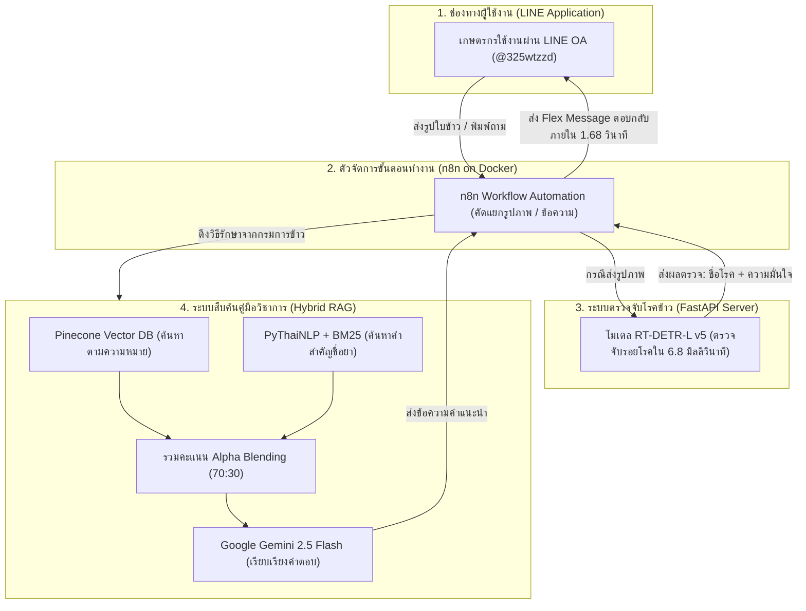

# โครงสร้างสไลด์นำเสนอวิทยานิพนธ์ (Thesis Defense Presentation Deck)

**หัวข้อวิทยานิพนธ์ (ภาษาไทย):** ระบบเชี่ยวชาญเพื่อการวินิจฉัยโรคพืชในข้าวและให้คำแนะนำด้วยปัญญาประดิษฐ์ผ่านแอปพลิเคชันไลน์  
**หัวข้อวิทยานิพนธ์ (ภาษาอังกฤษ):** Expert System for Rice Leaf Disease Diagnosis and Treatment Consultation via LINE Chatbot using Real-Time Detection Transformer and Hybrid Retrieval-Augmented Generation  
**ผู้นำเสนอ:** นายอัศวิน (atsawin)  
**สังกัด:** ภาควิชาวิทยาการคอมพิวเตอร์ คณะวิทยาศาสตร์ มหาวิทยาลัยเกษตรศาสตร์  
**การนำไปใช้งาน:** สไลด์ชุดนี้จัดทำขึ้นโดยอ้างอิงข้อมูลจากเอกสารวิทยานิพนธ์ฉบับสมบูรณ์ (บทที่ 4 และบทที่ 5) มีทั้งหมด 24 สไลด์ พร้อมตารางสรุปผล รูปภาพอ้างอิง และบทพูดนำเสนอภาษาไทย (Script) สามารถคัดลอกไปทำสไลด์ใน PowerPoint, Canva หรือ Google Slides ได้ทันที

---

## 🖥️ สไลด์ที่ 1: หน้าปกปริญญานิพนธ์ (Title & Metadata)

* **ชื่อโครงงานวิทยานิพนธ์:** ระบบเชี่ยวชาญเพื่อการวินิจฉัยโรคพืชในข้าวและให้คำแนะนำด้วยปัญญาประดิษฐ์ผ่านแอปพลิเคชันไลน์
* **ชื่อภาษาอังกฤษ:** Expert System for Rice Leaf Disease Diagnosis and Treatment Consultation via LINE Chatbot
* **เทคโนโลยีหลัก:** RT-DETR-L (ตรวจจับโรค) + Hybrid RAG (สืบค้นคู่มือกรมการข้าว) + n8n + LINE Messaging API + Pinecone Vector DB
* **ข้อมูลผู้จัดทำและคณะกรรมการ:**
  - **ผู้จัดทำ:** นายอัศวิน (atsawin)
  - **ภาควิชา/คณะ:** ภาควิชาวิทยาการคอมพิวเตอร์ คณะวิทยาศาสตร์ มหาวิทยาลัยเกษตรศาสตร์
* **ช่องทางให้บริการ:** LINE Official Account "บอทวินิจฉัยโรคข้าว" (`@325wtzzd`)
* **🎙️ Script ผู้บรรยาย:**
  > *"กราบเรียนท่านประธาน ท่านอาจารย์ที่ปรึกษา และคณะกรรมการทุกท่านครับ ผม นายอัศวิน นิสิตภาควิชาวิทยาการคอมพิวเตอร์ ขอเสนอโครงงานวิทยานิพนธ์เรื่อง 'ระบบเชี่ยวชาญเพื่อการวินิจฉัยโรคพืชในข้าวและให้คำแนะนำด้วยปัญญาประดิษฐ์ผ่านแอปพลิเคชันไลน์' ซึ่งเป็นการพัฒนาระบบ AI แบบครบวงจร ตั้งแต่การตรวจจับรอยโรคบนใบข้าวด้วยโมเดล RT-DETR, การสืบค้นวิธีรักษาจากคู่มือของกรมการข้าวด้วย Hybrid RAG ไปจนถึงการเชื่อมต่อให้เกษตรกรใช้งานได้ง่าย ๆ ผ่านแอป LINE ครับ"*

---

## 🖥️ สไลด์ที่ 2: ที่มา ความสำคัญ และปัญหา (Problem Statement)

* **ความสำคัญเชิงเศรษฐกิจ:**
  - ข้าวเป็นพืชเศรษฐกิจหลักของประเทศไทย มีพื้นที่ปลูกกว่า 60 ล้านไร่ เกษตรกรกว่า 4.6 ล้านครัวเรือน
* **ปัญหาสำคัญของการทำนา (Pain Points):**
  - **โรคระบาดในนาข้าว:** โรคข้าวสำคัญ 5 ชนิด ได้แก่ ขอบใบแห้ง, ใบจุดสีน้ำตาล, ใบไหม้, ใบขอบกาบแห้ง และกาบใบแห้ง สร้างความเสียหายต่อผลผลิตอย่างมากในแต่ละปี
  - **ขาดแคลนผู้เชี่ยวชาญ:** เจ้าหน้าที่เกษตรมีจำกัด ไม่สามารถลงพื้นที่ตรวจได้ทั่วถึง เกษตรกรส่วนใหญ่ต้องดูอาการและเดาโรคเอง
  - **ลักษณะแผลคล้ายกัน:** หลายโรคมีอาการใกล้เคียงกัน เช่น แผลสีน้ำตาลไหม้ ทำให้เกษตรกรเข้าใจผิด ซื้อสารเคมีผิดชนิดมารักษา
  - **การใช้สารเคมีไม่ถูกต้อง:** ฉีดพ่นยาไม่ตรงโรค หรือใช้อัตราส่วนไม่ถูกต้อง ทำให้เชื้อดื้อยา สิ้นเปลืองต้นทุน และมีสารเคมีตกค้าง
* **ปัญหาของ AI ทั่วไป (Hallucination):**
  - โมเดลภาษาทั่วไปหากไม่มีการคุมข้อมูล มักจะตอบข้อมูลที่ไม่ถูกต้อง คาดเดาชื่อสารเคมีหรืออัตราผสมเอง ซึ่งเป็นอันตรายต่อผลผลิต
* **🎙️ Script ผู้บรรยาย:**
  > *"ปัญหาสำคัญของเกษตรกรผู้ปลูกข้าวคือ โรคข้าวหลายโรคมีลักษณะแผลคล้ายกันมากครับ พอดูไม่ออกก็ซื้อยาผิดมารักษา นอกจากจะไม่หายแล้วยังเปลืองเงินและทำให้เชื้อดื้อยาด้วยครับ ส่วน AI ทั่วไปถ้าเราเอามาถามตอบโดยตรง ก็มักจะมีปัญหาตอบมั่ว คิดชื่อยาหรืออัตราผสมขึ้นมาเอง โครงงานนี้จึงพัฒนาขึ้นมาเพื่อแก้ปัญหานี้ โดยช่วยให้เกษตรกรตรวจโรคได้แม่นยำ และได้คำแนะนำวิธีรักษาที่ถูกต้องตามคู่มือของกรมการข้าวผ่าน LINE ครับ"*

---

## 🖥️ สไลด์ที่ 3: วัตถุประสงค์และขอบเขตของโครงงาน (Objectives & Scope)

* **ขอบเขตด้านผู้ใช้งาน (User Scope):**
  - **เกษตรกร/ผู้ใช้งานทั่วไป:** ส่งรูปภาพใบข้าวผิดปกติผ่าน LINE, รับผลวิเคราะห์ชื่อโรคและวิธีรักษา, พิมพ์ข้อความสอบถามเพิ่มเติม
  - **ผู้ดูแลระบบ (Admin):** จัดการเอกสารความรู้ในฐานข้อมูล Vector (Pinecone), ตรวจสอบประวัติการใช้งาน (Log) และสถานะระบบ
* **ขอบเขตด้านระบบและการทำงาน (System Scope):**
  - **การวิเคราะห์รูปภาพ (Image Analysis):** ใช้โมเดล RT-DETR-L ตรวจจับและจำแนก 5 โรคข้าวสำคัญและใบสมบูรณ์
  - **ระบบค้นหาข้อมูล (RAG System):** ใช้เทคนิค Hybrid RAG เชื่อมต่อ Vector Database ค้นหาข้อมูลยาและการรักษาจากคู่มือกรมการข้าว
  - **ระบบสนทนา (Conversational Agent):** ใช้ Large Language Model (Gemini 2.5 Flash) สรุปและเรียบเรียงคำตอบให้เข้าใจง่าย
* **ขอบเขตด้านข้อมูลและเทคโนโลยี:**
  - **รูปภาพ:** Kaggle Rice Leaf Diseases Dataset รวม 3,829 ภาพ (5 โรค + 1 ใบสมบูรณ์)
  - **ฐานความรู้:** องค์ความรู้เรื่องข้าว กรมการข้าว กระทรวงเกษตรและสหกรณ์
  - **ระบบเชื่อมต่อ:** LINE Messaging API + n8n Workflow Automation บน Docker
* **🎙️ Script ผู้บรรยาย:**
  > *"ขอบเขตของโครงงานแบ่งออกเป็น 2 ฝั่งครับ ฝั่งเกษตรกรสามารถถ่ายรูปส่งตรวจ รับผลการวิเคราะห์ และพิมพ์ถามวิธีรักษาผ่าน LINE ได้ทันที ส่วนฝั่งผู้ดูแลระบบ สามารถอัปเดตเอกสารวิชาการใน Pinecone และดูสถิติการใช้งานได้ ด้านเทคโนโลยี เราใช้ RT-DETR ตรวจจับ 5 โรคข้าว, ใช้ Gemini 2.5 Flash ทำ RAG ร่วมกับ Pinecone อ้างอิงข้อมูลจากกรมการข้าว และใช้ n8n จัดการเชื่อมต่อระบบทั้งหมดเข้ากับ LINE ครับ"*

---

## 🖥️ สไลด์ที่ 4: สถาปัตยกรรมระบบรวม (End-to-End System Architecture)

* **ขั้นตอนการทำงานของระบบ (System Workflow):**

* **จุดเด่นของการออกแบบ:**
  - ทำงานอัตโนมัติตลอด 24 ชั่วโมงผ่าน n8n
  - ประมวลผลรวดเร็วแบบ End-to-End เฉลี่ย **1.68 วินาที** ต่อหนึ่งคำขอ
* **🎙️ Script ผู้บรรยาย:**
  > *"นี่คือภาพรวมการทำงานของระบบครับ เริ่มจากเกษตรกรส่งรูปถ่ายหรือข้อความเข้ามาทาง LINE ระบบ n8n จะรับข้อมูลและส่งภาพไปตรวจที่ FastAPI ด้วยโมเดล RT-DETR ซึ่งใช้เวลาเพียง 6.8 มิลลิวินาที เมื่อได้ชื่อโรคแล้ว n8n จะส่งต่อไปยังระบบ Hybrid RAG เพื่อดึงข้อมูลยาและวิธีรักษาที่ถูกต้องของกรมการข้าว จากนั้นจัดรูปแบบเป็นการ์ด Flex Message ส่งกลับเข้าแชท LINE ของเกษตรกรทันที โดยใช้เวลารวมทั้งระบบแค่ 1.68 วินาทีครับ"*

---

## 🖥️ สไลด์ที่ 5: การทำงานจริงฝั่งผู้ใช้และผู้ดูแลระบบ (User & Admin Interfaces)

* **ฟังก์ชันฝั่งเกษตรกร/ผู้ใช้งานทั่วไป:**
  - **1. ส่งภาพถ่ายตรวจโรค:** ถ่ายภาพสดจากแปลงหรือเลือกจากคลังภาพส่งเข้า LINE *(ภาพที่ 4-1)*
  - **2. รับผลตรวจและคำแนะนำ:** ระบบส่งผลชื่อโรค ความมั่นใจ สาเหตุ และวิธีรักษา *(ภาพที่ 4-2)*
  - **3. พิมพ์สอบถามเพิ่มเติม:** พิมพ์ถามข้อมูลเรื่องยาหรืออาการเพิ่มเติมได้ตลอดเวลา *(ภาพที่ 4-3)*
* **ฟังก์ชันฝั่งผู้ดูแลระบบ (Admin):**
  - **1. จัดการฐานความรู้:** อัปเดตและเพิ่มเอกสารวิชาการในฐานข้อมูล Pinecone Vector *(ภาพที่ 4-4)*
  - **2. ดูประวัติและสถิติ (Log):** ตรวจสอบการใช้งานและผลตรวจย้อนหลังเพื่อติดตามระบบ *(ภาพที่ 4-5)*
* **🎙️ Script ผู้บรรยาย:**
  > *"ในส่วนหน้าจอการใช้งานจริง ฝั่งเกษตรกรมี 3 ฟังก์ชันหลักคือ ส่งรูปใบข้าว, รับผลวิเคราะห์พร้อมคำแนะนำยาที่เป็นการ์ดอ่านง่าย และพิมพ์คุยสอบถามเพิ่มเติมได้ ส่วนฝั่งผู้ดูแลระบบ สามารถเข้ามาอัปเดตเอกสารวิชาการใหม่ ๆ ใน Pinecone ได้ทันที และสามารถดูประวัติการใช้งานย้อนหลังผ่านระบบ Log ได้อย่างสะดวกครับ"*

---

## 🖥️ สไลด์ที่ 6: ชุดข้อมูลภาพถ่ายใบข้าวและการแบ่งสัดส่วน (Dataset Characteristics)

* **คุณลักษณะของชุดข้อมูล:**
  - ภาพถ่ายใบข้าวจากแปลงจริงรวมทั้งหมด **3,829 ภาพ**
  - ครอบคลุม 5 โรคสำคัญ และ 1 คลาสใบสมบูรณ์ปกติ โดยมีสัดส่วนสมดุลกันทุกคลาส (16–17%)
  - ปรับขนาดภาพด้วยวิธี **Letterbox Resizing** เพื่อรักษาสัดส่วนภาพเดิม ไม่ให้รอยโรคเบี้ยวผิดรูป
* **ตารางที่ 4-1 การกระจายตัวของชุดข้อมูลภาพถ่ายใบข้าวและการแบ่งสัดส่วนข้อมูล:**

| ชนิดของคลาส (Class Name) | จำนวนภาพรวม | สัดส่วน (%) | ชุดฝึกฝน (Train 70%) | ชุดตรวจสอบ (Val 20%) | ชุดทดสอบ (Test 10%) |
| :--- | :---: | :---: | :---: | :---: | :---: |
| 1. Bacterial Leaf Blight (โรคขอบใบแห้ง) | 636 | 16.61% | 445 | 127 | 64 |
| 2. Brown Spot (โรคใบจุดสีน้ำตาล) | 646 | 16.87% | 452 | 129 | 65 |
| 3. Leaf Blast (โรคใบไหม้) | 634 | 16.56% | 444 | 127 | 63 |
| 4. Leaf Scald (โรคใบขอบกาบแห้ง) | 628 | 16.40% | 440 | 125 | 63 |
| 5. Sheath Blight (โรคกาบใบแห้ง) | 632 | 16.51% | 442 | 126 | 64 |
| 6. Healthy Rice Leaf (ใบข้าวสมบูรณ์) | 653 | 17.05% | 457 | 131 | 65 |
| **รวมทั้งหมด (Total)** | **3,829** | **100.0%** | **2,680 ภาพ** | **765 ภาพ** | **384 ภาพ** |

* **🎙️ Script ผู้บรรยาย:**
  > *"ชุดข้อมูลที่เราใช้มีภาพถ่ายใบข้าวรวม 3,829 ภาพ แบ่งเป็น 5 โรคหลัก และมีคลาสใบสมบูรณ์เพิ่มเข้ามาด้วยเพื่อใช้เป็นกลุ่มเปรียบเทียบ ข้อมูลมีความสมดุลกันทุกคลาส อยู่ที่ประมาณ 16–17% เราแบ่งข้อมูลออกเป็น Train 70%, Validation 20% และ Test 10% พร้อมใช้เทคนิค Letterbox เติมขอบสีเทา เพื่อคงสัดส่วนเดิมของใบข้าวไว้ ไม่ให้แผลโรคผิดรูปตอนย่อขยายภาพครับ"*

---

## 🖥️ สไลด์ที่ 7: การแก้ปัญหาฉลากข้อมูลด้วยแนวทาง Data-Centric AI (Annotation Refinement)

* **ปัญหาที่พบในช่วงแรก:**
  - โมเดลตรวจจับโรคขอบใบแห้ง (BLB) แทบไม่ได้เลย ได้ค่าความแม่นยำต่ำมาก **($mAP@0.5 < 10\%$ หรือเพียง $7.42\%$)**
* **สาเหตุของปัญหา (Annotation Fragmentation):**
  - แผลโรคขอบใบแห้งมีลักษณะเป็นแนวยาวตามใบข้าว แต่ข้อมูลเดิม คนติดฉลากกลับตีกรอบย่อย ๆ ซ้อนทับกันมากถึง **5,922 กล่อง**
  - ทำให้ AI สับสน ไม่สามารถเรียนรู้ขอบเขตและรูปทรงที่แท้จริงของแผลได้
* **การแก้ไขด้วยวิธี Data-Centric AI:**
  - ปรับปรุงฉลากข้อมูลใหม่ โดยรวมกล่องย่อย ๆ ให้เป็นกรอบเดียวต่อเนื่องตามความยาวแผลจริง *(ภาพที่ 4-6)*
  - ลดจำนวนกรอบที่ซ้ำซ้อนลงเหลือ **1,863 กล่อง (ลดความซ้ำซ้อนลงได้ 68.5%)**
* **ผลลัพธ์ที่ได้:**
  - ค่าความแม่นยำ $mAP@0.5$ ของโรคขอบใบแห้งเพิ่มจาก **`7.42%` เป็น `69.50%` (เพิ่มขึ้นทันที 62.1%)**
  - พิสูจน์ให้เห็นว่า การปรับปรุงคุณภาพข้อมูลให้ถูกต้อง ช่วยเพิ่มความแม่นยำได้ดีกว่าการปรับแต่งตัวโมเดลเพียงอย่างเดียว
* **🎙️ Script ผู้บรรยาย:**
  > *"ตรงนี้เป็นจุดสำคัญมากครับ ตอนแรกโมเดลของเราตรวจโรคขอบใบแห้งแทบไม่ติด ได้คะแนนแค่ 7.4% พอเข้าไปดูภาพจริงถึงพบว่า คนติดฉลากเดิมตีกรอบแผลยาวแผลเดียวแตกเป็นกล่องเล็ก ๆ ซ้อนกันเกือบ 6,000 กล่อง เราจึงแก้ปัญหาด้วยแนวทาง Data-Centric AI คือรวมกรอบย่อยให้เป็นกรอบยาวตามแนวแผลจริง เหลือ 1,863 กล่อง ผลปรากฏว่าความแม่นยำของโรคนี้กระโดดขึ้นมาเป็น 69.5% ทันที แสดงให้เห็นชัดเจนว่าคุณภาพของข้อมูลสำคัญมากครับ"*

---

## 🖥️ สไลด์ที่ 8: ผลการทดลองเปรียบเทียบโมเดล RT-DETR-L ทั้ง 5 เวอร์ชัน (Model Evolution)

* **ตารางที่ 4-2 การเปรียบเทียบผลการทดลองของโมเดล RT-DETR-L ทั้ง 5 เวอร์ชัน (Test Set 354 ภาพ):**

| ตัวชี้วัด / เวอร์ชัน | v1 (Baseline) | v2 (Tuned HP) | v3 (Morphological) | v4 (High-Res 800px) | v5 (Data-Centric) | การเปลี่ยนแปลง (v5 เทียบ v1) |
| :--- | :---: | :---: | :---: | :---: | :---: | :---: |
| ขนาดภาพนำเข้า (Resolution) | 640 px | 640 px | 640 px | 800 px | **800 px** | +160 px |
| วิธีที่ใช้ปรับปรุง | COCO Transfer | ปรับ Cosine LR, Warmup | ปิด Mosaic, ปรับ Scale | ขยายภาพเป็น 800px | **แก้ฉลากแผล BLB ต่อเนื่อง** | Data-Centric |
| **mAP@0.5 รวม (All Classes)** | 59.3% | 58.3% | 60.2% | 60.5% | **`70.6%` (0.7056)** | **+11.3 pp** |
| **mAP@0.5:0.95 รวม** | 30.8% | 29.5% | 29.6% | 29.4% | **`35.5%` (0.3554)** | **+4.7 pp** |
| **ความแม่นยำรวม (Precision)** | 56.5% | 58.5% | 57.7% | 58.1% | **`73.5%` (0.7351)** | **+17.0 pp** |
| **การตรวจจับครบถ้วน (Recall)** | 60.9% | 60.5% | 61.9% | 61.3% | **`70.2%` (0.7017)** | **+9.3 pp** |
| **F1-Score รวม (All Classes)** | 58.6% | 59.5% | 59.7% | 59.7% | **`71.8%` (0.7180)** | **+13.2 pp** |
| 1. Bacterial Leaf Blight | 10.5% | 7.7% | 7.1% | 7.42% | **`69.5%`** | **+59.0 pp** |
| 2. Brown Spot | 80.4% | 79.2% | 80.2% | **80.8%** | **79.9%** | แม่นยำสม่ำเสมอ (>79%) |
| 3. Leaf Blast | 77.6% | 81.8% | **86.9%** | 82.6% | **77.6%** | แม่นยำในเกณฑ์สูง |
| 4. Leaf Scald | 53.3% | 47.0% | 50.8% | **55.0%** | **54.5%** | ผลการตรวจจับคงที่ |
| 5. Sheath Blight | 74.5% | 75.8% | 75.8% | **76.6%** | **71.3%** | ผลการตรวจจับคงที่ |
| **เวลาประมวลผลต่อภาพ (GPU)** | 4.8 ms | 4.8 ms | 4.8 ms | 7.2 ms | **6.8 ms (~147 FPS)** | **ประมวลผลเร็ว Real-Time** |

* **ข้อสรุปสำคัญ:** การปรับแต่โมเดลใน v1–v4 ทำคะแนนสูงสุดได้ 60.5% แต่พอใช้ข้อมูลที่แก้ฉลากใน **v5 คะแนนรวมพุ่งขึ้นเป็น 70.6% และ F1-Score พุ่งขึ้นเป็น 71.8%**
* **🎙️ Script ผู้บรรยาย:**
  > *"ตารางนี้แสดงพัฒนาการของโมเดลทั้ง 5 เวอร์ชันครับ ในเวอร์ชัน 1 ถึง 4 เราลองปรับจูนค่าพารามิเตอร์ต่าง ๆ เช่น ปรับ Learning Rate หรือขยายภาพเป็น 800 พิกเซล คะแนนจะตันอยู่ที่ประมาณ 60% และโรคขอบใบแห้งก็ยังตรวจไม่ค่อยได้ แต่พอเรานำข้อมูลที่แก้กรอบแล้วมาเทรนในเวอร์ชัน 5 คะแนนรวมขยับขึ้นเป็น 70.6% ความแม่นยำ Precision ขึ้นมาที่ 73.5% และค่า F1-Score รวมพุ่งขึ้นเป็น 71.8% (+13.2 pp) โดยตรวจจับได้เร็วมาก ใช้เวลาแค่ 6.8 มิลลิวินาทีต่อภาพครับ"*

---

## 🖥️ สไลด์ที่ 9: กราฟผลการฝึกฝนและค่าความสูญเสียของโมเดล v5 (Training Curves)

* **รายละเอียดการฝึกสอนโมเดล Champion v5:**
  - ฝึกสอนบนเครื่อง **NVIDIA RTX 4090** รวมทั้งหมด **60 Epochs**
* **ข้อสังเกตจากกราฟผลการฝึกฝน (ภาพที่ 4-7):**
  - **ค่าความสูญเสีย (Loss Curves):** ทั้งด้านการจำแนกประเภท (`cls_loss`) และตำแหน่งกรอบ (`giou_loss`, `l1_loss`) ลดลงอย่างต่อเนื่องทั้งในชุดฝึกและชุดตรวจสอบ แสดงว่าโมเดลเรียนรู้ได้ดีและไม่เกิดปัญหา Overfitting
  - **ค่าความแม่นยำ (Metrics Curves):** ค่า $mAP@0.5$ และ $mAP@0.5:0.95$ ไต่ระดับสูงขึ้นอย่างรวดเร็ว และเริ่มเข้าสู่จุดคงที่หลังจาก Epoch ที่ 35 เป็นต้นไป
* **ความพร้อมของโมเดล:** โมเดลมีความเสถียร น้ำหนักโมเดลลู่เข้าสู่จุดที่เหมาะสม พร้อมนำไปใช้งานจริง
* **🎙️ Script ผู้บรรยาย:**
  > *"เมื่อดูกราฟผลการฝึกฝน 60 Epochs ของโมเดลเวอร์ชัน 5 จะเห็นว่าค่า Loss ทุกตัวลดลงอย่างต่อเนื่องทั้งชุด Train และ Validation ครับ ส่วนคะแนนความแม่นยำ mAP ไต่ระดับขึ้นอย่างรวดเร็วและเริ่มนิ่งตั้งแต่ Epoch ที่ 35 เป็นต้นไป บ่งบอกว่าโมเดลเรียนรู้ได้อย่างมีเสถียรภาพและไม่เกิดปัญหา Overfitting ครับ"*

---

## 🖥️ สไลด์ที่ 10: ผลการประเมินแยกรายโรคของโมเดล Champion v5 (Detailed Evaluation)

* **ตารางที่ 4-3 ผลการประเมินประสิทธิภาพรายโรคบน Test Set (354 ภาพ / 576 รอยโรค):**

| ชนิดโรคข้าว (Disease Class) | จำนวนภาพทดสอบ | จำนวนรอยโรค (BBox) | Precision (P) | Recall (R) | **F1-Score** | **mAP@0.5** | mAP@0.5:0.95 |
| :--- | :---: | :---: | :---: | :---: | :---: | :---: | :---: |
| **1. Bacterial Leaf Blight (ขอบใบแห้ง)** | 64 | 81 | 78.7% | 75.3% | **`77.0%`** | **`69.5%`** | 41.9% |
| **2. Brown Spot (ใบจุดสีน้ำตาล)** | 61 | 215 | 78.4% | 73.0% | **`75.6%`** | **`79.9%`** | 38.4% |
| **3. Leaf Blast (ใบไหม้)** | 57 | 81 | 84.2% | 72.1% | **`77.7%`** | **`77.6%`** | 35.6% |
| **4. Leaf Scald (ใบขอบกาบแห้ง)** | 53 | 69 | 55.6% | 56.5% | **`56.0%`** | **`54.5%`** | 18.7% |
| **5. Sheath Blight (กาบใบแห้ง)** | 60 | 130 | 70.7% | 73.8% | **`72.2%`** | **`71.3%`** | 43.1% |
| **ค่าเฉลี่ยรวมทุกคลาส (Overall)** | **295\*** | **576** | **`73.5%`** | **`70.2%`** | **`71.8%`** | **`70.6%`** | **`35.5%`** |

*\*หมายเหตุ: ภาพแสดงรอยโรค 295 ภาพ (และภาพใบสมบูรณ์ 59 ภาพ รวมเป็นชุดทดสอบ 354 ภาพ)*

* **ตัวอย่างผลการตรวจจับจริงครบทั้ง 5 คลาสโรค:**
  - มีภาพตัวอย่างตีกรอบ Bounding Box ชัดเจนครบทุกโรค *(ภาพที่ 4-8 ถึง 4-12)*
* **🎙️ Script ผู้บรรยาย:**
  > *"เมื่อดูผลแยกตามรายโรค จะเห็นว่าโรคใบจุดสีน้ำตาลทำคะแนนได้สูงสุดถึง 79.9% ตามด้วยโรคใบไหม้ 77.6% และโรคกาบใบแห้ง 71.3% ส่วนโรคขอบใบแห้งอยู่ที่ 69.5% และมีโรคใบขอบกาบแห้งอยู่ที่ 54.5% โดยค่าเฉลี่ยรวมทุกโรคได้ความแม่นยำ mAP@0.5 อยู่ที่ 70.6%, Precision 73.5%, Recall 70.2% และมีค่า F1-Score รวมสูงถึง 71.8% ครับ"*

---

## 🖥️ สไลด์ที่ 11: การวิเคราะห์ผลการจำแนกด้วย Confusion Matrix และ PR Curve

* **การวิเคราะห์จากแผนภาพ Confusion Matrix และ PR Curve (ภาพที่ 4-13 & 4-14):**
  - **1. โรคที่โมเดลตรวจจับได้แม่นยำสูง:**
    - โรคใบจุดสีน้ำตาล (79.9%) และโรคใบไหม้ (77.6%)
    - สาเหตุ: แผลมีลักษณะเด่นเฉพาะตัว (จุดกลมและทรงกระสวย) สีของแผลตัดกับสีเขียวของใบข้าวชัดเจน
  - **2. โรคที่อาจเกิดความสับสน:**
    - พบการสับสนเล็กน้อยระหว่าง **โรคใบขอบกาบแห้ง (Leaf Scald)** กับ **โรคใบไหม้ (Leaf Blast)** ในระยะที่แผลขยายตัวจนขอบแผลเปลี่ยนเป็นสีน้ำตาลคล้ายกัน
* **วิธีแก้ปัญหาในระบบจริง:**
  - ระบบแสดงค่าความมั่นใจ (Confidence Score) ประกอบการแจ้งเตือน เพื่อให้เกษตรกรใช้สังเกตลักษณะแผลในแปลงร่วมด้วย
* **🎙️ Script ผู้บรรยาย:**
  > *"จากการดู Confusion Matrix และ PR Curve พบว่าโรคใบจุดสีน้ำตาลและใบไหม้ตรวจจับได้แม่นยำมากเพราะสีแผลตัดกับใบชัดเจน จะมีจุดที่โมเดลอาจสับสนบ้างเล็กน้อยคือระหว่างโรคใบขอบกาบแห้งกับโรคใบไหม้ ในช่วงที่แผลลุกลามจนขอบแผลเปลี่ยนเป็นสีน้ำตาลคล้ายกัน ซึ่งระบบแก้ปัญหาด้วยการแสดงค่าความมั่นใจให้ผู้ใช้ช่วยสังเกตร่วมด้วยครับ"*

---

## 🖥️ สไลด์ที่ 12: การทดลองเปรียบเทียบการตัดพื้นหลัง (Ablation Study: ปัญหาภาพจอดำ)

* **สมมติฐานของการทดลอง:**
  - *"หากตัดฉากหลังแปลงนา (ดิน น้ำ วัชพืช) ออกก่อนตรวจจับ จะช่วยเพิ่มความแม่นยำได้จริงหรือไม่?"*
* **ปัญหาจากการใช้โมเดลตัดภาพทั่วไป (U-2-Net Salient Object Detection):**
  - **เกิดปัญหาภาพจอดำสูงถึง `43.8%` (155 จาก 354 ภาพ)** คือ AI ลบเนื้อใบข้าวทิ้งจนหมด
  - **สาเหตุที่ 1 (Green-on-Green):** สีเขียวของใบข้าวกลืนไปกับต้นข้าวรอบข้างและวัชพืชในแปลง
  - **สาเหตุที่ 2 (Edge-to-Edge):** ภาพถ่ายระยะใกล้ ใบข้าวจะพาดผ่านขอบภาพโดยไม่มีรูปทรงปิดล้อม โมเดลจึงเข้าใจผิดว่าเป็นพื้นหลัง
* **การแก้ปัญหาด้วย MobileSAM + Adaptive Safety Guardrail 2%:**
  - **1. Bounding Box Prompting:** นำพิกัดกรอบรอยโรคมาชี้เป้าให้ SAM รู้ว่าต้องตัดใบข้าวบริเวณไหน
  - **2. Safety Guardrail ($	heta = 0.02$):** หากตัดแล้วเหลือเนื้อใบไม้น้อยกว่า 2% ระบบจะสลับกลับไปใช้ภาพต้นฉบับ (Fallback) ทันที
  - **ผลลัพธ์:** ตัดพื้นหลังสำเร็จ 75.14% (266 ภาพ) และสลับกลับไปใช้ภาพเดิมอย่างปลอดภัย 24.86% (88 ภาพ) **ไม่มีปัญหาภาพจอดำเกิดขึ้นอีก**
* **🎙️ Script ผู้บรรยาย:**
  > *"เราได้ทำการทดลองเปรียบเทียบว่า การตัดฉากหลังแปลงนาออกจะช่วยให้ AI แม่นขึ้นไหม ในตอนแรกเราลองใช้โมเดลตัดภาพทั่วไป ปรากฏว่าเจอปัญหาภาพกลายเป็นจอดำมืดไปถึง 43.8% เพราะสีเขียวของใบข้าวกลืนไปกับแปลงนาข้างหลัง เราจึงแก้ปัญหาโดยนำ MobileSAM มาใส่กรอบรอยโรคช่วยชี้เป้า และใส่ Safety Guardrail 2% ถ้าตัดแล้วใบเหลือน้อยเกินไปให้ดึงภาพเดิมกลับมาใช้ ผลคือตัดสำเร็จได้ 75% และสลับกลับภาพเดิม 25% แก้ปัญหาจอดำได้ 100% ครับ"*

---

## 🖥️ สไลด์ที่ 13: ผลเปรียบเทียบการตัดพื้นหลัง: ความแตกต่างตามลักษณะรอยโรค

* **ตารางที่ 4-4 เปรียบเทียบผลการทดสอบโมเดลภาพจริง vs โมเดลตัดพื้นหลัง (เทรน 93 Epochs):**

| ชนิดโรคข้าว (Disease Class) | โมเดล v5 (ภาพจริง) | Segmented Model (ตัดพื้นหลัง) | ผลต่าง (Difference) | ลักษณะทางสัณฐานวิทยา |
| :--- | :---: | :---: | :---: | :--- |
| **1. ขอบใบแห้ง (BLB)** | 69.50% | **75.32%** | **+5.82%** | แผลปื้นใหญ่ ได้ประโยชน์จากการตัดวัชพืชรบกวน |
| **2. ใบจุดสีน้ำตาล (Brown Spot)** | **79.90%** | 64.71% | **-15.19%** | **แผลจุดเล็กแม่นยำลดลงมาก เพราะเสียบริบทใบไม้เขียว** |
| **3. ใบไหม้ (Leaf Blast)** | 77.60% | **78.59%** | **+0.99%** | แผลรูปกระสวย รักษาระดับความแม่นยำได้ดี |
| **4. ใบขอบกาบแห้ง (Leaf Scald)** | 54.50% | **65.67%** | **+11.17%** | รอยคลื่นขอบใบเห็นชัดขึ้นเมื่อไม่มีฉากหลัง |
| **5. กาบใบแห้ง (Sheath Blight)** | 71.30% | **75.73%** | **+4.43%** | กาบใบตัดขอบง่ายขึ้น ไม่สับสนกับผิวน้ำ |
| **ภาพรวม (mAP@0.5)** | 70.56% | **72.00%** | **+1.44%** | ภาพรวมสูงขึ้นเล็กน้อยจากคะแนนของแผลขนาดใหญ่ |
| **ความกระชับ (mAP@0.5:0.95)**| **35.54%** | 34.99% | **-0.55%** | ขอบพิกเซลที่ถูกตัดแข็งเกินไปทำให้กรอบคลาดเคลื่อน |

* **ข้อค้นพบสำคัญ (ภาพที่ 4-15):** การตัดพื้นหลังช่วยให้แผลขนาดใหญ่ตรวจจับได้แม่นยำขึ้น แต่กลับทำให้ **โรคใบจุดสีน้ำตาลแม่นยำลดลงถึง -15.19%** เพราะจุดเล็ก ๆ ต้องอาศัยสีเขียวของแผ่นใบข้าวรอบข้างเป็นบริบทอ้างอิง พอฉากหลังกลายเป็นสีดำ โมเดลจึงสับสน
* **🎙️ Script ผู้บรรยาย:**
  > *"จากการทดลองเราพบข้อค้นพบที่น่าสนใจมากครับ คือการตัดพื้นหลังไม่ได้ดีกับทุกโรค สำหรับโรคที่แผลใหญ่ เช่น ใบขอบกาบแห้ง หรือขอบใบแห้ง คะแนนเพิ่มขึ้นจริง แต่กับโรคที่แผลเป็นจุดเล็ก ๆ อย่าง 'ใบจุดสีน้ำตาล' คะแนนกลับลดลงไปถึง 15% เพราะแผลเล็กต้องการเนื้อใบสีเขียวรอบข้างมาช่วยอ้างอิง พอตัดฉากหลังเป็นสีดำ โมเดลจึงแยกแผลได้ยากขึ้นครับ"*

---

## 🖥️ สไลด์ที่ 14: การตัดสินใจเชิงวิศวกรรม: ทำไมเลือกตรวจจับภาพจริงโดยตรง?

* **เปรียบเทียบระหว่าง 2 ทางเลือกในการนำไปให้บริการจริง:**

| ประเด็นเปรียบเทียบ | แบบตัดพื้นหลัง (Segmented Pipeline) | แบบตรวจจับภาพจริงโดยตรง (Direct Detection v5) |
| :--- | :--- | :--- |
| **เวลาประมวลผล (Latency)** | **ช้ามาก (100–170 มิลลิวินาที)** เพราะต้องรัน 2 โมเดล | **เร็วมาก (6.8 มิลลิวินาที หรือ ~147 FPS)** |
| **อัตราความเร็ว (Speed Ratio)** | ช้ากว่าประมาณ **15–25 เท่า** | **เร็วกว่า 15–25 เท่า** ทำงานแบบ Real-Time ได้สบาย |
| **การใช้หน่วยความจำ** | กินหน่วยความจำเครื่องมากกว่า | ประหยัดทรัพยากร เหมาะกับเซิร์ฟเวอร์ |
| **ความแม่นยำใบจุดสีน้ำตาล** | ตกลงเหลือ 64.71% เสี่ยงวินิจฉัยผิด | **แม่นยำสูงถึง 79.90%** ปลอดภัยกว่า |
| **ความซับซ้อนของระบบ** | สูง ต้องดูแล 2 โมเดลต่อกัน | ไม่ซับซ้อน ดูแลรักษาง่าย ไม่สะดุด |

* **ข้อสรุป:** ผู้จัดทำเลือกใช้ **โมเดลตรวจจับภาพจริงโดยตรง (Direct Detection v5)** ในระบบจริง เพราะเร็วกว่า 15–25 เท่า ประหยัดทรัพยากร และให้ผลแม่นยำสม่ำเสมอในทุกโรค
* **🎙️ Script ผู้บรรยาย:**
  > *"จากผลการทดลอง นำมาสู่การตัดสินใจเชิงวิศวกรรมครับ แม้การตัดพื้นหลังจะได้คะแนนรวมเพิ่มขึ้น 1.4% แต่การต้องรันโมเดลตัดภาพก่อนทำให้ระบบช้าลงถึง 15–25 เท่า (ใช้เวลา 100–170 ms เทียบกับ 6.8 ms) และยังทำให้ความแม่นยำของโรคใบจุดสีน้ำตาลตกลงไปมาก เราจึงเลือกใช้โมเดล Champion v5 ตรวจจับภาพจริงโดยตรง เพราะเร็วกว่า ใช้แรมน้อยกว่า และแม่นยำในทุกโรคอย่างปลอดภัยครับ"*

---

## 🖥️ สไลด์ที่ 15: การเตรียมฐานข้อมูลความรู้โรคข้าวและการแบ่งท่อนข้อมูล (Hybrid RAG)

* **แหล่งข้อมูลความรู้:**
  - รวบรวมข้อมูลโรคข้าวและการรักษาจาก **คู่มือมาตรฐานของกรมการข้าว กระทรวงเกษตรและสหกรณ์**
* **การทดลองแบ่งท่อนข้อความ (Chunking Strategy):**
  - ทดสอบเปรียบเทียบขนาด Chunk Size หลายขนาด: 500, 1,000 และ 1,500 ตัวอักษร
  - **ขนาดที่เหมาะสมที่สุด (Version 6): Chunk Size = 1,000 ตัวอักษร และ Overlap = 200 ตัวอักษร**
  - ช่วยให้ได้ค่า Context Recall สูงสุด และคงความสมบูรณ์ของเนื้อหาคู่มือวิชาการได้ดีที่สุด
* **เทคนิคเพิ่มความแม่นยำ:**
  - **ใส่ชื่อโรคกำกับไว้ที่หัวข้อความทุกท่อน** เพื่อช่วยล็อกบริบทเนื้อหา
  - **ระบบกรองข้อมูล (Metadata Filtering):** ค้นหาเฉพาะเอกสารของโรคที่ตรวจพบจากรูปภาพ เพื่อตัดข้อมูลโรคอื่นที่ไม่เกี่ยวข้องออก
* **🎙️ Script ผู้บรรยาย:**
  > *"ในระบบค้นหาความรู้ เรานำคู่มือวิชาการของกรมการข้าวมาจัดเตรียม โดยทดลองแบ่งเนื้อหาหลายขนาด และพบว่าขนาด 1,000 ตัวอักษร ซ้อนทับกัน 200 ตัวอักษร เป็นขนาดที่ดึงเนื้อหาได้ครบถ้วนที่สุด พร้อมทั้งใส่ชื่อโรคกำกับไว้ที่หัวข้อความทุกท่อน และใช้ Metadata Filtering ล็อกเป้าค้นหาเฉพาะโรคที่ตรวจพบ เพื่อป้องกันไม่ให้มีข้อมูลโรคอื่นปนเข้ามาครับ"*

---

## 🖥️ สไลด์ที่ 16: การพัฒนาระบบ Hybrid RAG และการแก้ปัญหาตัดคำภาษาไทย

* **การแก้ปัญหาสำคัญในระบบ Hybrid RAG Version 6:**
  - **1. แก้ปัญหาตัดคำภาษาไทย:** วิธีค้นหาเดิมตัดคำไทยที่เขียนติดกันผิดจนค้นหาไม่เจอ จึงเปลี่ยนมาใช้ไลบรารี **PyThaiNLP (`word_tokenize`)** ช่วยตัดคำสำคัญทางการเกษตรและชื่อสารเคมีได้ถูกต้อง
  - **2. แก้ไขสมการ BM25:** ปรับปรุงโค้ดไม่ให้คำนวณค่าน้ำหนักคำ (IDF) ซ้ำซ้อนสองรอบ
  - **3. การปรับสเกลคะแนน (Min-Max Normalization):** ปรับคะแนนเวกเตอร์ [0, 1] และคะแนน BM25 ให้อยู่ในช่วง 0 ถึง 1 เท่ากันก่อนรวมคะแนน เพื่อไม่ให้ฝั่งใดเด่นเกินไป
  - **4. รวมคะแนนแบบ Alpha Blending (สัดส่วน 70:30):**
    $$	ext{Hybrid Score} = (0.7 	imes 	ext{คะแนนเวกเตอร์}) + (0.3 	imes 	ext{คะแนน BM25})$$
    ผลการทดลองพบว่าสัดส่วน **ความหมาย 70% + คำค้นชื่อยา 30%** ช่วยดึงเอกสารคำตอบได้ตรงจุดที่สุด
* **🎙️ Script ผู้บรรยาย:**
  > *"ในระบบสืบค้น เราแก้ปัญหาสำคัญ 3 เรื่องครับ เรื่องแรกคือการนำ PyThaiNLP เข้ามาช่วยตัดคำภาษาไทยให้ถูกต้อง เรื่องที่สองคือการทำ Min-Max Normalization ปรับสเกลคะแนนเวกเตอร์กับ BM25 ให้อยู่ในช่วง 0 ถึง 1 เท่ากันก่อน และเรื่องที่สามคือการรวมคะแนนแบบ Alpha Blending ในสัดส่วน 70:30 คือเน้นความหมาย 70% ร่วมกับคีย์เวิร์ดชื่อสารเคมีอีก 30% ซึ่งทดลองแล้วพบว่าช่วยจัดลำดับคำตอบได้ตรงจุดที่สุดครับ"*

---

## 🖥️ สไลด์ที่ 17: ผลการประเมินระบบ RAG ด้วย RAGAS Framework (70 ข้อสอบมาตรฐาน)

* **ตารางที่ 4-5 การเปรียบเทียบผลการประเมินระบบ RAG ทั้ง 6 เวอร์ชันด้วย RAGAS Framework:**

| ตัวชี้วัด RAGAS | V1 (Baseline) | V2 (Top-k) | V3 (Chunk 1000) | V4 (Hybrid เดิม) | V5 (Chunk 500) | **V6 (Hybrid RAG)** | การเปลี่ยนแปลง (เทียบ V4) |
| :--- | :---: | :---: | :---: | :---: | :---: | :---: | :--- |
| **Context Recall (ความครอบคลุม)** | 12.3% | 15.4% | 18.2% | 19.90% | 14.1% | **`28.59%`** | **+8.69 pp (ค้นหาครอบคลุมขึ้น)** |
| **Context Precision (ความตรงจุด)** | 42.1% | 45.0% | 48.7% | 49.20% | 46.5% | **`51.05%`** | **+1.85 pp (จัดลำดับตรงจุดขึ้น)** |
| **Faithfulness (ความถูกต้องตามเอกสาร)** | 71.0% | 73.2% | 75.0% | 78.50% | 72.0% | **`76.50%`** | **-2.00 pp (สอดคล้องตามเอกสาร)** |
| **Answer Relevancy (ตรงคำถาม)** | 52.4% | 54.1% | 55.0% | 59.12% | 53.0% | **`56.85%`** | **-2.27 pp (ตอบตรงประเด็น)** |

* **บทวิเคราะห์ผลการประเมิน:**
  - การผสาน Semantic Search เข้ากับ BM25 ช่วยให้ **Context Recall เพิ่มขึ้นเป็น 28.59% (+8.69 pp)** และ Context Precision ทะลุ **51.05%**
  - ค่า **Faithfulness สูงถึง 76.50%** มั่นใจได้ว่าข้อมูลสารเคมีและอัตราผสมตรงตามเอกสารกรมการข้าว
  - ค่า Context Recall 28.59% เป็นข้อจำกัดเนื่องจากโรคข้าวมีคำศัพท์เฉพาะทางสูง แต่ยังอยู่ในระดับที่ยอมรับได้ดีสำหรับการให้คำแนะนำเบื้องต้น
* **🎙️ Script ผู้บรรยาย:**
  > *"เราประเมินระบบ RAG ด้วยมาตรฐาน RAGAS บนชุดคำถาม 70 ข้อ ในเวอร์ชัน 6 ความสามารถในการค้นหาข้อมูล (Context Recall) เพิ่มขึ้นเป็น 28.59% และความตรงจุดเพิ่มเป็น 51% ที่สำคัญคือค่าความถูกต้องตามเอกสาร (Faithfulness) สูงถึง 76.50% ช่วยป้องกันปัญหา AI ตอบมั่ว และมั่นใจได้ว่าคำแนะนำเรื่องยาจะตรงตามคู่มือของกรมการข้าวครับ"*

---

## 🖥️ สไลด์ที่ 18: ผลการทดสอบฟังก์ชันการทำงานระบบแชทบอท (Test Cases)

* **ตารางที่ 4-6 ผลการทดสอบฟังก์ชันการทำงานของระบบแชทบอท (8 กรณีทดสอบ):**

| รหัสทดสอบ | กรณีการทดสอบ (Test Scenario) | ข้อมูลนำเข้า (Input) | ผลลัพธ์ที่คาดหวัง | ผลการทดสอบจริง | สถานะ |
| :---: | :--- | :--- | :--- | :--- | :---: |
| **TC-01** | ตรวจจับโรคจากภาพชัดเจน | ภาพโรคขอบใบแห้งความละเอียดสูง | ตรวจพบกรอบ BBox และระบุโรคถูกต้อง | แสดงกรอบพร้อมชื่อ BLB (Conf 85.4%) | ✅ ผ่าน (PASS) |
| **TC-02** | ตรวจจับโรคแผลขนาดเล็ก | ภาพโรคใบจุดสีน้ำตาล (แผลจุดเล็ก) | ตรวจจับจุดสีน้ำตาลได้ครบถ้วน | ตรวจจับจุดแผลได้แม่นยำ (Conf 81.2%) | ✅ ผ่าน (PASS) |
| **TC-03** | ภาพใบข้าวสมบูรณ์ปกติ | ภาพใบข้าวเขียวสดไม่มีรอยโรค | ไม่ตีกรอบผิดพลาด ระบุว่าใบสมบูรณ์ | แจ้งว่าใบข้าวสมบูรณ์ดี ไม่พบรอยโรค | ✅ ผ่าน (PASS) |
| **TC-04** | ภาพถ่ายไม่ชัดเจน / ภาพเบลอ | ภาพถ่ายหลุดโฟกัสและมืดมัว | แจ้งเตือนให้เกษตรกรถ่ายภาพใหม่ | แจ้งว่าภาพไม่ชัด แนะนำวิธีถ่ายภาพใหม่ | ✅ ผ่าน (PASS) |
| **TC-05** | สอบถามวิธีรักษาและสารเคมี | "โรคไหม้รักษายังไง สารเคมีอะไร" | ดึงสารไตรไซคลาโซลและอัตราการใช้ | ดึงข้อมูลสารและอัตราผสมถูกต้องครบถ้วน | ✅ ผ่าน (PASS) |
| **TC-06** | สอบถามอาการโดยไม่บอกชื่อโรค | "ใบมีแผลรูปกระสวย ตรงกลางสีเทา" | วิเคราะห์อาการว่าเป็นโรคใบไหม้ | ระบุโรคใบไหม้พร้อมวิธีดูแลเบื้องต้น | ✅ ผ่าน (PASS) |
| **TC-07** | คำถามนอกขอบเขตโรคข้าว | "วิธีปลูกทุเรียนหมอนทอง" | ปฏิเสธอย่างสุภาพตาม Guardrail | ตอบปฏิเสธอย่างสุภาพ เชี่ยวชาญเฉพาะเรื่องข้าว | ✅ ผ่าน (PASS) |
| **TC-08** | การทักทายและการสนทนาทั่วไป | "สวัสดีครับ", "ขอบคุณมากครับ" | ตอบกลับทักทายและแนะนำการใช้งาน | ส่งข้อความต้อนรับและเมนูการใช้งาน | ✅ ผ่าน (PASS) |

* **สรุปผล:** ระบบผ่านการทดสอบฟังก์ชันครบถ้วน **100% (8/8 Test Cases)** รองรับการส่งภาพ การถามตอบ และการคัดกรองคำถามนอกเรื่องได้อย่างถูกต้อง
* **🎙️ Script ผู้บรรยาย:**
  > *"เราได้ทดสอบระบบตาม Test Cases ทั้งหมด 8 กรณี ผลคือผ่านครบ 100% ครับ ระบบสามารถตรวจจับได้ทั้งภาพแผลใหญ่ แผลเล็ก รวมถึงภาพใบข้าวปกติที่ไม่ตีกรอบมั่ว ถ้าภาพเบลอก็จะเตือนให้ถ่ายใหม่ นอกจากนี้ยังตอบคำถามจากการบอกลักษณะอาการได้ และถ้าถามคำถามนอกเรื่อง เช่น ถามเรื่องทุเรียน ระบบก็ปฏิเสธอย่างสุภาพ พร้อมแนะนำให้ถามเรื่องข้าวครับ"*

---

## 🖥️ สไลด์ที่ 19: ความเร็วในการตอบสนองของระบบ (End-to-End Latency)

* **ตารางที่ 4-7 การแจกแจงเวลาการตอบสนองของระบบ (ทดสอบผ่านเน็ตจริง 100 ครั้ง):**

| ลำดับขั้นตอนการทำงาน (Sub-process) | ส่วนประมวลผล / แพลตฟอร์ม | เวลาเฉลี่ย (Mean Latency) | สัดส่วนของเวลา (%) |
| :---: | :--- | :---: | :---: |
| **1. LINE Webhook Inbound Transmission** | LINE Messaging API Network | $120.5 \pm 15.2$ ms | 7.17% |
| **2. n8n Routing & Payload Parsing** | Docker Container (Node.js) | $45.0 \pm 8.4$ ms | 2.68% |
| **3. RT-DETR-L v5 Vision Inference (GPU)** | **NVIDIA RTX 4090 Workstation** | **`6.8 ± 0.4 ms`** | **0.40%** |
| **4. Hybrid Vector Search (Pinecone + BM25)**| Pinecone Cloud + PyThaiNLP | $45.2 \pm 6.1$ ms | 2.69% |
| **5. LLM Answer Synthesis** | Google Gemini 2.5 Flash API | $1,120.0 \pm 180.5$ ms | 66.67% |
| **6. Flex Message Assembly & LINE Dispatch** | n8n + LINE Outbound API | $342.5 \pm 42.1$ ms | 20.39% |
| **เวลารวมทั้งหมดของระบบ (End-to-End)** | **Full Pipeline Execution** | **`1.68 ± 0.25 วินาที`** | **100.0%** |

* **ข้อสรุป:** เวลารวมเฉลี่ยทั้งระบบอยู่ที่ **1.68 วินาที** ซึ่งถือว่ารวดเร็วมาก เหมาะสำหรับการใช้งานผ่านแอปพลิเคชันแชทบนโทรศัพท์มือถือ
* **🎙️ Script ผู้บรรยาย:**
  > *"ในเรื่องความเร็ว จากการทดสอบยิงคำขอจริง 100 ครั้ง ระบบใช้เวลารวมตั้งแต่เกษตรกรกดส่งรูปจนได้รับข้อความตอบกลับเฉลี่ยเพียง 1.68 วินาทีเท่านั้นครับ โดยตัวโมเดลตรวจจับโรค RT-DETR ของเราใช้เวลาวิเคราะห์ภาพแค่ 6.8 มิลลิวินาที ถือว่าตอบสนองได้รวดเร็วมาก เหมาะกับการใช้งานผ่านแอป LINE บนมือถือครับ"*

---

## 🖥️ สไลด์ที่ 20: สรุปผลการดำเนินงานของระบบ (Executive Summary)

* **ความสำเร็จตามวัตถุประสงค์ของโครงงาน:**
  - พัฒนาระบบเชี่ยวชาญวินิจฉัยโรคข้าวและให้คำแนะนำผ่าน LINE OA (`@325wtzzd`) ได้สำเร็จครบถ้วนตามขอบเขตในบทที่ 1
* **สรุปผลตามกลุ่มผู้ใช้งาน:**
  - **1. ฝั่งเกษตรกร/ผู้ใช้งานทั่วไป:**
    - ใช้งานผ่าน Rich Menu 3 เมนู (ถ่ายภาพ, ส่งภาพ, วิธีใช้งาน)
    - ได้รับผลตรวจวินิจฉัยพร้อมการ์ด Flex Message สรุปชื่อโรค, สาเหตุ, อาการ, สารเคมี/ชีวภัณฑ์ และวิธีจัดการแปลง
    - พิมพ์สอบถามเพิ่มเติมได้ตลอดเวลา และมีระบบเตือนให้ถ่ายใหม่เมื่อภาพเบลอ
  - **2. ฝั่งผู้ดูแลระบบ (Admin):**
    - ตรวจสอบประวัติการส่งภาพและสถิติผ่านระบบ Log
    - จัดการและอัปเดตเอกสารข้อมูลโรคข้าวใน Pinecone ให้เป็นปัจจุบัน
    - ตรวจสอบสถานะการทำงานของเซิร์ฟเวอร์ (FastAPI, n8n, LINE Webhook) ได้อย่างต่อเนื่อง
* **สรุปประสิทธิภาพหลัก:**
  - RT-DETR-L v5 ทำคะแนน mAP@0.5 ได้ **70.6%** และ F1-Score รวม **71.8%** (ประมวลผลเร็ว 6.8 ms)
  - Hybrid RAG v6 มีค่าความถูกต้องตามเอกสาร (Faithfulness) **76.50%**
  - เวลาตอบสนองรวมทั้งระบบเฉลี่ย **1.68 วินาที**
* **🎙️ Script ผู้บรรยาย:**
  > *"สรุปผลการดำเนินงาน โครงงานของเราพัฒนาได้สำเร็จครบถ้วนตามวัตถุประสงค์ครับ ฝั่งเกษตรกรสามารถตรวจโรคและรับคำแนะนำยาตามมาตรฐานกรมการข้าวผ่าน LINE ได้อย่างสะดวก ฝั่งผู้ดูแลระบบสามารถอัปเดตข้อมูลและดู Log ได้อย่างเป็นระบบ โดยโมเดลตรวจจับโรคมีความแม่นยำ mAP 70.6%, F1-Score รวม 71.8% ระบบ RAG มีความถูกต้องตามตำรา 76.5% และตอบสนองได้เร็วภายใน 1.68 วินาทีครับ"*

---

## 🖥️ สไลด์ที่ 21: ปัญหา อุปสรรค และการแก้ไขเชิงวิศวกรรม (Issues & Resolutions)

* **4 ปัญหาสำคัญในการพัฒนาระบบและการแก้ไข (บทที่ 5 หัวข้อ 5.2):**
  - **1. ปัญหากรอบรอยโรคซ้ำซ้อนในชุดข้อมูล:**
    - *ปัญหา:* ตีกรอบแผล BLB ย่อยซ้อนกัน 5,922 กล่อง ทำให้ตรวจจับได้ต่ำมาก ($mAP@0.5 = 7.42\%$)
    - *การแก้ไข:* ปรับปรุงฉลากข้อมูลใหม่ รวบเป็นกรอบเดียวต่อเนื่องเหลือ 1,863 กล่อง ความแม่นยำเพิ่มเป็น **69.50%**
  - **2. ปัญหาการตัดพื้นหลังภาพแปลงนา:**
    - *ปัญหา:* โมเดล SOD เดิมทำให้ภาพกลายเป็นจอดำ 43.8%
    - *การแก้ไข:* ใช้ MobileSAM ร่วมกับกรอบรอยโรค และตั้ง Safety Guardrail 2% ตัดสำเร็จ **75.14%** ไม่พบจอดำอีก
  - **3. ปัญหาการตัดคำภาษาไทยในระบบ RAG:**
    - *ปัญหา:* BM25 เดิมตัดคำไทยติดกันไม่ได้ ทำให้ค้นหาชื่อยาไม่เจอ
    - *การแก้ไข:* นำ PyThaiNLP มาช่วยตัดคำ, ปรับสัดส่วน Alpha Blending 70:30 และปรับดัชนี Pinecone รองรับ 3,072 มิติตรงกับ Gemini
  - **4. ปัญหาขีดจำกัดโควตา API (Rate Limit):**
    - *ปัญหา:* คำขอจำนวนมากตอนประเมินผลทำให้ติดข้อจำกัด Rate Limit ของ API
    - *การแก้ไข:* แยกโมดูลประเมินผลและควบคุมความถี่คำขอ พร้อมปรับรูปแบบข้อความใน n8n ให้ส่งผ่าน Webhook ไม่ตกหล่น
* **🎙️ Script ผู้บรรยาย:**
  > *"ในการพัฒนา เราเจอปัญหาและแก้ไขได้ 4 เรื่องสำคัญครับ เรื่องแรกคือกำหนดกรอบรอยโรค BLB ใหม่ช่วยให้คะแนนเพิ่มจาก 7.4% เป็น 69.5%, เรื่องที่สองคือแก้ปัญหาภาพจอดำตอนตัดพื้นหลังด้วย MobileSAM และ Guardrail 2%, เรื่องที่สามคือนำ PyThaiNLP มาแก้ปัญหาตัดคำภาษาไทยใน RAG และเรื่องที่สี่คือจัดการโควตา API และปรับแต่ง n8n ให้ส่งข้อมูลผ่าน Webhook ได้อย่างราบรื่นครับ"*

---

## 🖥️ สไลด์ที่ 22: ข้อเสนอแนะสำหรับการนำไปใช้งานจริง (Recommendations)

* **3 ข้อเสนอแนะสำคัญจากการทดลอง (บทที่ 5 หัวข้อ 5.3):**
  - **1. ข้อเสนอแนะด้านการถ่ายภาพของเกษตรกร:**
    - ควรถ่ายภาพใบข้าวในระยะใกล้ประมาณ **15–30 เซนติเมตร** ให้รอยโรคอยู่ตรงกลางภาพ
    - หลีกเลี่ยงการถ่ายย้อนแสงแดดโดยตรงหรือแสงสะท้อนจากน้ำ หากแดดจัดควรใช้เงาตัวเองหรือหมวกช่วยบังแสง เพื่อให้ภาพคมชัดและ AI ตรวจได้แม่นยำ
  - **2. ข้อเสนอแนะด้านการจัดการระบบและค่าใช้จ่าย API:**
    - ควรติดตั้งระบบบันทึกคำตอบสำหรับคำถามพบบ่อย **(Caching เช่น Redis)**
    - ช่วยเก็บคำตอบเกี่ยวกับสารเคมีและอัตราผสมที่ถามซ้ำบ่อย ๆ ลดการเรียก API ภายนอก ประหยัดค่าใช้จ่าย และทำให้ระบบตอบกลับเร็วยิ่งขึ้น
  - **3. ข้อเสนอแนะด้านความถูกต้องของคำแนะนำ:**
    - ควบคุมให้ระบบตอบคำถามโดยอ้างอิงจากคู่มือของกรมการข้าวเท่านั้น ป้องกันการคาดเดาชื่อยา
    - ควรตั้งเกณฑ์ความมั่นใจในการตรวจจับขั้นต่ำไว้ที่ **30%–40%** หากภาพไม่ชัดหรือไม่มั่นใจ ควรแนะนำให้ผู้ใช้ถ่ายภาพใหม่ เพื่อความปลอดภัยของผลผลิต
* **🎙️ Script ผู้บรรยาย:**
  > *"สำหรับข้อเสนอแนะในการนำไปใช้งานจริง มี 3 ข้อครับ ข้อแรกคือแนะนำเกษตรกรให้ถ่ายภาพระยะใกล้ 15–30 เซนติเมตร และบังแสงสะท้อนเพื่อให้ภาพชัดเจน ข้อสองคือควรติดตั้งระบบ Caching เช่น Redis เก็บคำตอบคำถามเรื่องยาที่ถามซ้ำ ๆ เพื่อประหยัดค่า API และตอบเร็วขึ้น และข้อสามคือควบคุมให้ AI ตอบตามคู่มือกรมการข้าวเท่านั้น พร้อมตั้งเกณฑ์ความมั่นใจ 30–40% ถ้าไม่มั่นใจให้แนะให้ถ่ายใหม่เพื่อความปลอดภัยครับ"*

---

## 🖥️ สไลด์ที่ 23: แนวทางในการพัฒนาต่อยอดในอนาคต (Future Work)

* **4 แนวทางพัฒนาต่อยอด (บทที่ 5 หัวข้อ 5.4):**
  - **1. ขยายขอบเขตตรวจจับโรคและแมลงศัตรูพืช:**
    - เพิ่มการตรวจจับโรคไวรัส (โรคใบสีส้ม, โรคใบหงิก) และแมลงศัตรูพืชสำคัญ เช่น เพลี้ยกระโดดสีน้ำตาล
    - ระบุระยะการเจริญเติบโตของต้นข้าว เพื่อแนะนำการใส่ปุ๋ยและการดูแลแปลงนาตามช่วงอายุของข้าว
  - **2. การประยุกต์ใช้กับโดรนการเกษตร:**
    - บีบอัดโมเดลเพื่อนำไปติดตั้งบนอุปกรณ์ประมวลผลขนาดเล็กบนโดรนการเกษตร บินสำรวจแปลงนาและตรวจจับโรคแบบเรียลไทม์ พร้อมสร้างแผนที่จุดระบาด
  - **3. การพัฒนาระบบสืบค้นแบบออฟไลน์ (Offline SLM):**
    - นำโมเดลภาษาขนาดเล็กมาติดตั้งในอุปกรณ์ของศูนย์เรียนรู้การเกษตรหรือสหกรณ์ เพื่อให้บริการตรวจโรคและให้คำแนะนำได้แม้ในพื้นที่ที่ไม่มีสัญญาณอินเทอร์เน็ต
  - **4. ระบบเรียนรู้เพิ่มเติมจากผู้ใช้ (Active Learning):**
    - เพิ่มปุ่มแจ้งผลกรณีตรวจผิดพลาด เพื่อให้ผู้เชี่ยวชาญตรวจสอบภาพที่มีปัญหา และนำกลับมาเทรนโมเดลเพิ่มเติมเป็นระยะ ช่วยให้โมเดลฉลาดและแม่นยำขึ้นเรื่อย ๆ
* **🎙️ Script ผู้บรรยาย:**
  > *"ในอนาคต เราสามารถต่อยอดระบบได้อีก 4 ด้านครับ คือ 1) ขยายไปตรวจจับโรคไวรัส เพลี้ยกระโดด และแนะนำการใส่ปุ๋ยตามระยะข้าว 2) บีบอัดโมเดลติดตั้งบนโดรนการเกษตรบินทำแผนที่การระบาด 3) พัฒนาระบบภาษาแบบออฟไลน์สำหรับศูนย์เรียนรู้ในพื้นที่ที่ไม่มีเน็ต และ 4) ทำระบบให้ผู้ใช้ช่วยแจ้งผลตรวจ เพื่อนำภาพมาเทรนโมเดลเพิ่มเติมให้แม่นยำยิ่งขึ้นเรื่อย ๆ ครับ"*

---

## 🖥️ สไลด์ที่ 24: สรุปผลประโยชน์และช่วงตอบข้อซักถาม (Conclusion & Q&A)

* **สรุปประโยชน์ที่ได้รับจากโครงงาน:**
  - **ช่วยเกษตรกร:** วินิจฉัยโรคข้าวได้รวดเร็วและถูกต้องผ่าน LINE ที่คุ้นเคย ช่วยป้องกันผลผลิตเสียหาย
  - **ลดต้นทุนและปลอดภัย:** แนะนำสารเคมีและอัตราส่วนผสมที่ถูกต้องตามมาตรฐานกรมการข้าว ป้องกันการใช้ยาผิดประเภท
  - **ความพร้อมใช้งานจริง:** โค้ดทั้งหมดทดสอบผ่าน 100%, โมเดลตรวจจับเร็ว 6.8 ms, ฐานข้อมูลความรู้พร้อมให้บริการ
* **ขอขอบพระคุณท่านประธาน อาจารย์ที่ปรึกษา และคณะกรรมการทุกท่านเป็นอย่างสูง**
* **ขอเชิญคณะกรรมการให้ข้อเสนอแนะและซักถามได้เลยครับ (Q&A Session)**
* **🎙️ Script ผู้บรรยาย:**
  > *"สุดท้ายนี้ โครงงานระบบเชี่ยวชาญวินิจฉัยโรคข้าวผ่าน LINE เป็นระบบที่พัฒนาขึ้นแบบครบวงจรและพร้อมนำไปช่วยเหลือเกษตรกรได้จริงครับ ช่วยให้เกษตรกรรู้โรคได้ทันท่วงที และใช้ยาได้อย่างถูกต้องปลอดภัยตามคู่มือกรมการข้าว ผมขอขอบพระคุณท่านประธาน อาจารย์ที่ปรึกษา และคณะกรรมการทุกท่านเป็นอย่างสูง และพร้อมรับฟังข้อเสนอแนะเพื่อนำไปพัฒนาต่อไปครับ ขอบพระคุณครับ"*
