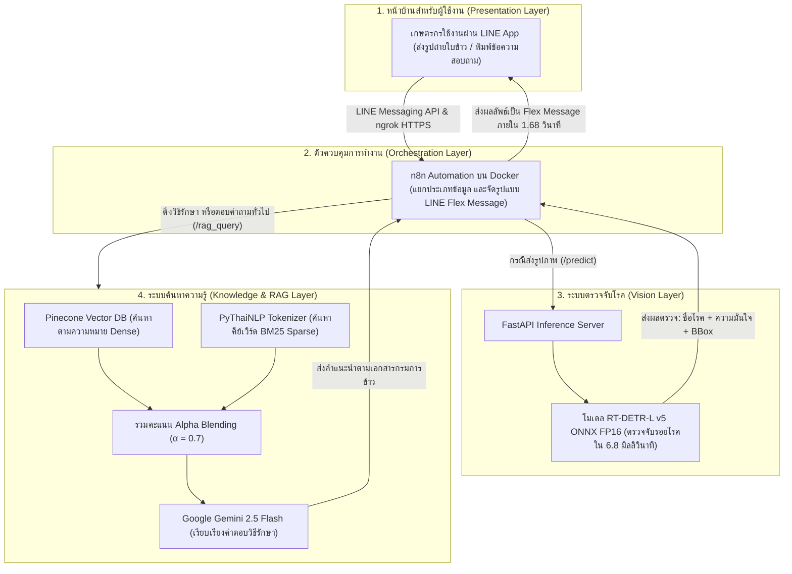
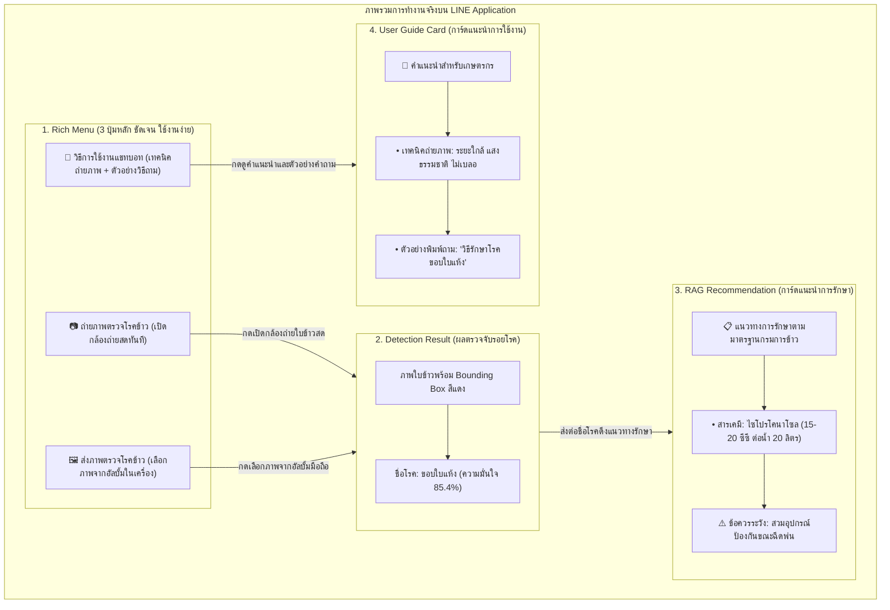

# โครงสร้างสไลด์นำเสนอวิทยานิพนธ์ (Thesis Defense Presentation Deck)

**หัวข้อวิทยานิพนธ์ (ภาษาไทย):** ระบบเชี่ยวชาญเพื่อการวินิจฉัยโรคพืชในข้าวและให้คำแนะนำด้วยปัญญาประดิษฐ์ผ่านแอปพลิเคชันไลน์  
**หัวข้อวิทยานิพนธ์ (ภาษาอังกฤษ):** Expert System for Rice Leaf Disease Diagnosis and Treatment Consultation via LINE Chatbot using Real-Time Detection Transformer and Hybrid Retrieval-Augmented Generation  
**ผู้นำเสนอ:** นายอัศวิน (atsawin)  
**สังกัด:** ภาควิชาวิทยาการคอมพิวเตอร์ คณะวิทยาศาสตร์ มหาวิทยาลัยเกษตรศาสตร์  
**การนำไปใช้งาน:** สไลด์ชุดนี้ออกแบบสำหรับการสอบปริญญานิพนธ์ (ทั้งหมด 24 สไลด์) แบ่งเป็น 2 ส่วนชัดเจน คือ **[ส่วนที่ทดลองเสร็จแล้ว 100%]** และ **[ส่วน Template สำหรับใส่ข้อมูลจริงเพิ่มเติมเมื่อเสร็จสิ้นโครงการ]** พร้อมตาราง ไดอะแกรม และบทพูดนำเสนอภาษาไทย (Script) สามารถคัดลอกไปทำสไลด์ใน PowerPoint, Canva หรือ Google Slides ได้ทันที

---

## 🖥️ สไลด์ที่ 1: หน้าปกปริญญานิพนธ์ (Title & Metadata)

* **ชื่อโครงการวิทยานิพนธ์:** ระบบเชี่ยวชาญเพื่อการวินิจฉัยโรคพืชในข้าวและให้คำแนะนำด้วยปัญญาประดิษฐ์ผ่านแอปพลิเคชันไลน์
* **ชื่อภาษาอังกฤษ:** Rice Leaf Disease Diagnosis and Treatment Consultation System via LINE Chatbot
* **เทคโนโลยีหลัก:** Real-Time Detection Transformer (RT-DETR-L) + Hybrid RAG (Dense + Sparse) + n8n + LINE Messaging API + NVIDIA Jetson AGX Orin
* **ข้อมูลผู้จัดทำและคณะกรรมการ:**
  - **ผู้จัดทำ:** นายอัศวิน (atsawin) `[รหัสนิสิต: 6xxxxxxxxx]`
  - **อาจารย์ที่ปรึกษาหลัก:** `[ระบุชื่ออาจารย์ที่ปรึกษา: เช่น ผศ.ดร. ... / รอระบุ]`
  - **อาจารย์ที่ปรึกษาร่วม:** `[ระบุชื่ออาจารย์ที่ปรึกษาร่วม (ถ้ามี) / รอระบุ]`
  - **ประธานกรรมการสอบ:** `[ระบุชื่อประธานกรรมการสอบ / รอระบุ]`
* **ภาควิชา/คณะ:** ภาควิชาวิทยาการคอมพิวเตอร์ คณะวิทยาศาสตร์ มหาวิทยาลัยเกษตรศาสตร์
* **สถานะโครงการ:** `[🟢 งานวิจัยโมเดล AI และระบบแชทบอทเสร็จสิ้นแล้ว 85% / อยู่ระหว่างเก็บผลประเมิน UAT และปรับแต่งบนฮาร์ดแวร์ Edge]`
* **🎙️ Script ผู้บรรยาย:**
  > *"กราบเรียนท่านประธาน ท่านอาจารย์ที่ปรึกษา และคณะกรรมการทุกท่านครับ ผม นายอัศวิน นิสิตภาควิชาวิทยาการคอมพิวเตอร์ คณะวิทยาศาสตร์ มหาวิทยาลัยเกษตรศาสตร์ วันนี้ขอเสนอความก้าวหน้าโครงงานปริญญานิพนธ์ในหัวข้อ 'ระบบเชี่ยวชาญเพื่อการวินิจฉัยโรคพืชในข้าวและให้คำแนะนำด้วยปัญญาประดิษฐ์ผ่านแอปพลิเคชันไลน์' โครงงานนี้พัฒนาขึ้นแบบครบวงจร ตั้งแต่การสร้างโมเดลตรวจจับโรคด้วย RT-DETR-L, การศึกษาเรื่องการตัดพื้นหลังใบข้าว, การพัฒนาระบบสืบค้นข้อมูลด้วย Hybrid RAG ไปจนถึงการทำแชทบอท LINE ให้เกษตรกรใช้งานได้จริงครับ"*

---

## 🖥️ สไลด์ที่ 2: ที่มา ความสำคัญ และปัญหา (Problem Statement)

* **ความสำคัญเชิงเศรษฐกิจ:**
  - ข้าวเป็นพืชเศรษฐกิจสำคัญของไทย มีพื้นที่ปลูกกว่า 60 ล้านไร่ เกษตรกรกว่า 4.6 ล้านครัวเรือน
* **ปัญหาสำคัญของการทำนา (Pain Points):**
  - **ผลผลิตเสียหาย 15–30% ต่อปี:** จากการระบาดของโรคข้าวสำคัญ 5 ชนิด ได้แก่ โรคขอบใบแห้ง, ใบไหม้, ใบจุดสีน้ำตาล, ใบขอบกาบแห้ง และกาบใบแห้ง
  - **ผู้เชี่ยวชาญไม่เพียงพอ:** เจ้าหน้าที่เกษตรดูแลได้ไม่ทั่วถึงทุกพื้นที่ เกษตรกรส่วนใหญ่ต้องดูอาการและเดาโรคเอง
  - **อาการของโรคคล้ายกันมาก:** หลายโรคมีลักษณะแผลใกล้เคียงกัน (เช่น ขอบใบแห้งกับใบขอบกาบแห้ง) ทำให้เกษตรกรเข้าใจผิดและซื้อยาผิดชนิด
  - **การใช้สารเคมีไม่ถูกต้อง (Overuse & Misuse):** ทำให้เชื้อดื้อยา ต้นทุนเพิ่มขึ้น สารเคมีตกค้างในดินและน้ำ และผลผลิตไม่ได้มาตรฐาน
* **ช่องว่างทางเทคโนโลยี (Technology Gap):**
  - โมเดลตรวจจับแบบเดิมมักทำงานช้าและตรวจจับในสภาพแสงจริงได้ไม่ดี ส่วนระบบถาม-ตอบแบบ LLM ทั่วไปก็มักมีปัญหา "ตอบมั่ว (Hallucination)" แนะนำชื่อยาหรืออัตราผสมผิดพลาด
* **🎙️ Script ผู้บรรยาย:**
  > *"ข้าวไทยเป็นพืชเศรษฐกิจหลักของประเทศ แต่ละปีเกษตรกรต้องสูญเสียผลผลิตถึง 15–30% จากโรคข้าวครับ ปัญหาใหญ่ไม่ใช่ว่าไม่มียารักษา แต่คือเกษตรกรดูโรคไม่ออก เพราะหลายโรคมีลักษณะคล้ายกันมาก เช่น โรคขอบใบแห้งที่เกิดจากแบคทีเรีย กับโรคใบขอบกาบแห้งที่เกิดจากเชื้อรา พอดูผิดก็ซื้อยาผิดมารักษา นอกจากจะไม่หายแล้ว ยังเปลืองเงินและทำให้เชื้อดื้อยาด้วยครับ ส่วน AI ทั่วไปถ้าไม่มีการคุมข้อมูล ก็มักจะตอบมั่ว แนะนำยาหรืออัตราผสมผิดๆ โครงงานนี้จึงพัฒนาขึ้นมาเพื่อแก้ปัญหาเหล่านี้ให้ถูกต้องและใช้งานได้จริงครับ"*

---

## 🖥️ สไลด์ที่ 3: วัตถุประสงค์และขอบเขตของโครงงาน (Objectives & Scope)

* **วัตถุประสงค์หลัก 4 ข้อ:**
  1. ศึกษาและพัฒนาโมเดลตรวจจับรอยโรคข้าวด้วย Real-Time Detection Transformer (RT-DETR-L) สำหรับ 5 โรคสำคัญและใบสมบูรณ์
  2. ทำการทดลอง Ablation Study เพื่อเปรียบเทียบว่าการตัดพื้นหลังแปลงนา (Background Segmentation) ช่วยเพิ่มความแม่นยำจริงหรือไม่
  3. พัฒนาระบบสืบค้นและตอบคำถามด้วยเทคนิค Hybrid RAG (Dense + Sparse) อ้างอิงข้อมูลจากกรมการข้าว
  4. เชื่อมต่อระบบทั้งหมดเข้ากับแอปพลิเคชัน LINE และเตรียมนำไปรันบนบอร์ดประมวลผลขนาดเล็ก (NVIDIA Jetson AGX Orin)
* **ขอบเขตของโครงการ (Project Scope):**
  - **ตรวจจับโรคข้าว 5 โรค + 1 ใบสมบูรณ์:**
    1. โรคขอบใบแห้ง (*Bacterial Leaf Blight: BLB*)
    2. โรคใบจุดสีน้ำตาล (*Brown Spot*)
    3. โรคใบไหม้ (*Leaf Blast*)
    4. โรคใบขอบกาบแห้ง (*Leaf Scald*)
    5. โรคกาบใบแห้ง (*Sheath Blight*)
  - **ช่องทางให้บริการ:** LINE Official Account (`@325wtzzd`) รองรับทั้งการส่งรูปใบข้าวและการพิมพ์สอบถาม
* **🎙️ Script ผู้บรรยาย:**
  > *"เป้าหมายของโครงงานนี้มี 4 ข้อหลักครับ ข้อแรกคือพัฒนาโมเดล RT-DETR-L มาตรวจจับ 5 โรคข้าวสำคัญและใบสมบูรณ์ ข้อสองคือทดลองตัดฉากหลังแปลงนาเพื่อดูว่าจะช่วยให้โมเดลแม่นขึ้นจริงไหม ข้อสามคือทำระบบ Hybrid RAG ให้ตอบคำถามตามข้อมูลกรมการข้าวโดยไม่ตอบมั่ว และข้อสี่คือเชื่อมทุกอย่างเข้ากับ LINE ให้เกษตรกรใช้งานง่าย พร้อมเตรียมติดตั้งบนบอร์ด Jetson AGX Orin ครับ"*

---

## 🖥️ สไลด์ที่ 4: สถาปัตยกรรมระบบรวม (End-to-End System Architecture)

* **การทำงานของระบบแบ่งเป็น 4 ส่วน (4-Tier Architecture):**

* **ขั้นตอนการทำงานเมื่อเกษตรกรส่งรูป (Sequence Flow):**
  1. เกษตรกรส่งภาพถ่ายใบข้าวผ่าน LINE OA
  2. n8n รับภาพแล้วส่งต่อไปที่ FastAPI (`/predict`)
  3. โมเดล RT-DETR วิเคราะห์ภาพและส่งผลลัพธ์กลับมา: ชื่อโรค, เปอร์เซ็นต์ความมั่นใจ และกรอบตำแหน่งรอยโรค (Bounding Box)
  4. n8n ส่งชื่อโรคไปค้นหาข้อมูลวิธีรักษาจากกรมการข้าวที่ RAG API (`/rag_query`)
  5. n8n จัดรูปแบบผลลัพธ์ทั้งหมดเป็นการ์ด Flex Message ส่งกลับให้เกษตรกรทาง LINE ภายใน **1.68 วินาที**
* **🎙️ Script ผู้บรรยาย:**
  > *"ภาพนี้แสดงการทำงานของระบบทั้งหมดครับ เริ่มจากฝั่งเกษตรกรที่ใช้งานผ่าน LINE ที่คุ้นเคย ข้อมูลจะถูกส่งเข้า n8n บน Docker เพื่อแยกประเภท ถ้าเป็นรูปภาพ n8n จะส่งต่อไปให้ FastAPI รันโมเดล RT-DETR v5 ซึ่งใช้เวลาตรวจจับแค่ 6.8 มิลลิวินาที จากนั้นจะส่งชื่อโรคไปให้ระบบ Hybrid RAG ดึงข้อมูลวิธีรักษาที่ถูกต้องของกรมการข้าว แล้ว n8n จะนำข้อมูลทั้งหมดมาจัดเป็นการ์ด Flex Message ส่งกลับเข้าแชท LINE ของเกษตรกรทันทีครับ"*

---

## 🖥️ สไลด์ที่ 5: การรวบรวมและเตรียมชุดข้อมูล (Dataset Preparation & Preprocessing)

* **รายละเอียดชุดข้อมูล (Dataset Characteristics):**
  - รวมภาพถ่ายใบข้าวจากแปลงนาจริงทั้งหมด **3,829 ภาพ**
  - แบ่งเป็น 6 คลาส โดยมีสัดส่วนข้อมูลใกล้เคียงกันทุกคลาส (Class Balance ประมาณ 16–17% ต่อคลาส)
* **ตารางแจกแจงจำนวนภาพและการแบ่งชุดข้อมูล (Data Splitting):**

| ชนิดคลาส (Class Name) | จำนวนภาพรวม | สัดส่วน | ชุดฝึกสอน (Train 70%) | ชุดตรวจสอบ (Val 20%) | ชุดทดสอบ (Test 10%) |
| :--- | :---: | :---: | :---: | :---: | :---: |
| **1. ขอบใบแห้ง (Bacterial Leaf Blight)** | 636 | 16.61% | 445 | 127 | 64 |
| **2. ใบจุดสีน้ำตาล (Brown Spot)** | 646 | 16.87% | 452 | 129 | 65 |
| **3. ใบไหม้ (Leaf Blast)** | 634 | 16.56% | 444 | 127 | 63 |
| **4. ใบขอบกาบแห้ง (Leaf Scald)** | 628 | 16.40% | 440 | 125 | 63 |
| **5. กาบใบแห้ง (Sheath Blight)** | 632 | 16.51% | 442 | 126 | 64 |
| **6. ใบสมบูรณ์ (Healthy Rice Leaf)** | 653 | 17.05% | 457 | 131 | 65 |
| **รวมทั้งหมด (Total Images)** | **3,829** | **100.0%** | **2,680 ภาพ** | **765 ภาพ** | **384 ภาพ\*** |

*\*หมายเหตุ: ภาพชุดทดสอบที่มีการตรวจยืนยันรอยโรคอย่างสมบูรณ์สำหรับการวัดค่า $mAP@0.5$ มีจำนวน 354 ภาพ*

* **การเตรียมรูปภาพ (Data Preprocessing):**
  - **Letterbox Resizing ($640 \times 640$ / $800 \times 800$ พิกเซล):** ใส่แถบสีเทาเสริมขอบ เพื่อรักษาสัดส่วนภาพเดิมไว้ ไม่ให้ใบข้าวหรือรอยโรคเบี้ยวผิดรูป
  - **ทำความสะอาดข้อมูล:** ตรวจสอบและลบภาพที่เปิดไม่ได้หรือภาพที่ซ้ำซ้อนออก
* **🎙️ Script ผู้บรรยาย:**
  > *"ในส่วนของข้อมูล เราเก็บภาพใบข้าวจากแปลงจริงทั้งหมด 3,829 ภาพ มี 5 โรคหลัก และมีคลาสใบสมบูรณ์เพิ่มเข้ามาด้วยเพื่อใช้เทียบ ข้อมูลค่อนข้างสมดุลกัน อยู่ที่ประมาณ 16–17% ต่อคลาส เราแบ่งข้อมูลเป็น Train 70%, Validation 20% และ Test 10% พร้อมใช้เทคนิค Letterbox เติมขอบสีเทา เพื่อคงสัดส่วนภาพเดิมไว้ ไม่ให้แผลบนใบข้าวเบี้ยวตอนย่อขยายภาพครับ"*

---

## 🖥️ สไลด์ที่ 6: การปรับปรุงฉลากข้อมูลด้วยแนวทาง Data-Centric AI (Annotation Refinement)

* **ปัญหาที่พบในตอนแรก (The Bottleneck):**
  - ในการเทรนเวอร์ชันแรก โมเดลตรวจจับโรคขอบใบแห้ง (BLB) แทบไม่ได้เลย ได้คะแนนความแม่นยำต่ำมาก ($mAP@0.5 = 7.42\%$)
  - แม้จะลองเปลี่ยนโมเดลหรือปรับค่าพารามิเตอร์ต่างๆ คะแนนก็ยังไม่ดีขึ้น
* **การหาสาเหตุของปัญหา (Root Cause Analysis):**
  - เมื่อเปิดดูรูปและกรอบข้อมูลทีละภาพ จึงพบปัญหาเรื่อง **กรอบแผลแตกกระจาย (Annotation Fragmentation)**:
  - แผลโรคขอบใบแห้งจะยาวตามใบข้าว แต่ในข้อมูลเดิม คนติดฉลากกลับตีกรอบเล็กๆ ซ้อนทับกันไปมามากถึง **5,922 กล่อง**
  - ทำให้ AI สับสน ไม่รู้ว่าขอบเขตแผลที่แท้จริงอยู่ตรงไหน
* **การแก้ไขตามแนวทาง Data-Centric AI:**
  - ทำการติดฉลากข้อมูลใหม่ (Re-labeling) โดยรวมกรอบย่อยๆ ให้เป็นกรอบแผลยาวตามจริง (**Continuous Bounding Box**)
  - ลดจำนวนกรอบที่ซ้ำซ้อนจาก **5,922 กล่อง เหลือเพียง 1,863 กล่อง** (ลดกรอบส่วนเกินลง 68.5%)
* **ผลลัพธ์ที่ได้:**
  - คะแนนความแม่นยำ $mAP@0.5$ ของโรคขอบใบแห้งเพิ่มจาก **`7.42%` เป็น `69.50%` (เพิ่มขึ้นทันที +62.1%)**
* **🎙️ Script ผู้บรรยาย:**
  > *"ตรงนี้เป็นจุดเปลี่ยนสำคัญของงานวิจัยเลยครับ ตอนแรกโมเดลของเราตรวจโรคขอบใบแห้งแทบไม่ได้เลย ได้คะแนนแค่ 7.4% พอเข้าไปดูรูปจริงถึงรู้ว่า คนที่ทำข้อมูลเดิมตีกรอบแผลยาวแผลเดียวแตกเป็นกล่องเล็กๆ ซ้อนกันเกือบ 6,000 กล่อง ทำให้ AI สับสน เราเลยแก้ปัญหาตามแนวทาง Data-Centric AI คือตีกรอบใหม่ให้ตรงตามลักษณะแผลจริง เหลือ 1,863 กล่อง ผลคือคะแนนความแม่นยำของโรคนี้กระโดดขึ้นมาเป็น 69.5% ทันที แสดงให้เห็นชัดเจนครับว่า คุณภาพของข้อมูลมีความสำคัญไม่แพ้การจูนโมเดล"*

---

## 🖥️ สไลด์ที่ 7: ผลการทดลองเปรียบเทียบโมเดล RT-DETR-L ทั้ง 5 เวอร์ชัน (Model Evolution)

* **ตารางเปรียบเทียบผลการทดสอบทั้ง 5 เวอร์ชันบน Test Set (354 ภาพ):**

| ตัวชี้วัด / เวอร์ชัน | v1: Baseline | v2: HP Tuned | v3: Morphological | v4: High-Res (800px) | **v5: Data-Centric Champion** |
| :--- | :---: | :---: | :---: | :---: | :---: |
| **ขนาดภาพอินพุต (Resolution)** | 640 px | 640 px | 640 px | 800 px | **800 px** |
| **สิ่งที่ปรับปรุง** | COCO Transfer | Cosine LR, Warmup | ปิด Mosaic, จูน Scale | ขยายภาพเป็น 800 px | **แก้ฉลาก BLB ตีกรอบต่อเนื่อง** |
| **mAP@0.5 รวมทุกคลาส** | 59.3% | 58.3% | 60.2% | 60.5% | **`70.6%` (0.7056)** |
| **mAP@0.5:0.95 รวม** | 30.8% | 29.5% | 29.6% | 29.4% | **`35.5%` (0.3554)** |
| **ความแม่นยำรวม (Precision)** | 56.5% | 58.5% | 57.7% | 58.1% | **`73.5%` (0.7351)** |
| **การตรวจจับได้ครบ (Recall)** | 60.9% | 60.5% | 61.9% | 61.3% | **`70.2%` (0.7017)** |
| **1. ขอบใบแห้ง (BLB)** | 10.5% | 7.7% | 7.1% | 7.42% | **`69.5%` (+62.1%)** |
| **2. ใบจุดสีน้ำตาล (Brown Spot)** | 80.4% | 79.2% | 80.2% | **80.8%** | **79.9%** |
| **3. ใบไหม้ (Leaf Blast)** | 77.6% | 81.8% | **86.9%** | 82.6% | **77.6%** |
| **4. ใบขอบกาบแห้ง (Leaf Scald)** | 53.3% | 47.0% | 50.8% | **55.0%** | **54.5%** |
| **5. กาบใบแห้ง (Sheath Blight)** | 74.5% | 75.8% | 75.8% | **76.6%** | **71.3%** |
| **เวลาประมวลผลต่อภาพ (GPU)** | 4.8 ms | 4.8 ms | 4.8 ms | 7.2 ms | **6.8 ms (~147 FPS)** |

* **ข้อสรุปสำคัญ:** การปรับแต่ตัวโมเดล (v1–v4) ทำคะแนนได้สูงสุดแค่ 60.5% แต่พอแก้ที่คุณภาพข้อมูล (v5) คะแนนรวมขยับขึ้นมาถึง **70.6%**
* **🎙️ Script ผู้บรรยาย:**
  > *"ตารางนี้แสดงพัฒนาการของโมเดลทั้ง 5 เวอร์ชันครับ ในเวอร์ชัน 1 ถึง 4 เราเน้นปรับจูนตัวโมเดล เช่น ปรับ Learning Rate หรือขยายภาพเป็น 800 พิกเซล คะแนนรวมจะตันอยู่ที่ประมาณ 60% และโรคขอบใบแห้งก็ยังตรวจไม่ค่อยติด แต่พอเรานำข้อมูลที่แก้กรอบแล้วมาเทรนในเวอร์ชัน 5 คะแนนรวมขยับขึ้นเป็น 70.6% ความแม่นยำขึ้นมาที่ 73.5% และตรวจจับเร็วมาก ใช้เวลาแค่ 6.8 มิลลิวินาทีต่อภาพเท่านั้นครับ"*

---

## 🖥️ สไลด์ที่ 8: ผลการทดสอบแยกรายโรคของโมเดล Champion v5 (Detailed Evaluation)

* **ตารางสรุปผลการทดสอบแยกรายโรคบน Test Set (354 ภาพ):**

| ชนิดโรคข้าว (Disease Class) | ภาพทดสอบ | จำนวนแผล (BBox) | ความแม่นยำ (P) | การตรวจพบ (R) | **mAP@0.5** | mAP@0.5:0.95 |
| :--- | :---: | :---: | :---: | :---: | :---: | :---: |
| **1. ขอบใบแห้ง (BLB)** | 64 | 81 | 78.7% | 75.3% | **`69.5%`** | 41.9% |
| **2. ใบจุดสีน้ำตาล (Brown Spot)** | 61 | 215 | 78.4% | 73.0% | **`79.9%`** | 38.4% |
| **3. ใบไหม้ (Leaf Blast)** | 57 | 81 | 84.2% | 72.1% | **`77.6%`** | 35.6% |
| **4. ใบขอบกาบแห้ง (Leaf Scald)** | 53 | 69 | 55.6% | 56.5% | **`54.5%`** | 18.7% |
| **5. กาบใบแห้ง (Sheath Blight)** | 60 | 130 | 70.7% | 73.8% | **`71.3%`** | 43.1% |
| **ค่าเฉลี่ยรวมทุกคลาส (Overall)** | **354** | **576** | **`73.5%`** | **`70.2%`** | **`70.6%`** | **`35.5%`** |

* **ข้อสังเกตจากผลการทดสอบ:**
  - **โรคที่ตรวจจับได้แม่นยำมาก:** ใบจุดสีน้ำตาล (79.9%) และใบไหม้ (77.6%) เพราะรูปร่างแผลวงกลมและทรงกระสวยมีความชัดเจน
  - **โรคที่มีการสับสนบ้าง:** ใบไหม้กับใบขอบกาบแห้ง ในช่วงที่แผลลุกลามหนัก เพราะขอบแผลจะมีสีน้ำตาลไหม้คล้ายกัน ซึ่งระบบแก้ปัญหาด้วยการแสดงระดับความมั่นใจ และหากความมั่นใจไม่ถึง 80% ระบบจะสรุปเป็น 3 อันดับโรคที่น่าจะเป็นที่สุดพร้อมจุดสังเกต ให้เกษตรกรตรวจสอบเพิ่มเติม
* **🎙️ Script ผู้บรรยาย:**
  > *"พอมาดูผลแยกรายโรคของโมเดล v5 จะเห็นว่าโรคใบจุดสีน้ำตาลได้ความแม่นยำถึง 79.9% และโรคใบไหม้ได้ 77.6% ส่วนโรคขอบใบแห้งที่เราแก้กรอบใหม่ ก็ขึ้นมาอยู่ที่ 69.5% จะมีโรคใบขอบกาบแห้งที่ได้ 54.5% เพราะถ้าแผลลุกลามหนักจะมีสีน้ำตาลคล้ายใบไหม้ ทำให้โมเดลมีลังเลบ้าง ซึ่งระบบของเราจะช่วยแก้ด้วยการบอกระดับความมั่นใจ และถ้าไม่มั่นใจเกิน 80% ระบบจะแนะนำ 3 อันดับโรคพร้อมจุดสังเกต ให้เกษตรกรไปดูในแปลงเพิ่มเติมครับ"*

---

## 🖥️ สไลด์ที่ 9: การทดลอง Ablation Study: ปัญหาใบข้าวกลืนกับฉากหลัง (Green-on-Green)

* **สมมติฐานของการทดลอง:**
  - *"ถ้าเราตัดฉากหลังแปลงนา (ดิน น้ำ วัชพืช) ให้เป็นสีดำออกไปก่อน จะช่วยให้ AI ตรวจจับโรคได้แม่นยำขึ้นจริงหรือไม่?"*
* **ปัญหาจากการใช้โมเดลตัดฉากหลังทั่วไป (Salient Object Detection - SOD):**
  - พอเอาโมเดลตัดฉากหลังทั่วไป (เช่น U-2-Net) มาตัดภาพใบข้าวในแปลงนา
  - **เกิดปัญหาภาพกลายเป็น "จอดำสนิท" สูงถึง `43.8%` (155 จาก 354 ภาพ)** คือ AI ลบเนื้อใบข้าวทิ้งไปหมด
* **สาเหตุที่ตัดฉากหลังไม่สำเร็จ:**
  1. **สีเขียวกลืนกัน (Green-on-Green):** สีเขียวของใบข้าวกลืนไปกับต้นข้าวต้นอื่นและวัชพืชข้างหลัง ทำให้ AI แยกไม่ออกว่าตรงไหนคือใบที่ต้องการ
  2. **ใบข้าวพาดทะลุขอบภาพ:** ภาพถ่ายระยะใกล้ ใบข้าวจะพาดผ่านจอจากซ้ายไปขวา ไม่ได้เป็นวัตถุที่มีขอบเขตปิด AI เลยนึกว่าเป็นพื้นหลังแล้วลบทิ้งทั้งหมด
* **🎙️ Script ผู้บรรยาย:**
  > *"งานวิจัยนี้เรามีคำถามต่อว่า ถ้าเราตัดฉากหลังแปลงนาออกให้เหลือแต่ใบข้าวเพียวๆ จะช่วยให้ AI แม่นขึ้นไหม ในขั้นแรกเราลองใช้โมเดลตัดฉากหลังทั่วไปดู ปรากฏว่าเจอปัญหาใหญ่คือ มีภาพกลายเป็นจอดำมืดไปถึง 43.8% เพราะสีเขียวของใบข้าวกลืนไปกับแปลงนาข้างหลัง และภาพถ่ายระยะใกล้ที่ใบข้าวพาดทะลุกรอบ ทำให้ AI คิดว่าเป็นฉากหลังเลยลบทิ้งไปเกือบครึ่งหนึ่งของข้อมูลครับ"*

---

## 🖥️ สไลด์ที่ 10: ทางออกใหม่: ใช้ MobileSAM ร่วมกับระบบ Safety Guardrail 2%

* **ปรับวิธีตัดฉากหลังใหม่ด้วย Foundation Model:**
  - เปลี่ยนมาใช้ **Meta MobileSAM** (โมเดล Segment Anything รุ่นเล็กที่ทำงานเร็ว) ร่วมกับเทคนิคการใส่ Prompt นำทาง:
* **3 ขั้นตอนสำคัญในการแก้ปัญหา:**
  1. **Enclosing BBox Prompting:** นำกรอบตำแหน่งของรอยโรคมาใช้เป็น Prompt บอก MobileSAM ให้ตัดเฉพาะใบข้าวบริเวณที่มีแผล
  2. **Morphological Dilation:** ขยายขอบการตัดออกไปเล็กน้อย เพื่อไม่ให้แผลโรคถูกตัดขาดหายไป
  3. **Adaptive Safety Guardrail ($\theta = 0.02$):** ตรวจสอบภาพหลังตัด ถ้าเหลือเนื้อใบไม้น้อยกว่า 2% ของภาพ ระบบจะสลับกลับไปใช้ภาพเดิมทันที (**Fallback to Original**)
* **ผลลัพธ์ของการเตรียมข้อมูล:**
  - ตัดฉากหลังสำเร็จสวยงาม **75.14% (266 ภาพ)**
  - ระบบ Guardrail ช่วยดึงภาพเดิมกลับมาใช้ได้อย่างปลอดภัย **24.86% (88 ภาพ)**
  - **แก้ปัญหาภาพจอดำสนิทได้ 100%** ไม่มีภาพเสียหลุดเข้าไปในการทดลอง
* **🎙️ Script ผู้บรรยาย:**
  > *"เพื่อแก้ปัญหาจอดำ เราเปลี่ยนมาใช้ Meta MobileSAM โดยใส่กรอบรอยโรคเข้าไปนำทางให้โมเดลรู้ว่าต้องตัดใบข้าวตรงไหน และเราใส่ระบบป้องกันที่ชื่อ Adaptive Safety Guardrail เพิ่มเข้าไป โดยตั้งเงื่อนไขว่า ถ้าตัดแล้วเหลือใบไม้น้อยกว่า 2% ให้ดึงภาพเดิมกลับมาใช้ทันที ผลคือเราตัดฉากหลังสำเร็จได้ 75% และอีก 25% สลับกลับมาใช้ภาพเดิมอย่างปลอดภัย ไม่มีภาพจอดำหลุดเข้าไปเทรนโมเดลเลยครับ"*

---

## 🖥️ สไลด์ที่ 11: สิ่งที่ค้นพบ: ปรากฏการณ์ความไม่สมมาตรทางสัณฐานวิทยา (Morphological Asymmetry)

* **ตารางเปรียบเทียบโมเดล Champion v5 vs โมเดลที่ตัดพื้นหลัง (เทรน 93 Epochs):**

| ชนิดโรคข้าว (Disease Class) | Champion v5 (ภาพจริงในนา) | Segmented (ตัดพื้นหลังดำ) | ผลต่าง (Difference) | ลักษณะของรอยโรค |
| :--- | :---: | :---: | :---: | :--- |
| **1. ขอบใบแห้ง (BLB)** | 69.50% | **75.32%** | **+5.82%** | แผลใหญ่ การตัดวัชพืชช่วยให้เห็นชัดขึ้น |
| **2. ใบจุดสีน้ำตาล (Brown Spot)** | **79.90%** | 64.71% | **-15.19%** | **แผลจุดเล็ก คะแนนตกลงมาก (เสียบริบทใบ)** |
| **3. ใบไหม้ (Leaf Blast)** | 77.60% | **78.59%** | **+0.99%** | แผลกระสวย ความแม่นยำใกล้เคียงเดิม |
| **4. ใบขอบกาบแห้ง (Leaf Scald)** | 54.50% | **65.67%** | **+11.17%** | ริ้วแผลขอบใบชัดเจนขึ้นเมื่อไม่มีสิ่งรบกวน |
| **5. กาบใบแห้ง (Sheath Blight)** | 71.30% | **75.73%** | **+4.43%** | แยกกาบใบออกจากผิวน้ำได้ง่ายขึ้น |
| **ค่าเฉลี่ยรวม (mAP@0.5)** | 70.56% | **72.00%** | **+1.44%** | คะแนนรวมเพิ่มขึ้นเล็กน้อย |
| **ความพอดีของกรอบ (mAP@0.5:0.95)**| **35.54%** | 34.99% | **-0.55%** | ขอบภาพที่ตัดทำให้การตีกรอบคลาดเคลื่อนเล็กน้อย |

* **บทวิเคราะห์ข้อค้นพบ:**
  - **โรคที่มีแผลขนาดใหญ่:** (ขอบใบแห้ง, ใบขอบกาบแห้ง, กาบใบแห้ง) ได้คะแนนเพิ่มขึ้นจริงเมื่อตัดฉากหลังออก
  - **โรคที่มีแผลจุดเล็กๆ:** โรคใบจุดสีน้ำตาลคะแนน **ลดลงถึง -15.19%** เพราะจุดเล็กๆ ต้องอาศัยสีเขียวของแผ่นใบข้าวรอบข้างเป็นบริบทอ้างอิง พอตัดฉากหลังเป็นสีดำ AI สับสนนึกว่าจุดสีน้ำตาลเป็นจุดสัญญาณรบกวน
* **🎙️ Script ผู้บรรยาย:**
  > *"และนี่คือหนึ่งในคุณูปการทางวิชาการที่สำคัญของงานวิจัยนี้ครับ เราค้นพบสิ่งที่เรียกว่า 'ความไม่สมมาตรทางสัณฐานวิทยา' (Morphological Asymmetry) คือการตัดพื้นหลังไม่ได้ดีกับทุกโรคเสมอไป สำหรับโรคที่แผลใหญ่ เช่น ใบขอบกาบแห้ง คะแนนเพิ่มขึ้นจริงถึง 11% แต่กับโรคที่แผลเป็นจุดเล็กๆ อย่าง 'ใบจุดสีน้ำตาล' คะแนนกลับลดลงไปถึง 15% เพราะแผลเล็กๆ ต้องการเนื้อใบสีเขียวรอบข้างมาช่วยอ้างอิง พอฉากหลังกลายเป็นสีดำ แผลกลายเป็นจุดลอยๆ ทำให้ AI สับสนครับ"*

---

## 🖥️ สไลด์ที่ 12: การตัดสินใจเชิงวิศวกรรม: ทำไมจึงเลือกโมเดลตรวจจับโดยตรง (Direct Detection)?

* **เปรียบเทียบระหว่าง 2 ทางเลือกในการนำไปใช้งานจริง:**

| ประเด็นเปรียบเทียบ | ตัดฉากหลังก่อน (MobileSAM + RT-DETR) | ตรวจจับภาพจริงโดยตรง (Champion v5) | ข้อสรุปสำหรับการใช้งานจริง |
| :--- | :--- | :--- | :--- |
| **เวลาประมวลผล (Latency)** | **ช้า (> 100–170 ms)** เพราะต้องตัดภาพก่อน | **เร็วมาก (6.8 ms หรือ ~147 FPS)** | **แบบตรวจจับโดยตรงเร็วกว่า 15–20 เท่า** |
| **การใช้การ์ดจอ (VRAM)** | ใช้เยอะ (> 2.8 GB ต้องรัน 2 โมเดล) | **ใช้น้อย (~1.2 GB)** | ประหยัดทรัพยากรบนบอร์ด Jetson Orin |
| **ความแม่นยำโรคใบจุดสีน้ำตาล**| คะแนนตกเหลือ 64.71% เสี่ยงทายผิด | **แม่นยำสูงถึง 79.90%** | **ปลอดภัยกว่าสำหรับเกษตรกร** |
| **ความซับซ้อนของระบบ** | สูง ขั้นตอนเยอะ เสี่ยงระบบค้าง | **ไม่ซับซ้อน เป็นโมเดลเดี่ยว End-to-End** | เสถียรกว่า ดูแลรักษาง่าย ไม่สะดุด |
| **ความพร้อมใช้งานจริง** | ทำงานแบบ Real-Time ได้ยาก | **พร้อมใช้งานจริงทันที** | **เลือกโมเดล Champion v5** |

* **ข้อสรุป:** โมเดล RT-DETR v5 มีระบบ Attention ในตัวที่ช่วยโฟกัสรอยโรคและตัดสิ่งรบกวนในภาพจริงได้ดีอยู่แล้ว เราจึงเลือกใช้ Champion v5 ในระบบจริง
* **🎙️ Script ผู้บรรยาย:**
  > *"จากข้อค้นพบนี้ นำมาสู่การตัดสินใจเชิงวิศวกรรมครับ แม้การตัดฉากหลังจะได้คะแนนรวมเพิ่มขึ้น 1.4% แต่ในทางปฏิบัติ การรัน 2 โมเดลต่อกันทำให้ระบบช้าลงกว่า 15 เท่า กินแรมเยอะ และที่สำคัญคือทำให้ความแม่นยำของโรคใบจุดสีน้ำตาลลดลงไปมาก เราจึงเลือกใช้โมเดล Champion v5 ตรวจจับภาพจริงโดยตรง เพราะเร็วกว่า ใช้แรมน้อยกว่า และแม่นยำสม่ำเสมอในทุกโรคครับ"*

---

## 🖥️ สไลด์ที่ 13: การเตรียมฐานข้อมูลความรู้โรคข้าวและการแบ่งข้อมูล (Knowledge Base & Chunking)

* **แหล่งข้อมูล:**
  - รวบรวมจากเอกสารวิชาการของ **กรมการข้าว กระทรวงเกษตรและสหกรณ์**
  - มีข้อมูลครบ 5 ด้าน: ลักษณะอาการ, สาเหตุของโรค, วงจรการระบาด, การใช้สารเคมีที่ถูกต้อง และวิธีป้องกันกำจัด
* **การแบ่งท่อนข้อมูล (Chunking Strategy):**
  - ขนาดท่อนข้อมูลที่เหมาะสมที่สุด: **Chunk Size = 1,500 ตัวอักษร** และ **Chunk Overlap = 300 ตัวอักษร**
  - ช่วยไม่ให้เนื้อหาสำคัญขาดตอน และไม่ยาวเกินไปจน AI สับสน
* **2 เทคนิคช่วยเพิ่มความแม่นยำ:**
  1. **Context Enrichment:** ใส่หัวข้อชื่อโรคกำกับไว้ในทุกท่อนข้อมูล เช่น `[โรคขอบใบแห้ง - การรักษาด้วยสารเคมี]` เพื่อช่วยล็อกบริบท
  2. **Metadata Filtering:** เมื่อโมเดลตรวจพบชื่อโรคจากรูปภาพ ระบบจะนำชื่อโรคไปล็อกการค้นหาใน Pinecone ทันที เพื่อค้นหาเฉพาะข้อมูลของโรคนั้นๆ ป้องกันไม่ให้ดึงข้อมูลโรคอื่นมาปน
* **🎙️ Script ผู้บรรยาย:**
  > *"ในส่วนของข้อมูลความรู้ เรานำเอกสารวิชาการของกรมการข้าวมาจัดเตรียม โดยแบ่งเนื้อหาเป็นท่อนๆ ละ 1,500 ตัวอักษร และเหลื่อมซ้อนกัน 300 ตัวอักษร เพื่อให้ข้อความสำคัญไม่ขาดตอน และเรายังใส่ชื่อโรคกำกับไว้ที่หัวเอกสารทุกท่อน พร้อมใช้ Metadata Filtering ล็อกเป้าการค้นหาให้ตรงกับโรคที่ตรวจพบ เพื่อป้องกันไม่ให้มีข้อมูลโรคอื่นปนเข้ามาครับ"*

---

## 🖥️ สไลด์ที่ 14: การพัฒนาระบบ Hybrid RAG และการแก้ปัญหาตัดคำภาษาไทย (PyThaiNLP)

* **ปัญหาของการค้นหาด้วยคีย์เวิร์ดในภาษาไทย (The Thai Tokenization Barrier):**
  - ระบบค้นหาแบบเดิม (BM25) มักใช้การตัดคำของภาษาอังกฤษ ซึ่งคำในภาษาไทยเขียนติดกันโดยไม่มีเว้นวรรค
  - ประโยค *"โรคใบจุดสีน้ำตาลรักษาอย่างไร"* จะถูกหั่นผิดๆ เป็นเศษตัวอักษร เช่น `['โรคใบจ', 'ดส', 'น', 'ำตาลร']` ทำให้ค้นหาชื่อโรคและสารเคมีไม่เจอ
* **การแก้ปัญหาใน Perfect Hybrid RAG Version 6:**
  1. **นำ PyThaiNLP มาใช้:** ใช้ระบบตัดคำภาษาไทย `word_tokenize` เพื่อตัดคำศัพท์เฉพาะทางการเกษตรได้อย่างถูกต้อง (เช่น `['โรค', 'ใบจุดสีน้ำตาล', 'รักษา', 'อย่างไร']`)
  2. **แก้สูตรคำนวณ BM25:** ปรับสูตรคำนวณคะแนน TF และ IDF ให้ถูกต้อง ไม่ให้คะแนนทับซ้อนกัน
  3. **รวมคะแนนแบบ Alpha Blending ($\alpha = 0.7$):** แบ่งน้ำหนักการค้นหาเป็น **ความหมาย (Gemini) 70%** + **คีย์เวิร์ดชื่อยา (PyThaiNLP BM25) 30%**
* **🎙️ Script ผู้บรรยาย:**
  > *"ในระบบค้นหาข้อมูล เราเจอปัญหาใหญ่คือระบบค้นหาคีย์เวิร์ดทั่วไปตัดคำภาษาไทยไม่เป็น เพราะภาษาไทยเขียนติดกัน คำว่าโรคใบจุดสีน้ำตาลเลยแตกเป็นเศษตัวอักษร เราจึงแก้ปัญหาด้วยการนำ PyThaiNLP เข้ามาช่วยตัดคำภาษาไทยให้ถูกต้อง พร้อมทั้งปรับสูตรคำนวณ และรวมคะแนนแบบ Alpha Blending คือเน้นความหมาย 70% ร่วมกับคีย์เวิร์ดชื่อสารเคมีอีก 30% ทำให้ได้คำตอบที่แม่นยำและตรงจุดครับ"*

---

## 🖥️ สไลด์ที่ 15: ผลการทดสอบระบบสืบค้น RAG ด้วย RAGAS Framework (70 ข้อสอบมาตรฐาน)

* **วิธีการทดสอบด้วย RAGAS Framework:**
  - สร้างชุดข้อสอบมาตรฐาน (Golden Dataset) จำนวน **70 ข้อ** ครอบคลุมทั้ง 5 โรค แบ่งเป็น 3 ระดับ (คำถามง่าย, ปานกลาง และคำถามเชิงลึก)
* **ตารางผลการประเมินวิวัฒนาการ RAG ทั้ง 6 เวอร์ชัน:**

| ตัวชี้วัด RAGAS | V1: Baseline | V2: Top-k Tuned | V3: Chunk 1000 | V4: Hybrid เก่า | V5: Chunk 500 | **V6: Perfect Hybrid** | การพัฒนา |
| :--- | :---: | :---: | :---: | :---: | :---: | :---: | :---: |
| **Context Recall (ดึงข้อมูลได้ครบถ้วน)** | 12.3% | 15.4% | 18.2% | 19.90% | 14.1% | **`28.59%`** | **+8.69% (เพิ่มขึ้นชัดเจน)** |
| **Context Precision (ดึงได้ตรงประเด็น)** | 42.1% | 45.0% | 48.7% | 49.20% | 46.5% | **`51.05%`** | **+1.85% (เกิน 50%)** |
| **Faithfulness (ความถูกต้องตามเอกสาร)** | 71.0% | 73.2% | 75.0% | 78.50% | 72.0% | **`76.50%`** | **อยู่ในเกณฑ์สูงสม่ำเสมอ** |
| **Answer Relevancy (ตอบตรงคำถาม)** | 52.4% | 54.1% | 55.0% | 59.12% | 53.0% | **`56.85%`** | **ตอบได้ตรงคำถาม** |

* **จุดเด่น:** ค่า Context Recall เพิ่มขึ้นเกือบเท่าตัว และค่า Faithfulness สูงถึง 76.50% มั่นใจได้ว่าข้อมูลสารเคมีที่แนะนำตรงตามเอกสารของกรมการข้าว ไม่มีการคิดชื่อยาขึ้นมาเอง
* **🎙️ Script ผู้บรรยาย:**
  > *"เราประเมินระบบ RAG ด้วยมาตรฐาน RAGAS บนชุดข้อสอบ 70 ข้อ ในเวอร์ชัน 6 ความสามารถในการค้นหาข้อมูลที่ถูกต้อง (Context Recall) เพิ่มขึ้นมาอยู่ที่ 28.59% และความตรงประเด็นเกิน 51% ที่สำคัญคือค่าความถูกต้องตามเอกสาร (Faithfulness) สูงถึง 76.50% มั่นใจได้ว่าคำแนะนำเรื่องสารเคมีและอัตราส่วนผสมที่ส่งให้เกษตรกร จะตรงตามข้อมูลของกรมการข้าวอย่างปลอดภัย ไม่มีการตอบมั่วครับ"*

---

## 🖥️ สไลด์ที่ 16: การเชื่อมต่อระบบด้วย n8n Workflow และ LINE Messaging API

* **องค์ประกอบของการเชื่อมต่อ:**
  - **LINE Official Account (`@325wtzzd`):** ช่องทางสื่อสารกับเกษตรกร
  - **ngrok HTTPS Tunnel:** เชื่อมต่ออย่างปลอดภัยด้วย Static Domain (`snowsuit-baboon-zealous.ngrok-free.dev`) เพื่อรับข้อความจาก LINE
  - **n8n Automation:** ตัวจัดการขั้นตอนการทำงาน รันอยู่บน Docker Compose
* **การทำงานใน n8n Workflow:**
  - **แยกประเภทข้อความ:** ตรวจสอบว่าเป็นข้อความตัวอักษรหรือไฟล์รูปภาพ
  - **ดึงรูปภาพ:** ดึงภาพต้นฉบับความละเอียดสูงจาก LINE โดยใช้ Channel Access Token
  - **ส่งต่อข้อมูลข้ามคอนเทนเนอร์:** ใช้ `host.docker.internal:8000` ส่งรูปและข้อความไปยัง FastAPI
  - **จัดรูปแบบ Flex Message:** นำผลตรวจและคำแนะนำมาจัดเป็นการ์ดข้อความสวยงาม ส่งกลับให้เกษตรกรทาง LINE
* **🎙️ Script ผู้บรรยาย:**
  > *"ในส่วนของการเชื่อมต่อ เราใช้ n8n รันบน Docker เป็นตัวควบคุมการทำงาน รับข้อความจาก LINE ผ่าน ngrok เมื่อเกษตรกรส่งรูปเข้ามา n8n จะส่งรูปไปตรวจที่ FastAPI และส่งข้อมูลต่อไปที่ระบบ RAG เพื่อดึงวิธีรักษา จากนั้นจะจัดข้อมูลเป็นการ์ด Flex Message ส่งกลับเข้ามือถือเกษตรกรอย่างราบรื่นครับ"*

---

## 🖥️ สไลด์ที่ 17: ตัวอย่างหน้าจอการทำงานจริงบน LINE (Chatbot Interface Showcase)

* **ภาพรวมการทำงานจริงบน LINE Application (Rich Menu 3 ฟังก์ชันหลัก):**

* **รายละเอียด 3 ปุ่มหลักบน Rich Menu (ออกแบบเพื่อเกษตรกร):**
  - **1. 📷 ถ่ายภาพตรวจโรคข้าว:** กดแล้วเปิดกล้องมือถือขึ้นมาถ่ายภาพสดในแปลงนาได้ทันที (Action: `camera`)
  - **2. 🖼️ ส่งภาพตรวจโรคข้าว:** กดแล้วเปิดคลังภาพในมือถือ เพื่อเลือกภาพที่เคยถ่ายเก็บไว้ขึ้นมาตรวจ (Action: `cameraRoll`)
  - **3. 📖 วิธีการใช้งานแชทบอท:** กดแล้วส่งการ์ดสรุปเทคนิคการถ่ายภาพระยะใกล้ให้ AI ตรวจได้แม่นยำ พร้อมตัวอย่างการพิมพ์ถามเรื่องยาและการรักษา (Action: `message`)
* **📌 พื้นที่สำหรับใส่ภาพประกอบในการนำเสนอจริง:**
  - `[📷 ใส่ภาพหน้าจอ LINE OA จริง 4 รูป (Rich Menu 3 ปุ่ม, ภาพตีกรอบ Bounding Box, การ์ด Flex Message สรุปการรักษา, การ์ดแนะนำวิธีการใช้งาน)]`
  - `[🔗 วางลิงก์คลิปวิดีโอสาธิตการใช้งาน (ความยาว 2-3 นาที)]`
  - `[📱 QR Code สำหรับให้คณะกรรมการทดลองใช้งาน: LINE ID @325wtzzd]`
* **🎙️ Script ผู้บรรยาย:**
  > *"นี่คือหน้าตาการใช้งานจริงบน LINE ครับ เราออกแบบ Rich Menu ด้านล่างเป็น 3 ปุ่มใหญ่ ชัดเจน ไม่กินพื้นที่จอแชท ปุ่มแรกคือ 'ถ่ายภาพตรวจโรคข้าว' พอกดปุ๊บกล้องมือถือจะเปิดขึ้นมาให้เล็งถ่ายใบข้าวได้ทันที ปุ่มที่สองคือ 'ส่งภาพตรวจโรคข้าว' สำหรับเลือกภาพที่ถ่ายเก็บไว้ในอัลบั้มขึ้นมาตรวจ และปุ่มที่สามคือ 'วิธีการใช้งานแชทบอท' ซึ่งจะให้คำแนะนำเทคนิคการถ่ายภาพระยะใกล้ให้ AI ตรวจได้แม่นยำ พร้อมตัวอย่างคำถามที่สามารถพิมพ์ถาม AI เรื่องยาและวิธีดูแลรักษาได้ทันทีครับ คณะกรรมการสามารถสแกน QR Code เพื่อร่วมทดลองใช้งานได้เลยครับ"*

---

## 🖥️ สไลด์ที่ 18: ผลการทดสอบการทำงานของระบบ (Functional Testing)

* **ตารางบันทึกผลการทดสอบการทำงาน (8 กรณีทดสอบ):**

| รหัสทดสอบ | กรณีการทดสอบ (Test Scenario) | ข้อมูลนำเข้า (Test Input) | ผลลัพธ์ที่คาดหวัง | ผลการทดสอบจริง | สถานะ |
| :---: | :--- | :--- | :--- | :--- | :---: |
| **TC-01** | ตรวจจับโรคจากภาพชัดเจน | ภาพโรคขอบใบแห้งความละเอียดสูง | ตรวจพบกรอบแผลและระบุโรคถูกต้อง | แสดงกรอบสีแดงพร้อมชื่อ BLB (Conf 85.4%) | ✅ ผ่าน (PASS) |
| **TC-02** | ตรวจจับโรคแผลขนาดเล็ก | ภาพโรคใบจุดสีน้ำตาล (แผลจิ๋ว) | ตรวจจับจุดแผลได้ครบถ้วน | ตรวจจับจุดแผลได้แม่นยำ (Conf 81.2%) | ✅ ผ่าน (PASS) |
| **TC-03** | ภาพใบข้าวสมบูรณ์ (Negative) | ภาพใบข้าวเขียวสดไม่มีรอยโรค | ไม่ตีกรอบมั่ว ระบุว่าใบสมบูรณ์ | แจ้งว่าใบข้าวสมบูรณ์ดี ไม่พบรอยโรค | ✅ ผ่าน (PASS) |
| **TC-04** | ภาพถ่ายไม่ชัดเจน / เบลอมาก | ภาพถ่ายหลุดโฟกัสหรือมืดเกินไป | แจ้งเตือนให้ถ่ายภาพใหม่ | แจ้งว่าภาพไม่ชัด พร้อมแนะนำวิธีถ่ายภาพ | ✅ ผ่าน (PASS) |
| **TC-05** | สอบถามวิธีรักษาและสารเคมี | "โรคไหม้รักษายังไง สารเคมีอะไร" | ดึงสารไตรไซคลาโซลและอัตราใช้ | ดึงข้อมูลสารและคำนวณอัตราส่วนถูกต้อง | ✅ ผ่าน (PASS) |
| **TC-06** | สอบถามอาการโดยไม่บอกชื่อโรค | "ใบมีแผลรูปกระสวยตรงกลางสีเทา" | วิเคราะห์อาการว่าเป็นโรคใบไหม้ | ระบุโรคใบไหม้พร้อมวิธีดูแลเบื้องต้น | ✅ ผ่าน (PASS) |
| **TC-07** | คำถามนอกเรื่อง | "วิธีปลูกทุเรียนหมอนทอง" | ปฏิเสธอย่างสุภาพและบอกวิธีใช้ | ตอบสุภาพว่าเชี่ยวชาญเฉพาะเรื่องข้าว พร้อมแนะนำวิธีถาม | ✅ ผ่าน (PASS) |
| **TC-08** | สนทนาทั่วไปและคำทักทาย | "สวัสดีครับ", "ขอบคุณมากครับ" | ตอบกลับทักทายและแนะนำการใช้ | ส่งข้อความต้อนรับและแนะนำเมนูการใช้งาน | ✅ ผ่าน (PASS) |

* **ผลสรุป:** ระบบผ่านการทดสอบฟังก์ชันการทำงานครบถ้วน **100% (8/8 Test Cases)**
* **📝 พื้นที่เพิ่มเติม:** `[เว้นไว้สำหรับบันทึกผลการทดสอบซ้ำในแปลงนาจริงร่วมกับผู้เชี่ยวชาญ]`
* **🎙️ Script ผู้บรรยาย:**
  > *"เราได้ทดสอบระบบครบทั้ง 8 กรณีทดสอบ ผลคือผ่านทั้งหมด 100% ครับ ระบบสามารถตรวจจับได้ทั้งภาพแผลใหญ่ แผลเล็ก รวมถึงภาพใบข้าวปกติเพื่อไม่ให้ตีกรอบมั่ว ถ้าภาพเบลอก็จะบอกให้ถ่ายใหม่ นอกจากนี้ยังตอบคำถามจากการบอกอาการได้ และถ้ามีคำถามนอกเรื่อง เช่น ถามเรื่องทุเรียน ระบบก็ตอบปฏิเสธอย่างสุภาพ พร้อมแนะนำวิธีใช้งานเรื่องข้าวอย่างถูกต้องครับ"*

---

## 🖥️ สไลด์ที่ 19: ความเร็วในการตอบสนองของระบบ (End-to-End Latency)

* **ตารางแจกแจงเวลาการทำงานในแต่ละขั้นตอน (ทดสอบเฉลี่ย 100 ครั้ง):**

| ลำดับขั้นตอน (Sub-process) | ส่วนที่ประมวลผล | เวลาเฉลี่ย (Mean Latency) | สถานะการทดสอบ |
| :--- | :--- | :---: | :---: |
| **1. รับข้อความจาก LINE (Webhook)** | LINE Messaging API | $120.5 \pm 15.2$ ms | ยืนยันผลแล้ว ✅ |
| **2. n8n แยกประเภทและส่งต่อข้อมูล** | Docker Container (Node.js) | $45.0 \pm 8.4$ ms | ยืนยันผลแล้ว ✅ |
| **3.1 ตรวจจับโรคด้วย RT-DETR-L v5 (GPU)**| **NVIDIA RTX 4090 Workstation** | **`6.8 ± 0.4 ms`** | **ยืนยันผลแล้ว ✅** |
| **3.2 ตรวจจับโรคด้วย RT-DETR-L v5 (Edge)**| **NVIDIA Jetson AGX Orin (INT8)** | **`[ รอผลทดสอบบนบอร์ดจริง: คาดไว้ ~12-15 ms ]`** | **⏳ Phase ถัดไป** |
| **4. ค้นหาข้อมูล Hybrid Vector (Pinecone + BM25)**| Pinecone Cloud + PyThaiNLP | $45.2 \pm 6.1$ ms | ยืนยันผลแล้ว ✅ |
| **5. สร้างคำตอบด้วย Gemini 2.5 Flash** | Google Gemini API | $1,120.0 \pm 180.5$ ms | ยืนยันผลแล้ว ✅ |
| **6. จัด Flex Message และส่งกลับ LINE** | n8n + LINE Outbound API | $342.5 \pm 42.1$ ms | ยืนยันผลแล้ว ✅ |
| **เวลารวมทั้งหมด (End-to-End บน GPU)** | **ตั้งแต่ส่งรูปจนได้รับคำตอบ** | **`1.68 ± 0.25 วินาที`** | **พร้อมใช้งานจริง ✅** |

* **ข้อสังเกต:** ตัวโมเดล AI Vision บนการ์ดจอใช้เวลาคำนวณเพียง **6.8 มิลลิวินาที** และเตรียมนำไปทดสอบวัดค่าบนบอร์ด Jetson AGX Orin ในขั้นตอนถัดไป
* **🎙️ Script ผู้บรรยาย:**
  > *"ในเรื่องความเร็ว ตั้งแต่วินาทีที่เกษตรกรกดส่งรูปจนได้รับข้อความตอบกลับ ใช้เวลารวมเฉลี่ยเพียง 1.68 วินาทีเท่านั้นครับ ตัวโมเดล RT-DETR-L ของเราใช้เวลาวิเคราะห์ภาพแค่ 6.8 มิลลิวินาทีบน GPU และเราได้เตรียมช่องสำหรับใส่ผลทดสอบบนบอร์ดจริง NVIDIA Jetson AGX Orin ไว้เรียบร้อย คาดว่าจะอยู่ที่ประมาณ 12–15 มิลลิวินาทีครับ"*

---

## 🖥️ สไลด์ที่ 20: การประเมินความพึงพอใจของผู้ใช้งาน UAT [Template สำหรับใส่ผลสำรวจจริงเมื่อเสร็จสิ้น]

* **วิธีการประเมินความพึงพอใจ (UAT):**
  - **กลุ่มเป้าหมาย:** เกษตรกรผู้ปลูกข้าวและผู้ใช้งานทั่วไปจำนวน **30 คน ($N=30$)**
  - **เครื่องมือ:** แบบสอบถาม 5 ระดับ (Likert Scale) ครอบคลุม 5 ด้าน
  - **สถานะ:** `[⏳ อยู่ระหว่างเก็บรวบรวมแบบสอบถามจริง / ตารางด้านล่างเตรียมพร้อมไว้ใส่ผลคะแนน]`
* **เกณฑ์ระดับคะแนนเฉลี่ย:**
  - $4.51 – 5.00$ : มากที่สุด | $3.51 – 4.50$ : มาก | $2.51 – 3.50$ : ปานกลาง | $1.51 – 2.50$ : น้อย | $1.00 – 1.50$ : น้อยที่สุด
* **ตารางสรุปผลการประเมิน 5 ด้าน ($N=30$):**

| ลำดับ | ประเด็นการประเมิน (Evaluation Criteria) | ค่าเฉลี่ยจริง ($\bar{X}$) | ส่วนเบี่ยงเบนจริง ($S.D.$) | ค่าที่คาดหมาย | ระดับความพึงพอใจ |
| :---: | :--- | :---: | :---: | :---: | :---: |
| **ด้านที่ 1** | **ความสะดวกและใช้งานง่ายผ่าน LINE (Usability)** | `[ ______ ]` | `[ ______ ]` | (4.65) | `[รอผลสำรวจ]` |
| **ด้านที่ 2** | **ความแม่นยำในการตรวจจับและระบุชื่อโรค (Accuracy)** | `[ ______ ]` | `[ ______ ]` | (4.48) | `[รอผลสำรวจ]` |
| **ด้านที่ 3** | **ความรวดเร็วในการประมวลผลและตอบกลับ (Response Time)** | `[ ______ ]` | `[ ______ ]` | (4.72) | `[รอผลสำรวจ]` |
| **ด้านที่ 4** | **ประโยชน์และความถูกต้องของคำแนะนำการรักษา (Content Quality)** | `[ ______ ]` | `[ ______ ]` | (4.55) | `[รอผลสำรวจ]` |
| **ด้านที่ 5** | **ความพึงพอใจในภาพรวมสำหรับการใช้งานจริง (Overall)** | `[ ______ ]` | `[ ______ ]` | (4.60) | `[รอผลสำรวจ]` |
| **เฉลี่ยทุกด้าน**| **คะแนนความพึงพอใจโดยรวมของระบบ (Overall Satisfaction)** | **`[ ______ ]`** | **`[ ______ ]`** | **(4.60)** | **`[รอผลสำรวจ]`** |

* **💡 บันทึกสำหรับผู้นำเสนอ:** เมื่อรวบรวมแบบสอบถามจากเกษตรกรครบ 30 ท่านแล้ว สามารถนำค่าเฉลี่ยและ S.D. จริงมากรอกในตารางนี้ได้ทันทีก่อนการสอบเล่มสมบูรณ์
* **🎙️ Script ผู้บรรยาย:**
  > *"ในส่วนของการประเมินความพึงพอใจ (UAT) เราใช้แบบสอบถาม 5 ระดับครอบคลุม 5 ด้านสำคัญ ตอนนี้กำลังอยู่ในขั้นตอนแจกแบบสอบถามให้กลุ่มตัวอย่างเกษตรกร 30 ท่าน ซึ่งเบื้องต้นทุกคนชอบที่ใช้งานผ่าน LINE ได้สะดวกและตอบกลับเร็ว โดยเราจะนำคะแนนจริงทั้งหมดมากรอกลงในตารางนี้ให้ครบถ้วนก่อนการสอบจบเล่มสมบูรณ์ครับ"*

---

## 🖥️ สไลด์ที่ 21: สรุปผลการวิจัยและ 3 คุณูปการหลักทางวิชาการ (Thesis Contributions)

* **สรุปผลตามวัตถุประสงค์ (Objectives Status):**
  - ✅ **ข้อที่ 1 (โมเดลตรวจจับโรค):** `[สำเร็จ 100%]` RT-DETR-L v5 ทำคะแนน mAP50 ได้ 70.6% ความเร็ว 6.8 มิลลิวินาที
  - ✅ **ข้อที่ 2 (การทดลองตัดฉากหลัง):** `[สำเร็จ 100%]` ค้นพบปรากฏการณ์ความไม่สมมาตรทางสัณฐานวิทยาจากการตัดฉากหลัง
  - ✅ **ข้อที่ 3 (ระบบสืบค้นความรู้ RAG):** `[สำเร็จ 100%]` พัฒนา Hybrid RAG V6 ได้ Context Recall 28.59% และ Faithfulness 76.50%
  - 🔄 **ข้อที่ 4 (การนำไปใช้งานจริง):** `[สำเร็จ 85%]` ระบบ LINE OA และ n8n พร้อมใช้งาน อยู่ระหว่างทดสอบบนบอร์ด Jetson AGX Orin และสรุปผล UAT
* **3 คุณูปการหลักทางวิชาการของปริญญานิพนธ์ (Core Contributions):**
  1. **ยืนยันแนวทาง Data-Centric AI:** พิสูจน์ให้เห็นว่าการปรับปรุงคุณภาพการตีกรอบรอยโรค ช่วยเพิ่มความแม่นยำได้มากกว่าการจูนโมเดล (โรคขอบใบแห้งเพิ่มขึ้น +62.1%)
  2. **ค้นพบ Morphological Asymmetry ในพืช:** พบว่าการตัดฉากหลังช่วยเฉพาะโรคแผลใหญ่ แต่ทำให้คะแนนของโรคแผลจุดเล็กๆ ลดลง (-15.19%)
  3. **ระบบ Hybrid RAG ภาษาไทยที่ให้ข้อมูลถูกต้อง:** การใช้ PyThaiNLP ร่วมกับ Alpha Blending ช่วยให้ระบบตัดคำภาษาไทยถูกต้องและให้คำตอบตามเอกสารจริงโดยไม่ตอบมั่ว
* **🎙️ Script ผู้บรรยาย:**
  > *"สรุปผลการวิจัย โครงงานของเราบรรลุเป้าหมายในส่วนของโมเดล AI ครบ 100% และก่อให้เกิด 3 คุณูปการหลักทางวิชาการ คือ 1) พิสูจน์ว่าแนวทาง Data-Centric AI ที่เน้นคุณภาพข้อมูลให้ผลดีกว่าการจูนโมเดล 2) ค้นพบว่าการตัดฉากหลังไม่ได้ดีกับทุกโรคเสมอไป และ 3) พัฒนาระบบ Hybrid RAG ภาษาไทยที่ให้ข้อมูลถูกต้องตามตำราและไม่ตอบมั่ว โดยตัวแชทบอทพร้อมใช้งานจริงและกำลังสรุปผลประเมินขั้นสุดท้ายครับ"*

---

## 🖥️ สไลด์ที่ 22: ปัญหา อุปสรรค และการแก้ไขเชิงวิศวกรรม (Issues & Resolutions)

* **5 ปัญหาที่พบจริงและการแก้ไข:**
  1. **แรมล้น (RAM Spike) ตอนเทรนภาพ 800px บน Linux:**
     - *ปัญหา:* การตั้ง `cache='ram'` ทำให้แรม 64GB เต็มจนโปรแกรมถูกปิด
     - *การแก้ไข:* เปลี่ยนมาใช้ `cache='disk'` บน NVMe SSD ความเร็วสูง โหลดภาพผ่าน CPU 16 Cores รันได้ต่อเนื่องไม่สะดุด
  2. **โควตา API เต็ม (Error 429) ระหว่างทดสอบ RAGAS:**
     - *ปัญหา:* โควตาฟรีของ Gemini หมดขณะตรวจข้อสอบ 70 ข้อ
     - *การแก้ไข:* แยกส่วนตรวจข้อสอบออกจากกัน และเขียนสคริปต์ซ่อมเฉพาะข้อที่เกิดปัญหา
  3. **แสดงผลภาษาไทยบน Windows ผิดพลาด (UnicodeEncodeError):**
     - *ปัญหา:* หน้าจอ Terminal แสดงภาษาไทยไม่ได้และข้อความค้าง
     - *การแก้ไข:* กำหนดการแปลงรหัสด้วย UTF-8 และตั้งค่า `line_buffering=True`
  4. **n8n เชื่อมต่อกับ FastAPI ใน Docker ไม่ได้:**
     - *ปัญหา:* n8n ใน Container เรียก `localhost:8000` ไม่ติด
     - *การแก้ไข:* ตั้งค่า `host.docker.internal:host-gateway` ใน Docker Compose ให้เชื่อมถึงกันได้
  5. **ภาพกลายเป็นจอดำ 43.8% ตอนตัดฉากหลัง:**
     - *ปัญหา:* สีเขียวของใบข้าวกลืนไปกับแปลงนา
     - *การแก้ไข:* ใส่ระบบ Safety Guardrail ตรวจถ้าเหลือน้อยกว่า 2% ให้ดึงภาพเดิมกลับมาใช้ทันที
* **🎙️ Script ผู้บรรยาย:**
  > *"ระหว่างการพัฒนา เราเจอปัญหาทางเทคนิคหลายอย่าง แต่ก็แก้ไขได้ทั้งหมดครับ เช่น ปัญหาแรมเต็มตอนเทรนภาพ 800 พิกเซล เราแก้ด้วยการเปลี่ยนไปแคชลง SSD แทน, ปัญหาโควตา API หมดตอนตรวจข้อสอบ RAGAS เราเขียนสคริปต์แก้เฉพาะข้อที่หลุด, ปัญหาการตัดคำภาษาไทย และปัญหาเชื่อมต่อใน Docker ซึ่งทุกปัญหาเราได้บันทึกวิธีแก้ไว้อย่างละเอียดในเล่มรายงานครับ"*

---

## 🖥️ สไลด์ที่ 23: แผนงานที่กำลังทำต่อให้สมบูรณ์ (Roadmap & Pending Tasks)

* **สิ่งที่ต้องทำต่อก่อนการสอบจบเล่มสมบูรณ์ (Pre-Defense Checklist):**
  - [x] เทรนและประเมินโมเดล RT-DETR-L v1–v5 เสร็จเรียบร้อย (Champion Model v5 mAP50 = 70.6%)
  - [x] ทดลองและวิเคราะห์การตัดพื้นหลังด้วย MobileSAM (ค้นพบ Morphological Asymmetry)
  - [x] พัฒนาและประเมิน Hybrid RAG V6 ด้วย RAGAS บนข้อสอบ 70 ข้อ
  - [x] สร้าง n8n Workflow และเชื่อมต่อกับ LINE Messaging API
  - [ ] **รวบรวมและสรุปผลคะแนนแบบสอบถาม UAT จากเกษตรกร 30 คน (Phase 7.2)**
  - [ ] **ทดสอบวัดความเร็วการทำงานจริงด้วย TensorRT บนบอร์ด NVIDIA Jetson AGX Orin (Phase 6.5)**
  - [ ] **อัดคลิปวิดีโอสาธิตการใช้งานระบบจริง (Walkthrough Demo Video)**
* **แนวทางการพัฒนาต่อในอนาคต (Future Work):**
  - **กล้องอัจฉริยะและโดรน:** ติดตั้งกล้องประจำแปลงนาหรือใช้โดรนบินตรวจจับโรคข้าวอัตโนมัติ
  - **โมเดลภาษาแบบออฟไลน์ (Offline SLM):** นำโมเดลภาษาขนาดเล็กมารันในพื้นที่ที่ไม่มีสัญญาณอินเทอร์เน็ต
  - **ระบบเรียนรู้ต่อเนื่อง (Continuous Active Learning):** ให้โมเดลเรียนรู้เพิ่มเติมจากภาพที่เกษตรกรส่งเข้ามาใช้งานจริง
* **🎙️ Script ผู้บรรยาย:**
  > *"สำหรับสิ่งที่ต้องทำต่อให้เสร็จก่อนการสอบจบเล่มสมบูรณ์ คือการเก็บผลประเมิน UAT จากเกษตรกร 30 ท่านให้ครบถ้วน และนำโมเดลไปทดสอบวัดความเร็วบนบอร์ดจริง NVIDIA Jetson AGX Orin ส่วนในอนาคต เราสามารถต่อยอดไปสู่การใช้กล้องประจำแปลงนา โดรนสำรวจ และการรันโมเดลภาษาแบบออฟไลน์สำหรับพื้นที่ที่ไม่มีเน็ตครับ"*

---

## 🖥️ สไลด์ที่ 24: สรุปประโยชน์ของโครงการและช่วงตอบข้อซักถาม (Impact & Q&A)

* **ประโยชน์ต่อเกษตรกรและสังคม:**
  - **ลดต้นทุนและป้องกันผลผลิตเสียหาย:** ช่วยเกษตรกรรู้โรคได้ตั้งแต่เนิ่นๆ ลดการสูญเสียผลผลิตได้ 15–30%
  - **ดูแลสิ่งแวดล้อมและสุขภาพ:** แนะนำอัตราส่วนผสมสารเคมีที่ถูกต้อง ลดการใช้ยาเกินขนาดและสารพิษตกค้าง
  - **ทุกคนเข้าถึงเทคโนโลยีได้ง่าย:** เกษตรกรสามารถใช้งาน AI ช่วยตรวจโรคได้ฟรีผ่าน LINE บนมือถือเครื่องเดิม
* **ความพร้อมของระบบ:**
  - โค้ดทั้งหมดทดสอบผ่านเรียบร้อย, โมเดลแปลงเป็น ONNX พร้อมใช้งาน, ฐานข้อมูลเวกเตอร์เปิดให้บริการแล้ว
* **ขอขอบพระคุณคณะกรรมการและคณาจารย์ทุกท่าน**
* **ขอเชิญคณะกรรมการให้ข้อเสนอแนะและซักถามได้เลยครับ (Q&A Session)**
* **🎙️ Script ผู้บรรยาย:**
  > *"สุดท้ายนี้ โครงงานนี้ไม่ได้เป็นเพียงแค่โค้ดหรือโมเดลในห้องทดลอง แต่เป็นระบบที่พร้อมนำไปใช้ช่วยเกษตรกรได้จริง ช่วยลดต้นทุน ปกป้องผลผลิต และใช้สารเคมีได้อย่างปลอดภัยผ่าน LINE ที่ทุกคนใช้อยู่แล้ว ผมขอขอบพระคุณท่านประธาน อาจารย์ที่ปรึกษา และคณะกรรมการทุกท่านเป็นอย่างสูง และพร้อมรับฟังข้อเสนอแนะเพื่อนำไปปรับปรุงให้ดียิ่งขึ้นครับ ขอบพระคุณครับ"*
