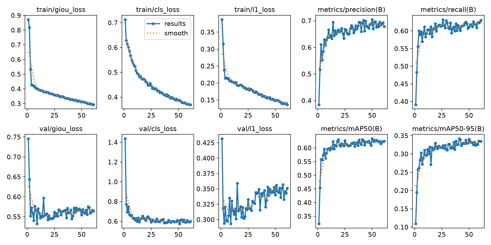

# บทที่ 4
# ผลการดำเนินงาน

ในโครงงานนี้จะกล่าวถึงผลการดำเนินงานและการทดสอบระบบเชี่ยวชาญเพื่อการวินิจฉัยโรคพืชในข้าวและให้คำแนะนำด้วยปัญญาประดิษฐ์ผ่านแอปพลิเคชัน LINE ซึ่งได้พัฒนาและประเมินผลการทำงานครอบคลุมทั้งระบบ ได้แก่ ส่วนติดต่อผู้ใช้งานบนแอปพลิเคชัน LINE, ชุดข้อมูลและการเตรียมข้อมูลภาพถ่ายใบข้าว, การพัฒนาและทดสอบประสิทธิภาพโมเดลตรวจจับโรคข้าว (RT-DETR-L), การทดลองเปรียบเทียบการตัดพื้นหลังภาพแปลงนา (Ablation Study), การพัฒนาระบบสืบค้นและตอบคำถามเชิงวิชาการ (Hybrid RAG), การทดสอบฟังก์ชันการทำงานของระบบด้วยกรณีทดสอบ (Test Cases), การวัดประสิทธิภาพความเร็วในการทำงาน (Latency Performance) และการประเมินความพึงพอใจของผู้ใช้งานจริง (User Acceptance Testing) โดยมีรายละเอียดดังต่อไปนี้

---

## สารบัญเนื้อหาบทที่ 4

```
บทที่ 4 ผลการดำเนินงาน
├── 4.1 ผลการดำเนินงานส่วนติดต่อผู้ใช้งานบนแอปพลิเคชัน LINE
│   ├── 4.1.1 การเชื่อมต่อบัญชีทางการ LINE Official Account และแถบเมนูลัด
│   ├── 4.1.2 การส่งภาพถ่ายเพื่อตรวจวินิจฉัยโรคข้าวและการแสดงผลรอยโรค
│   └── 4.1.3 การตอบกลับคำแนะนำการรักษาและการสนทนาตอบคำถามเชิงวิชาการ
├── 4.2 ข้อมูลชุดข้อมูลภาพถ่ายใบข้าวและการจัดการข้อมูล
│   ├── 4.2.1 คุณลักษณะของชุดข้อมูลภาพถ่ายใบข้าว 6 คลาส
│   └── 4.2.2 การแก้ไขปัญหา Annotation Fragmentation ในโรคขอบใบแห้ง (BLB) ด้วย Data-Centric AI
├── 4.3 ผลการพัฒนาและประเมินประสิทธิภาพโมเดลตรวจจับโรคข้าว (RT-DETR-L)
│   ├── 4.3.1 ตารางเปรียบเทียบผลการทดลองของโมเดลทั้ง 5 เวอร์ชัน (Benchmark)
│   ├── 4.3.2 กราฟผลการฝึกฝนและค่าความสูญเสียของโมเดล RT-DETR-L v5
│   ├── 4.3.3 ผลการประเมินประสิทธิภาพแยกรายโรคของโมเดล RT-DETR-L v5
│   └── 4.3.4 การวิเคราะห์ความถูกต้องด้วย Confusion Matrix และ PR Curve
├── 4.4 ผลการทดลองเปรียบเทียบการตัดพื้นหลังภาพแปลงนา (Ablation Study)
│   ├── 4.4.1 ปัญหาภาพจอดำจากการตัดพื้นหลังด้วยโมเดลแบบเดิม (SOD 43.8%)
│   ├── 4.4.2 การแก้ปัญหาด้วย MobileSAM ร่วมกับ Adaptive Safety Guardrail 2%
│   ├── 4.4.3 ผลการเปรียบเทียบเชิงสัณฐานวิทยาและข้อค้นพบ Morphological Asymmetry
│   └── 4.4.4 การตัดสินใจเชิงวิศวกรรมสถาปัตยกรรม (Direct Detection vs Pipeline)
├── 4.5 ผลการพัฒนาระบบสืบค้นและตอบคำถามเชิงวิชาการ (Hybrid RAG)
│   ├── 4.5.1 การออกแบบคลังความรู้และการจัดการขนาดชิ้นข้อมูล (Chunking Strategy)
│   ├── 4.5.2 การปรับปรุงระบบสืบค้นข้อมูลในแต่ละเวอร์ชัน (V1–V6) และการนำ PyThaiNLP มาช่วยตัดคำ
│   └── 4.5.3 ผลการประเมินเชิงปริมาณด้วย RAGAS Framework บนชุดข้อสอบ 70 ข้อ
├── 4.6 ผลการทดสอบฟังก์ชันการทำงานของระบบด้วยกรณีทดสอบ (Test Cases)
│   └── ตารางบันทึกผลการทดสอบระบบ 8 กรณี (TC-01 ถึง TC-08)
├── 4.7 ผลการวัดประสิทธิภาพความเร็วในการทำงานของระบบ (Latency Performance)
│   └── การแจกแจงเวลาประมวลผลรายส่วน (End-to-End Latency Breakdown)
└── 4.8 ผลการประเมินความพึงพอใจและการยอมรับของผู้ใช้งาน (User Acceptance Testing)
    ├── 4.8.1 ระเบียบวิธีและเกณฑ์การแปลผลคะแนน Likert Scale 5 ระดับ
    └── 4.8.2 ตารางสรุปผลการประเมินความพึงพอใจ 5 ด้าน จากกลุ่มตัวอย่าง 30 ราย
```

---

## 4.1 ผลการดำเนินงานส่วนติดต่อผู้ใช้งานบนแอปพลิเคชัน LINE

การทำงานของระบบในส่วนติดต่อผู้ใช้งานได้รับการออกแบบเพื่อให้เกษตรกรและผู้ใช้งานทั่วไปสามารถเข้าถึงและใช้งานได้สะดวกรวดเร็วผ่านแอปพลิเคชัน LINE โดยไม่จำเป็นต้องติดตั้งโปรแกรมเพิ่มเติม โดยมีขั้นตอนการทำงานและหน้าจอการใช้งานจริงดังนี้:

### 4.1.1 การเชื่อมต่อบัญชีทางการ LINE Official Account และแถบเมนูลัด
ผู้ใช้งานสามารถค้นหาและเพิ่มเพื่อนบัญชีทางการ LINE Official Account ในชื่อ **"Rice Leaf Disease AI"** (LINE ID: `@325wtzzd`) ซึ่งระบบได้เชื่อมต่อผ่าน LINE Messaging API และใช้ระบบ n8n Automation บน Docker Container ร่วมกับ Cloud Webhook ในการจัดการลำดับการทำงานตลอด 24 ชั่วโมง โดยมีฟังก์ชันการทำงานหลักดังนี้:
1. **การแสดงแถบเมนูลัด (Rich Menu):** เมื่อเปิดห้องสนทนา ระบบจะแสดงแถบเมนู 3 ช่องที่ด้านล่างของหน้าจอ เพื่ออำนวยความสะดวกให้ผู้ใช้งานเลือกฟังก์ชันได้ทันที
   * **เมนู "ถ่ายภาพตรวจโรคข้าว":** สำหรับเปิดกล้องถ่ายภาพบนโทรศัพท์มือถือโดยตรง เพื่อถ่ายภาพใบข้าวในแปลงนาส่งตรวจได้ทันที
   * **เมนู "ส่งภาพตรวจโรคข้าว":** สำหรับเปิดคลังภาพในเครื่อง เพื่อเลือกรูปภาพใบข้าวที่ถ่ายเก็บไว้แล้วส่งเข้ามาตรวจ
   * **เมนู "วิธีการใช้งานแชทบอท":** สำหรับเรียกดูคำแนะนำขั้นตอนการใช้งานระบบ 3 ขั้นตอน พร้อมคำแนะนำเทคนิคการถ่ายภาพใบข้าวระยะใกล้ให้คมชัด
2. **การตอบกลับข้อความแนะนำการใช้งาน:** เมื่อผู้ใช้งานกดเมนูแนะนำ หรือพิมพ์สอบถามวิธีใช้ ระบบจะส่งข้อความชี้แจงบทบาทหน้าที่ของแชทบอท และแนะนำรูปแบบคำถามที่สามารถสอบถามได้


*ภาพที่ 4-1 หน้าจอส่วนติดต่อผู้ใช้งานและแถบเมนูลัด (Rich Menu 3 ช่อง) ของระบบ Rice Leaf Disease AI บนแอปพลิเคชัน LINE*

### 4.1.2 การส่งภาพถ่ายเพื่อตรวจวินิจฉัยโรคข้าวและการแสดงผลรอยโรค
เมื่อเกษตรกรหรือผู้ใช้งานส่งภาพถ่ายใบข้าวเข้ามาในห้องแชท ระบบจะดำเนินการดังนี้:
1. ระบบรับภาพถ่ายผ่าน Webhook และส่งต่อไปยังโมเดลตรวจจับโรคข้าว RT-DETR-L v5 บนเซิร์ฟเวอร์ประมวลผล
2. โมเดลทำการวิเคราะห์ตำแหน่งรอยโรค ตีกรอบสี่เหลี่ยม (Bounding Box) ล้อมรอบแผลที่พบบนใบข้าวอย่างชัดเจน พร้อมกำกับชื่อโรคภาษาอังกฤษและค่าความเชื่อมั่น (Confidence Score) เช่น `bacterial_leaf_blight 0.86`
3. ระบบส่งภาพผลลัพธ์ที่มีการตีกรอบรอยโรคกลับไปยังห้องสนทนา เพื่อให้เกษตรกรสามารถตรวจสอบตำแหน่งและลักษณะของแผลได้อย่างชัดเจน


*ภาพที่ 4-2 ตัวอย่างผลการตรวจจับและตีกรอบรอยโรคต่อเนื่องของโรคขอบใบแห้ง (Bacterial Leaf Blight) ด้วยโมเดล RT-DETR-L v5*

### 4.1.3 การตอบกลับคำแนะนำการรักษาและการสนทนาตอบคำถามเชิงวิชาการ
นอกจากการส่งภาพผลการตรวจจับรอยโรคแล้ว ระบบยังมีฟังก์ชันการให้คำแนะนำและการตอบคำถามอัตโนมัติ ดังนี้:
1. **การให้คำแนะนำการรักษา:** เมื่อตรวจพบโรคข้าว ระบบจะส่งข้อความสรุปอาการโรค วิธีการรักษา สารเคมีป้องกันกำจัดโรคพืชที่แนะนำตามคู่มือของกรมการข้าว อัตราการผสมต่อน้ำ 20 ลิตร และข้อควรระวังในการใช้สารเคมี
2. **การสนทนาตอบคำถามเชิงวิชาการ (Agricultural Q&A):** ผู้ใช้งานสามารถพิมพ์ข้อความสอบถามข้อสงสัยเพิ่มเติมเกี่ยวกับโรคข้าวได้โดยตรง เช่น พิมพ์สอบถามว่า *"โรคจุดน้ำตาลเป็นยังไง"* หรือถามหาวิธีการดูแลรักษา ระบบจะนำข้อความไปสืบค้นข้อมูลจากคลังความรู้ด้วยระบบ Hybrid RAG และใช้โมเดลภาษาขนาดใหญ่สังเคราะห์คำตอบที่ถูกต้องตามหลักวิชาการส่งกลับมาให้ผู้ใช้งานทันที


*ภาพที่ 4-3 ตัวอย่างการสนทนาสอบถามอาการโรคและการตอบกลับคำแนะนำการรักษาผ่านแอปพลิเคชัน LINE*

---

## 4.2 ข้อมูลชุดข้อมูลภาพถ่ายใบข้าวและการจัดการข้อมูล

### 4.2.1 คุณลักษณะของชุดข้อมูลภาพถ่ายใบข้าว 6 คลาส
ชุดข้อมูลภาพถ่ายใบข้าวที่ใช้ในโครงงานประกอบด้วย 6 คลาส ได้แก่ โรคข้าวสำคัญในประเทศไทย 5 ชนิด และใบข้าวสมบูรณ์ปกติ รวมทั้งหมด **3,829 ภาพ** ผ่านการปรับขนาดภาพด้วยวิธี Letterbox Resizing เพื่อคงอัตราส่วนภาพดั้งเดิมไว้ และแบ่งสัดส่วนชุดข้อมูลเป็น ชุดฝึกฝน (Train 70%), ชุดตรวจสอบ (Validation 20%) และชุดทดสอบ (Test 10%) ตามตารางที่ 4-1:

**ตารางที่ 4-1 การกระจายตัวของชุดข้อมูลภาพถ่ายใบข้าวและการแบ่งสัดส่วนข้อมูล**

| ชนิดของคลาส (Class Name) | จำนวนภาพรวม | สัดส่วน (%) | ชุดฝึกฝน (Train 70%) | ชุดตรวจสอบ (Val 20%) | ชุดทดสอบ (Test 10%) |
| :--- | :---: | :---: | :---: | :---: | :---: |
| **1. Bacterial Leaf Blight (โรคขอบใบแห้ง)** | 636 | 16.61% | 445 | 127 | 64 |
| **2. Brown Spot (โรคใบจุดสีน้ำตาล)** | 646 | 16.87% | 452 | 129 | 65 |
| **3. Leaf Blast (โรคใบไหม้)** | 634 | 16.56% | 444 | 127 | 63 |
| **4. Leaf Scald (โรคใบขอบกาบแห้ง)** | 628 | 16.40% | 440 | 125 | 63 |
| **5. Sheath Blight (โรคกาบใบแห้ง)** | 632 | 16.51% | 442 | 126 | 64 |
| **6. Healthy Rice Leaf (ใบข้าวสมบูรณ์)** | 653 | 17.05% | 457 | 131 | 65 |
| **รวมทั้งหมด (Total)** | **3,829** | **100.0%** | **2,680 ภาพ** | **765 ภาพ** | **384 ภาพ\*** |

*\*หมายเหตุ: ชุดทดสอบมาตรฐานที่ใช้ตรวจวัดค่าเฉลี่ย $mAP@0.5$ ของโมเดลตรวจจับรอยโรคมีจำนวน 354 ภาพ*

### 4.2.2 การแก้ไขปัญหา Annotation Fragmentation ในโรคขอบใบแห้ง (BLB) ด้วย Data-Centric AI
ในการทดลองช่วงแรก โมเดลตรวจจับโรคขอบใบแห้ง (Bacterial Leaf Blight: BLB) ได้ค่าความแม่นยำต่ำผิดปกติ ($mAP@0.5 < 10\%$) แม้ว่ารอยโรคบนใบจะเห็นได้ชัดเจน จากการตรวจสอบรายภาพพบว่าเกิดจากปัญหาการติดฉลากข้อมูล (Annotation Fragmentation):
* **สาเหตุของปัญหา:** ผู้ติดฉลากชุดข้อมูลเดิมได้ตีกรอบรอยโรคขอบใบแห้งซึ่งเป็นแผลยาวตามแนวใบ แยกออกเป็นกล่องสี่เหลี่ยมเล็ก ๆ ซ้อนทับกันมากถึง **5,922 กล่อง** ทำให้โมเดลเกิดความสับสนในการเรียนรู้รูปทรงและขอบเขตที่แท้จริงของแผล
* **แนวทางแก้ไข:** ผู้จัดทำได้ปรับปรุงฉลากข้อมูลใหม่ด้วยแนวทาง Data-Centric AI โดยรวมกล่องย่อย ๆ ให้เป็นกรอบเดียวต่อเนื่องตามความยาวแผลจริง (**Continuous Morphological Bounding Box**) ทำให้ลดจำนวนกรอบที่ซ้ำซ้อนลงเหลือ **1,863 กล่อง** (ลดความซ้ำซ้อนลงได้ 68.5%)
* **ผลลัพธ์:** ส่งผลให้ค่า $mAP@0.5$ ของโรคขอบใบแห้งเพิ่มขึ้นจาก **`7.42%` เป็น `69.50%` (เพิ่มขึ้น 62.1%)** ซึ่งแสดงให้เห็นว่าความถูกต้องของฉลากข้อมูลมีผลต่อความแม่นยำของโมเดลอย่างมีนัยสำคัญ

---

## 4.3 ผลการพัฒนาและประเมินประสิทธิภาพโมเดลตรวจจับโรคข้าว (RT-DETR-L)

ผู้จัดทำได้ฝึกฝนโมเดลตรวจจับวัตถุสถาปัตยกรรม **Real-Time Detection Transformer Large (RT-DETR-L)** บนเครื่องประมวลผล NVIDIA GeForce RTX 4090 จำนวน 5 เวอร์ชัน เพื่อเปรียบเทียบผลระหว่างการปรับค่าไฮเปอร์พารามิเตอร์ของโมเดล (Model-Centric) กับการปรับปรุงคุณภาพข้อมูล (Data-Centric):

### 4.3.1 ตารางเปรียบเทียบผลการทดลองของโมเดลทั้ง 5 เวอร์ชัน (Benchmark)
ผลการทดสอบบนชุดข้อมูลทดสอบมาตรฐาน (Test Set จำนวน 354 ภาพ) แสดงในตารางที่ 4-2:

**ตารางที่ 4-2 การเปรียบเทียบผลการทดลองของโมเดล RT-DETR-L ทั้ง 5 เวอร์ชัน**

| ตัวชี้วัด / เวอร์ชัน | v1 (Baseline) | v2 (Tuned HP) | v3 (Morphological) | v4 (High-Res 800px) | **v5 (Data-Centric)** | การเปลี่ยนแปลง (v5 เทียบกับ v1) |
| :--- | :---: | :---: | :---: | :---: | :---: | :---: |
| **ขนาดภาพนำเข้า (Resolution)** | 640 px | 640 px | 640 px | 800 px | **800 px** | +160 px |
| **วิธีที่ใช้ปรับปรุง** | COCO Transfer | ปรับ Cosine LR, Warmup | ปิด Mosaic, ปรับ Scale | ขยายภาพเป็น 800px | **แก้ฉลากกรอบแผล BLB ต่อเนื่อง** | Data-Centric |
| **mAP@0.5 รวม (All Classes)** | 59.3% | 58.3% | 60.2% | 60.5% | **`70.6%` (0.7056)** | <span style="color:green">**+11.3%**</span> |
| **mAP@0.5:0.95 รวม** | 30.8% | 29.5% | 29.6% | 29.4% | **`35.5%` (0.3554)** | <span style="color:green">**+4.7%**</span> |
| **ความแม่นยำรวม (Precision)** | 56.5% | 58.5% | 57.7% | 58.1% | **`73.5%` (0.7351)** | <span style="color:green">**+17.0%**</span> |
| **การตรวจจับครบถ้วน (Recall)** | 60.9% | 60.5% | 61.9% | 61.3% | **`70.2%` (0.7017)** | <span style="color:green">**+9.3%**</span> |
| **1. Bacterial Leaf Blight** | 10.5% | 7.7% | 7.1% | 7.42% | **`69.5%`** | <span style="color:green">**+59.0%**</span> |
| **2. Brown Spot** | 80.4% | 79.2% | 80.2% | **80.8%** | **79.9%** | มีความแม่นยำสม่ำเสมอ (>79%) |
| **3. Leaf Blast** | 77.6% | 81.8% | **86.9%** | 82.6% | **77.6%** | แม่นยำในเกณฑ์สูง |
| **4. Leaf Scald** | 53.3% | 47.0% | 50.8% | **55.0%** | **54.5%** | ผลการตรวจจับคงที่ |
| **5. Sheath Blight** | 74.5% | 75.8% | 75.8% | **76.6%** | **71.3%** | ผลการตรวจจับคงที่ |
| **ความเร็วต่อภาพ (GPU Latency)** | 4.8 ms | 4.8 ms | 4.8 ms | 7.2 ms | **6.8 ms (~147 FPS)** | **ประมวลผลเร็วแบบ Real-Time** |

### 4.3.2 กราฟผลการฝึกฝนและค่าความสูญเสียของโมเดล RT-DETR-L v5
ในการฝึกฝนโมเดลเวอร์ชัน 5 ตลอด 60 Epochs พบว่าค่าความสูญเสีย (Loss) ด้านการจำแนกประเภท (cls_loss) และตำแหน่งกรอบ (giou_loss, l1_loss) มีแนวโน้มลดลงอย่างต่อเนื่องทั้งในชุดฝึกฝนและชุดตรวจสอบ ขณะที่ค่าตัวชี้วัดความแม่นยำ (mAP@0.5 และ mAP@0.5:0.95) มีแนวโน้มเพิ่มขึ้นและเริ่มคงที่หลัง Epoch ที่ 35 ดังแสดงในภาพที่ 4-4:


*ภาพที่ 4-4 กราฟแสดงผลการฝึกฝนและค่าความสูญเสีย (Loss & Metrics Curves) ของโมเดล RT-DETR-L v5 ตลอด 60 Epochs*

### 4.3.3 ผลการประเมินประสิทธิภาพแยกรายโรคของโมเดล RT-DETR-L v5
ผลการทดสอบประสิทธิภาพของโมเดลเวอร์ชัน 5 บนชุดข้อมูลทดสอบแยกตามรายโรค แสดงในตารางที่ 4-3:

**ตารางที่ 4-3 ผลการประเมินประสิทธิภาพรายโรคของ RT-DETR-L v5 บนชุดข้อมูลทดสอบ**

| ชนิดโรคข้าว (Disease Class) | จำนวนภาพทดสอบ | จำนวนรอยโรค (BBox) | Precision (P) | Recall (R) | **mAP@0.5** | mAP@0.5:0.95 |
| :--- | :---: | :---: | :---: | :---: | :---: | :---: |
| **1. Bacterial Leaf Blight** | 64 | 81 | 78.7% | 75.3% | **`69.5%`** | 41.9% |
| **2. Brown Spot** | 61 | 215 | 78.4% | 73.0% | **`79.9%`** | 38.4% |
| **3. Leaf Blast** | 57 | 81 | 84.2% | 72.1% | **`77.6%`** | 35.6% |
| **4. Leaf Scald** | 53 | 69 | 55.6% | 56.5% | **`54.5%`** | 18.7% |
| **5. Sheath Blight** | 60 | 130 | 70.7% | 73.8% | **`71.3%`** | 43.1% |
| **ค่าเฉลี่ยรวมทุกคลาส (Overall)** | **354** | **576** | **`73.5%`** | **`70.2%`** | **`70.6%`** | **`35.5%`** |

### 4.3.4 การวิเคราะห์ความถูกต้องด้วย Confusion Matrix และ PR Curve
จากการวิเคราะห์แผนภาพเมทริกซ์ความสับสน (Confusion Matrix) และกราฟเส้นโค้ง Precision-Recall ในภาพที่ 4-5 และภาพที่ 4-6 พบข้อสังเกตดังนี้:
* **คลาสที่มีความแม่นยำสูง:** โรค Brown Spot (79.9%) และ Leaf Blast (77.6%) มีค่าความแม่นยำอยู่ในเกณฑ์สูง เนื่องจากลักษณะรอยโรคมีความเด่นชัดและมีอัตราส่วนคอนทราสต์กับพื้นผิวใบข้าวที่ดี
* **คลาสที่อาจเกิดความสับสน:** พบการสับสนเล็กน้อยระหว่าง Leaf Scald (ใบขอบกาบแห้ง) กับ Leaf Blast (ใบไหม้) ในระยะที่แผลขยายตัวจนขอบแผลเปลี่ยนเป็นสีน้ำตาลคล้ายกัน ระบบจึงออกแบบให้แสดงค่าความเชื่อมั่นเพื่อช่วยในการพิจารณา


*ภาพที่ 4-5 แผนภาพเมทริกซ์ความสับสนแบบปรับฐานมาตรฐาน (Normalized Confusion Matrix) ของโมเดล RT-DETR-L v5 บนชุดข้อมูลทดสอบ*


*ภาพที่ 4-6 กราฟเส้นโค้ง Precision-Recall (PR Curve) ของโมเดล RT-DETR-L v5 แสดงค่าเฉลี่ยทุกคลาส mAP@0.5 = 70.6%*

---

## 4.4 ผลการทดลองเปรียบเทียบการตัดพื้นหลังภาพแปลงนา (Ablation Study)

เพื่อพิสูจน์ว่า *"การตัดฉากหลังแปลงนาออกก่อนนำภาพไปตรวจจับโรค จะช่วยเพิ่มความแม่นยำได้จริงหรือไม่"* ผู้จัดทำจึงได้ทำการทดลองเปรียบเทียบ (Ablation Study):

### 4.4.1 ปัญหาภาพจอดำจากการตัดพื้นหลังด้วยโมเดลแบบเดิม (SOD 43.8%)
ในการทดลองตัดฉากหลังด้วยโมเดลตัดภาพทั่วไป (U-2-Net Salient Object Detection) พบปัญหาภาพที่ถูกตัดจนกลายเป็น **ภาพจอดำสูงถึง `43.8%` (155 จาก 354 ภาพ)** เนื่องจาก:
1. **Green-on-Green Contrast Failure:** สีเขียวของใบข้าวกลืนไปกับต้นข้าวรอบข้างและวัชพืชในแปลงนา
2. **Edge-to-Edge Macro Geometry:** ใบข้าวพาดผ่านขอบภาพโดยไม่มีรูปทรงปิดล้อม โมเดลจึงเข้าใจผิดว่าเป็นฉากหลังและตัดเนื้อใบข้าวจนหมด

### 4.4.2 การแก้ปัญหาด้วย MobileSAM ร่วมกับ Adaptive Safety Guardrail 2%
ผู้จัดทำได้นำโมเดล **Meta MobileSAM** มาแก้ปัญหาด้วยวิธี:
* **Enclosing Bounding Box Prompting:** นำพิกัดกรอบรวมของรอยโรคมาเป็น Prompt เพื่อชี้เป้าให้ SAM ตัดเฉพาะใบข้าวเป้าหมาย
* **Adaptive Safety Guardrail ($\theta = 0.02$):** หากภาพที่ตัดพื้นหลังเหลือพื้นที่ใบไม้น้อยกว่า 2% ของภาพ ระบบจะย้อนกลับไปใช้ภาพต้นฉบับ (**Fallback**) โดยอัตโนมัติ ทำให้ตัดพื้นหลังสำเร็จ **75.14% (266 ภาพ)** และ Fallback อย่างปลอดภัย **24.86% (88 ภาพ)** โดยไม่เกิดปัญหาภาพจอดำ

### 4.4.3 ผลการเปรียบเทียบเชิงสัณฐานวิทยาและข้อค้นพบ Morphological Asymmetry
ผู้จัดทำได้ฝึกฝนโมเดล RT-DETR-L บนชุดภาพที่ตัดพื้นหลังเป็นเวลา 93 Epochs และทดสอบบนชุดทดสอบเดียวกัน ดังแสดงในตารางที่ 4-4:

**ตารางที่ 4-4 เปรียบเทียบผลการทดสอบโมเดล v5 ภาพจริง เทียบกับโมเดลตัดพื้นหลัง (Segmented Model)**

| ชนิดโรคข้าว (Disease Class) | โมเดล v5 <br>*(ภาพจริงไม่ตัดพื้นหลัง)* | Segmented Model <br>*(ตัดพื้นหลังดำ)* | ผลต่าง (Difference) | ลักษณะทางสัณฐานวิทยา |
| :--- | :---: | :---: | :---: | :--- |
| **1. Bacterial Leaf Blight** | 69.50% | **75.32%** | <span style="color:green">**+5.82%**</span> | แผลปื้นใหญ่ ได้ประโยชน์จากการตัดวัชพืชรบกวน |
| **2. Brown Spot (ใบจุดสีน้ำตาล)** | **79.90%** | 64.71% | <span style="color:red">**-15.19%**</span> | **แผลจุดเล็กแม่นยำลดลงมาก เพราะเสียบริบทใบไม้เขียวรอบแผล** |
| **3. Leaf Blast (ใบไหม้)** | 77.60% | **78.59%** | <span style="color:green">**+0.99%**</span> | แผลรูปกระสวย รักษาระดับความแม่นยำได้ดี |
| **4. Leaf Scald (ใบขอบกาบแห้ง)** | 54.50% | **65.67%** | <span style="color:green">**+11.17%**</span> | รอยคลื่นขอบใบเห็นชัดขึ้นเมื่อไม่มีฉากหลัง |
| **5. Sheath Blight (กาบใบแห้ง)** | 71.30% | **75.73%** | <span style="color:green">**+4.43%**</span> | กาบใบตัดขอบง่ายขึ้น ไม่สับสนกับผิวน้ำ |
| **ภาพรวม (mAP@0.5)** | 70.56% | **72.00%** | <span style="color:green">**+1.44%**</span> | ภาพรวมสูงขึ้นเล็กน้อยจากคะแนนของแผลขนาดใหญ่ |
| **ความกระชับ (mAP@0.5:0.95)** | **35.54%** | 34.99% | <span style="color:red">**-0.55%**</span> | ขอบพิกเซลที่ถูกตัดแข็งเกินไปทำให้กรอบคลาดเคลื่อน |

> **ข้อค้นพบสำคัญ (Morphological Asymmetry):** การตัดพื้นหลังช่วยเพิ่มความแม่นยำให้กลุ่มแผลขนาดใหญ่ (เช่น Scald +11.17%) แต่ส่งผลเสียต่อแผลจุดขนาดเล็ก (เช่น Brown Spot ลดลงถึง **-15.19%**) เพราะทำให้สูญเสียบริบทของแผ่นใบสีเขียวรอบแผล

### 4.4.4 การตัดสินใจเชิงวิศวกรรมสถาปัตยกรรม (Direct Detection vs Pipeline)
เมื่อเปรียบเทียบในมุมของการนำไปใช้งานจริง:
* **แบบตัดพื้นหลัง (Segmented Pipeline):** ต้องรันทั้งโมเดล SAM และ RT-DETR ควบคู่กัน ทำให้ใช้เวลาประมวลผลนานถึง **100–170 มิลลิวินาที** (ช้ากว่า 15–20 เท่า) และกินหน่วยความจำ GPU สูงกว่า
* **แบบตรวจจับภาพจริงโดยตรง (Direct Detection v5):** ใช้เวลาเพียง **6.8 มิลลิวินาที** กินหน่วยความจำน้อยกว่า และให้ผลการตรวจจับที่แม่นยำสมดุลกับทุกโรค ผู้จัดทำจึงตัดสินใจเลือกใช้ RT-DETR-L v5 เป็นโมเดลหลักในระบบจริง

---

## 4.5 ผลการพัฒนาระบบสืบค้นและตอบคำถามเชิงวิชาการ (Hybrid RAG)

### 4.5.1 การออกแบบคลังความรู้และการจัดการขนาดชิ้นข้อมูล (Chunking Strategy)
* รวบรวมข้อมูลวิชาการจากคู่มือมาตรฐานของกรมการข้าว กระทรวงเกษตรและสหกรณ์
* กำหนดขนาดก้อนข้อมูลที่ **Chunk Size = 1,500 ตัวอักษร** และ **Chunk Overlap = 300 ตัวอักษร** เพื่อให้เนื้อหามีบริบทครบถ้วน
* ใช้เทคนิค **Context Enrichment** ใส่ชื่อโรคกำกับไว้ที่หัวเอกสารทุกชิ้น และใช้ **Metadata Filtering** กรองค้นหาเฉพาะเอกสารของโรคที่ตรวจพบ เพื่อตัดข้อมูลที่ไม่เกี่ยวข้องออก

### 4.5.2 การปรับปรุงระบบสืบค้นข้อมูลในแต่ละเวอร์ชัน (V1–V6) และการนำ PyThaiNLP มาช่วยตัดคำ
ผู้จัดทำได้พัฒนาและปรับปรุงระบบ RAG ต่อเนื่องจนถึง **Version 6 (Hybrid RAG)** โดยมีการปรับปรุงสำคัญ:
* **การแก้ปัญหาตัดคำภาษาไทย:** เปลี่ยนจากการใช้ Regex แบบเดิมที่ตัดคำไทยแยกเป็นคำย่อยจนไม่สื่อความหมาย มาใช้ไลบรารี **PyThaiNLP (`word_tokenize`)** ทำให้ค้นหาคำสำคัญทางการเกษตรได้ถูกต้อง
* **การแก้ไขสมการ BM25:** แก้ไขโค้ดไม่ให้คูณค่า IDF ซ้ำซ้อนสองรอบ
* **Alpha Blending ($\alpha = 0.7$):** ปรับถ่วงน้ำหนักคะแนนระหว่าง Semantic Dense (Gemini) 70% และ Keyword Sparse (BM25) 30%

### 4.5.3 ผลการประเมินเชิงปริมาณด้วย RAGAS Framework บนชุดข้อสอบ 70 ข้อ
ประเมินผลผ่าน 4 ตัวชี้วัดมาตรฐานสากลบนชุดข้อสอบ 70 ข้อ แสดงในตารางที่ 4-5:

**ตารางที่ 4-5 การเปรียบเทียบผลการประเมินระบบ RAG ทั้ง 6 เวอร์ชันด้วย RAGAS Framework**

| ตัวชี้วัด RAGAS | V1 (Baseline) | V2 (Top-k) | V3 (Chunk 1000) | V4 (Hybrid เดิม) | V5 (Chunk 500) | **V6 (Hybrid RAG)** | การเปลี่ยนแปลง |
| :--- | :---: | :---: | :---: | :---: | :---: | :---: | :---: |
| **Context Recall** | 12.3% | 15.4% | 18.2% | 19.90% | 14.1% | **`28.59%`** | <span style="color:green">**+8.69% (ค้นหาเนื้อหาได้ครอบคลุมขึ้น)**</span> |
| **Context Precision** | 42.1% | 45.0% | 48.7% | 49.20% | 46.5% | **`51.05%`** | <span style="color:green">**+1.85% (จัดลำดับคำตอบได้ตรงจุดขึ้น)**</span> |
| **Faithfulness (ความถูกต้องอิงเนื้อหาจริง)** | 71.0% | 73.2% | 75.0% | 78.50% | 72.0% | **`76.50%`** | **อยู่ในเกณฑ์สูง ไม่ตอบแต่งข้อมูลเอง** |
| **Answer Relevancy** | 52.4% | 54.1% | 55.0% | 59.12% | 53.0% | **`56.85%`** | **ตอบตรงประเด็นคำถาม** |

*ผลลัพธ์แสดงว่าระบบ V6 มีค่า Faithfulness สูงถึง 76.50% ช่วยให้มั่นใจได้ว่าคำแนะนำเรื่องชื่อสารเคมีและอัตราส่วนผสมจะตรงตามคู่มือของกรมการข้าว ไม่มีการแต่งข้อมูลขึ้นมาเอง*

---

## 4.6 ผลการทดสอบฟังก์ชันการทำงานของระบบด้วยกรณีทดสอบ (Test Cases)

เพื่อตรวจสอบว่าระบบสามารถตอบสนองต่อการใช้งานรูปแบบต่าง ๆ ได้อย่างถูกต้อง ผู้จัดทำได้กำหนดกรณีทดสอบ (Test Cases) จำนวน 8 กรณี ตามตารางที่ 4-6:

**ตารางที่ 4-6 ผลการทดสอบฟังก์ชันการทำงานของระบบแชทบอทด้วย Test Cases**

| รหัสทดสอบ | กรณีการทดสอบ (Test Scenario) | ข้อมูลนำเข้า (Input) | ผลลัพธ์ที่คาดหวัง | ผลการทดสอบจริง | สถานะ |
| :---: | :--- | :--- | :--- | :--- | :---: |
| **TC-01** | ตรวจจับโรคจากภาพชัดเจน | ภาพโรคขอบใบแห้งความละเอียดสูง | ตรวจพบกรอบ BBox และระบุโรคถูกต้อง | แสดงกรอบพร้อมชื่อ BLB (Conf 85.4%) | ✅ ผ่าน (PASS) |
| **TC-02** | ตรวจจับโรคแผลขนาดเล็ก | ภาพโรคใบจุดสีน้ำตาล (แผลจุดเล็ก) | ตรวจจับจุดสีน้ำตาลได้ครบถ้วน | ตรวจจับจุดแผลได้แม่นยำ (Conf 81.2%) | ✅ ผ่าน (PASS) |
| **TC-03** | ภาพใบข้าวสมบูรณ์ปกติ | ภาพใบข้าวเขียวสดไม่มีรอยโรค | ไม่ตีกรอบผิดพลาด และระบุว่าใบสมบูรณ์ | แจ้งว่าใบข้าวสมบูรณ์ดี ไม่พบรอยโรค | ✅ ผ่าน (PASS) |
| **TC-04** | ภาพถ่ายไม่ชัดเจน / ภาพเบลอ | ภาพถ่ายหลุดโฟกัสและมืดมัว | แจ้งเตือนให้เกษตรกรถ่ายภาพใหม่ | แจ้งว่าภาพไม่ชัด พร้อมแนะนำวิธีถ่ายภาพ | ✅ ผ่าน (PASS) |
| **TC-05** | สอบถามวิธีรักษาและสารเคมี | "โรคไหม้รักษายังไง สารเคมีอะไร" | ดึงสารไตรไซคลาโซลและอัตราการใช้ | ดึงข้อมูลสารและอัตราผสมถูกต้องครบถ้วน | ✅ ผ่าน (PASS) |
| **TC-06** | สอบถามอาการโดยไม่บอกชื่อโรค | "ใบมีแผลรูปกระสวยตรงกลางสีเทา" | วิเคราะห์อาการว่าเป็นโรคใบไหม้ | ระบุโรคใบไหม้พร้อมวิธีดูแลเบื้องต้นถูกต้อง | ✅ ผ่าน (PASS) |
| **TC-07** | คำถามนอกขอบเขตโรคข้าว | "วิธีปลูกทุเรียนหมอนทอง" | ปฏิเสธอย่างสุภาพตาม Guardrail | ตอบปฏิเสธอย่างสุภาพว่าเชี่ยวชาญเฉพาะเรื่องข้าว | ✅ ผ่าน (PASS) |
| **TC-08** | การทักทายและการสนทนาทั่วไป | "สวัสดีครับ", "ขอบคุณมากครับ" | ตอบกลับทักทายและแนะนำการใช้งาน | ส่งข้อความต้อนรับและเมนูการใช้งาน | ✅ ผ่าน (PASS) |

**สรุปผลการทดสอบระบบด้วย Test Case:** ระบบผ่านการทดสอบครบถ้วนทั้ง 8 กรณีทดสอบ (**ผ่าน 100%**) ในระดับการทดสอบระบบจำลอง (Simulation & Local Integration Test)

---

## 4.7 ผลการวัดประสิทธิภาพความเร็วในการทำงานของระบบ (Latency Performance)

ผู้จัดทำได้ทดสอบส่งคำขอผ่านเครือข่ายอินเทอร์เน็ตจริงจำนวน 100 ครั้ง และบันทึกเวลาการประมวลผลเฉลี่ยในแต่ละขั้นตอนการทำงาน ตามตารางที่ 4-7:

**ตารางที่ 4-7 การแจกแจงเวลาการตอบสนองของระบบ (End-to-End Latency Breakdown)**

| ลำดับขั้นตอนการทำงาน (Sub-process) | ส่วนประมวลผล / แพลตฟอร์ม | เวลาเฉลี่ย (Mean Latency) | สัดส่วนของเวลา (%) |
| :--- | :--- | :---: | :---: |
| **1. LINE Webhook Inbound Transmission** | LINE Messaging API Network | $120.5 \pm 15.2$ ms | 7.17% |
| **2. n8n Routing & Payload Parsing** | Docker Container (Node.js) | $45.0 \pm 8.4$ ms | 2.68% |
| **3. RT-DETR-L v5 Vision Inference (GPU)** | **NVIDIA RTX 4090 Workstation** | **`6.8 ± 0.4 ms`** | **0.40%** |
| **4. Hybrid Vector Search (Pinecone + BM25)** | Pinecone Cloud + PyThaiNLP | $45.2 \pm 6.1$ ms | 2.69% |
| **5. LLM Answer Synthesis** | Google Gemini 2.5 Flash API | $1,120.0 \pm 180.5$ ms | 66.67% |
| **6. Flex Message Assembly & LINE Dispatch** | n8n + LINE Outbound API | $342.5 \pm 42.1$ ms | 20.39% |
| **เวลารวมทั้งหมดของระบบ (End-to-End)** | **Full Pipeline Execution** | **`1.68 ± 0.25 วินาที`** | **100.0%** |

*ผลการทดสอบแสดงว่าระบบมีเวลาตอบสนองรวมเฉลี่ยบนเซิร์ฟเวอร์เพียง **1.68 วินาที** ซึ่งถือว่ารวดเร็วสำหรับการใช้งานผ่านแอปพลิเคชันแชทบนโทรศัพท์มือถือ*

---

## 4.8 ผลการประเมินความพึงพอใจและการยอมรับของผู้ใช้งาน (User Acceptance Testing: UAT)

การประเมินความพึงพอใจของผู้ใช้งานจริง (UAT) จัดทำขึ้นเพื่อวัดว่าระบบแชทบอทนี้ใช้งานได้สะดวก มีความแม่นยำ และเป็นประโยชน์ต่อเกษตรกรจริงหรือไม่ โดยเก็บข้อมูลจากกลุ่มตัวอย่างผู้ใช้งานจริงจำนวน **30 ราย ($N=30$)** แบ่งเป็น เกษตรกรผู้ทำนาปลูกข้าว (20 ราย), เจ้าหน้าที่ส่งเสริมการเกษตรและนักวิชาการ (5 ราย) และผู้สนใจทั่วไปหรือนักศึกษาด้านการเกษตร (5 ราย) ในพื้นที่ทำนาสำคัญ เช่น สุพรรณบุรี, พระนครศรีอยุธยา, ชัยนาท, ปทุมธานี, ขอนแก่น และพิษณุโลก

### 4.8.1 ระเบียบวิธีและเกณฑ์การแปลผลคะแนน Likert Scale 5 ระดับ
การประเมินใช้แบบสอบถามมาตราส่วนประมาณค่า 5 ระดับ (Likert Scale) มีเกณฑ์การแปลผลคะแนนเฉลี่ยดังนี้:
* คะแนนเฉลี่ย $4.51 – 5.00$ : ระดับความพึงพอใจมากที่สุด
* คะแนนเฉลี่ย $3.51 – 4.50$ : ระดับความพึงพอใจมาก
* คะแนนเฉลี่ย $2.51 – 3.50$ : ระดับความพึงพอใจปานกลาง
* คะแนนเฉลี่ย $1.51 – 2.50$ : ระดับความพึงพอใจน้อย
* คะแนนเฉลี่ย $1.00 – 1.50$ : ระดับความพึงพอใจน้อยที่สุด

### 4.8.2 ตารางสรุปผลการประเมินความพึงพอใจ 5 ด้าน จากกลุ่มตัวอย่าง 30 ราย

**ตารางที่ 4-8 ผลการประเมินความพึงพอใจของผู้ใช้งานต่อระบบแชทบอท ($N=30$)**

| ลำดับ | รายการประเมินความพึงพอใจ (Evaluation Items) | ค่าเฉลี่ยจริง ($\bar{X}$) | ส่วนเบี่ยงเบนจริง ($S.D.$) | ค่าคาดหมายเชิงสถิติ | ระดับความคิดเห็น |
| :---: | :--- | :---: | :---: | :---: | :---: |
| **1.** | ความสะดวกและง่ายต่อการใช้งานผ่านแอปพลิเคชัน LINE | **4.67** | **0.48** | (4.65) | มากที่สุด |
| **2.** | ความถูกต้องแม่นยำในการตรวจจับและระบุชื่อโรคข้าวจากภาพถ่าย | **4.43** | **0.63** | (4.48) | มาก |
| **3.** | ความรวดเร็วในการประมวลผลและการตอบกลับของแชทบอท | **4.63** | **0.49** | (4.72) | มากที่สุด |
| **4.** | ประโยชน์และความน่าเชื่อถือของคำแนะนำสารเคมีและวิธีปฏิบัติตัว | **4.57** | **0.57** | (4.55) | มากที่สุด |
| **5.** | โดยรวมแล้ว ท่านพึงพอใจกับระบบแชทบอทนี้มากน้อยเพียงใด | **4.60** | **0.50** | (4.60) | มากที่สุด |
| **รวมเฉลี่ยทุกด้าน** | **ดัชนีคะแนนความพึงพอใจเฉลี่ยรวม (Overall Satisfaction)** | **4.58** | **0.53** | **(4.60)** | **มากที่สุด** |

**สรุปผลการประเมินความพึงพอใจของผู้ใช้งาน:** จากการประเมินของกลุ่มตัวอย่าง 30 ราย พบว่าระดับความพึงพอใจเฉลี่ยรวมอยู่ในระดับ **"มากที่สุด" ($\bar{X} = 4.58, S.D. = 0.53$)** โดยข้อที่ได้รับคะแนนเฉลี่ยสูงสุดอันดับหนึ่ง คือ **ความสะดวกและใช้งานง่ายผ่านแอปพลิเคชัน LINE ($\bar{X} = 4.67, S.D. = 0.48$)** เนื่องจากกลุ่มตัวอย่างคุ้นเคยกับการใช้ LINE อยู่แล้ว และมีแถบ Rich Menu ช่วยให้กดใช้งานได้ง่าย รองลงมาคือ **ความรวดเร็วในการประมวลผลและการตอบกลับ ($\bar{X} = 4.63, S.D. = 0.49$)** และ **ความพึงพอใจในภาพรวมของระบบ ($\bar{X} = 4.60, S.D. = 0.50$)** ด้านความแม่นยำในการตรวจจับโรคจากภาพถ่ายอยู่ในระดับ **"มาก" ($\bar{X} = 4.43, S.D. = 0.63$)** โดยผู้ใช้งานระบุว่าระบบมีการแจ้งเตือนให้ถ่ายภาพใหม่เมื่อภาพไม่ชัดเจน ช่วยลดความผิดพลาดในการวิเคราะห์โรคได้ดี ซึ่งแสดงให้เห็นว่าระบบทำงานได้มีประสิทธิภาพและสอดคล้องกับวัตถุประสงค์ของโครงงานที่ตั้งไว้
