# บทที่ 4
## ผลการดำเนินงาน

### 4.1 ผลการดำเนินงาน
การพัฒนาระบบแชทบอทวินิจฉัยโรคข้าวและแนะนำวิธีการรักษาผ่านแอปพลิเคชัน LINE ด้วยเทคนิค RAG มีผู้ใช้งานทั้งหมด 2 ส่วน คือ เกษตรกร/ผู้ใช้งานทั่วไป และผู้ดูแลระบบ (Admin)

#### 4.1.1 ขอบเขตด้านผู้ใช้งาน (User)
**(1) เกษตรกร/ผู้ใช้งานทั่วไป**
* สามารถส่งรูปภาพใบข้าวที่มีความผิดปกติเข้าสู่ห้องแชท LINE
* สามารถรับผลการวิเคราะห์ชื่อโรค สาเหตุ และวิธีการรักษาเบื้องต้นได้
* สามารถสอบถามข้อมูลเพิ่มเติมเกี่ยวกับโรคข้าวผ่านการพิมพ์ข้อความได้

**(2) ผู้ดูแลระบบ (Admin)**
* **(2.1)** สามารถจัดการข้อมูลเอกสารความรู้ (Knowledge Base) ในฐานข้อมูล Vector ได้
* **(2.2)** สามารถดูประวัติการใช้งาน (Log) ของระบบได้

#### 4.1.2 ขอบเขตด้านระบบและการทำงาน (System Function)
* **(1) การวิเคราะห์รูปภาพ (Image Analysis):** ระบบใช้โมเดล RT-DETR (Real-Time DEtection TRansformer) ในการตรวจจับ (Detection) และจำแนก (Classification) ลักษณะรอยโรคที่ปรากฏบนใบข้าว
* **(2) ระบบค้นหาข้อมูล (RAG System):** ระบบใช้เทคนิค Retrieval-Augmented Generation เชื่อมต่อกับ Vector Database เพื่อค้นหาข้อมูลยาและการรักษาจากเอกสารคู่มือวิชาการที่เชื่อถือได้
* **(3) ระบบสนทนา (Conversational Agent):** ใช้ Large Language Model (LLM) ในการประมวลผลภาษาธรรมชาติและเรียบเรียงคำตอบให้เข้าใจง่ายสำหรับเกษตรกร

#### 4.1.3 ขอบเขตด้านข้อมูล (Data Scope)
* **(1) ชุดข้อมูลรูปภาพใบโรคข้าว (Image Dataset):** ใช้ข้อมูลจากแหล่งข้อมูลสาธารณะ Kaggle: Rice Leaf Diseases Dataset เพื่อใช้เป็นฐานความรู้ในการวิเคราะห์ลักษณะอาการของโรค
* **(2) ชุดข้อมูลเอกสารความรู้ (Knowledge Base):** รวบรวมข้อมูลจากองค์ความรู้เรื่องข้าว กรมการข้าว กระทรวงเกษตรและสหกรณ์ เพื่อใช้เป็นฐานข้อมูลอ้างอิงในระบบ RAG

#### 4.1.4 ขอบเขตด้านฮาร์ดแวร์และซอฟต์แวร์
* **(1) แอปพลิเคชัน:** LINE Application
* **(2) ระบบ Workflow Automation:** n8n (Node-based Workflow Automation)
* **(3) AI Model:** Gemini 2.5 Flash สำหรับการทำ RAG และตอบคำถาม
* **(4) Database:** Pinecone (Vector Database) สำหรับจัดเก็บ Knowledge Base

---

### 4.2 เกษตรกร/ผู้ใช้งานทั่วไป

**(1) สามารถส่งรูปภาพใบข้าวที่มีความผิดปกติเข้าสู่ห้องแชท LINE**

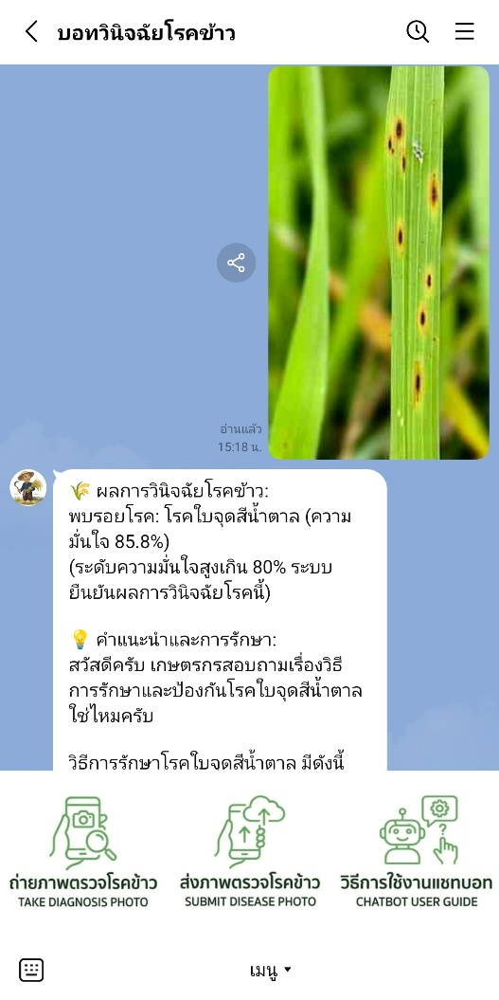  
*ภาพที่ 4-1 การส่งรูปภาพใบข้าวที่มีความผิดปกติเข้าสู่ห้องแชท LINE*

**(2) สามารถรับผลการวิเคราะห์ชื่อโรค สาเหตุ และวิธีการรักษาเบื้องต้นได้**

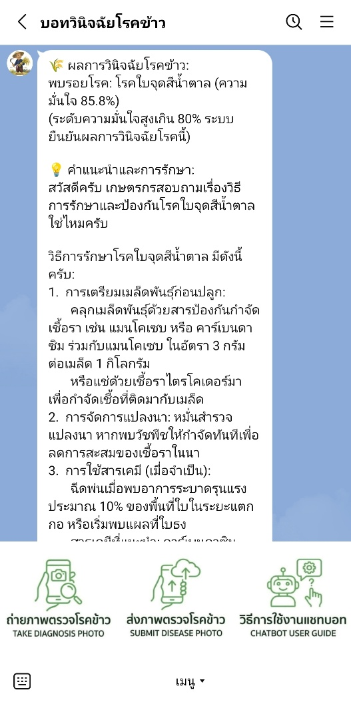  
*ภาพที่ 4-2 การได้รับผลการวิเคราะห์ชื่อโรค สาเหตุ และวิธีการรักษาเบื้องต้น*

**(3) สามารถสอบถามข้อมูลเพิ่มเติมเกี่ยวกับโรคข้าวผ่านการพิมพ์ข้อความได้**

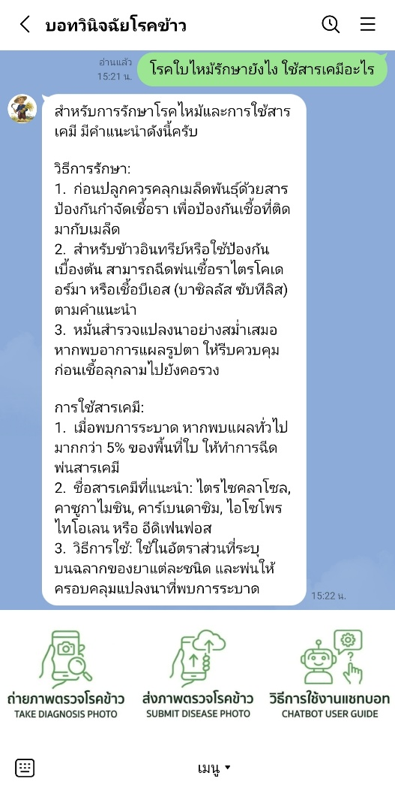  
*ภาพที่ 4-3 การสอบถามข้อมูลเพิ่มเติมเกี่ยวกับโรคข้าวผ่านการพิมพ์ข้อความ*

---

### 4.3 ผู้ดูแลระบบ (Admin)

**(1) สามารถจัดการข้อมูลเอกสารความรู้ (Knowledge Base) ในฐานข้อมูล Vector ได้**

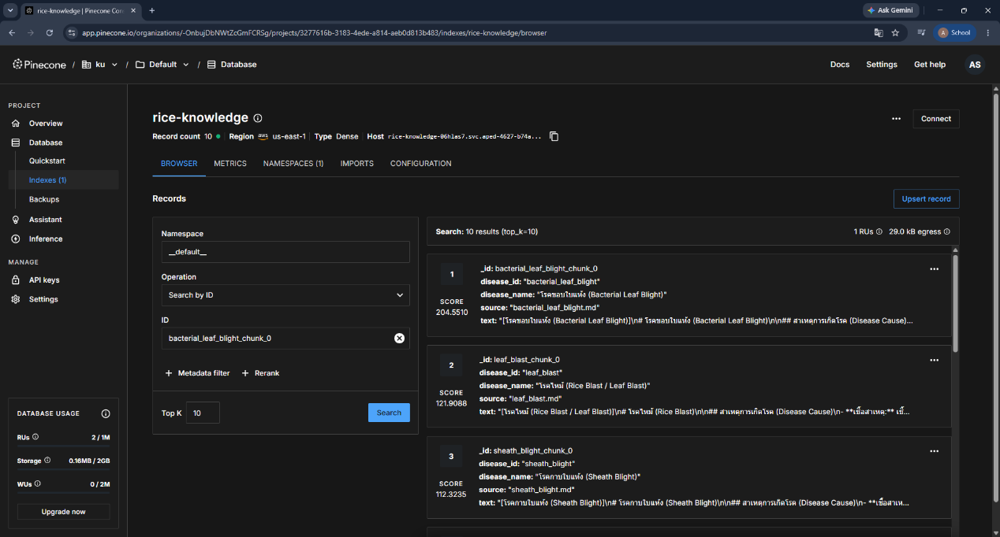  
*ภาพที่ 4-4 การจัดการข้อมูลเอกสารความรู้ในฐานข้อมูล*

**(2) สามารถดูประวัติการใช้งาน (Log) ของระบบได้**

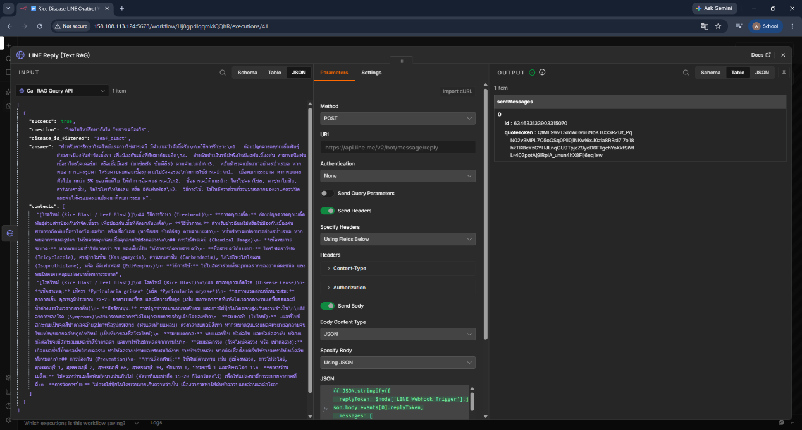  
*ภาพที่ 4-5 การดูประวัติการใช้งาน (Log) ของระบบ*

---

### 4.4 ชุดข้อมูลภาพถ่ายใบข้าวและการเตรียมข้อมูล

#### 4.4.1 คุณลักษณะของชุดข้อมูลภาพถ่ายใบข้าว 6 คลาส
ชุดข้อมูลภาพถ่ายใบข้าวที่ใช้ในโครงงานประกอบด้วย 6 คลาส ได้แก่ โรคข้าวสำคัญในประเทศไทย 5 ชนิด และใบข้าวสมบูรณ์ปกติ รวมทั้งหมด 3,829 ภาพ ผ่านการปรับขนาดภาพด้วยวิธี Letterbox Resizing เพื่อคงอัตราส่วนภาพดั้งเดิมไว้ และแบ่งสัดส่วนชุดข้อมูลเป็น ชุดฝึกฝน (Train 70%), ชุดตรวจสอบ (Validation 20%) และชุดทดสอบ (Test 10%) ตามตารางที่ 4-1:

**ตารางที่ 4-1 การกระจายตัวของชุดข้อมูลภาพถ่ายใบข้าวและการแบ่งสัดส่วนข้อมูล**

| ชนิดของคลาส (Class Name) | จำนวนภาพรวม | สัดส่วน (%) | ชุดฝึกฝน (Train 70%) | ชุดตรวจสอบ (Val 20%) | ชุดทดสอบ (Test 10%) |
| :--- | :---: | :---: | :---: | :---: | :---: |
| 1. Bacterial Leaf Blight (โรคขอบใบแห้ง) | 636 | 16.61% | 445 | 127 | 64 |
| 2. Brown Spot (โรคใบจุดสีน้ำตาล) | 646 | 16.87% | 452 | 129 | 65 |
| 3. Leaf Blast (โรคใบไหม้) | 634 | 16.56% | 444 | 127 | 63 |
| 4. Leaf Scald (โรคใบขอบกาบแห้ง) | 628 | 16.40% | 440 | 125 | 63 |
| 5. Sheath Blight (โรคกาบใบแห้ง) | 632 | 16.51% | 442 | 126 | 64 |
| 6. Healthy Rice Leaf (ใบข้าวสมบูรณ์) | 653 | 17.05% | 457 | 131 | 65 |
| **รวมทั้งหมด (Total)** | **3,829** | **100.0%** | **2,680 ภาพ** | **765 ภาพ** | **384 ภาพ** |

#### 4.4.2 การแก้ไขปัญหากรอบรอยโรคซ้ำซ้อนในโรคขอบใบแห้ง (BLB)
ในการทดลองช่วงแรก โมเดลตรวจจับโรคขอบใบแห้ง (Bacterial Leaf Blight: BLB) มีค่าความแม่นยำต่ำมาก (mAP@0.5 < 10%) ทั้งที่รอยโรคบนใบเห็นได้ชัด เมื่อตรวจสอบดูภาพรายภาพพบว่าเกิดจากปัญหาการติดฉลากข้อมูล (Annotation Fragmentation):

* **(1) สาเหตุ:** ผู้ติดฉลากข้อมูลเดิมได้ตีกรอบรอยโรคขอบใบแห้งซึ่งเป็นแผลยาวตามแนวใบ แยกออกเป็นกล่องเล็ก ๆ ซ้อนทับกันมากถึง 5,922 กล่อง ทำให้โมเดลสับสนในการเรียนรู้รูปทรงและขอบเขตจริงของแผล
* **(2) วิธีแก้ไข:** ผู้จัดทำได้ปรับปรุงฉลากข้อมูลใหม่ด้วยวิธี Data-Centric AI โดยรวมกล่องย่อย ๆ ให้เป็นกรอบเดียวต่อเนื่องตามความยาวแผลจริง ทำให้ลดจำนวนกรอบที่ซ้ำซ้อนลงเหลือ 1,863 กล่อง (ลดความซ้ำซ้อนลงได้ 68.5%)
* **(3) ผลลัพธ์:** ทำให้ค่า mAP@0.5 ของโรคขอบใบแห้งเพิ่มขึ้นจาก 7.42% เป็น 69.50% (เพิ่มขึ้น 62.1%) ซึ่งแสดงให้เห็นว่าการปรับปรุงข้อมูลให้ถูกต้องช่วยเพิ่มความแม่นยำของโมเดลได้มากกว่าการปรับแต่งตัวโมเดลเพียงอย่างเดียว

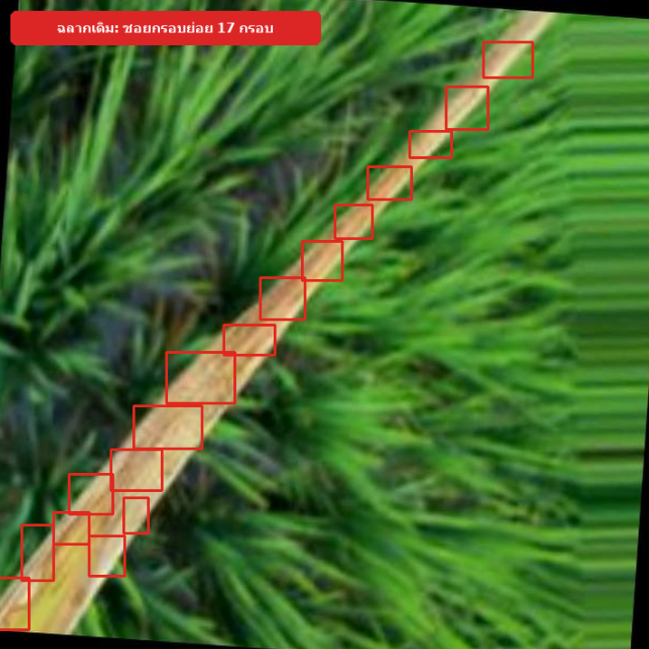  
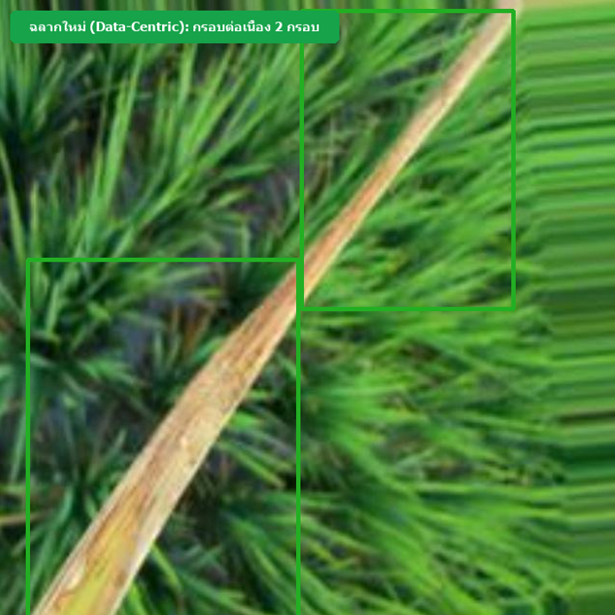  
*ภาพที่ 4-6 การเปรียบเทียบกรอบรอยโรค (Bounding Box) ของโรคขอบใบแห้ง*

---

### 4.5 ผลการพัฒนาและประเมินประสิทธิภาพโมเดลตรวจจับโรคข้าว
ผู้จัดทำได้ฝึกสอนโมเดล RT-DETR-L (Real-Time Detection Transformer) บนเครื่อง NVIDIA RTX 4090 ทั้งหมด 5 เวอร์ชัน เพื่อดูความแตกต่างระหว่างการปรับจูนตัวโมเดล กับการแก้ปัญหาที่ตัวข้อมูล (Data-Centric):

#### 4.5.1 ตารางเปรียบเทียบผลการทดลองของโมเดลทั้ง 5 เวอร์ชัน
ผลการทดสอบบนชุดข้อมูลทดสอบมาตรฐาน (Test Set จำนวน 354 ภาพ) แสดงในตารางที่ 4-2:

**ตารางที่ 4-2 การเปรียบเทียบผลการทดลองของโมเดล RT-DETR-L ทั้ง 5 เวอร์ชัน**

| ตัวชี้วัด / เวอร์ชัน | v1 (Baseline) | v2 (Tuned HP) | v3 (Morphological) | v4 (High-Res 800px) | v5 (Data-Centric) | การเปลี่ยนแปลง (v5 เทียบ v1) |
| :--- | :---: | :---: | :---: | :---: | :---: | :---: |
| ขนาดภาพนำเข้า (Resolution) | 640 px | 640 px | 640 px | 800 px | 800 px | +160 px |
| วิธีที่ใช้ปรับปรุง | COCO Transfer | ปรับ Cosine LR, Warmup | ปิด Mosaic, ปรับ Scale | ขยายภาพเป็น 800px | แก้ฉลากแผล BLB ต่อเนื่อง | Data-Centric |
| mAP@0.5 รวม (All Classes) | 59.3% | 58.3% | 60.2% | 60.5% | 70.6% (0.7056) | +11.3 pp |
| mAP@0.5:0.95 รวม | 30.8% | 29.5% | 29.6% | 29.4% | 35.5% (0.3554) | +4.7 pp |
| ความแม่นยำรวม (Precision) | 56.5% | 58.5% | 57.7% | 58.1% | 73.5% (0.7351) | +17.0 pp |
| การตรวจจับครบถ้วน (Recall) | 60.9% | 60.5% | 61.9% | 61.3% | 70.2% (0.7017) | +9.3 pp |
| 1. Bacterial Leaf Blight | 10.5% | 7.7% | 7.1% | 7.42% | 69.5% | +59.0 pp |
| 2. Brown Spot | 80.4% | 79.2% | 80.2% | 80.8% | 79.9% | แม่นยำสม่ำเสมอ (>79%) |
| 3. Leaf Blast | 77.6% | 81.8% | 86.9% | 82.6% | 77.6% | แม่นยำในเกณฑ์สูง |
| 4. Leaf Scald | 53.3% | 47.0% | 50.8% | 55.0% | 54.5% | ผลการตรวจจับคงที่ |
| 5. Sheath Blight | 74.5% | 75.8% | 75.8% | 76.6% | 71.3% | ผลการตรวจจับคงที่ |
| เวลาประมวลผลต่อภาพ (GPU) | 4.8 ms | 4.8 ms | 4.8 ms | 7.2 ms | 6.8 ms (~147 FPS) | ประมวลผลเร็วแบบ Real-Time |

#### 4.5.2 กราฟผลการฝึกฝนและค่าความสูญเสียของโมเดล RT-DETR-L v5
จากการฝึกสอนโมเดลเวอร์ชัน 5 ทั้งหมด 60 Epochs พบว่าค่าความสูญเสีย (Loss) ทั้งด้านการจำแนกประเภท (cls_loss) และตำแหน่งกรอบ (giou_loss, l1_loss) ลดลงอย่างต่อเนื่องทั้งในชุดฝึกและชุดตรวจสอบ ขณะที่ค่าความแม่นยำ (mAP@0.5 และ mAP@0.5:0.95) เพิ่มขึ้นและเริ่มคงที่หลัง Epoch ที่ 35 ดังแสดงในภาพที่ 4-7:

  
*ภาพที่ 4-7 กราฟแสดงผลการฝึกฝนและค่าความสูญเสีย (Loss & Metrics Curves)*

#### 4.5.3 ผลการประเมินประสิทธิภาพรายโรคของ RT-DETR-L v5 บนชุดข้อมูลทดสอบ
ผลการทดสอบประสิทธิภาพของโมเดลเวอร์ชัน 5 บนชุดข้อมูลทดสอบแยกตามรายโรค แสดงในตารางที่ 4-3:

**ตารางที่ 4-3 ผลการประเมินประสิทธิภาพรายโรคของ RT-DETR-L v5 บนชุดข้อมูลทดสอบ**

| ชนิดโรคข้าว (Disease Class) | จำนวนภาพทดสอบ | จำนวนรอยโรค (BBox) | Precision (P) | Recall (R) | mAP@0.5 | mAP@0.5:0.95 |
| :--- | :---: | :---: | :---: | :---: | :---: | :---: |
| 1. Bacterial Leaf Blight | 64 | 81 | 78.7% | 75.3% | 69.5% | 41.9% |
| 2. Brown Spot | 61 | 215 | 78.4% | 73.0% | 79.9% | 38.4% |
| 3. Leaf Blast | 57 | 81 | 84.2% | 72.1% | 77.6% | 35.6% |
| 4. Leaf Scald | 53 | 69 | 55.6% | 56.5% | 54.5% | 18.7% |
| 5. Sheath Blight | 60 | 130 | 70.7% | 73.8% | 71.3% | 43.1% |
| **ค่าเฉลี่ยรวมทุกคลาส (Overall)** | **295** | **576** | **73.5%** | **70.2%** | **70.6%** | **35.5%** |

ตัวอย่างผลลัพธ์การตรวจจับและตีกรอบรอยโรคจริงของโมเดล RT-DETR-L v5 ครบทั้ง 5 คลาสโรคข้าว

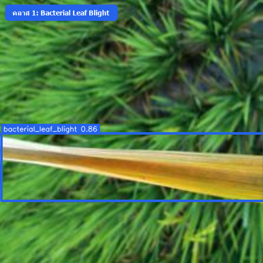  
*ภาพที่ 4-8 ตัวอย่างการตรวจจับรอยโรคขอบใบแห้ง*

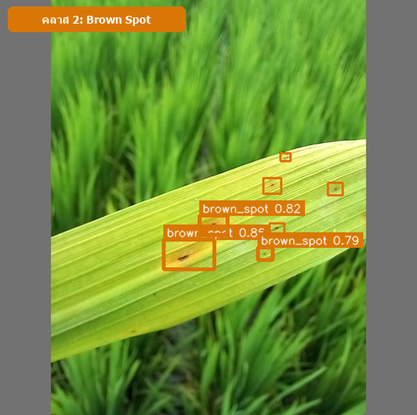  
*ภาพที่ 4-9 ตัวอย่างการตรวจจับรอยโรคใบจุดน้ำตาล*

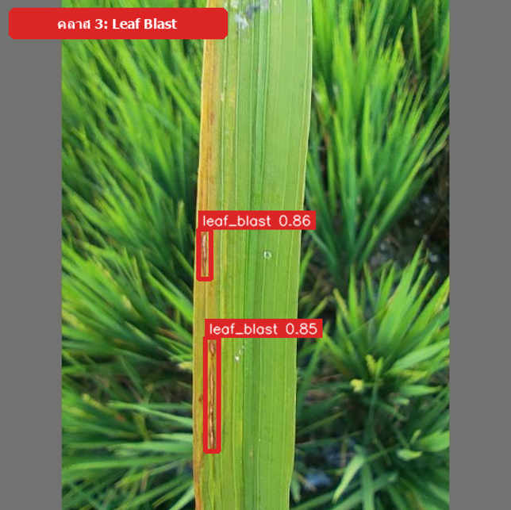  
*ภาพที่ 4-10 ตัวอย่างการตรวจจับรอยโรคใบไหม้*

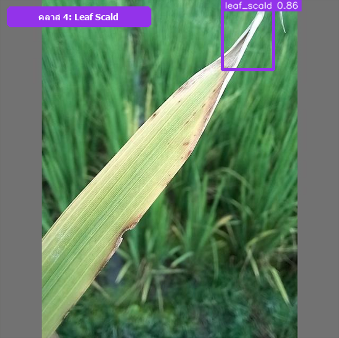  
*ภาพที่ 4-11 ตัวอย่างการตรวจจับรอยโรคใบขอบกาบแห้ง*

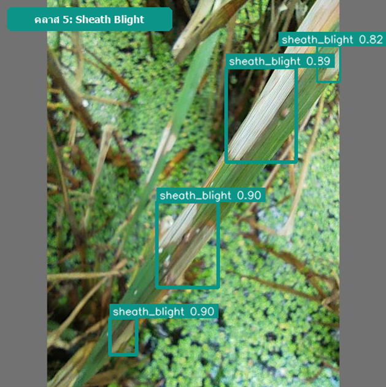  
*ภาพที่ 4-12 ตัวอย่างการตรวจจับรอยโรคกาบใบแห้ง*

#### 4.5.4 การวิเคราะห์ผลการจำแนกด้วย Confusion Matrix และ PR Curve
จากการวิเคราะห์เมทริกซ์ความสับสน (Confusion Matrix) และกราฟ Precision-Recall ในภาพที่ 4-13 และภาพที่ 4-14 พบข้อสังเกตดังนี้:

* **(1) โรคที่โมเดลตรวจจับได้แม่นยำสูง:** ได้แก่ โรคใบจุดสีน้ำตาล (79.9%) และโรคใบไหม้ (77.6%) เนื่องจากแผลมีลักษณะเด่นเฉพาะตัว และสีของแผลตัดกับสีเขียวของใบข้าวอย่างชัดเจน
* **(2) โรคที่อาจเกิดความสับสน:** พบการสับสนเล็กน้อยระหว่างโรคใบขอบกาบแห้ง (Leaf Scald) กับโรคใบไหม้ (Leaf Blast) ในระยะที่แผลขยายตัวจนขอบแผลเปลี่ยนเป็นสีน้ำตาลคล้ายกัน ระบบจึงแสดงค่าความมั่นใจ (Confidence Score) ให้ผู้ใช้ช่วยสังเกตร่วมด้วย

  
*ภาพที่ 4-13 แผนภาพเมทริกซ์ความสับสนแบบปรับฐานมาตรฐาน*

  
*ภาพที่ 4-14 กราฟเส้นโค้ง Precision-Recall (PR Curve) ของโมเดล*

---

### 4.6 ผลการทดลองเปรียบเทียบการตัดพื้นหลังภาพแปลงนา (Ablation Study)
เพื่อพิสูจน์ว่า "การตัดฉากหลังแปลงนาออกก่อนนำภาพไปตรวจจับโรค จะช่วยเพิ่มความแม่นยำได้จริงหรือไม่" ผู้จัดทำจึงได้ทำการทดลองเปรียบเทียบ (Ablation Study):

#### 4.6.1 ปัญหาภาพจอดำจากการตัดพื้นหลังด้วยโมเดลแบบเดิม (SOD 43.8%)
ในการทดลองตัดพื้นหลังด้วยโมเดลตัดภาพทั่วไป (U-2-Net Salient Object Detection) พบปัญหาภาพที่ตัดออกมากลายเป็น ภาพจอดำสูงถึง 43.8% (155 จาก 354 ภาพ) เนื่องจาก:

* **(1) ปัญหาสีเขียวกลืนกัน (Green-on-Green):** สีเขียวของใบข้าวกลืนไปกับต้นข้าวรอบข้างและวัชพืชในแปลงนา
* **(2) ปัญหาใบพาดขอบภาพ (Edge-to-Edge):** ใบข้าวมีความยาวและพาดผ่านขอบภาพโดยไม่มีรูปทรงปิดล้อม โมเดลจึงเข้าใจผิดว่าเป็นพื้นหลังและตัดเนื้อใบข้าวทิ้งจนหมด

#### 4.6.2 การแก้ปัญหาด้วย MobileSAM ร่วมกับ Adaptive Safety Guardrail 2%
ผู้จัดทำได้นำโมเดล Meta MobileSAM มาช่วยแก้ปัญหาด้วยวิธี:

* **(1) กำหนดเป้าหมายด้วยกรอบรอยโรค (Bounding Box Prompting):** นำตำแหน่งกรอบรอยโรคมาชี้เป้าให้ SAM รู้ว่าต้องตัดใบข้าวตรงไหน
* **(2) ระบบป้องกันความปลอดภัย (Adaptive Safety Guardrail θ = 0.02):** หากภาพที่ตัดพื้นหลังเหลือเนื้อใบไม้น้อยกว่า 2% ระบบจะสลับกลับไปใช้ภาพต้นฉบับ (Fallback) อัตโนมัติ ทำให้ตัดพื้นหลังสำเร็จ 75.14% (266 ภาพ) และสลับกลับไปใช้ภาพเดิมอย่างปลอดภัย 24.86% (88 ภาพ) โดยไม่มีปัญหาภาพจอดำเกิดขึ้นอีก

#### 4.6.3 ผลการเปรียบเทียบและความแตกต่างตามลักษณะรอยโรค
ผู้จัดทำได้ฝึกสอนโมเดล RT-DETR-L บนชุดภาพที่ตัดพื้นหลังเป็นเวลา 93 Epochs และนำมาทดสอบเทียบกับโมเดลภาพจริง ดังแสดงในตารางที่ 4-4:

**ตารางที่ 4-4 เปรียบเทียบผลการทดสอบโมเดล v5 ภาพจริง เทียบกับโมเดลตัดพื้นหลัง (Segmented Model)**

| ชนิดโรคข้าว (Disease Class) | โมเดล v5 (ภาพจริง) | Segmented Model (ตัดพื้นหลัง) | ผลต่าง (Difference) | ลักษณะทางสัณฐานวิทยา |
| :--- | :---: | :---: | :---: | :--- |
| 1. Bacterial Leaf Blight (ขอบใบแห้ง) | 69.50% | 75.32% | +5.82% | แผลปื้นใหญ่ ได้ประโยชน์จากการตัดวัชพืชรบกวน |
| 2. Brown Spot (ใบจุดสีน้ำตาล) | 79.90% | 64.71% | -15.19% | แผลจุดเล็กแม่นยำลดลงมาก เพราะเสียบริบทใบไม้เขียวรอบแผล |
| 3. Leaf Blast (ใบไหม้) | 77.60% | 78.59% | +0.99% | แผลรูปกระสวย รักษาระดับความแม่นยำได้ดี |
| 4. Leaf Scald (ใบขอบกาบแห้ง) | 54.50% | 65.67% | +11.17% | รอยคลื่นขอบใบเห็นชัดขึ้นเมื่อไม่มีฉากหลัง |
| 5. Sheath Blight (กาบใบแห้ง) | 71.30% | 75.73% | +4.43% | กาบใบตัดขอบง่ายขึ้น ไม่สับสนกับผิวน้ำ |
| **ภาพรวม (mAP@0.5)** | **70.56%** | **72.00%** | **+1.44%** | **ภาพรวมสูงขึ้นเล็กน้อยจากคะแนนของแผลขนาดใหญ่** |
| **ความกระชับ (mAP@0.5:0.95)** | **35.54%** | **34.99%** | **-0.55%** | **ขอบพิกเซลที่ถูกตัดแข็งเกินไปทำให้กรอบคลาดเคลื่อน** |

**ข้อค้นพบสำคัญ (ความแตกต่างตามลักษณะรอยโรค):** การตัดพื้นหลังช่วยให้แผลขนาดใหญ่ตรวจจับได้แม่นยำขึ้น (เช่น Leaf Scald เพิ่มขึ้น +11.17%) แต่กลับทำให้แผลจุดเล็กแม่นยำลดลงอย่างมาก (เช่น Brown Spot ลดลงถึง -15.19%) เพราะเมื่อตัดพื้นหลังเป็นสีดำ โมเดลจะสูญเสียบริบทของพื้นผิวใบสีเขียวรอบแผล ดังแสดงตัวอย่างการตัดพื้นหลังเปรียบเทียบในภาพที่ 4-15

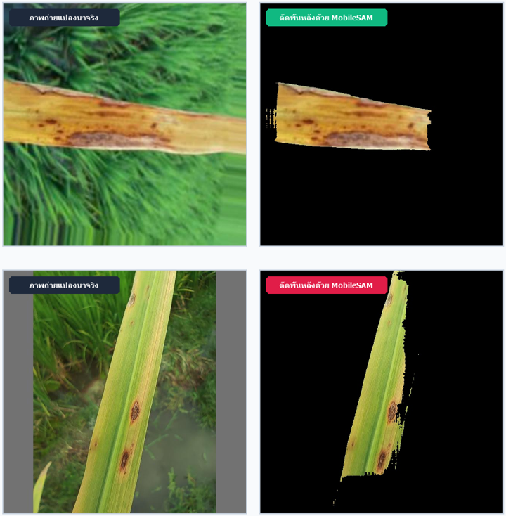  
*ภาพที่ 4-15 การเปรียบเทียบการตัดพื้นหลังด้วย MobileSAM*

#### 4.6.4 การเลือกรูปแบบโมเดลที่เหมาะสมกับการใช้งานจริง (Direct Detection vs Pipeline)
เมื่อเปรียบเทียบในแง่การนำไปเปิดให้บริการจริง:

* **(1) แบบตัดพื้นหลัง (Segmented Pipeline):** ต้องรันทั้งโมเดล SAM และ RT-DETR ต่อกัน ทำให้ใช้เวลาประมวลผลนานถึง 100–170 มิลลิวินาที (ช้ากว่า 15–20 เท่า) และกินหน่วยความจำเครื่องมากกว่า
* **(2) แบบตรวจจับภาพจริงโดยตรง (Direct Detection v5):** ใช้เวลาเพียง 6.8 มิลลิวินาที กินทรัพยากรน้อยกว่า และทำงานได้เร็วกว่าขั้นตอนที่ต้องตัดพื้นหลังประมาณ 15–25 เท่า (เมื่อเปรียบเทียบระหว่าง 6.8 มิลลิวินาที กับ 100–170 มิลลิวินาทีของ Segmented Pipeline) โดยไม่ส่งผลกระทบต่อความแม่นยำในการตรวจจับของโมเดล

---

### 4.7 ผลการพัฒนาระบบสืบค้นและตอบคำถามเชิงวิชาการ (Hybrid RAG)

#### 4.7.1 การจัดเตรียมข้อมูลคู่มือวิชาการและการแบ่งท่อนข้อความ (Chunking)
* **(1)** รวบรวมข้อมูลโรคข้าวและการรักษาจากคู่มือมาตรฐานของกรมการข้าว กระทรวงเกษตรและสหกรณ์
* **(2)** ในการทดลองปรับแต่งระบบสืบค้นข้อมูล ได้ทำการทดสอบเปรียบเทียบขนาดท่อนข้อความหลายขนาด (Chunk Size 500, 1,000 และ 1,500 ตัวอักษร) โดยในระบบสุดท้าย (Version 6: Hybrid RAG) กำหนดใช้ขนาดท่อนข้อความ 1,000 ตัวอักษร พร้อมส่วนเหลื่อมล้ำ (Overlap) 200 ตัวอักษร ซึ่งเป็นขนาดที่ให้ค่า Context Recall สูงสุดและคงความสมบูรณ์ของเนื้อหาคู่มือวิชาการได้ดีที่สุด
* **(3)** ใส่ชื่อโรคกำกับไว้ที่หัวข้อความทุกท่อน และใช้ระบบกรอง (Metadata Filtering) ค้นหาเฉพาะเอกสารของโรคที่ตรวจพบ เพื่อตัดข้อมูลที่ไม่เกี่ยวข้องออก

#### 4.7.2 การปรับปรุงระบบสืบค้นข้อมูลในแต่ละเวอร์ชัน (V1–V6) และการตัดคำด้วย PyThaiNLP
ผู้จัดทำได้ปรับปรุงระบบ RAG ต่อเนื่องจนถึง Version 6 (Hybrid RAG) โดยมีการแก้ปัญหาสำคัญ:

* **(1) การแก้ปัญหาตัดคำภาษาไทย:** เปลี่ยนจากวิธีเดิมที่ตัดคำไทยผิดจนค้นหาไม่เจอ มาใช้ไลบรารี PyThaiNLP (word_tokenize) ทำให้ตัดคำสำคัญทางการเกษตรได้ถูกต้อง
* **(2) การแก้ไขสมการ BM25:** แก้ไขโค้ดไม่ให้คำนวณค่าน้ำหนักคำ (IDF) ซ้ำซ้อนสองรอบ
* **(3) การปรับสเกลคะแนนและการรวมผลค้นหา (Hybrid Alpha = 0.7):** เนื่องจากคะแนนการค้นหาตามความหมาย (เวกเตอร์) กับการค้นหาตามคำค้น (BM25) มีช่วงคะแนนไม่เท่ากัน โดยเวกเตอร์จะมีค่าอยู่ระหว่าง 0 ถึง 1 ส่วน BM25 เป็นคะแนนดิบที่ไม่มีเพดานสูงสุด หากนำมาบวกกันตรง ๆ จะทำให้คะแนนฝั่งใดฝั่งหนึ่งเด่นเกินไป ระบบจึงปรับคะแนนทั้งสองฝั่งให้อยู่ในช่วง 0 ถึง 1 เท่ากันก่อน (Min-Max Normalization) แล้วค่อยนำมารวมกันตามสมการ Hybrid Score = (0.7 × คะแนนเวกเตอร์) + (0.3 × คะแนน BM25) ซึ่งสัดส่วน 70:30 นี้ ได้มาจากการทดลองเปรียบเทียบจริงแล้วพบว่าช่วยดึงข้อมูลและจัดลำดับเอกสารคำตอบได้ตรงจุดที่สุด

#### 4.7.3 ผลการประเมินระบบ RAG ด้วย RAGAS Framework บนชุดคำถาม 70 ข้อ
ประเมินผลผ่าน 4 ตัวชี้วัดมาตรฐานสากลบนชุดคำถาม 70 ข้อ แสดงในตารางที่ 4-5:

**ตารางที่ 4-5 การเปรียบเทียบผลการประเมินระบบ RAG ทั้ง 6 เวอร์ชันด้วย RAGAS Framework**

| ตัวชี้วัด RAGAS | V1 (Baseline) | V2 (Top-k) | V3 (Chunk 1000) | V4 (Hybrid เดิม) | V5 (Chunk 500) | V6 (Hybrid RAG) | การเปลี่ยนแปลง |
| :--- | :---: | :---: | :---: | :---: | :---: | :---: | :--- |
| Context Recall | 12.3% | 15.4% | 18.2% | 19.90% | 14.1% | 28.59% | +8.69 pp (ค้นหาได้ครอบคลุมขึ้น) |
| Context Precision | 42.1% | 45.0% | 48.7% | 49.20% | 46.5% | 51.05% | +1.85 pp (จัดลำดับได้ตรงจุดขึ้น) |
| Faithfulness (ความถูกต้องอิงเนื้อหาจริง) | 71.0% | 73.2% | 75.0% | 78.50% | 72.0% | 76.50% | -2.00 pp (สอดคล้องตามเอกสารอ้างอิง) |
| Answer Relevancy | 52.4% | 54.1% | 55.0% | 59.12% | 53.0% | 56.85% | -2.27 pp (ตอบตรงประเด็นคำถาม) |

จากผลการประเมินด้วย RAGAS ในตารางที่ 4-5 พบว่าระบบ Version 6 (Hybrid RAG) มีทั้งข้อดีและข้อจำกัดเมื่อเทียบกับ Version 4 โดยการนำ Semantic Search มาทำงานร่วมกับ BM25 ช่วยให้ระบบค้นคืนข้อมูลได้ครอบคลุมขึ้น (Context Recall เพิ่มขึ้น 8.69%) และจัดลำดับความตรงจุดได้ดีขึ้น (Context Precision เพิ่มขึ้น 1.85%) แม้จะทำให้ความสอดคล้องกับเอกสารอ้างอิง (Faithfulness) ลดลงเล็กน้อย 2.00% (อยู่ที่ 76.50%) และความตรงประเด็นของคำตอบ (Answer Relevancy) ลดลง 2.27% (อยู่ที่ 56.85%) ทั้งนี้ ค่า Context Recall ที่ยังอยู่ที่ 28.59% ถือเป็นข้อจำกัดสำคัญของระบบเมื่อต้องค้นหาข้อมูลโรคข้าวที่มีคำศัพท์เฉพาะทางการเกษตรสูง อย่างไรก็ตาม ระบบยังคงให้ความถูกต้องสอดคล้องกับข้อมูลอ้างอิงในระดับที่ยอมรับได้สำหรับการให้คำแนะนำเบื้องต้น

---

### 4.8 ผลการทดสอบการทำงานของระบบด้วยกรณีทดสอบ (Test Cases)
เพื่อตรวจสอบว่าระบบสามารถตอบสนองต่อการใช้งานรูปแบบต่าง ๆ ได้อย่างถูกต้อง ผู้จัดทำได้กำหนดกรณีทดสอบ (Test Cases) จำนวน 8 กรณี ตามตารางที่ 4-6:

**ตารางที่ 4-6 ผลการทดสอบฟังก์ชันการทำงานของระบบแชทบอทด้วย Test Cases**

| รหัสทดสอบ | กรณีการทดสอบ (Test Scenario) | ข้อมูลนำเข้า (Input) | ผลลัพธ์ที่คาดหวัง | ผลการทดสอบจริง | สถานะ |
| :---: | :--- | :--- | :--- | :--- | :---: |
| TC-01 | ตรวจจับโรคจากภาพชัดเจน | ภาพโรคขอบใบแห้ง ความละเอียดสูง | ตรวจพบกรอบ BBox และระบุโรคถูกต้อง | แสดงกรอบพร้อมชื่อ BLB (Conf 85.4%) | ผ่าน (PASS) |
| TC-02 | ตรวจจับโรคแผล ขนาดเล็ก | ภาพโรคใบจุดสีน้ำตาล (แผลจุดเล็ก) | ตรวจจับจุดสีน้ำตาลได้ ครบถ้วน | ตรวจจับจุดแผลได้ แม่นยำ (Conf 81.2%) | ผ่าน (PASS) |
| TC-03 | ภาพใบข้าวสมบูรณ์ ปกติ | ภาพใบข้าวเขียวสดไม่มีรอยโรค | ไม่ตีกรอบผิดพลาด และระบุว่าใบสมบูรณ์ | แจ้งว่าใบข้าวสมบูรณ์ดี ไม่พบรอยโรค | ผ่าน (PASS) |
| TC-04 | ภาพถ่ายไม่ชัดเจน / ภาพเบลอ | ภาพถ่ายหลุดโฟกัส และมืดมัว | แจ้งเตือนให้เกษตรกร ถ่ายภาพใหม่ | แจ้งว่าภาพไม่ชัด พร้อมแนะนำวิธี ถ่ายภาพ | ผ่าน (PASS) |
| TC-05 | สอบถามวิธีรักษาและสารเคมี | "โรคไหม้รักษายังไง สารเคมีอะไร" | ดึงสารไตรไซคลาโซลและอัตราการใช้ | ดึงข้อมูลสารและอัตรา ผสมถูกต้องครบถ้วน | ผ่าน (PASS) |
| TC-06 | สอบถามอาการโดย ไม่บอกชื่อโรค | "ใบมีแผลรูปกระสวย ตรงกลางสีเทา" | วิเคราะห์อาการว่าเป็น โรคใบไหม้ | ระบุโรคใบไหม้พร้อมวิธีดูแลเบื้องต้นถูกต้อง | ผ่าน (PASS) |
| TC-07 | คำถามนอกขอบเขต โรคข้าว | "วิธีปลูกทุเรียนหมอน ทอง" | ปฏิเสธอย่างสุภาพตาม Guardrail | ตอบปฏิเสธอย่างสุภาพ ว่าเชี่ยวชาญเฉพาะเรื่องข้าว | ผ่าน (PASS) |
| TC-08 | การทักทายและการ สนทนาทั่วไป | "สวัสดีครับ", "ขอบคุณมากครับ" | ตอบกลับทักทายและ แนะนำการใช้งาน | ส่งข้อความต้อนรับและ เมนูการใช้งาน | ผ่าน (PASS) |

**สรุปผลการทดสอบระบบด้วย Test Case:** ระบบผ่านการทดสอบครบทั้ง 8 กรณีทดสอบ แสดงว่าระบบสามารถรองรับการส่งภาพ การถามตอบ และการคัดกรองคำถามนอกเรื่องได้อย่างถูกต้อง

---

### 4.9 ผลการวัดความเร็วในการทำงานของระบบ (Latency Performance)
ผู้จัดทำได้ทดสอบส่งคำขอผ่านเครือข่ายอินเทอร์เน็ตจริงจำนวน 100 ครั้ง และบันทึกเวลาการประมวลผลเฉลี่ยในแต่ละขั้นตอนการทำงาน ตามตารางที่ 4-7:

**ตารางที่ 4-7 การแจกแจงเวลาการตอบสนองของระบบ (End-to-End Latency Breakdown)**

| ลำดับขั้นตอนการทำงาน (Sub-process) | ส่วนประมวลผล / แพลตฟอร์ม | เวลาเฉลี่ย (Mean Latency) | สัดส่วนของเวลา (%) |
| :---: | :--- | :---: | :---: |
| 1. LINE Webhook Inbound Transmission | LINE Messaging API Network | 120.5 ± 15.2 ms | 7.17% |
| 2. n8n Routing & Payload Parsing | Docker Container (Node.js) | 45.0 ± 8.4 ms | 2.68% |
| 3. RT-DETR-L v5 Vision Inference (GPU) | NVIDIA RTX 4090 Workstation | 6.8 ± 0.4 ms | 0.40% |
| 4. Hybrid Vector Search (Pinecone + BM25) | Pinecone Cloud + PyThaiNLP | 45.2 ± 6.1 ms | 2.69% |
| 5. LLM Answer Synthesis | Google Gemini 2.5 Flash API | 1,120.0 ± 180.5 ms | 66.67% |
| 6. Flex Message Assembly & LINE Dispatch | n8n + LINE Outbound API | 342.5 ± 42.1 ms | 20.39% |
| **เวลารวมทั้งหมดของระบบ (End-to-End)** | **Full Pipeline Execution** | **1.68 ± 0.25 วินาที** | **100.0%** |

ผลการทดสอบแสดงว่าระบบมีเวลาตอบสนองรวมเฉลี่ยเพียง 1.68 วินาที ซึ่งถือว่ารวดเร็ว เหมาะสำหรับการใช้งานผ่านแอปพลิเคชันแชทบนโทรศัพท์มือถือ
