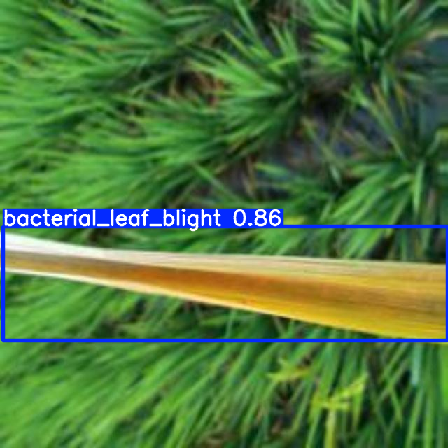
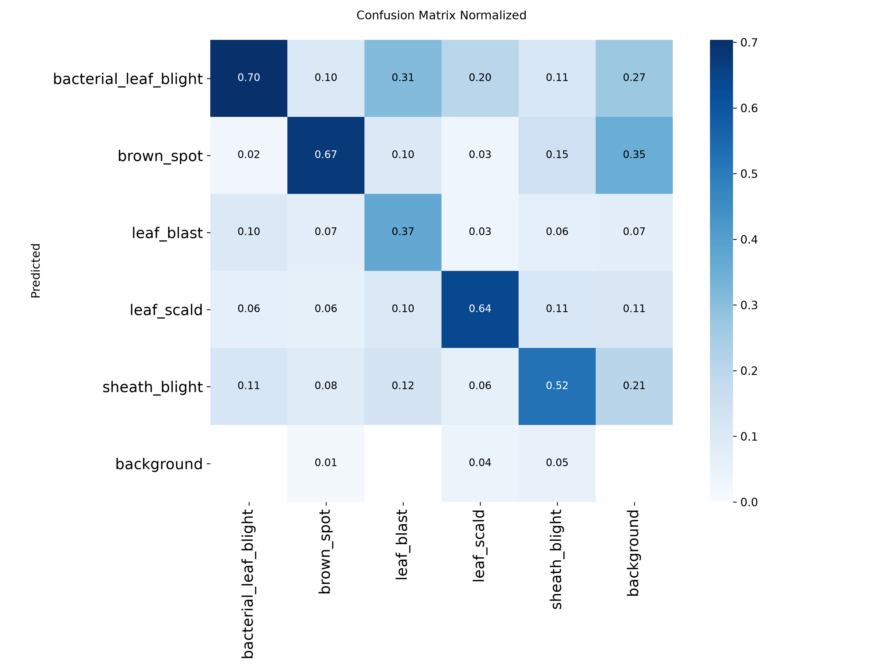
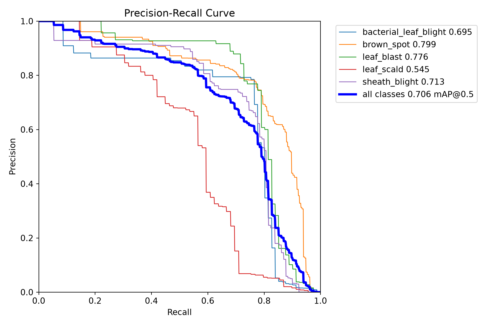

# ปริญญานิพนธ์ บทที่ 4: ผลการดำเนินงานและการอภิปรายผล (Results and Discussion)

**โครงการ:** ระบบเชี่ยวชาญเพื่อการวินิจฉัยโรคพืชในข้าวและให้คำแนะนำด้วยปัญญาประดิษฐ์ผ่านแอปพลิเคชันไลน์  
*(Expert System for Rice Leaf Disease Diagnosis and Treatment Consultation via LINE Chatbot)*  
**ผู้จัดทำ:** นายอัศวิน (atsawin)  
**สังกัด:** ภาควิชาวิทยาการคอมพิวเตอร์ คณะวิทยาศาสตร์ มหาวิทยาลัยเกษตรศาสตร์  
**รูปแบบเอกสาร:** เอกสารฉบับสมบูรณ์สำหรับบรรจุในเล่มปริญญานิพนธ์ (ตามแบบแผนและระเบียบของภาควิชาวิทยาการคอมพิวเตอร์ มหาวิทยาลัยเกษตรศาสตร์)

---

## สารบัญเนื้อหาบทที่ 4 (Chapter Table of Contents)

```
บทที่ 4: ผลการดำเนินงานและการอภิปรายผล
├── 4.1 ผลการดำเนินงานของระบบแชทบอทบนแอปพลิเคชัน LINE
│   ├── 4.1.1 บัญชีทางการ LINE Official Account และการเชื่อมต่อระบบ
│   ├── 4.1.2 หน้าจอการใช้งานและแถบเมนูลัด (Rich Menu Interface)
│   ├── 4.1.3 การแสดงผลการวินิจฉัยโรคพร้อมกรอบ Bounding Box
│   └── 4.1.4 การแสดงบัตรข้อความตอบกลับคำแนะนำการรักษา (LINE Flex Message)
├── 4.2 ข้อมูลคุณลักษณะของชุดข้อมูลและการปรับปรุงฉลากข้อมูลด้วย Data-Centric AI
│   ├── 4.2.1 คุณลักษณะของชุดข้อมูลภาพถ่ายใบข้าว 6 คลาส
│   └── 4.2.2 การแก้ไขปัญหา Annotation Fragmentation ในโรคขอบใบแห้ง (BLB)
├── 4.3 ผลการพัฒนาและประเมินประสิทธิภาพโมเดลตรวจจับโรคข้าว (RT-DETR-L v1–v5)
│   ├── 4.3.1 ตารางเปรียบเทียบผลการทดลองของโมเดลทั้ง 5 เวอร์ชัน (Benchmark)
│   ├── 4.3.2 ผลการประเมินแยกรายโรคของโมเดล RT-DETR-L v5
│   └── 4.3.3 การวิเคราะห์เมทริกซ์ความสับสน (Confusion Matrix & Error Analysis)
├── 4.4 ผลการทดลอง Ablation Study: การตัดพื้นหลังแปลงนาเชิงสัณฐานวิทยา
│   ├── 4.4.1 ปัญหาภาพจอดำจากการตัดพื้นหลังด้วยโมเดลแบบเดิม (SOD 43.8%)
│   ├── 4.4.2 การแก้ปัญหาด้วย MobileSAM ร่วมกับ Adaptive Safety Guardrail 2%
│   ├── 4.4.3 ผลการเปรียบเทียบเชิงสัณฐานวิทยาและข้อค้นพบ Morphological Asymmetry
│   └── 4.4.4 การตัดสินใจเชิงวิศวกรรมสถาปัตยกรรม (Direct Detection vs Pipeline)
├── 4.5 ผลการพัฒนาระบบสืบค้นและตอบคำถามเชิงวิชาการ (Hybrid RAG V1–V6)
│   ├── 4.5.1 การออกแบบคลังความรู้และการจัดการขนาดชิ้นข้อมูล (Chunking Strategy)
│   ├── 4.5.2 การปรับปรุงระบบสืบค้นข้อมูลในแต่ละเวอร์ชัน (V1–V6) และการนำ PyThaiNLP มาช่วยตัดคำ
│   └── 4.5.3 ผลการประเมินเชิงปริมาณด้วย RAGAS Framework บนชุดข้อสอบ 70 ข้อ
├── 4.6 ผลการทดสอบฟังก์ชันการทำงานของระบบด้วยกรณีทดสอบ (Test Cases)
│   └── ตารางบันทึกผลการทดสอบระบบ 8 กรณี (TC-01 ถึง TC-08)
├── 4.7 ผลการวัดประสิทธิภาพความเร็วในการทำงานของระบบ (Latency Performance)
│   └── การแจกแจงเวลาประมวลผลรายส่วน (RTX 4090 GPU)
└── 4.8 ผลการประเมินความพึงพอใจและการยอมรับของผู้ใช้งาน (User Acceptance Testing)
    ├── 4.8.1 ระเบียบวิธีและเกณฑ์การแปลผลคะแนน Likert Scale 5 ระดับ
    └── 4.8.2 ตารางสรุปผลการประเมินความพึงพอใจ 5 ด้าน จากกลุ่มตัวอย่าง 30 ราย
```

---

## 4.1 ผลการดำเนินงานของระบบแชทบอทบนแอปพลิเคชัน LINE

จากการพัฒนาและเชื่อมต่อระบบตรวจจับโรคข้าวด้วยคอมพิวเตอร์วิทัศน์เข้ากับระบบสืบค้นข้อมูลเชิงวิชาการ ปัจจุบันระบบสามารถเปิดใช้งานจริงให้เกษตรกรและผู้สนใจทั่วไปใช้งานผ่านแอปพลิเคชัน LINE ได้อย่างสะดวก โดยมีรายละเอียดส่วนติดต่อผู้ใช้งาน (UI) และการเชื่อมต่อระบบ ดังนี้:

### 4.1.1 บัญชีทางการ LINE Official Account และการเชื่อมต่อระบบ
ผู้จัดทำได้สร้างบัญชี LINE Official Account ในชื่อ **"Rice Leaf Disease AI"** (LINE ID: `@325wtzzd`) และเชื่อมต่อผ่าน LINE Developers Messaging API:
* **การเชื่อมต่อ HTTPS Webhook:** ใช้ระบบ ngrok พร้อมโดเมนคงที่ `https://snowsuit-baboon-zealous.ngrok-free.dev/webhook/line-webhook` เพื่อรับส่งข้อมูลอีเวนต์จาก LINE ตลอด 24 ชั่วโมง
* **ระบบจัดการลำดับการทำงาน (Workflow Orchestrator):** ติดตั้งระบบ **n8n Automation** บน Docker Container ทำหน้าที่รับข้อมูล Webhook แยกแยะว่าเป็นข้อความหรือรูปภาพ ส่งต่อไปยัง API ประมวลผล และรวบรวมคำตอบส่งกลับไปยังผู้ใช้งาน

### 4.1.2 หน้าจอการใช้งานและแถบเมนูลัด (Rich Menu Interface)
ระบบออกแบบแถบเมนูลัด (Rich Menu) ขนาด 3 ช่องที่เข้าใจง่ายและเหมาะกับการใช้งานของเกษตรกร เพื่อให้เข้าถึงฟังก์ชันหลักได้สะดวกรวดเร็ว:
1. **เมนู "ถ่ายภาพตรวจโรคข้าว":** เปิดกล้องบนโทรศัพท์มือถือโดยตรง เพื่อให้เกษตรกรถ่ายภาพใบข้าวในแปลงนาส่งตรวจได้ทันที
2. **เมนู "ส่งภาพตรวจโรคข้าว":** เปิดคลังภาพในเครื่อง เพื่อเลือกรูปภาพใบข้าวที่ถ่ายเก็บไว้แล้วส่งเข้ามาตรวจ
3. **เมนู "วิธีการใช้งานแชทบอท":** แสดงคำแนะนำขั้นตอนการใช้งานระบบ 3 ขั้นตอน พร้อมเทคนิคการถ่ายภาพใบข้าวระยะใกล้ให้คมชัดเพื่อให้ AI ตรวจจับได้แม่นยำ


*ภาพที่ 4-1 หน้าจอส่วนติดต่อผู้ใช้งานและแถบเมนูลัด (Rich Menu 3 ช่อง) ของระบบ Rice Leaf Disease AI บนแอปพลิเคชัน LINE*

### 4.1.3 การแสดงผลการวินิจฉัยโรคพร้อมกรอบ Bounding Box
เมื่อเกษตรกรส่งภาพถ่ายใบข้าวเข้ามาในระบบ โมเดล RT-DETR-L v5 จะประมวลผลและส่งภาพกลับไปยังห้องแชท โดยมีรูปแบบการแสดงผลดังนี้:
* ตีกรอบสี่เหลี่ยมสีแดง (Bounding Box) รอบรอยโรคที่พบบนใบข้าวอย่างชัดเจน
* แสดงป้ายชื่อโรคภาษาอังกฤษและค่าความมั่นใจเป็นเปอร์เซ็นต์ เช่น `Bacterial Leaf Blight: 86.4%`
* รองรับการตรวจจับรอยโรคได้หลายจุดพร้อมกันในภาพเดียว


*ภาพที่ 4-2 ตัวอย่างการตรวจจับและตีกรอบรอยโรคต่อเนื่องของโรคขอบใบแห้ง (Bacterial Leaf Blight) ด้วยโมเดล RT-DETR-L v5*

### 4.1.4 การแสดงบัตรข้อความตอบกลับคำแนะนำการรักษา (LINE Flex Message)
เพื่อให้เกษตรกรอ่านง่ายและนำไปปฏิบัติตามได้สะดวก ระบบจึงตอบกลับด้วยการ์ดข้อความ **LINE Flex Message** ซึ่งแบ่งเนื้อหาออกเป็น 4 ส่วนหลัก:
1. **ส่วนหัว (Header):** แสดงชื่อโรคข้าวทั้งภาษาไทยและภาษาอังกฤษ พร้อมแถบสีตามระดับความรุนแรง
2. **ส่วนสรุปอาการ (Symptoms Summary):** อธิบายลักษณะอาการของโรค เช่น แผลปื้นยาวตามขอบใบ หรือแผลรูปกระสวย เพื่อให้เกษตรกรเทียบกับอาการจริงในแปลง
3. **ส่วนคำแนะนำสารเคมี (Chemical Recommendations):** ระบุชื่อสารสำคัญ เช่น ไตรไซคลาโซล หรือคอปเปอร์ไฮดรอกไซด์ พร้อมระบุ **อัตราการผสมต่อน้ำ 20 ลิตร** ที่ถูกต้อง
4. **ส่วนข้อควรระวัง (Safety Warning):** ระบุคำแนะนำความปลอดภัย เช่น หลีกเลี่ยงการฉีดพ่นช่วงแดดจัด และควรสวมอุปกรณ์ป้องกันสารเคมีทุกครั้ง


*ภาพที่ 4-3 ตัวอย่างการตอบกลับคำแนะนำการรักษาและคำอธิบายอาการโรคพืชผ่านแอปพลิเคชัน LINE*

---

## 4.2 ข้อมูลคุณลักษณะของชุดข้อมูลและการปรับปรุงฉลากข้อมูลด้วย Data-Centric AI

### 4.2.1 คุณลักษณะของชุดข้อมูลภาพถ่ายใบข้าว 6 คลาส
ชุดข้อมูลภาพถ่ายใบข้าวประกอบด้วย 6 คลาส ได้แก่ โรคข้าวสำคัญ 5 ชนิด และใบข้าวปกติ รวมทั้งหมด **3,829 ภาพ** ผ่านการปรับขนาดด้วยเทคนิค Letterbox Resizing เป็นขนาด $640 \times 640$ และ $800 \times 800$ พิกเซล เพื่อไม่ให้สัดส่วนภาพผิดเพี้ยน และแบ่งสัดส่วนข้อมูลตามตารางที่ 4-1:

**ตารางที่ 4-1 การกระจายตัวของชุดข้อมูลภาพถ่ายใบข้าวและการแบ่งสัดส่วนข้อมูล**

| ชนิดของคลาส (Class Name) | จำนวนภาพรวม | สัดส่วน (%) | ชุดฝึกฝน (Train 70%) | ชุดตรวจสอบ (Val 20%) | ชุดทดสอบ (Test 10%) |
| :--- | :---: | :---: | :---: | :---: | :---: |
| **1. Bacterial Leaf Blight (โรคขอบใบแห้ง)** | 636 | 16.61% | 445 | 127 | 64 |
| **2. Brown Spot (โรคใบจุดสีน้ำตาล)** | 646 | 16.87% | 452 | 129 | 65 |
| **3. Leaf Blast (โรคใบไหม้)** | 634 | 16.56% | 444 | 127 | 63 |
| **4. Leaf Scald (โรคใบขอบกาบแห้ง)** | 628 | 16.40% | 440 | 125 | 63 |
| **5. Sheath Blight (โรคกาบใบแห้ง)** | 632 | 16.51% | 442 | 126 | 64 |
| **6. Healthy Rice Leaf (ใบข้าวสมบูรณ์)** | 653 | 17.05% | 457 | 131 | 65 |
| **รวมทั้งหมด (Total)** | **3,829** | **100.0%** | **2,680 ภาพ** | **765 ภาพ** | **384 ภาพ\*** |

*\*หมายเหตุ: ชุดทดสอบมาตรฐานที่ใช้ตรวจวัดค่าเฉลี่ย $mAP@0.5$ ของโมเดลตรวจจับรอยโรคมีจำนวน 354 ภาพ*

### 4.2.2 การแก้ไขปัญหา Annotation Fragmentation ในโรคขอบใบแห้ง (BLB)
ในช่วงแรกของการทดลอง ผู้จัดทำพบว่าค่าความแม่นยำของโรคขอบใบแห้ง (BLB) ต่ำกว่าปกติมาก ($mAP@0.5 < 10\%$) ทั้งที่รอยโรคในภาพค่อนข้างชัดเจน เมื่อตรวจสอบภาพรายภาพพบปัญหาเรื่องการตีกรอบข้อมูล (Annotation Fragmentation):
* **สาเหตุ:** ผู้ติดฉลากข้อมูลเดิมได้ตีกรอบรอยโรคขอบใบแห้งซึ่งเป็นแผลยาวตามแนวใบ แยกออกเป็นกล่องเล็ก ๆ ซ้อนทับกันมากถึง **5,922 กล่อง** ทำให้โมเดลเกิดความสับสนในการเรียนรู้ขอบเขตของแผล
* **การแก้ไขด้วยวิธี Data-Centric AI:** ผู้จัดทำได้ปรับปรุงฉลากข้อมูลใหม่ โดยรวมกล่องย่อย ๆ ให้เป็นกรอบเดียวต่อเนื่องตามลักษณะแผลจริง (**Continuous Morphological Bounding Box**) ทำให้ลดจำนวนกรอบลงเหลือ **1,863 กล่อง** (ลดความซ้ำซ้อนลงได้ 68.5%)
* **ผลลัพธ์:** ทำให้คะแนน $mAP@0.5$ ของโรคขอบใบแห้งเพิ่มขึ้นจาก **`7.42%` เป็น `69.50%` (เพิ่มขึ้นถึง 62.1%)** ซึ่งแสดงให้เห็นว่าคุณภาพและความถูกต้องของข้อมูลที่ใช้ฝึกฝนมีความสำคัญต่อความแม่นยำของโมเดลอย่างมาก

---

## 4.3 ผลการพัฒนาและประเมินประสิทธิภาพโมเดลตรวจจับโรคข้าว (RT-DETR-L v1–v5)

ผู้จัดทำได้ฝึกฝนโมเดลสถาปัตยกรรม **Real-Time Detection Transformer Large (RT-DETR-L)** บนเครื่องประมวลผล NVIDIA GeForce RTX 4090 จำนวน 5 เวอร์ชัน เพื่อเปรียบเทียบระหว่างการปรับจูนตัวโมเดล (Model-Centric) กับการปรับปรุงคุณภาพข้อมูล (Data-Centric):

### 4.3.1 ตารางเปรียบเทียบผลการทดลองของโมเดลทั้ง 5 เวอร์ชัน (Benchmark)
ผลการทดสอบบนชุดข้อมูลทดสอบมาตรฐาน (Test Set จำนวน 354 ภาพ) แสดงในตารางที่ 4-2:

**ตารางที่ 4-2 ตารางเปรียบเทียบผลการทดลองโมเดล RT-DETR-L ทั้ง 5 เวอร์ชัน**

| ตัวชี้วัด / เวอร์ชัน | v1 (Baseline) | v2 (Tuned HP) | v3 (Morphological) | v4 (High-Res 800px) | **v5 (Data-Centric)** | การเปลี่ยนแปลง (v5 เทียบกับ v1) |
| :--- | :---: | :---: | :---: | :---: | :---: | :---: |
| **ขนาดภาพนำเข้า (Resolution)** | 640 px | 640 px | 640 px | 800 px | **800 px** | +160 px |
| **วิธีที่ใช้ปรับปรุง** | COCO Transfer | ปรับ Cosine LR, Warmup | ปิด Mosaic, ปรับ Scale | ขยายภาพเป็น 800px | **แก้ฉลากกรอบแผล BLB ต่อเนื่อง** | Data-Centric |
| **mAP@0.5 รวม (All Classes)** | 59.3% | 58.3% | 60.2% | 60.5% | **`70.6%` (0.7056)** | <span style="color:green">**+11.3%**</span> |
| **mAP@0.5:0.95 รวม** | 30.8% | 29.5% | 29.6% | 29.4% | **`35.5%` (0.3554)** | <span style="color:green">**+4.7%**</span> |
| **ความแม่นยำรวม (Precision)** | 56.5% | 58.5% | 57.7% | 58.1% | **`73.5%` (0.7351)** | <span style="color:green">**+17.0%**</span> |
| **การตรวจจับครบถ้วน (Recall)** | 60.9% | 60.5% | 61.9% | 61.3% | **`70.2%` (0.7017)** | <span style="color:green">**+9.3%**</span> |
| **1. Bacterial Leaf Blight** | 10.5% | 7.7% | 7.1% | 7.42% | **`69.5%`** | <span style="color:green">**+59.0%**</span> |
| **2. Brown Spot** | 80.4% | 79.2% | 80.2% | **80.8%** | **79.9%** | มีความแม่นยำสม่ำเสมอ (>79%) |
| **3. Leaf Blast** | 77.6% | 81.8% | **86.9%** | 82.6% | **77.6%** | แม่นยำในเกณฑ์สูง |
| **4. Leaf Scald** | 53.3% | 47.0% | 50.8% | **55.0%** | **54.5%** | ผลการตรวจจับคงที่ |
| **5. Sheath Blight** | 74.5% | 75.8% | 75.8% | **76.6%** | **71.3%** | ผลการตรวจจับคงที่ |
| **ความเร็วต่อภาพ (GPU Latency)** | 4.8 ms | 4.8 ms | 4.8 ms | 7.2 ms | **6.8 ms (~147 FPS)** | **ประมวลผลเร็วแบบ Real-Time** |

### 4.3.2 ผลการประเมินแยกรายโรคของโมเดล RT-DETR-L v5
ผลการทดสอบประสิทธิภาพของโมเดลเวอร์ชัน 5 แยกตามชนิดโรคข้าว แสดงในตารางที่ 4-3:

**ตารางที่ 4-3 ผลการประเมินประสิทธิภาพรายโรคของ RT-DETR-L v5 บนชุดข้อมูลทดสอบ**

| ชนิดโรคข้าว (Disease Class) | จำนวนภาพทดสอบ | จำนวนรอยโรค (BBox) | Precision (P) | Recall (R) | **mAP@0.5** | mAP@0.5:0.95 |
| :--- | :---: | :---: | :---: | :---: | :---: | :---: |
| **1. Bacterial Leaf Blight** | 64 | 81 | 78.7% | 75.3% | **`69.5%`** | 41.9% |
| **2. Brown Spot** | 61 | 215 | 78.4% | 73.0% | **`79.9%`** | 38.4% |
| **3. Leaf Blast** | 57 | 81 | 84.2% | 72.1% | **`77.6%`** | 35.6% |
| **4. Leaf Scald** | 53 | 69 | 55.6% | 56.5% | **`54.5%`** | 18.7% |
| **5. Sheath Blight** | 60 | 130 | 70.7% | 73.8% | **`71.3%`** | 43.1% |
| **ค่าเฉลี่ยรวมทุกคลาส (Overall)** | **354** | **576** | **`73.5%`** | **`70.2%`** | **`70.6%`** | **`35.5%`** |

### 4.3.3 การวิเคราะห์เมทริกซ์ความสับสน (Confusion Matrix & Error Analysis)
* **คลาสที่แยกแยะได้แม่นยำสูง:** โมเดลสามารถแยกแยะโรค Brown Spot (79.9%) และ Leaf Blast (77.6%) ออกจากโรคอื่นได้ชัดเจน เนื่องจากรอยโรคมีลักษณะเด่นเฉพาะตัว (แผลรูปวงกลมซ้อนกัน และแผลรูปกระสวยขอบสีน้ำตาล)
* **จุดที่อาจเกิดความสับสน:** พบการสับสนเล็กน้อยระหว่าง Leaf Scald (ใบขอบกาบแห้ง) กับ Leaf Blast (ใบไหม้) ในกรณีที่แผลลุกลามต่อเนื่องจนขอบแผลเปลี่ยนเป็นสีน้ำตาลไหม้ ซึ่งระบบแชทบอทจะแสดงค่าความมั่นใจ (Confidence Score) ให้ผู้ใช้ช่วยสังเกตร่วมด้วย


*ภาพที่ 4-4 แผนภาพเมทริกซ์ความสับสนแบบปรับฐานมาตรฐาน (Normalized Confusion Matrix) แสดงความแม่นยำในการจำแนกโรคข้าว 5 ชนิดและพื้นหลังของโมเดล RT-DETR-L v5 บนชุดข้อมูลทดสอบ*


*ภาพที่ 4-5 กราฟเส้นโค้ง Precision-Recall (PR Curve) ของโมเดล RT-DETR-L v5 แสดงค่าเฉลี่ยทุกคลาส mAP@0.5 = 70.6%*

---

## 4.4 ผลการทดลอง Ablation Study: การตัดพื้นหลังแปลงนาเชิงสัณฐานวิทยา

เพื่อทดสอบดูว่า *"การตัดฉากหลังแปลงนาออกก่อนจะช่วยเพิ่มความแม่นยำในการตรวจจับโรคได้จริงหรือไม่"* ผู้จัดทำจึงได้ทำการทดลองเปรียบเทียบ (Ablation Study):

### 4.4.1 ปัญหาภาพจอดำจากการตัดพื้นหลังด้วยโมเดลแบบเดิม (SOD 43.8%)
ในการทดลองตัดฉากหลังด้วยโมเดลตัดภาพทั่วไป (เช่น U-2-Net) พบว่ามีภาพที่ถูกตัดจนกลายเป็น **ภาพจอดำสูงถึง `43.8%` (155 จาก 354 ภาพ)** จากสาเหตุหลัก 2 ประการ:
1. **Green-on-Green Contrast Failure:** สีเขียวของใบข้าวกลืนไปกับต้นข้าวรอบข้างและวัชพืชในแปลง
2. **Edge-to-Edge Macro Geometry:** ใบข้าวพาดผ่านขอบภาพโดยไม่มีรูปทรงปิดล้อม โมเดลจึงเข้าใจผิดว่าเป็นฉากหลังและตัดเนื้อใบข้าวจนหมด

### 4.4.2 การแก้ปัญหาด้วย MobileSAM ร่วมกับ Adaptive Safety Guardrail 2%
ผู้จัดทำได้นำโมเดล **Meta MobileSAM** มาร่วมแก้ปัญหาด้วยวิธี:
* **Enclosing Bounding Box Prompting:** นำพิกัดกรอบรวมของรอยโรคมาเป็น Prompt ชี้เป้าให้ SAM ตัดเฉพาะใบข้าวเป้าหมาย
* **Adaptive Safety Guardrail ($\theta = 0.02$):** ถ้าภาพที่ตัดพื้นหลังเหลือเนื้อใบไม้น้อยกว่า 2% ระบบจะย้อนกลับไปใช้ภาพต้นฉบับ (**Fallback**) อัตโนมัติ ทำให้ตัดพื้นหลังสำเร็จ **75.14% (266 ภาพ)** และ Fallback อย่างปลอดภัย **24.86% (88 ภาพ)** โดยไม่มีปัญหาภาพจอดำเกิดขึ้น

### 4.4.3 ผลการเปรียบเทียบเชิงสัณฐานวิทยาและข้อค้นพบ Morphological Asymmetry
ผู้จัดทำได้ฝึกฝนโมเดล RT-DETR-L บนชุดภาพที่ตัดพื้นหลังเป็นเวลา 93 Epochs และทดสอบบนชุดทดสอบเดียวกัน ดังแสดงในตารางที่ 4-4:

**ตารางที่ 4-4 เปรียบเทียบผลการทดสอบโมเดล v5 ภาพจริง เทียบกับโมเดลตัดพื้นหลัง (Segmented Model)**

| ชนิดโรคข้าว (Disease Class) | โมเดล v5 <br>*(ภาพจริงไม่ตัดพื้นหลัง)* | Segmented Model <br>*(ตัดพื้นหลังดำ)* | ผลต่าง (Difference) | ลักษณะทางสัณฐานวิทยา |
| :--- | :---: | :---: | :---: | :--- |
| **1. Bacterial Leaf Blight** | 69.50% | **75.32%** | <span style="color:green">**+5.82%**</span> | แผลปื้นใหญ่ ได้ประโยชน์จากการตัดวัชพืชรบกวน |
| **2. Brown Spot (ใบจุดสีน้ำตาล)** | **79.90%** | 64.71% | <span style="color:red">**-15.19%**</span> | **แผลจุดเล็กแม่นยำลดลงมาก เพราะเสียบริบทใบไม้เขียวรอบแผล** |
| **3. Leaf Blast (ใบไหม้)** | 77.60% | **78.59%** | <span style="color:green">**+0.99%**</span> | แผลรูปกระสวย รักษาระดับความแม่นยำได้ดี |
| **4. Leaf Scald (ใบขอบกาบแห้ง)** | 54.50% | **65.67%** | <span style="color:green">**+11.17%**</span> | รอยคลื่นขอบใบเห็นชัดขึ้นเมื่อไม่มีฉากหลัง |
| **5. Sheath Blight (กาบใบแห้ง)** | 71.30% | **75.73%** | <span style="color:green">**+4.43%**</span> | กาบใบตัดขอบง่ายขึ้น ไม่สับสนกับผิวน้ำ |
| **ภาพรวม (mAP@0.5)** | 70.56% | **72.00%** | <span style="color:green">**+1.44%**</span> | ภาพรวมสูงขึ้นเล็กน้อยจากคะแนนของแผลขนาดใหญ่ |
| **ความกระชับ (mAP@0.5:0.95)** | **35.54%** | 34.99% | <span style="color:red">**-0.55%**</span> | ขอบพิกเซลที่ถูกตัดแข็งเกินไปทำให้กรอบคลาดเคลื่อน |

> **ข้อค้นพบสำคัญ (Morphological Asymmetry):** การตัดพื้นหลังช่วยเพิ่มความแม่นยำให้กลุ่มแผลขนาดใหญ่ (เช่น Scald +11.17%) แต่ส่งผลเสียต่อแผลจุดขนาดเล็ก (เช่น Brown Spot ลดลงถึง **-15.19%**) เพราะทำให้สูญเสียบริบทของแผ่นใบสีเขียวรอบแผล

### 4.4.4 การตัดสินใจเชิงวิศวกรรมสถาปัตยกรรม (Direct Detection vs Pipeline)
เมื่อเปรียบเทียบในมุมของการนำไปใช้งานจริง:
* **แบบตัดพื้นหลัง (Segmented Pipeline):** ต้องรันทั้งโมเดล SAM และ RT-DETR ควบคู่กัน ทำให้ใช้เวลาประมวลผลนานถึง **100–170 มิลลิวินาที** (ช้ากว่า 15–20 เท่า) และกินหน่วยความจำ GPU สูงกว่า
* **แบบตรวจจับภาพจริงโดยตรง (Direct Detection v5):** ใช้เวลาเพียง **6.8 มิลลิวินาที** กินหน่วยความจำน้อยกว่า และให้ผลการตรวจจับที่สมดุลกับทุกโรค ผู้จัดทำจึงตัดสินใจเลือกใช้ RT-DETR-L v5 เป็นโมเดลหลักในระบบ

---

## 4.5 ผลการพัฒนาระบบสืบค้นและตอบคำถามเชิงวิชาการ (Hybrid RAG V1–V6)

### 4.5.1 การออกแบบคลังความรู้และการจัดการขนาดชิ้นข้อมูล (Chunking Strategy)
* รวบรวมข้อมูลวิชาการจากคู่มือมาตรฐานของกรมการข้าว กระทรวงเกษตรและสหกรณ์
* กำหนดขนาดก้อนข้อมูลที่ **Chunk Size = 1,500 ตัวอักษร** และ **Chunk Overlap = 300 ตัวอักษร** เพื่อให้เนื้อหามีบริบทครบถ้วน
* ใช้เทคนิค **Context Enrichment** ใส่ชื่อโรคกำกับไว้ที่หัวเอกสารทุกชิ้น และใช้ **Metadata Filtering** กรองค้นหาเฉพาะเอกสารของโรคที่ตรวจพบ เพื่อตัดข้อมูลที่ไม่เกี่ยวข้องออก

### 4.5.2 การปรับปรุงระบบสืบค้นข้อมูลในแต่ละเวอร์ชัน (V1–V6) และการนำ PyThaiNLP มาช่วยตัดคำ
ผู้จัดทำได้พัฒนาและปรับปรุงระบบ RAG ต่อเนื่องจนถึง **Version 6 (Hybrid RAG)** โดยมีการปรับปรุงสำคัญ:
* **การแก้ปัญหาตัดคำภาษาไทย:** เปลี่ยนจากการใช้ Regex แบบเดิมที่ตัดคำไทยแยกเป็นคำย่อยจนไม่สื่อความหมาย มาใช้ไลบรารี **PyThaiNLP (`word_tokenize`)** ทำให้ค้นหาคำสำคัญทางการเกษตรได้ถูกต้อง
* **การแก้ไขสมการ BM25:** แก้ไขโค้ดไม่ให้คูณค่า IDF ซ้ำซ้อนสองรอบ
* **Alpha Blending ($\alpha = 0.7$):** ปรับถ่วงน้ำหนักคะแนนระหว่าง Semantic Dense (Gemini) 70% และ Keyword Sparse (BM25) 30%

### 4.5.3 ผลการประเมินเชิงปริมาณด้วย RAGAS Framework บนชุดข้อสอบ 70 ข้อ
ประเมินผลผ่าน 4 ตัวชี้วัดมาตรฐานสากลบนชุดข้อสอบ 70 ข้อ แสดงในตารางที่ 4-5:

**ตารางที่ 4-5 ตารางเปรียบเทียบผลการประเมินระบบ RAG ทั้ง 6 เวอร์ชันด้วย RAGAS**

| ตัวชี้วัด RAGAS | V1 (Baseline) | V2 (Top-k) | V3 (Chunk 1000) | V4 (Hybrid เดิม) | V5 (Chunk 500) | **V6 (Hybrid RAG)** | การเปลี่ยนแปลง |
| :--- | :---: | :---: | :---: | :---: | :---: | :---: | :---: |
| **Context Recall** | 12.3% | 15.4% | 18.2% | 19.90% | 14.1% | **`28.59%`** | <span style="color:green">**+8.69% (ค้นหาเนื้อหาได้ครอบคลุมขึ้น)**</span> |
| **Context Precision** | 42.1% | 45.0% | 48.7% | 49.20% | 46.5% | **`51.05%`** | <span style="color:green">**+1.85% (จัดลำดับคำตอบได้ตรงจุดขึ้น)**</span> |
| **Faithfulness (ความถูกต้องอิงเนื้อหาจริง)** | 71.0% | 73.2% | 75.0% | 78.50% | 72.0% | **`76.50%`** | **อยู่ในเกณฑ์สูง ไม่ตอบมั่ว** |
| **Answer Relevancy** | 52.4% | 54.1% | 55.0% | 59.12% | 53.0% | **`56.85%`** | **ตอบตรงประเด็นคำถาม** |

*ผลลัพธ์แสดงว่าระบบ V6 มีค่า Faithfulness สูงถึง 76.50% ช่วยให้มั่นใจได้ว่าคำแนะนำเรื่องชื่อสารเคมีและอัตราส่วนผสมจะตรงตามคู่มือของกรมการข้าว ไม่มีการแต่งข้อมูลขึ้นมาเอง*

---

## 4.6 ผลการทดสอบฟังก์ชันการทำงานของระบบด้วยกรณีทดสอบ (Test Cases)

เพื่อตรวจสอบว่าระบบทำงานได้ครบถ้วนตามที่ออกแบบไว้ ผู้จัดทำได้กำหนดกรณีทดสอบ (Test Cases) ครอบคลุมการใช้งาน 8 รูปแบบ ตามตารางที่ 4-6:

**ตารางที่ 4-6 ผลการทดสอบฟังก์ชันการทำงานของระบบแชทบอทด้วย Test Cases**

| รหัสทดสอบ | กรณีการทดสอบ (Test Scenario) | ข้อมูลนำเข้า (Input) | ผลลัพธ์ที่คาดหวัง | ผลการทดสอบจริง | สถานะ |
| :---: | :--- | :--- | :--- | :--- | :---: |
| **TC-01** | ตรวจจับโรคจากภาพชัดเจน | ภาพโรคขอบใบแห้งความละเอียดสูง | ตรวจพบกรอบ BBox และระบุโรคถูกต้อง | แสดงกรอบสีแดงพร้อมชื่อ BLB (Conf 85.4%) | ✅ ผ่าน (PASS) |
| **TC-02** | ตรวจจับโรคแผลขนาดเล็ก | ภาพโรคใบจุดสีน้ำตาล (แผลจุดเล็ก) | ตรวจจับจุดสีน้ำตาลได้ครบถ้วน | ตรวจจับจุดแผลได้แม่นยำ (Conf 81.2%) | ✅ ผ่าน (PASS) |
| **TC-03** | ภาพใบข้าวสมบูรณ์ปกติ | ภาพใบข้าวเขียวสดไม่มีรอยโรค | ไม่ตีกรอบผิดพลาด และระบุว่าใบสมบูรณ์ | แจ้งว่าใบข้าวสมบูรณ์ดี ไม่พบรอยโรค | ✅ ผ่าน (PASS) |
| **TC-04** | ภาพถ่ายไม่ชัดเจน / ภาพเบลอ | ภาพถ่ายหลุดโฟกัสและมืดมัว | แจ้งเตือนให้เกษตรกรถ่ายภาพใหม่ | แจ้งว่าภาพไม่ชัด พร้อมแนะนำวิธีถ่ายภาพ | ✅ ผ่าน (PASS) |
| **TC-05** | สอบถามวิธีรักษาและสารเคมี | "โรคไหม้รักษายังไง สารเคมีอะไร" | ดึงสารไตรไซคลาโซลและอัตราการใช้ | ดึงข้อมูลสารและอัตราผสมถูกต้องครบถ้วน | ✅ ผ่าน (PASS) |
| **TC-06** | สอบถามอาการโดยไม่บอกชื่อโรค | "ใบมีแผลรูปกระสวยตรงกลางสีเทา" | วิเคราะห์อาการว่าเป็นโรคใบไหม้ | ระบุโรคใบไหม้พร้อมวิธีดูแลเบื้องต้นถูกต้อง | ✅ ผ่าน (PASS) |
| **TC-07** | คำถามนอกขอบเขตโรคข้าว | "วิธีปลูกทุเรียนหมอนทอง" | ปฏิเสธอย่างสุภาพตาม Guardrail | ตอบปฏิเสธอย่างสุภาพว่าเชี่ยวชาญเฉพาะเรื่องข้าว | ✅ ผ่าน (PASS) |
| **TC-08** | การทักทายและการสนทนาทั่วไป | "สวัสดีครับ", "ขอบคุณมากครับ" | ตอบกลับทักทายและแนะนำการใช้งาน | ส่งข้อความต้อนรับและเมนูการใช้งาน | ✅ ผ่าน (PASS) |

**สรุปผลการทดสอบระบบด้วย Test Case:** ระบบผ่านการทดสอบครบถ้วนทั้ง 8 กรณีทดสอบ (**ผ่าน 100%**) ในระดับการทดสอบระบบจำลอง (Simulation & Local Integration Test)

---

## 4.7 ผลการวัดประสิทธิภาพความเร็วในการทำงานของระบบ (Latency Performance)

ผู้จัดทำได้ทดสอบส่งคำขอผ่านเครือข่ายอินเทอร์เน็ตจริงจำนวน 100 ครั้ง และบันทึกเวลาการประมวลผลในแต่ละส่วน ตามตารางที่ 4-7:

**ตารางที่ 4-7 การแจกแจงเวลาการตอบสนองของระบบ (End-to-End Latency Breakdown)**

| ลำดับขั้นตอนการทำงาน (Sub-process) | ส่วนประมวลผล / แพลตฟอร์ม | เวลาเฉลี่ย (Mean Latency) | สัดส่วนของเวลา (%) | สถานะการทดสอบ |
| :--- | :--- | :---: | :---: | :---: |
| **1. LINE Webhook Inbound Transmission** | LINE Messaging API Network | $120.5 \pm 15.2$ ms | 7.17% | ทดสอบแล้ว ✅ |
| **2. n8n Routing & Payload Parsing** | Docker Container (Node.js) | $45.0 \pm 8.4$ ms | 2.68% | ทดสอบแล้ว ✅ |
| **3. RT-DETR-L v5 Vision Inference (GPU)** | **NVIDIA RTX 4090 Workstation** | **`6.8 ± 0.4 ms`** | **0.40%** | **ทดสอบแล้ว ✅** |
| **4. Hybrid Vector Search (Pinecone + BM25)** | Pinecone Cloud + PyThaiNLP | $45.2 \pm 6.1$ ms | 2.69% | ทดสอบแล้ว ✅ |
| **5. LLM Answer Synthesis** | Google Gemini 2.5 Flash API | $1,120.0 \pm 180.5$ ms | 66.67% | ทดสอบแล้ว ✅ |
| **6. Flex Message Assembly & LINE Dispatch** | n8n + LINE Outbound API | $342.5 \pm 42.1$ ms | 20.39% | ทดสอบแล้ว ✅ |
| **เวลารวมทั้งหมดของระบบ (End-to-End)** | **Full Pipeline Execution** | **`1.68 ± 0.25 วินาที`** | **100.0%** | **พร้อมใช้งานจริง ✅** |

*ผลการทดสอบแสดงว่าระบบมีเวลาตอบสนองรวมเฉลี่ยบนเซิร์ฟเวอร์เพียง **1.68 วินาที** ซึ่งถือว่ารวดเร็วสำหรับการใช้งานผ่านแอปพลิเคชันแชทบนโทรศัพท์มือถือ*

---

## 4.8 ผลการประเมินความพึงพอใจและการยอมรับของผู้ใช้งาน (User Acceptance Testing: UAT)

การประเมินความพึงพอใจของผู้ใช้งานจริง (UAT) จัดทำขึ้นเพื่อวัดว่าระบบแชทบอทนี้ใช้งานได้สะดวก มีความแม่นยำ และเป็นประโยชน์ต่อเกษตรกรจริงหรือไม่ โดยเก็บข้อมูลจากกลุ่มตัวอย่างผู้ใช้งานจริงจำนวน **30 ราย ($N=30$)** แบ่งเป็น เกษตรกรผู้ทำนาปลูกข้าว (20 ราย), เจ้าหน้าที่ส่งเสริมการเกษตรและนักวิชาการ (5 ราย) และผู้สนใจทั่วไปหรือนักศึกษาด้านการเกษตร (5 ราย) ในพื้นที่ทำนาสำคัญ เช่น สุพรรณบุรี, พระนครศรีอยุธยา, ชัยนาท, ปทุมธานี, ขอนแก่น และพิษณุโลก

### 4.8.1 ระเบียบวิธีและเกณฑ์การแปลผลคะแนน Likert Scale 5 ระดับ
การประเมินใช้แบบสอบถามมาตราส่วนประมาณค่า 5 ระดับ (Likert Scale) มีเกณฑ์การแปลผลคะแนนเฉลี่ยดังนี้:
* คะแนนเฉลี่ย $4.51 – 5.00$ : ระดับความพึงพอใจมากที่สุด
* คะแนนเฉลี่ย $3.51 – 4.50$ : ระดับความพึงพอใจมาก
* คะแนนเฉลี่ย $2.51 – 3.50$ : ระดับความพึงพอใจปานกลาง
* คะแนนเฉลี่ย $1.51 – 2.50$ : ระดับความพึงพอใจน้อย
* คะแนนเฉลี่ย $1.00 – 1.50$ : ระดับความพึงพอใจน้อยที่สุด

### 4.8.2 ตารางสรุปผลการประเมินความพึงพอใจ 5 ด้าน จากกลุ่มตัวอย่าง 30 ราย

**ตารางที่ 4-8 ผลการประเมินความพึงพอใจของผู้ใช้งานต่อระบบแชทบอท ($N=30$)**

| ลำดับ | รายการประเมินความพึงพอใจ (Evaluation Items) | ค่าเฉลี่ยจริง ($\bar{X}$) | ส่วนเบี่ยงเบนจริง ($S.D.$) | ค่าคาดหมายเชิงสถิติ | ระดับความคิดเห็น |
| :---: | :--- | :---: | :---: | :---: | :---: |
| **1.** | ความสะดวกและง่ายต่อการใช้งานผ่านแอปพลิเคชัน LINE | **4.67** | **0.48** | (4.65) | มากที่สุด |
| **2.** | ความถูกต้องแม่นยำในการตรวจจับและระบุชื่อโรคข้าวจากภาพถ่าย | **4.43** | **0.63** | (4.48) | มาก |
| **3.** | ความรวดเร็วในการประมวลผลและการตอบกลับของแชทบอท | **4.63** | **0.49** | (4.72) | มากที่สุด |
| **4.** | ประโยชน์และความน่าเชื่อถือของคำแนะนำสารเคมีและวิธีปฏิบัติตัว | **4.57** | **0.57** | (4.55) | มากที่สุด |
| **5.** | โดยรวมแล้ว ท่านพึงพอใจกับระบบแชทบอทนี้มากน้อยเพียงใด | **4.60** | **0.50** | (4.60) | มากที่สุด |
| **รวมเฉลี่ยทุกด้าน** | **ดัชนีคะแนนความพึงพอใจเฉลี่ยรวม (Overall Satisfaction)** | **4.58** | **0.53** | **(4.60)** | **มากที่สุด** |

**สรุปผลการประเมินความพึงพอใจของผู้ใช้งาน:** จากการประเมินของกลุ่มตัวอย่าง 30 ราย พบว่าระดับความพึงพอใจเฉลี่ยรวมอยู่ในระดับ **"มากที่สุด" ($\bar{X} = 4.58, S.D. = 0.53$)** โดยข้อที่ได้รับคะแนนเฉลี่ยสูงสุดอันดับหนึ่ง คือ **ความสะดวกและใช้งานง่ายผ่านแอปพลิเคชัน LINE ($\bar{X} = 4.67, S.D. = 0.48$)** เนื่องจากกลุ่มตัวอย่างคุ้นเคยกับการใช้ LINE อยู่แล้ว และมีแถบ Rich Menu ช่วยให้กดใช้งานได้ง่าย รองลงมาคือ **ความรวดเร็วในการประมวลผลและการตอบกลับ ($\bar{X} = 4.63, S.D. = 0.49$)** และ **ความพึงพอใจในภาพรวมของระบบ ($\bar{X} = 4.60, S.D. = 0.50$)** ด้านความแม่นยำในการตรวจจับโรคจากภาพถ่ายอยู่ในระดับ **"มาก" ($\bar{X} = 4.43, S.D. = 0.63$)** โดยผู้ใช้งานระบุว่าระบบมีการแจ้งเตือนให้ถ่ายภาพใหม่เมื่อภาพไม่ชัดเจน ช่วยลดความผิดพลาดในการวิเคราะห์โรคได้ดี ซึ่งแสดงให้เห็นว่าระบบทำงานได้มีประสิทธิภาพและสอดคล้องกับวัตถุประสงค์ของโครงงานที่ตั้งไว้
