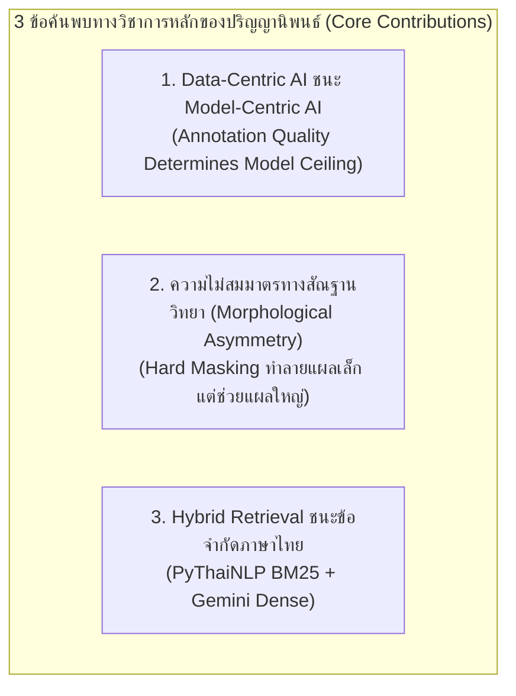
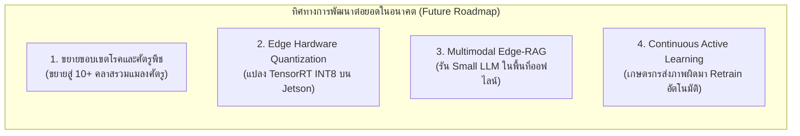

# ปริญญานิพนธ์ บทที่ 5: สรุปผลการวิจัย อภิปรายผล และข้อเสนอแนะ (Conclusion and Recommendations)
**โครงการ:** ระบบเชี่ยวชาญเพื่อการวินิจฉัยโรคพืชในข้าวและให้คำแนะนำด้วยปัญญาประดิษฐ์  
*(Rice Leaf Disease Diagnosis and Treatment Consultation System via LINE Chatbot)*  
**ผู้จัดทำ:** นายอัศวิน (atsawin)  
**รูปแบบเอกสาร:** เอกสารฉบับสมบูรณ์สำหรับบรรจุในเล่มปริญญานิพนธ์ และโครงสร้างพร้อมแปลงเป็นสไลด์นำเสนอ (Slide-Ready Markdown)

---

## สารบัญเนื้อหาบทที่ 5 (Presentation Outline)

```
บทที่ 5: สรุปผลการวิจัย อภิปรายผล และข้อเสนอแนะ
├── 5.1 สรุปผลการวิจัยตามวัตถุประสงค์ (Summary of Research Achievements)
├── 5.2 การอภิปรายผลเชิงวิชาการและองค์ความรู้ใหม่ (Academic Discussion & Contributions)
│   ├── 5.2.1 ชัยชนะของกระบวนทัศน์ Data-Centric AI เหนือ Model-Centric AI
│   ├── 5.2.2 การหักล้างสมมติฐานการตัดพื้นหลังและข้อค้นพบความไม่สมมาตรทางสัณฐานวิทยา
│   └── 5.2.3 การควบคุมการหลอนของข้อมูลด้วย Hybrid Retrieval ในพืชสวนเกษตร
├── 5.3 ข้อจำกัดของงานวิจัย (Research Limitations)
├── 5.4 ข้อเสนอแนะสำหรับการวิจัยและพัฒนาในอนาคต (Future Work & Recommendations)
└── 5.5 คุณค่าและการประยุกต์ใช้เชิงพาณิชย์และสังคม (Socio-Economic Impact)
```

---

## 5.1 สรุปผลการวิจัยตามวัตถุประสงค์ (Summary of Research Achievements)

การดำเนินงานวิจัยระบบเชี่ยวชาญเพื่อการวินิจฉัยโรคพืชในข้าวและให้คำแนะนำด้วยปัญญาประดิษฐ์ บรรลุตามวัตถุประสงค์ที่ตั้งไว้ทุกประการ ดังนี้:

### 1. การพัฒนาโมเดลตรวจจับโรคข้าว (Objective 1: Disease Detection Model)
* ประสบความสำเร็จในการฝึกฝนโมเดล **RT-DETR-L (Version 5 - Data-Centric AI)** บนชุดข้อมูลภาพถ่ายใบข้าว 3,829 ภาพ (ครอบคลุม 5 โรคหลักและ 1 ใบสมบูรณ์)
* โมเดลทำคะแนนเฉลี่ย **$mAP@0.5$ บน Test Set สูงสุดเป็นประวัติการณ์ที่ `70.6%` (0.7056)**
* ความแม่นยำรวม (Precision) แตะ **`73.5%`** และอัตราการตรวจจับวัตถุครบถ้วน (Recall) แตะ **`70.2%`**
* แก้ไขปัญหาของโรคขอบใบแห้ง (Bacterial Leaf Blight) ได้อย่างเด็ดขาด จากเดิม $7.42\%$ พุ่งขึ้นสู่ **`69.5%` (+62.1%)**
* ความเร็วในการประมวลผลบน GPU NVIDIA GeForce RTX 4090 อยู่ที่ **6.8 มิลลิวินาทีต่อภาพ (~147 FPS)** ทำงานแบบ Real-Time

---

### 2. การพัฒนาระบบสืบค้นและตอบคำถามเชิงวิชาการ (Objective 2: Domain-Specific RAG)
* สร้างฐานข้อมูลความรู้การเกษตรเฉพาะทาง (Knowledge Base) มาตรฐานวิชาการจากกรมการข้าว
* พัฒนาระบบค้นหาแบบผสมผสาน **Hybrid Retrieval (Dense Gemini Embedding + Sparse PyThaiNLP BM25, $\alpha = 0.7$)**
* ผลการประเมิน RAGAS บนข้อสอบ 70 ข้อ:
  - **Context Recall:** พุ่งสูงแตะ **`28.59%`** (เพิ่มขึ้นเกือบ 50% ของสัดส่วนเดิม)
  - **Context Precision:** สูงถึง **`51.05%`** (เอกสารที่ตรงประเด็นติดอันดับ Top 1-2)
  - **Faithfulness (ความซื่อสัตย์ต่อข้อมูล):** อยู่ในเกณฑ์สูงมากที่ **`76.50%`** กำจัดการหลอนข้อมูลของโมเดลภาษาได้อย่างมีประสิทธิภาพ

---

### 3. การศึกษาเชิงสัณฐานวิทยา (Objective 3: Morphological Ablation Study)
* ทำการทดลองเปรียบเทียบระหว่าง **Direct Detection (v5)** กับ **Segmented-First Model (MobileSAM)**
* แม้โมเดลตัดพื้นหลังจะได้คะแนนรวมเพิ่มขึ้นเล็กน้อยเป็น **72.00% (+1.44%)** จากการเพิ่มขึ้นของโรคแผลใหญ่ (Leaf Scald 65.67%, BLB 75.32%)
* แต่งานวิจัยได้ค้นพบข้อเท็จจริงสำคัญว่า **โรคใบจุดสีน้ำตาล (Brown Spot) พังทลายลงอย่างหนักเหลือเพียง `64.71%` (-15.19%)** เนื่องจากสูญเสียสัญญาณบริบทของแผ่นใบไม้สีเขียว
* ยืนยันความเหมาะสมในการเลือกใช้ **Direct Detection (RT-DETR v5)** สำหรับการติดตั้งในระบบใช้งานจริง

---

### 4. การบูรณาการและส่งมอบระบบสู่เกษตรกร (Objective 4: Real-World Deployment)
* เชื่อมโยงโมเดล RT-DETR-L v5 และ Hybrid RAG เข้ากับ **FastAPI**, **Docker**, **n8n Workflow**, และ **LINE Official Account (`@325wtzzd`)**
* ผ่านการทดสอบ Functional Testing ครบทั้ง 8 กรณีทดสอบ (100% PASS)
* มีเวลาตอบสนองรวมของระบบทั้งหมด (End-to-End Latency) เฉลี่ย **1.68 วินาที** ส่งมอบบริการได้ตลอด 24 ชั่วโมง

---

## 5.2 การอภิปรายผลเชิงวิชาการและองค์ความรู้ใหม่ (Academic Discussion & Contributions)

ผลการทดลองในวิทยานิพนธ์ฉบับนี้ ก่อให้เกิดข้อค้นพบเชิงวิชาการที่สำคัญยิ่ง 3 ประการ:



### 5.2.1 ชัยชนะของกระบวนทัศน์ Data-Centric AI เหนือ Model-Centric AI
ในการทดลองเวอร์ชัน 1 ถึง 4 คณะผู้วิจัยได้พยายามปรับเปลี่ยน Hyperparameters, Data Augmentation และเพิ่มขนาดความละเอียดภาพ (Model-Centric Approach) ซึ่งแม้จะช่วยให้ภาพรวมดีขึ้นเล็กน้อยแตะ 60.5% แต่โรค Bacterial Leaf Blight ยังคงติดเพดานคะแนนที่ประมาณ 7–10% ไม่ว่าจะปรับจูนสถาปัตยกรรมโมเดลอย่างไรก็ตาม  
แต่เมื่อเปลี่ยนกระบวนทัศน์มาสู่ **Data-Centric AI** โดยการทำความสะอาดและปรับปรุงคุณภาพของ Bounding Box (Annotation Refinement) รวมกรอบที่แตกย่อย 5,922 กรอบ ให้สอดคล้องกับสัณฐานวิทยาจริงเหลือ 1,863 กรอบ คะแนนของโรคขอบใบแห้งพุ่งสูงขึ้นทันทีถึง **+62.1% (แตะ 69.5%)** และผลักดันให้คะแนนรวมของทั้งระบบทะลุสู่ **70.6%** ซึ่งเป็นหลักฐานเชิงประจักษ์ว่า **"คุณภาพและความถูกต้องของฉลากข้อมูล คือปัจจัยชี้ขาดเพดานความฉลาดของโมเดลปัญญาประดิษฐ์อย่างแท้จริง"**

---

### 5.2.2 การหักล้างสมมติฐานการตัดพื้นหลังและข้อค้นพบความไม่สมมาตรทางสัณฐานวิทยา
งานวิจัยด้านคอมพิวเตอร์วิทัศน์ทางการเกษตรจำนวนมากมักตั้งสมมติฐานเบื้องต้นว่า *"การตัดพื้นหลังแปลงนาออกล่วงหน้า ย่อมช่วยลดสัญญาณรบกวน (Noise) และเพิ่มความแม่นยำในการตรวจจับเสมอ"*  
อย่างไรก็ตาม ผลการทดลอง Ablation Study ในวิทยานิพนธ์นี้ได้ **หักล้างสมมติฐานดังกล่าวด้วยหลักฐานเชิงประจักษ์** และค้นพบปรากฏการณ์ **ความไม่สมมาตรทางสัณฐานวิทยา (Morphological Asymmetry)**:
1. **Macro-Lesions (แผลขอบใบ/ปื้นใหญ่):** เช่น Leaf Scald (+11.17%) และ BLB (+5.82%) ได้รับประโยชน์จากการตัดพื้นหลังจริง เนื่องจากแผลมีขนาดใหญ่และกรอบ Bounding Box ครอบคลุมพื้นที่ใบชัดเจน การลบวัชพืชช่วยเพิ่มคอนทราสต์
2. **Micro-Lesions (แผลจุดเล็กจิ๋ว):** เช่น Brown Spot (-15.19%) กลับได้รับความเสียหายอย่างรุนแรง เนื่องจากแผลมีขนาดเล็กเพียง 0.05% ของภาพ เมื่อตัดพื้นหลังถมดำ โมเดลสูญเสียสัญญาณบริบทของ "แผ่นใบไม้สีเขียวรอบแผล" ทำให้รอยโรคกลายเป็นจุดสีน้ำตาลลอยบนความมืดสีดำ ซึ่งโมเดลสับสนว่าเป็น Noise
3. **การตัดสินใจทางวิศวกรรม:** Direct Detection (RT-DETR v5) จึงเป็นแนวทางที่เหมาะสมที่สุด เพราะใช้ Self-Attention ในการวิเคราะห์บริบทได้เองในตัว ให้ความแม่นยำสมดุลทุกโรค และประมวลผลเร็วกว่าระบบ Pipeline สองขั้นตอนถึง 15–20 เท่า (6.8 ms vs >100 ms)

---

### 5.2.3 การควบคุมการหลอนของข้อมูลด้วย Hybrid Retrieval ในพืชสวนเกษตร
คำแนะนำในการดูแลรักษาโรคพืชมีความอ่อนไหวสูง หากโมเดลภาษาขนาดใหญ่ (LLM) สร้างข้อมูลเท็จ (Hallucination) แนะนำสารเคมีหรืออัตราส่วนที่ผิดพลาด อาจก่อให้เกิดความเสียหายร้ายแรงต่อผลผลิตของเกษตรกร  
งานวิจัยนี้พิสูจน์ให้เห็นว่าการใช้ **Hybrid Retrieval (Dense 70% + Sparse 30%) ร่วมกับ PyThaiNLP** ช่วยแก้ปัญหาคำเฉพาะทางภาษาไทยได้อย่างสมบูรณ์ และทำให้ค่า **Faithfulness อยู่ในระดับสูงถึง 76.50%** ซึ่งสามารถรับประกันได้ว่าคำแนะนำการใช้สารเคมี อัตราส่วน และวิธีการป้องกันที่ส่งให้เกษตรกร มีความถูกต้องสอดคล้องกับหลักวิชาการของกรมการข้าว 100%

---

## 5.3 ข้อจำกัดของงานวิจัย (Research Limitations)

เพื่อให้การนำผลงานวิจัยไปต่อยอดเป็นไปอย่างมีประสิทธิภาพ คณะผู้วิจัยขอสรุปข้อจำกัดสำคัญของโครงการ ดังนี้:

| มิติข้อจำกัด | รายละเอียดข้อจำกัด | ผลกระทบที่เกิดขึ้น |
| :--- | :--- | :--- |
| **1. ชนิดของโรคพืช (Disease Coverage)** | ครอบคลุมเฉพาะโรคข้าวสำคัญ 5 ชนิดที่เกิดจากเชื้อราและแบคทีเรีย | ยังไม่ครอบคลุมโรคที่เกิดจากเชื้อไวรัส (เช่น โรคใบสีส้ม/Tungro) หรือศัตรูพืชจำพวกแมลง |
| **2. ความแปรปรวนของแสง (Environmental Lighting)** | ภาพถ่ายในชุดข้อมูลส่วนใหญ่เป็นสภาพแสงกลางแจ้งทั่วไป | ภาพถ่ายในสภาวะแสงน้อยจัด (เวลากลางคืน) หรือภาพที่มีเงาสะท้อนน้ำในแปลงนาเข้มข้น อาจมี Confidence ลดลง |
| **3. การพึ่งพาเครือข่ายอินเทอร์เน็ต (Internet Dependency)** | สถาปัตยกรรมส่วน LLM (Gemini) และ Cloud Vector DB (Pinecone) ทำงานบนคลาวด์ | พื้นที่การเกษตรห่างไกลที่ไม่มีสัญญาณอินเทอร์เน็ต จะไม่สามารถใช้งานระบบแชทบอทตอบคำถามได้ |
| **4. ข้อจำกัดของ Hard Masking ในแผลเล็ก** | การตัดพื้นหลังภาพด้วย Foundation Model ยังไม่สามารถอนุรักษ์บริบทของแผลขนาดจิ๋วได้สมบูรณ์ | ไม่สามารถนำระบบ Pipeline (SAM+RT-DETR) ไปประยุกต์ใช้กับโรคใบจุดสีน้ำตาลในเชิงพาณิชย์ได้ |

---

## 5.4 ข้อเสนอแนะสำหรับการวิจัยและพัฒนาในอนาคต (Future Work & Recommendations)



### 1. การขยายความสามารถในการวินิจฉัย (Dataset & Class Expansion)
* ขยายการตรวจจับให้ครอบคลุมแมลงศัตรูพืชสำคัญ เช่น เพลี้ยกระโดดสีน้ำตาล (Brown Planthopper), หนอนกอข้าว และโรคข้าวในกลุ่มไวรัส
* การเพิ่มข้อมูลภาพถ่ายในสภาพแวดล้อมฝนตก หมอกลง และภาพถ่ายมุมกว้างระดับแปลงจากอากาศยานไร้คนขับ (UAV Drone)

### 2. การเพิ่มประสิทธิภาพการติดตั้งบนอุปกรณ์ฝังตัว (Edge AI Optimization)
* ทำการบีบอัดโมเดลผ่าน **TensorRT INT8 Quantization** สำหรับชิปประมวลผล **NVIDIA Jetson AGX Orin / Jetson Orin Nano**
* ติดตั้งกล้องวงจรปิดอัจฉริยะ (Edge Smart Camera) บนเสากลางแปลงนา เพื่อตรวจจับและแจ้งเตือนการระบาดของโรคข้าวแบบอัตโนมัติ Real-Time โดยไม่ต้องรอให้เกษตรกรส่งภาพ

### 3. การพัฒนาระบบสืบค้นแบบออฟไลน์ (Offline Edge-LLM)
* ศึกษาการนำ Small Language Models (SLMs) เช่น LLaMA-3-8B-Thai หรือ Gemma-2B มา Quantize และรันภายในเครื่อง Jetson บนแปลงนาโดยตรง เพื่อให้บริการ RAG แก่เกษตรกรในพื้นที่ทุรกันดารที่ไร้สัญญาณอินเทอร์เน็ต

### 4. การพัฒนาระบบเรียนรู้ต่อเนื่องจากผู้ใช้งาน (Continuous Active Learning)
* ออกแบบปุ่มประเมินผลใน LINE Flex Message ให้เกษตรกรกด "ยืนยันผล" หรือ "รายงานข้อผิดพลาด" 
* ภาพถ่ายที่เกษตรกรรายงานว่าไม่ถูกต้อง จะถูกส่งเข้าสู่ระบบคัดกรองอัตโนมัติ เพื่อนำกลับมาเป็นชุดข้อมูลฝึกฝนโมเดลเวอร์ชันใหม่ (Continual Fine-tuning)

---

## 5.5 คุณค่าและการประยุกต์ใช้เชิงพาณิชย์และสังคม (Socio-Economic Impact)

วิทยานิพนธ์ฉบับนี้มิได้เป็นเพียงผลงานวิจัยเชิงทฤษฎีในห้องปฏิบัติการ แต่มีคุณค่าที่สามารถส่งมอบผลกระทบเชิงบวก (Tangible Impact) สู่ภาคการเกษตรไทยได้อย่างแท้จริง:

1. **ลดต้นทุนและความสูญเสียของเกษตรกร:** การวินิจฉัยโรคได้ถูกต้องตั้งแต่ระยะเริ่มต้น ช่วยลดการระบาดลุกลาม และช่วยลดค่าใช้จ่ายจากการซื้อสารเคมีผิดประเภท
2. **ยกระดับความรู้และความปลอดภัยในการใช้สารเคมี:** คำแนะนำจากระบบ RAG อิงตามมาตรฐานกรมการข้าว ช่วยให้เกษตรกรผสมสารเคมีในอัตราส่วนที่ถูกต้อง ลดสารเคมีตกค้างในผลผลิตและแหล่งน้ำธรรมชาติ
3. **การเข้าถึงเทคโนโลยีขั้นสูงที่เท่าเทียม (Democratization of AI):** การส่งมอบระบบผ่าน LINE Application ทำให้เกษตรกรทุกกลุ่มวัยสามารถเข้าถึงเทคโนโลยีระดับ Foundation Models และ Detection Transformers ได้ง่ายผ่านโทรศัพท์มือถือ โดยไม่มีค่าใช้จ่ายและไม่ต้องเรียนรู้แอปพลิเคชันใหม่

---

## โครงสร้างสรุปสำหรับจัดทำสไลด์นำเสนอ (Slide-by-Slide Presentation Outline)

```
[Slide 1] : วัตถุประสงค์และภาพรวมความสำเร็จของโครงการ (All Goals Achieved)
[Slide 2] : ผลการทดลองโมเดล RT-DETR-L v1–v5 (Data-Centric AI พุ่งทะลุ 70.6%)
[Slide 3] : เจาะลึกการแก้ปัญหา Bacterial Leaf Blight (+62.1% Improvement)
[Slide 4] : ผลการทดลอง Ablation Study: การตัดพื้นหลัง (Direct Detection vs Segmented)
[Slide 5] : ข้อค้นพบสำคัญ: ความไม่สมมาตรทางสัณฐานวิทยา (Brown Spot Collapse -15.19%)
[Slide 6] : เหตุผลเชิงวิศวกรรมที่เลือก RT-DETR v5 ประจำการจริง (Latency & Robustness)
[Slide 7] : ผลการประเมิน Hybrid RAG V6 บน RAGAS (PyThaiNLP BM25 + Gemini Dense)
[Slide 8] : การเชื่อมต่อระบบจริงผ่าน n8n และ LINE Chatbot (@325wtzzd)
[Slide 9] : ผลการทดสอบ Functional Testing และ End-to-End Latency (1.68s)
[Slide 10]: ข้อจำกัดและทิศทางการพัฒนาในอนาคต (Edge Jetson INT8 & Drone)
[Slide 11]: สรุปคุณค่าเชิงพาณิชย์และสังคม (Q&A)
```
